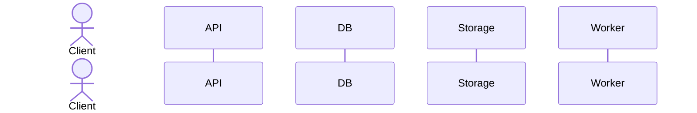

# RFC XXX: [Service / Feature Name]

| Metadata | Details |
| :--- | :--- |
| **RFC ID** | RFC-XXX |
| **Title** | [Descriptive Title] |
| **Authors** | Bitmill Engineering Team (Lead, BA/UX, Solutions Architect, SecOps/QA) |
| **Status** | **PROPOSED (Pending Review & Sign-Off)** |
| **Target Milestones** | [Target Milestones] |
| **Related Documents** | [01-ba-ux-analysis.md](./discovery/01-ba-ux-analysis.md)<br>[02-solutions-architecture.md](./discovery/02-solutions-architecture.md)<br>[03-secops-chaos-analysis.md](./discovery/03-secops-chaos-analysis.md) |

---

## 1. Executive Summary & Problem Statement
*Describe the high-level business motivation, limitations of naive happy-path implementations, and the target architecture.*

---

## 2. 360° Discovery Synthesis: Key Findings
*Summarize critical edge cases uncovered by the 3 subagents:*
- **BA & UX Findings**: [Network drops, progress smoothing, state machines]
- **Architect Findings**: [Protocols, cloud cost/FinOps, capacity boundaries]
- **SecOps Findings**: [FMEA risks, poison inputs, lifecycle cleanups]

---

## 3. Trade-off Matrix & Architectural Decisions

| Decision Area | Option A | Option B (Selected) | Trade-Off Rationale |
| :--- | :--- | :--- | :--- |
| **[Decision 1]** | [Option A description] | [Option B description] | [Why Option B was chosen over A] |
| **[Decision 2]** | [Option A description] | [Option B description] | [Why Option B was chosen over A] |

---

## 4. End-to-End Architecture & Sequence Diagram


---

## 5. Data Contracts & Database Schema (DDL)
```sql
-- DDL script for relational tables, indexes, and triggers
```

---

## 6. REST / RPC API Specification
- `POST /api/v1/...`
- `GET /api/v1/...`

---

## 7. FMEA & Security Hardening Matrix

| Failure Mode | Initial RPN | Mitigation Strategy | Final RPN |
| :--- | :---: | :--- | :---: |
| [Failure Mode 1] | [Score] | [Mitigation] | [Score] |

---

## 8. Inversion of Control (IoC) Contracts
```go
// Pure domain interfaces decoupled from infrastructure
```

---

## 9. Next Steps & Quality Gate Sign-Off
- [ ] User Sign-Off on RFC
- [ ] Database Migration
- [ ] Implementation with pure interfaces
- [ ] Verification tests (unit + live e2e)
