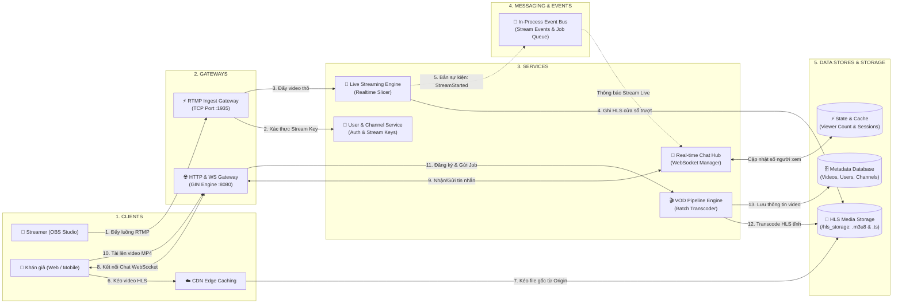
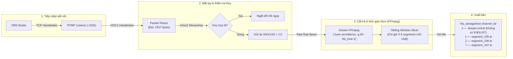
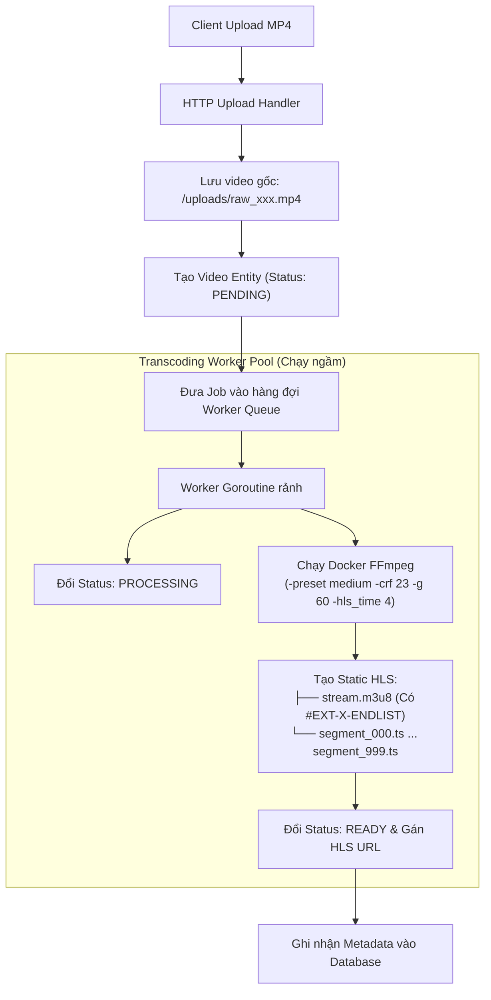
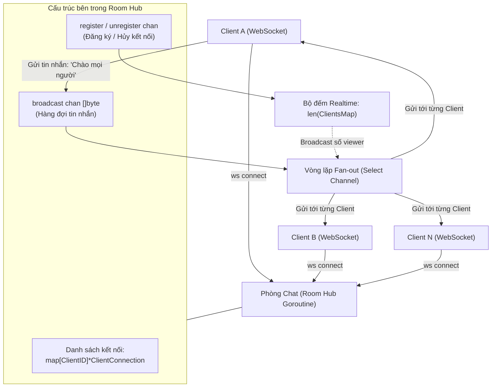

# 🏛️ Tài Liệu Thiết Kế Kiến Trúc Hệ Thống Bitmill

Tài liệu này được thiết kế theo nguyên lý **C4 Model (Phân tầng từ Tổng quan đến Chi tiết)**:
1. **Phần 1: Góc nhìn tổng quan toàn hệ thống (System Landscape)** — Tương tự bức tranh toàn cảnh hạ tầng.
2. **Phần 2: Bóc tách chi tiết từng Service phức tạp (Deep Dive Services)** — Giải thích cấu trúc bên trong của từng động cơ xử lý.

---

## PHẦN 1: GÓC NHÌN TỔNG QUAN HỆ THỐNG (SYSTEM OVERVIEW)

Sơ đồ dưới đây thể hiện toàn bộ luồng di chuyển từ **Clients $\rightarrow$ Gateways $\rightarrow$ Services $\rightarrow$ Messaging $\rightarrow$ Storage**:



### Bảng phân vai các cột trong sơ đồ tổng quan:

| Khối (Column) | Vai trò | Công nghệ thực thi |
| :--- | :--- | :--- |
| **1. Clients** | Nơi bắt đầu luồng (Streamer phát) và nơi kết thúc (Viewer xem & chat). | OBS Studio, Trình duyệt Web (Hls.js), Mobile App. |
| **2. Gateways** | Cổng đón tiếp: Phân tách rõ rệt giữa luồng đẩy video (RTMP TCP 1935) và luồng giao tiếp Web (HTTP/WS 8080). | TCP Listener chuẩn, GIN Web Framework. |
| **3. Services** | 4 động cơ nghiệp vụ độc lập: Live Engine, VOD Engine, Chat Hub, và Quản lý Kênh/User. | Modular Monolith Packages trong Go (`internal/`). |
| **4. Messaging** | Cầu nối bất đồng bộ giúp các service không phụ thuộc chặt vào nhau. | Go Channels / Event Bus nội bộ. |
| **5. Data & Storage** | Nơi lưu trữ file HLS (`.m3u8`, `.ts`), trạng thái phòng chat và metadata. | Disk/S3 Storage, In-memory Mutex / Redis, Metadata Store. |

---

## PHẦN 2: BÓC TÁCH CHI TIẾT TỪNG SERVICE PHỨC TẠP (DEEP DIVE)

Thay vì nhồi nhét chi tiết vào sơ đồ lớn, dưới đây là thiết kế chi tiết bên trong của 3 Service cốt lõi:

```
┌───────────────────────────────────────────────────────────────┐
│ MỤC LỤC BÓC TÁCH DỊCH VỤ                                      │
│  ├─ Service 1: Live Streaming & Transcoding Engine (Phức tạp) │
│  ├─ Service 2: VOD Pipeline Engine (Xử lý hàng đợi ngầm)      │
│  └─ Service 3: Real-time Chat & Presence Hub (Concurrency)    │
└───────────────────────────────────────────────────────────────┘
```

---

### 🔴 SERVICE 1: Live Streaming & Transcoding Engine

Service này chịu trách nhiệm: **Nhận video theo thời gian thực từ OBS và biến thành luồng HLS cho người xem với độ trễ thấp nhất có thể.**



#### Thiết kế chi tiết bên trong:
* **Cơ chế Pipe**: Dữ liệu từ kết nối TCP được pipe trực tiếp vào `stdin` của FFmpeg container $\rightarrow$ **Zero-disk write** trước khi encode.
* **Cấu hình FFmpeg độ trễ thấp**:
  * `-tune zerolatency -preset ultrafast`: Ép CPU mã hóa khung hình ngay khi vừa nhận được.
  * `-hls_flags delete_segments`: Cứ một file `.ts` mới sinh ra thì xóa một file `.ts` cũ nhất đi để không làm tràn ổ cứng.
  * Không ghi thẻ `#EXT-X-ENDLIST` để trình duyệt tiếp tục kéo các đoạn mới.

---

### 🎬 SERVICE 2: VOD Pipeline Engine

Service này xử lý video đã quay xong. Mục tiêu là: **Chất lượng hình ảnh đẹp nhất, dung lượng nén nhỏ nhất, hỗ trợ tua (seeking).**



#### Thiết kế chi tiết bên trong:
* **Xử lý bất đồng bộ (Non-blocking HTTP)**: Client upload xong nhận ngay phản hồi `202 Accepted`. Toàn bộ quá trình nén và cắt HLS diễn ra trong background Goroutine.
* **Cấu hình FFmpeg chất lượng cao**:
  * `-preset medium`: Cho phép nén chậm hơn nhưng dung lượng nhẹ hơn 50% so với live stream.
  * Thẻ `#EXT-X-ENDLIST` ở cuối file `.m3u8` cho phép trình phát video (Player) tính toán toàn bộ thời lượng video và cho phép người dùng tua tự do.

---

### 💬 SERVICE 3: Real-time Chat & Presence Hub

Service này giải quyết bài toán: **Hàng nghìn người trong cùng 1 phòng livestream nhắn tin và cập nhật số người xem cùng lúc.**



#### Thiết kế chi tiết bên trong:
* **Hub Pattern & Single-Threaded State Management**:
  * Mỗi phòng chat được quản lý bởi một Goroutine duy nhất chạy vòng lặp `select` trên các Go Channels (`broadcast`, `register`, `unregister`).
  * **Không cần dùng Mutex Lock**: Tránh hoàn toàn lỗi Race Condition và Deadlock vì mọi thao tác thêm/xóa client hay phát tin nhắn đều tuần tự hóa qua Channel.
* **Presence (Bộ đếm người xem trực tiếp)**:
  * Khi client ngắt kết nối WebSocket $\rightarrow$ rơi vào `unregister channel` $\rightarrow$ bộ đếm giảm $\rightarrow$ tự động phát số người xem mới tới toàn phòng.

---

## 3. Tổng Kết: Cách Tiếp Cận Kiến Trúc Này Giúp Gì Cho Bạn?

1. **Không bị ngợp**: Khi nhìn vào hệ thống, bạn nhìn vào **Phần 1** để thấy vị trí của mình (Streamer đẩy vào đâu, Viewer lấy từ đâu).
2. **Dễ hiện thực hóa từng phần**: Khi muốn code tính năng Live, bạn chỉ cần mở sơ đồ **Service 1**. Khi muốn làm Chat, chỉ cần nhìn **Service 3**.
3. **Mã nguồn tương ứng 100%**:
   - `internal/interfaces/http` và `internal/interfaces/rtmp` $\rightarrow$ Khối **Gateways**.
   - `internal/application/video` và `internal/domain/video` $\rightarrow$ Khối **Services**.
   - `internal/infrastructure/transcoder` $\rightarrow$ Khối **FFmpeg Engine**.
