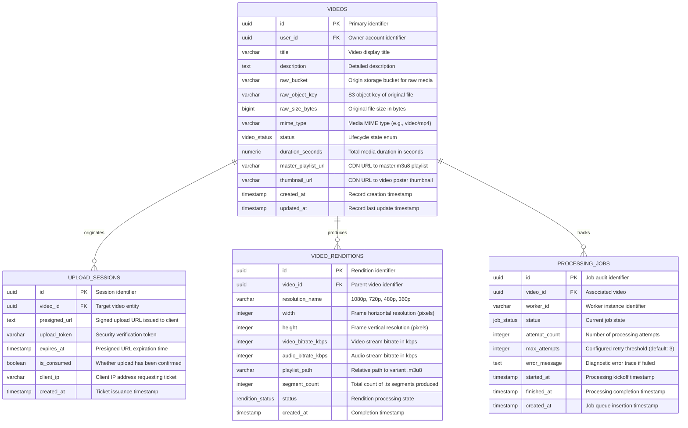
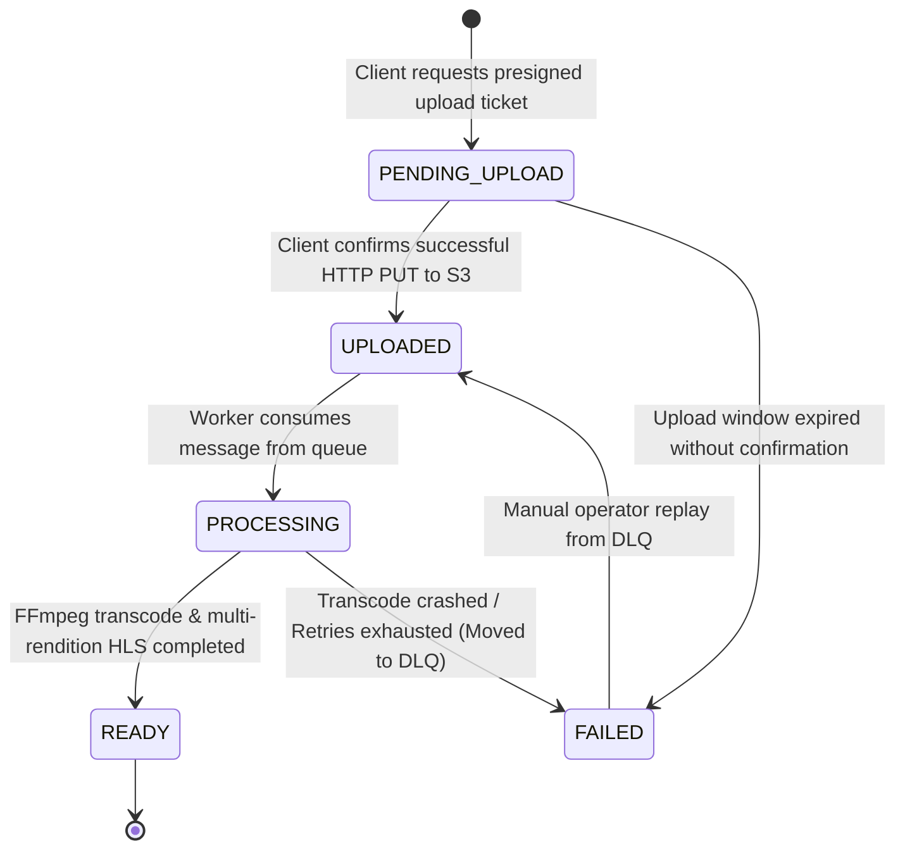

# 🗄️ Database Design: Relational Metadata Database (RMDS - PostgreSQL)

This document specifies the relational schema, entity relationships, integrity constraints, and state machine for the **Video Upload and VOD Pipeline** in **Bitmill**.

---

## 1. Entity-Relationship Diagram (ERD)



---

## 2. Video Lifecycle State Machine

Video entities transition through strict, deterministic state transitions:



### State Definitions:

| Status (`video_status`) | Description | Next Trigger / Action |
| :--- | :--- | :--- |
| `PENDING_UPLOAD` | Record created; Client holds a signed PUT URL. No media uploaded yet. | Awaits `/complete` confirmation from Client or S3 webhook. |
| `UPLOADED` | Source file exists in Raw Storage; processing job dispatched to Message Queue. | Worker pulls job from Queue to initiate transcoding. |
| `PROCESSING` | Worker is actively downloading, decoding, encoding ABR HLS, and generating thumbnails. | Worker finishes packaging and uploads HLS segments to Processed Storage. |
| `READY` | HLS master playlist and all renditions validated. Video is live on CDN. | Available for global streaming and seeking. |
| `FAILED` | Media corruption, unsupported codec, or worker timeout occurred. | Routed to Dead Letter Queue for engineering diagnostics. |

---

## 3. Production PostgreSQL DDL Script

Executable SQL script compatible with **PostgreSQL 14+**:

```sql
-- Enable UUID v4 generation extension
CREATE EXTENSION IF NOT EXISTS "uuid-ossp";

-- 1. ENUM Type Definitions
CREATE TYPE video_status AS ENUM (
    'PENDING_UPLOAD',
    'UPLOADED',
    'PROCESSING',
    'READY',
    'FAILED'
);

CREATE TYPE rendition_status AS ENUM (
    'PROCESSING',
    'READY',
    'FAILED'
);

CREATE TYPE job_status AS ENUM (
    'QUEUED',
    'PROCESSING',
    'COMPLETED',
    'FAILED',
    'DLQ'
);

-- 2. Core VIDEOS Table
CREATE TABLE IF NOT EXISTS videos (
    id UUID PRIMARY KEY DEFAULT uuid_generate_v4(),
    user_id UUID NOT NULL,
    title VARCHAR(255) NOT NULL,
    description TEXT,
    raw_bucket VARCHAR(128) NOT NULL,
    raw_object_key VARCHAR(512) NOT NULL,
    raw_size_bytes BIGINT DEFAULT 0,
    mime_type VARCHAR(64) NOT NULL DEFAULT 'video/mp4',
    status video_status NOT NULL DEFAULT 'PENDING_UPLOAD',
    duration_seconds NUMERIC(10, 2) DEFAULT 0.00,
    master_playlist_url VARCHAR(1024),
    thumbnail_url VARCHAR(1024),
    created_at TIMESTAMP WITH TIME ZONE NOT NULL DEFAULT CURRENT_TIMESTAMP,
    updated_at TIMESTAMP WITH TIME ZONE NOT NULL DEFAULT CURRENT_TIMESTAMP
);

-- Indices for performance querying
CREATE INDEX idx_videos_user_id ON videos(user_id);
CREATE INDEX idx_videos_status ON videos(status);
CREATE INDEX idx_videos_created_at ON videos(created_at DESC);

-- 3. UPLOAD_SESSIONS Table (Presigned ticket security & tracking)
CREATE TABLE IF NOT EXISTS upload_sessions (
    id UUID PRIMARY KEY DEFAULT uuid_generate_v4(),
    video_id UUID NOT NULL REFERENCES videos(id) ON DELETE CASCADE,
    presigned_url TEXT NOT NULL,
    upload_token VARCHAR(128) NOT NULL UNIQUE,
    expires_at TIMESTAMP WITH TIME ZONE NOT NULL,
    is_consumed BOOLEAN NOT NULL DEFAULT FALSE,
    client_ip VARCHAR(45),
    created_at TIMESTAMP WITH TIME ZONE NOT NULL DEFAULT CURRENT_TIMESTAMP
);

CREATE INDEX idx_upload_sessions_token ON upload_sessions(upload_token);
CREATE INDEX idx_upload_sessions_expires_at ON upload_sessions(expires_at);

-- 4. VIDEO_RENDITIONS Table (Adaptive Bitrate variants)
CREATE TABLE IF NOT EXISTS video_renditions (
    id UUID PRIMARY KEY DEFAULT uuid_generate_v4(),
    video_id UUID NOT NULL REFERENCES videos(id) ON DELETE CASCADE,
    resolution_name VARCHAR(32) NOT NULL, -- '1080p', '720p', '480p', '360p'
    width INT NOT NULL,
    height INT NOT NULL,
    video_bitrate_kbps INT NOT NULL,
    audio_bitrate_kbps INT NOT NULL DEFAULT 128,
    playlist_path VARCHAR(512) NOT NULL,
    segment_count INT NOT NULL DEFAULT 0,
    status rendition_status NOT NULL DEFAULT 'PROCESSING',
    created_at TIMESTAMP WITH TIME ZONE NOT NULL DEFAULT CURRENT_TIMESTAMP,
    CONSTRAINT uq_video_resolution UNIQUE (video_id, resolution_name)
);

CREATE INDEX idx_video_renditions_video_id ON video_renditions(video_id);

-- 5. PROCESSING_JOBS Table (Worker execution audit & DLQ tracking)
CREATE TABLE IF NOT EXISTS processing_jobs (
    id UUID PRIMARY KEY DEFAULT uuid_generate_v4(),
    video_id UUID NOT NULL REFERENCES videos(id) ON DELETE CASCADE,
    worker_id VARCHAR(64),
    status job_status NOT NULL DEFAULT 'QUEUED',
    attempt_count INT NOT NULL DEFAULT 0,
    max_attempts INT NOT NULL DEFAULT 3,
    error_message TEXT,
    started_at TIMESTAMP WITH TIME ZONE,
    finished_at TIMESTAMP WITH TIME ZONE,
    created_at TIMESTAMP WITH TIME ZONE NOT NULL DEFAULT CURRENT_TIMESTAMP
);

CREATE INDEX idx_processing_jobs_video_id ON processing_jobs(video_id);
CREATE INDEX idx_processing_jobs_status ON processing_jobs(status);

-- 6. Trigger for Automatic updated_at Timestamp Updates
CREATE OR REPLACE FUNCTION update_updated_at_column()
RETURNS TRIGGER AS $$
BEGIN
    NEW.updated_at = CURRENT_TIMESTAMP;
    RETURN NEW;
END;
$$ LANGUAGE plpgsql;

CREATE TRIGGER trigger_videos_updated_at
BEFORE UPDATE ON videos
FOR EACH ROW
EXECUTE FUNCTION update_updated_at_column();
```
