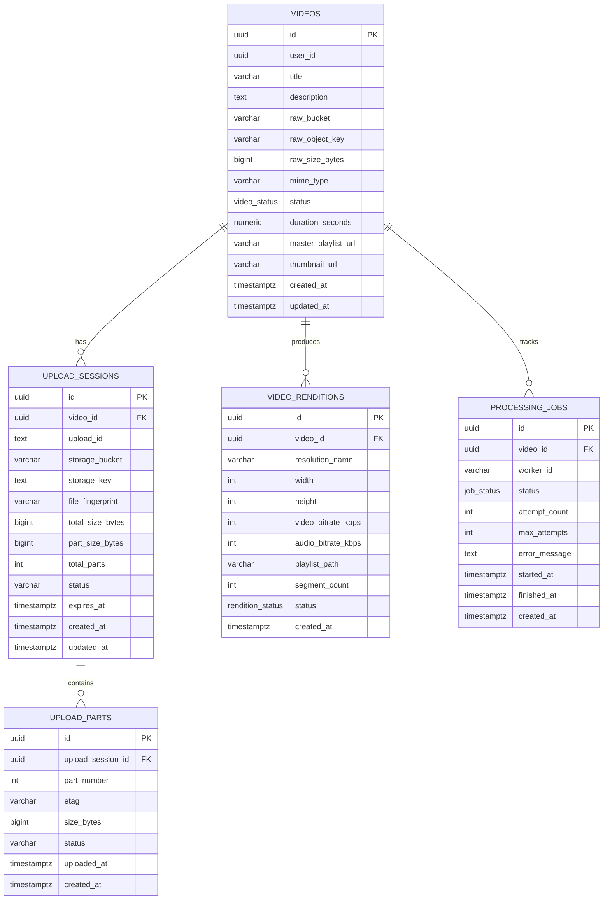

# Bitmill Relational Database Schema (PostgreSQL 15+)

This document serves as the **Single Source of Truth (SSOT)** for the active relational database schema in Bitmill.

---

## 1. Entity-Relationship Diagram (ERD)



---

## 2. Complete DDL Specification

```sql
-- Enable UUID v4 extension
CREATE EXTENSION IF NOT EXISTS "uuid-ossp";

-- 1. Custom ENUM Types
CREATE TYPE video_status AS ENUM (
    'PENDING_UPLOAD',
    'UPLOADED',
    'PROCESSING',
    'READY',
    'FAILED'
);

CREATE TYPE rendition_status AS ENUM (
    'PROCESSING',
    'READY',
    'FAILED'
);

CREATE TYPE job_status AS ENUM (
    'QUEUED',
    'PROCESSING',
    'COMPLETED',
    'FAILED',
    'DLQ'
);

-- 2. Videos Table
CREATE TABLE IF NOT EXISTS videos (
    id UUID PRIMARY KEY DEFAULT uuid_generate_v4(),
    user_id UUID NOT NULL,
    title VARCHAR(255) NOT NULL,
    description TEXT,
    raw_bucket VARCHAR(128) NOT NULL,
    raw_object_key VARCHAR(512) NOT NULL,
    raw_size_bytes BIGINT DEFAULT 0,
    mime_type VARCHAR(64) NOT NULL DEFAULT 'video/mp4',
    status video_status NOT NULL DEFAULT 'PENDING_UPLOAD',
    duration_seconds NUMERIC(10, 2) DEFAULT 0.00,
    master_playlist_url VARCHAR(1024),
    thumbnail_url VARCHAR(1024),
    created_at TIMESTAMPTZ NOT NULL DEFAULT CURRENT_TIMESTAMP,
    updated_at TIMESTAMPTZ NOT NULL DEFAULT CURRENT_TIMESTAMP
);

CREATE INDEX IF NOT EXISTS idx_videos_user_id ON videos(user_id);
CREATE INDEX IF NOT EXISTS idx_videos_status ON videos(status);
CREATE INDEX IF NOT EXISTS idx_videos_created_at ON videos(created_at DESC);

-- 3. Upload Sessions Table (Multipart Tracking)
CREATE TABLE IF NOT EXISTS upload_sessions (
    id UUID PRIMARY KEY DEFAULT uuid_generate_v4(),
    video_id UUID NOT NULL REFERENCES videos(id) ON DELETE CASCADE,
    upload_id TEXT NOT NULL,
    storage_bucket VARCHAR(128) NOT NULL,
    storage_key TEXT NOT NULL,
    file_fingerprint VARCHAR(128),
    total_size_bytes BIGINT DEFAULT 0,
    part_size_bytes BIGINT DEFAULT 20971520,
    total_parts INT DEFAULT 1,
    status VARCHAR(32) NOT NULL DEFAULT 'UPLOADING',
    expires_at TIMESTAMPTZ NOT NULL,
    is_consumed BOOLEAN NOT NULL DEFAULT FALSE,
    client_ip VARCHAR(45),
    created_at TIMESTAMPTZ NOT NULL DEFAULT CURRENT_TIMESTAMP,
    updated_at TIMESTAMPTZ NOT NULL DEFAULT CURRENT_TIMESTAMP
);

CREATE INDEX IF NOT EXISTS idx_upload_sessions_video_id ON upload_sessions(video_id);
CREATE INDEX IF NOT EXISTS idx_upload_sessions_upload_id ON upload_sessions(upload_id);
CREATE INDEX IF NOT EXISTS idx_upload_sessions_status ON upload_sessions(status);
CREATE INDEX IF NOT EXISTS idx_upload_sessions_fingerprint ON upload_sessions(file_fingerprint);
CREATE INDEX IF NOT EXISTS idx_upload_sessions_expires_at ON upload_sessions(expires_at);

-- 4. Upload Parts Table (Chunk-level Telemetry)
CREATE TABLE IF NOT EXISTS upload_parts (
    id UUID PRIMARY KEY DEFAULT uuid_generate_v4(),
    upload_session_id UUID NOT NULL REFERENCES upload_sessions(id) ON DELETE CASCADE,
    part_number INT NOT NULL CHECK (part_number BETWEEN 1 AND 10000),
    etag VARCHAR(128),
    size_bytes BIGINT NOT NULL CHECK (size_bytes > 0),
    status VARCHAR(32) NOT NULL DEFAULT 'PENDING',
    uploaded_at TIMESTAMPTZ,
    created_at TIMESTAMPTZ NOT NULL DEFAULT CURRENT_TIMESTAMP,
    CONSTRAINT uq_session_part UNIQUE (upload_session_id, part_number)
);

CREATE INDEX IF NOT EXISTS idx_upload_parts_session_status ON upload_parts(upload_session_id, status);

-- 5. Video Renditions Table (HLS ABR Variants)
CREATE TABLE IF NOT EXISTS video_renditions (
    id UUID PRIMARY KEY DEFAULT uuid_generate_v4(),
    video_id UUID NOT NULL REFERENCES videos(id) ON DELETE CASCADE,
    resolution_name VARCHAR(32) NOT NULL, -- '1080p', '720p', '480p', '360p'
    width INT NOT NULL,
    height INT NOT NULL,
    video_bitrate_kbps INT NOT NULL,
    audio_bitrate_kbps INT NOT NULL DEFAULT 128,
    playlist_path VARCHAR(512) NOT NULL,
    segment_count INT NOT NULL DEFAULT 0,
    status rendition_status NOT NULL DEFAULT 'PROCESSING',
    created_at TIMESTAMPTZ NOT NULL DEFAULT CURRENT_TIMESTAMP,
    CONSTRAINT uq_video_resolution UNIQUE (video_id, resolution_name)
);

CREATE INDEX IF NOT EXISTS idx_video_renditions_video_id ON video_renditions(video_id);

-- 6. Processing Jobs Table (Worker Execution Tracking)
CREATE TABLE IF NOT EXISTS processing_jobs (
    id UUID PRIMARY KEY DEFAULT uuid_generate_v4(),
    video_id UUID NOT NULL REFERENCES videos(id) ON DELETE CASCADE,
    worker_id VARCHAR(64),
    status job_status NOT NULL DEFAULT 'QUEUED',
    attempt_count INT NOT NULL DEFAULT 0,
    max_attempts INT NOT NULL DEFAULT 3,
    error_message TEXT,
    started_at TIMESTAMPTZ,
    finished_at TIMESTAMPTZ,
    created_at TIMESTAMPTZ NOT NULL DEFAULT CURRENT_TIMESTAMP
);

CREATE INDEX IF NOT EXISTS idx_processing_jobs_video_id ON processing_jobs(video_id);
CREATE INDEX IF NOT EXISTS idx_processing_jobs_status ON processing_jobs(status);
```
