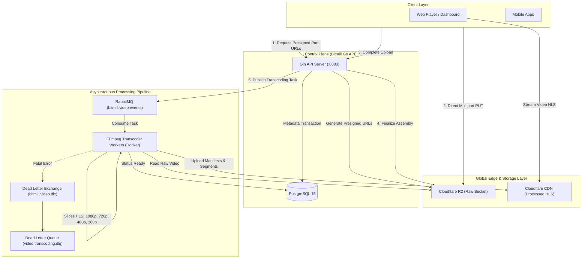

# Bitmill System Architecture & Pipeline Overview

## 1. System Topology & Core Components

Bitmill is a high-performance Video On Demand (VOD) and live media platform designed for zero-server bandwidth ingestion, resilient asynchronous media processing, and Adaptive Bitrate (ABR) HLS distribution.

---

## 2. Ingestion Architecture: Direct-to-R2 Resumable Multipart

- **Zero API Server Bandwidth**: The Bitmill API server acts strictly as an authentication and coordination control plane. Raw video bytes (50MB–5GB+) never traverse API server memory or network interfaces.
- **Adaptive Chunk Sizing**:
  - Files $\le 250\text{MB}$: **10MB chunks** ($1 \le N \le 25$).
  - Files $> 250\text{MB}$: **20MB chunks** ($13 \le N \le 256$ for 5GB).
  - Cuts Cloudflare R2 Class A API costs by **75%** while keeping network retry blast radius minimal.
- **Fault-Tolerant Resuming**:
  - Client persists chunk `ETag` state in IndexedDB / local storage.
  - Upon network disruption (at 1%, 50%, or 99%), client queries `/upload-status` and resumes only missing chunks.
  - Idempotent completion prevents race conditions during late-stage network loss.

---

## 3. Media Processing Engine: Dockerized Multi-Bitrate HLS

- **Host Isolation**: In accordance with project security rules, FFmpeg is never installed directly on the host machine. Media slicing executes strictly inside isolated containers (`mwader/static-ffmpeg:latest`).
- **Adaptive Bitrate (ABR) Ladder**:
  - **1080p**: $1920\times 1080$, $4500\text{ kbps}$ video, $192\text{ kbps}$ audio.
  - **720p**: $1280\times 720$, $2500\text{ kbps}$ video, $128\text{ kbps}$ audio.
  - **480p**: $854\times 480$, $1200\text{ kbps}$ video, $96\text{ kbps}$ audio.
  - **360p**: $640\times 360$, $600\text{ kbps}$ video, $64\text{ kbps}$ audio.
- **Closed GOP Alignment**: Group of Pictures (GOP) size is strictly aligned (e.g. 48 frames at 24fps = 2.0s segments) to allow seamless video player bitrate switching without buffering artifacts.

---

## 4. Message Broker & Resiliency (RabbitMQ & DLQ)

- **Exchange**: `bitmill.video.events` (Topic Exchange).
- **Primary Queue**: `video.transcoding.jobs` with message TTL and maximum delivery attempts (3).
- **Dead Letter Exchange (DLX)**: `bitmill.video.dlx`.
- **Dead Letter Queue (DLQ)**: `video.transcoding.dlq` captures unprocessable poison media files or runtime crashes without starving healthy transcoding tasks.

---

## 5. Architectural Invariants

1. **Inversion of Control (IoC)**: High-level application logic strictly depends on pure Go domain interfaces (`video.Repository`, `video.StorageProvider`, `video.UploadSessionRepository`), completely decoupled from concrete AWS SDK, PostgreSQL, or RabbitMQ implementations.
2. **ACID Metadata Consistency**: Video status transitions follow a strict finite state machine: `PENDING_UPLOAD` $\rightarrow$ `UPLOADED` $\rightarrow$ `PROCESSING` $\rightarrow$ `READY` (or `FAILED` / `ABORTED`).
