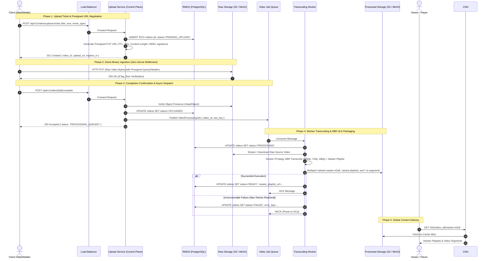

# 🏛️ Architecture Specification: Video Upload & Processing Pipeline

This document provides the technical architecture specification for the **Video Upload Service and Processing Pipeline**, modeled directly from [upload-service.drawio](file:///Users/quidb/Working/projects/bitmill/upload-service.drawio).

---

## 1. System Architecture Overview

```mermaid
flowchart TD
    subgraph Clients["1. Clients"]
        Client["📱 Web / Mobile Client"]
    end

    subgraph Ingress["2. Ingress & Routing"]
        LB["⚖️ Load Balancer\n(NGINX / AWS ALB)"]
    end

    subgraph ControlPlane["3. Upload Control Service (Cluster 1..n)"]
        UploadSvc["🚀 Upload Service Instances\n(1, 2, ... n)"]
    end

    subgraph StorageLayer["4. Cloudflare R2 Storage (S3-Compatible / Zero Egress)"]
        RawBucket[("🪣 Raw R2 Bucket\n(bitmill-raw-videos)")]
        ProcessedBucket[("🪣 Processed R2 Bucket\n(bitmill-processed-videos)")]
    end

    subgraph AsyncMessaging["5. Messaging & Event Queue (RabbitMQ)"]
        Queue["📬 Video Processing Queue\n(AMQP: video.transcoding.jobs)"]
        DLQ["☠️ Dead Letter Queue (DLQ)\n(AMQP: video.transcoding.dlq)"]
    end

    subgraph DataStore["6. Relational Database (RMDS)"]
        DB[("🗄️ PostgreSQL Database\n(Videos, Renditions, Jobs)")]
    end

    subgraph WorkerPool["7. Processing Worker Pool (Cluster 1..N)"]
        Worker["⚙️ Transcoding Workers\n(1, 2, 3, ... N)\n[Docker FFmpeg ABR Engine]"]
    end

    subgraph Distribution["8. Global CDN & Playback"]
        CDN["☁️ Cloudflare CDN / Edge Cache"]
        Viewer["👀 Viewers / HLS Players"]
    end

    %% INTERACTION FLOWS
    %% Presigned URL acquisition
    Client -->|1. Request Upload Ticket / Presigned URL| LB
    LB --> UploadSvc
    UploadSvc -->|2. Create Video Record: PENDING_UPLOAD| DB
    UploadSvc -->|3. Return Signed PUT URL + VideoID| Client

    %% Direct R2 upload
    Client -->|4. Direct HTTP PUT (Raw MP4 Payload)| RawBucket

    %% Storage Event Notification (Option B)
    RawBucket -->|5. ObjectCreated Event Notification (Webhook)| UploadSvc
    UploadSvc -->|6. Update Status: UPLOADED| DB
    UploadSvc -->|7. Publish Job: ProcessVideoTask| Queue

    %% Worker Execution
    Queue -->|8. Consume Job| Worker
    Worker -->|9. Update Status: PROCESSING| DB
    RawBucket -->|10. Download / Stream Raw Video| Worker
    Worker -->|11. Transcode ABR HLS (FFmpeg)| Worker
    Worker -->|12. Upload master.m3u8 & .ts chunks| ProcessedBucket
    Worker -->|13. Update Status: READY + Playlist URLs| DB

    %% Error Handling & DLQ
    Worker -.->|Retries Exhausted| DLQ
    DLQ -.->|Manual Replay / Diagnostics| Queue

    %% Playback
    ProcessedBucket -->|Origin Fetch| CDN
    CDN -->|14. Low-Latency HLS Playback| Viewer
```

---

## 2. Sequence Diagram (End-to-End Lifecycle)



---

## 3. Component Deep Dive

### 3.1. Client & Ingress Load Balancer
* **Client**: Web applications (Hls.js / Video.js) or Mobile apps. Employs chunked/streaming HTTP `PUT` directly to Object Storage.
* **Load Balancer (NGINX / AWS ALB)**:
  * Manages TLS termination and edge routing.
  * Distributes traffic across homogeneous Upload Service instances.
  * Enforces rate limiting on ticket generation endpoints to prevent denial-of-service abuse.

### 3.2. Upload Service (Control Plane Cluster)
* Dedicated entirely to **Control Plane orchestration**; never ingests video bytes into its memory or disk.
* Responsibilities:
  1. Authenticates and authorizes incoming requests.
  2. Generates cryptographically signed **Presigned PUT URLs**:
     - Time-to-Live (TTL): 15 minutes.
     - Strict MIME enforcement (`video/mp4`, `video/quicktime`).
     - Size boundary limits (`Content-Length-Range`).
  3. Records initial metadata in the Relational Database.
  4. Emits transactional job messages to the Message Queue once an upload is verified.

### 3.3. Object Storage Layer (Raw vs. Processed)
Organized into two isolated buckets with distinct access control policies:
* **Raw Video Bucket (`bitmill-raw-videos`)**:
  * 100% private bucket (No public access).
  * Ingestion permitted exclusively through signed HMAC URLs.
  * Lifecycle policy: Moves objects to Cold Storage / Glacier after 30 days to optimize storage costs.
* **Processed Video Bucket (`bitmill-processed-videos`)**:
  * Stores multi-bitrate HLS structure: `master.m3u8`, resolution directories (`1080p/`, `720p/`), and uniform `.ts` segments.
  * Read permissions restricted to CloudFront Origin Access Control (OAC).

### 3.4. Messaging Queue & Dead Letter Queue (DLQ)
* **Main Queue (RabbitMQ / SQS / Redis Streams)**:
  * Transports immutable JSON payloads: `{"job_id": "...", "video_id": "...", "raw_key": "...", "retry_count": 0}`.
  * Enforces reliable delivery via explicit manual message acknowledgement (ACK/NACK).
* **Dead Letter Queue (DLQ)**:
  * Catches poison messages (corrupted video headers, unsupported codecs, out-of-memory errors) after exponential backoff retries exceed `max_attempts` (default: 3).
  * Protects worker capacity from getting stuck in retry loops while preserving telemetry for debugging and manual replays.

### 3.5. Transcoding Worker Pool
* Horizontally scalable background workers decoupled from the HTTP API.
* Executes the media processing pipeline:
  1. Polls / consumes jobs from the message broker.
  2. Pulls raw video files from the Raw Bucket.
  3. Spawns isolated Docker FFmpeg containers (`mwader/static-ffmpeg:latest`):
     - Probes media container metadata (duration, resolution, audio/video bitrates, codec profiles).
     - Generates poster frames/thumbnails at keyframe boundaries.
     - Performs Adaptive Bitrate (ABR) encoding across standard profiles (1080p, 720p, 480p) using closed GOP structures (`-g 60 -hls_time 4`).
  4. Uploads `.m3u8` playlists and `.ts` transport stream segments to the Processed Bucket.
  5. Updates video records to `READY` state with CDN URLs.

### 3.6. Relational Database (RMDS - PostgreSQL)
* Acts as the single source of truth for video states, encoding profiles, upload sessions, and worker audit logs.
* Employs ACID transactions to safeguard against state divergence.

### 3.7. CloudFront CDN
* Global edge caching for HLS `.ts` video chunks and sub-playlists.
* Offloads up to 98% of bandwidth from the storage origin.
* Supports HTTP/2 and HTTP/3 multiplexing for rapid parallel segment retrieval.

---

## 4. Architectural Rules & Best Practices

1. **Strict Control Plane & Data Plane Segregation**:
   - Web application instances exchange lightweight JSON payloads and metadata only.
   - Video payload streams travel exclusively via `Client -> S3 -> Worker -> S3 -> CDN`.
2. **Idempotency Across Asynchronous Boundaries**:
   - Upload confirmation (`/complete`) and queue consumption handlers must be idempotent. Redelivered messages must not generate corrupted duplicate renditions or inconsistent database states.
3. **Execution Timeouts & Guardrails**:
   - All FFmpeg transcode processes must run within strict Golang `context.WithTimeout` boundaries (e.g., 30 minutes max) to prevent orphaned processes.
4. **Centralized Viper Configuration**:
   - All ports, storage endpoints, credentials, and worker concurrency parameters are loaded through Viper (`config.yaml`) with environment variable overrides.
