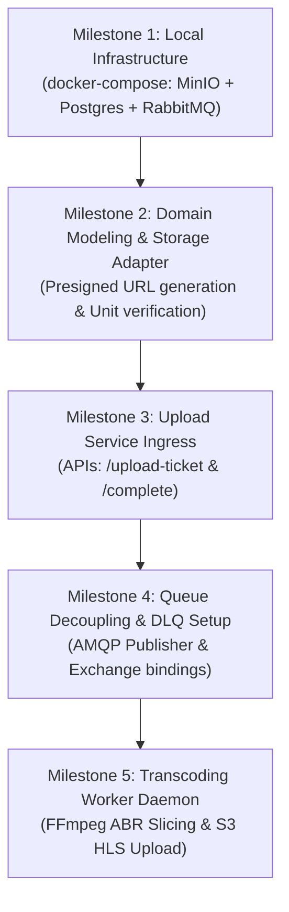

# 🛠️ Task Specification: Video Upload Service Implementation

This document provides engineering guidance, tech stack specifics, architectural guardrails, and a complete file inventory for implementing the **Video Upload Service & Transcoding Pipeline** in the **Bitmill** project.

---

## 1. Project Directory Structure

The repository maintains a Modular Monolith with Domain-Driven Design (DDD) principles located under `go-streaming/`:

```
bitmill/
├── docs/                                  # Central technical documentation
│   ├── README.md
│   ├── analysis-design/
│   │   └── database-schema.md
│   ├── architecture/
│   │   └── upload-service-architecture.md
│   └── development/
│       └── upload-service-task.md
├── go-streaming/                          # Core Go application
│   ├── cmd/
│   │   ├── server/                        # API Gateway & Web HTTP server entrypoint
│   │   │   └── main.go
│   │   └── worker/                        # [Planned] Background transcoding worker entrypoint
│   │       └── main.go
│   ├── config.yaml                        # Application configuration (Viper managed)
│   ├── go.mod                             # Go dependency manifest
│   ├── go.sum
│   ├── internal/
│   │   ├── domain/                        # Pure business logic (Zero external dependencies)
│   │   │   └── video/                     # Video entity, value objects, domain interfaces
│   │   │       ├── entity.go
│   │   │       ├── repository.go
│   │   │       ├── storage.go             # [Planned] Storage provider interface
│   │   │       ├── queue.go               # [Planned] Message broker interface
│   │   │       └── transcoder.go
│   │   ├── application/                   # Use case orchestration
│   │   │   └── video/
│   │   │       ├── service.go             # Upload coordination, ticket issuance, completion
│   │   │       └── worker_service.go      # [Planned] Worker job execution orchestrator
│   │   ├── infrastructure/                # External adapters and implementations
│   │   │   ├── storage/                   # [Planned] S3 / MinIO storage adapter (Presigned URLs)
│   │   │   │   └── s3_adapter.go
│   │   │   ├── queue/                     # [Planned] RabbitMQ / Redis message queue adapter
│   │   │   │   └── rabbitmq_adapter.go
│   │   │   ├── repository/
│   │   │   │   ├── memory_repo.go         # Prototype in-memory store
│   │   │   │   └── postgres_repo.go       # [Planned] Production PostgreSQL adapter
│   │   │   └── transcoder/
│   │   │       └── ffmpeg_docker.go       # Static Docker FFmpeg execution wrapper
│   │   ├── interfaces/                    # Ingress delivery layers
│   │   │   ├── http/                      # Gin REST API handlers
│   │   │   │   ├── handler.go
│   │   │   │   ├── upload_handler.go      # [Planned] Presigned ticket & complete handlers
│   │   │   │   └── web/
│   │   │   │       └── index.html
│   │   │   └── rtmp/                      # Realtime RTMP TCP ingest server (:1935)
│   │   │       └── server.go
│   │   └── config/
│   │       └── config.go                  # Viper loader and config structs
│   └── pkg/                               # Reusable utility packages
│       ├── logger/                        # Structured logger
│       └── response/                      # Standardized JSON response envelope
├── ffmpeg.sh                              # Host wrapper script delegating to Docker FFmpeg
├── ffprobe.sh                             # Host wrapper script delegating to Docker FFprobe
├── docker-compose.yml                     # [Planned] Local infrastructure: MinIO, Postgres, RabbitMQ
└── upload-service.drawio                  # Visual architecture diagram
```

---

## 2. Technology Stack Matrix

| Layer / Component | Technology | Rationale & Usage |
| :--- | :--- | :--- |
| **Language & Runtime** | **Golang 1.27+** | High-concurrency, low-latency, typed memory-safe systems language. |
| **HTTP Framework** | **Gin (`gin-gonic/gin`)** | Lightweight, high-throughput routing engine for REST APIs. |
| **Configuration** | **Viper (`spf13/viper`)** | Hierarchical config management via `config.yaml` with environment variable overrides. |
| **Relational Database** | **PostgreSQL 15+** | ACID-compliant storage for video lifecycle metadata, renditions, and job states. |
| **Database Driver** | **`pgx/v5` or `database/sql`** | High-performance PostgreSQL native driver with connection pooling. |
| **Object Storage** | **MinIO (Local) / Cloudflare R2 (Cloud)** | S3-compatible zero-egress object store for raw and HLS processed video assets via Presigned URLs. |
| **AWS SDK** | **AWS SDK for Go v2 (`aws-sdk-go-v2`)** | Official SDK for S3 Presign Client (`s3.NewPresignClient`), `PutObject`, and `HeadObject` targeting R2/MinIO endpoints. |
| **Message Broker** | **RabbitMQ (AMQP 0-9-1)** | Reliable async job queue with explicit ACK/NACK, Dead Letter Exchange (DLX), and Management UI (:15672). |
| **Media Transcoder** | **Docker Static FFmpeg** | `mwader/static-ffmpeg:latest` container producing Multi-bitrate ABR HLS (1080p, 720p, 480p, 360p). |
| **Content Delivery** | **Cloudflare CDN / Edge Cache** | Global edge caching with zero data egress charges between R2 and Cloudflare CDN. |

---

## 3. Core Architectural Rules (Guardrails)

Adhere strictly to the requirements in [AI_WORKFLOW.md](file:///Users/quidb/Working/projects/bitmill/AI_WORKFLOW.md):

1. **Domain Independence (Clean Architecture)**:
   - `internal/domain/` MUST NOT import any packages from `application`, `infrastructure`, or `interfaces`.
   - `internal/domain/` MUST NOT import external frameworks (no Gin, no SQL drivers, no AWS SDK). Only standard library Go types.
2. **Application Decoupling**:
   - `internal/application/` orchestrates use cases. It MUST NOT import `*gin.Context` or inspect raw HTTP requests.
3. **Control Plane vs Data Plane Segregation**:
   - Raw video binary streams MUST NEVER transit through the API server memory or local disk. The API service only generates Presigned URLs.
4. **Media Processing Isolation**:
   - DO NOT install FFmpeg on the host (`brew install ffmpeg` is prohibited). All media encoding operations MUST execute inside Docker or via [`./ffmpeg.sh`](file:///Users/quidb/Working/projects/bitmill/ffmpeg.sh).
5. **Idempotency & Resilience**:
   - Upload completion hooks and worker consumer logic MUST be idempotent. Duplicate messages must not corrupt database states.

---

## 4. File Mapping & Implementation Inventory

### A. Existing Files to Inspect / Modify

| File Path | Current Status | Required Action / Evolution |
| :--- | :--- | :--- |
| [`go-streaming/config.yaml`](file:///Users/quidb/Working/projects/bitmill/go-streaming/config.yaml) | Basic port & local dir config | Add sections for `database` (Postgres DSN), `storage` (S3/MinIO endpoint, credentials, buckets), and `queue` (RabbitMQ URI, queue names). |
| [`go-streaming/internal/config/config.go`](file:///Users/quidb/Working/projects/bitmill/go-streaming/internal/config/config.go) | Structs for Server/Storage/Transcoder | Extend structs to map new Postgres, S3, and Queue config properties. |
| [`go-streaming/internal/domain/video/entity.go`](file:///Users/quidb/Working/projects/bitmill/go-streaming/internal/domain/video/entity.go) | Simple `Video` struct & statuses | Update statuses to match state machine (`PENDING_UPLOAD`, `UPLOADED`, `PROCESSING`, `READY`, `FAILED`). Add S3 bucket/key fields and `VideoRendition` entity. |
| [`go-streaming/internal/domain/video/repository.go`](file:///Users/quidb/Working/projects/bitmill/go-streaming/internal/domain/video/repository.go) | Memory repo interface | Expand interface methods to support state transitions, pagination, and transactional updates. |
| [`go-streaming/internal/interfaces/http/handler.go`](file:///Users/quidb/Working/projects/bitmill/go-streaming/internal/interfaces/http/handler.go) | Local disk VOD APIs | Wire new upload endpoints (`/api/v1/videos/upload-ticket`, `/api/v1/videos/:id/complete`). |
| [`go-streaming/cmd/server/main.go`](file:///Users/quidb/Working/projects/bitmill/go-streaming/cmd/server/main.go) | Monolith DI wiring | Wire S3 adapter, Postgres repo, and Queue producer into application service. |

### B. New Files to Create

| Target File Path | Layer | Purpose & Responsibility |
| :--- | :--- | :--- |
| `docker-compose.yml` (Root) | Infrastructure | Spawns local MinIO (S3), PostgreSQL, and RabbitMQ containers with pre-created buckets and exchanges. |
| `go-streaming/internal/domain/video/storage.go` | Domain | Defines `StorageProvider` interface (`GeneratePresignedPutURL`, `CheckObjectExists`, `GetDownloadURL`). |
| `go-streaming/internal/domain/video/queue.go` | Domain | Defines `JobQueue` publisher and consumer interfaces (`PublishJob`, `ConsumeJobs`). |
| `go-streaming/internal/infrastructure/storage/s3_adapter.go` | Infrastructure | Implements `StorageProvider` using AWS SDK for Go v2 against MinIO / AWS S3. |
| `go-streaming/internal/infrastructure/queue/rabbitmq_adapter.go` | Infrastructure | Implements `JobQueue` using AMQP 0-9-1 with channel pooling and DLX/DLQ topology. |
| `go-streaming/internal/infrastructure/repository/postgres_repo.go` | Infrastructure | Implements `video.Repository` using PostgreSQL with parameterized queries. |
| `go-streaming/cmd/worker/main.go` | Ingress / Worker | Entrypoint for the background transcoding worker daemon that consumes from the Queue. |
| `go-streaming/internal/application/video/worker_service.go` | Application | Worker execution logic: downloads raw S3 video, invokes Docker FFmpeg, uploads ABR HLS segments, updates RMDS. |

---

## 5. Phased Execution Roadmap



### Verification Criteria for Each Milestone:
1. **Milestone 1**: `docker compose up -d` brings up all 3 services; MinIO console accessible at `http://localhost:9001`, Postgres accessible at `5432`.
2. **Milestone 2**: Unit test confirms `GeneratePresignedPutURL` produces valid URL; curl can `PUT` raw sample file into MinIO.
3. **Milestone 3**: `curl POST /api/v1/videos/upload-ticket` returns Presigned URL and records `PENDING_UPLOAD` in PostgreSQL.
4. **Milestone 4**: Calling `/complete` updates status to `UPLOADED` and puts message into RabbitMQ visible in RabbitMQ Management UI.
5. **Milestone 5**: Worker picks up job, runs FFmpeg, generates `.m3u8` and `.ts`, uploads to processed bucket, and sets status to `READY`.
