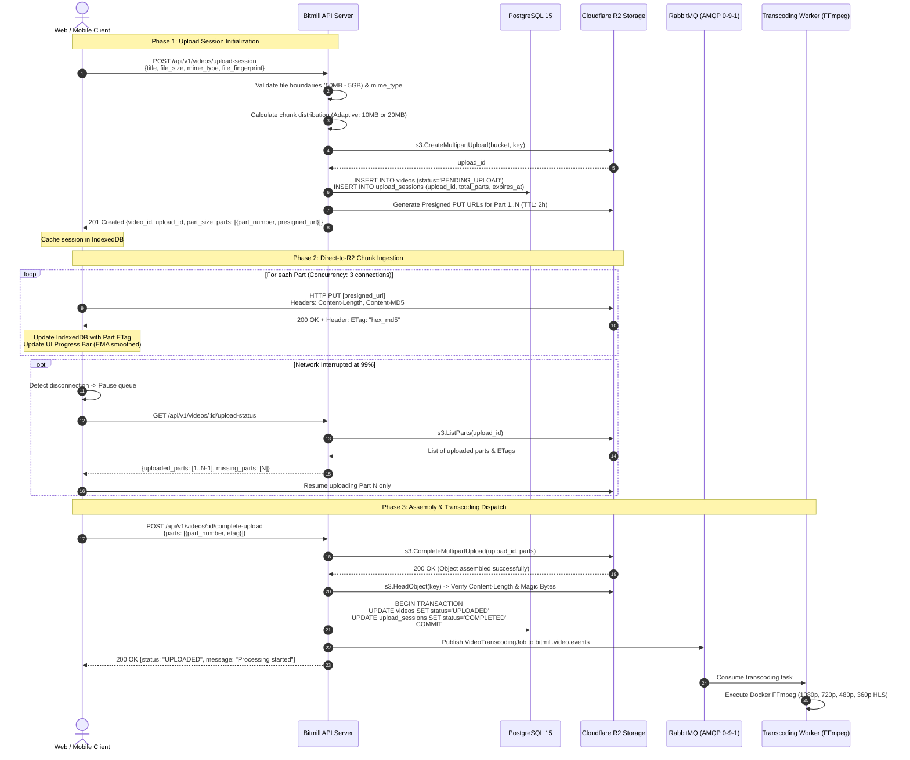

# RFC 001: Resumable & Fault-Tolerant Video Ingestion Engine

| Metadata | Details |
| :--- | :--- |
| **RFC ID** | RFC-001 |
| **Title** | Resumable & Fault-Tolerant Video Ingestion Engine via Cloudflare R2 |
| **Authors** | Bitmill Engineering Team (Tech Lead, BA/UX, Solutions Architect, SecOps/QA) |
| **Status** | **PROPOSED (Pending Review & Sign-Off)** |
| **Target Milestones** | Milestone 3 (Upload Ingress) & Milestone 4 (Transcoding Worker) |
| **Related Documents** | [01-ba-ux-analysis.md](file:///Users/quidb/Working/projects/bitmill/.worktrees/experiment/docs/rfcs/discovery/01-ba-ux-analysis.md)<br>[02-solutions-architecture.md](file:///Users/quidb/Working/projects/bitmill/.worktrees/experiment/docs/rfcs/discovery/02-solutions-architecture.md)<br>[03-secops-chaos-analysis.md](file:///Users/quidb/Working/projects/bitmill/.worktrees/experiment/docs/rfcs/discovery/03-secops-chaos-analysis.md) |

---

## 1. Executive Summary & Problem Statement

### 1.1 The Problem with Single Presigned PUT URLs
The initial architecture relied on a single HTTP `PUT` presigned URL directly to Cloudflare R2. While suitable for lightweight avatars or images (< 50MB), this pattern is completely unacceptable for high-scale video platforms (50MB to 5GB+):
1. **Zero Fault Tolerance**: A connection drop at 99% of a 2GB file forces the user to re-upload from 0MB, wasting user bandwidth and battery.
2. **Inaccurate Progress Telemetry**: Browser socket buffers can report 100% transmitted while Cloudflare edge has not yet acknowledged the full payload.
3. **No Pause/Resume**: Mobile or flaky Wi-Fi users cannot pause or switch networks without failing the session.
4. **Poison Input Risks**: Renamed binaries (`.exe` disguised as `.mp4`) can trigger buffer overflows or OOM crashes in FFmpeg workers if not validated before processing.

### 1.2 Proposed Solution: Direct-to-R2 Resumable S3 Multipart Upload
We propose an enterprise-grade, chunked, resumable ingestion engine leveraging **Cloudflare R2 S3-Compatible Multipart Upload API**:
- **Zero API Server Transit**: Video binaries flow directly from Client $\rightarrow$ Cloudflare R2 edges via presigned part PUT URLs.
- **Resilience**: File is partitioned into chunks ($10\text{MB} - 20\text{MB}$). Failed chunks retry independently with exponential backoff.
- **Accurate Telemetry**: Progress calculated at chunk acknowledgment granularity with Exponential Moving Average (EMA) for speed/ETA smoothing.
- **Dual-Layer Garbage Collection**: Cloudflare R2 Lifecycle Policy (`AbortIncompleteMultipartUpload` after 3 days) + Go Sweeper daemon purging abandoned sessions.
- **Strict Inversion of Control (IoC)**: High-level application logic strictly depends on pure Go domain interfaces (`video.StorageProvider`, `video.Repository`), 100% decoupled from AWS SDK or Cloudflare implementations.

---

## 2. 360° Discovery Synthesis: Key Findings

```
                        ┌────────────────────────────────────────┐
                        │      360° Discovery Synthesis          │
                        └───────────────────┬────────────────────┘
                                            │
         ┌──────────────────────────────────┼──────────────────────────────────┐
         ▼                                  ▼                                  ▼
┌──────────────────┐              ┌──────────────────┐               ┌──────────────────┐
│   BA / UX Lens   │              │  Architect Lens  │               │ SecOps / QA Lens │
├──────────────────┤              ├──────────────────┤               ├──────────────────┤
│ • 99% "Ghost     │              │ • 20MB Chunk cuts│               │ • Highest Risk:  │
│   Complete" fix  │              │   R2 Class A API │               │   Orphaned parts │
│ • Fast Finger-   │              │   costs by 75%   │               │   (RPN 432 -> 6) │
│   printing <50ms │              │ • Adaptive Size: │               │ • Magic Bytes    │
│ • R2 CORS: Must  │              │   <=250MB: 10MB  │               │   ISOBMFF probe  │
│   expose "ETag"  │              │   >250MB: 20MB   │               │ • 6 Chaos tests  │
└──────────────────┘              └──────────────────┘               └──────────────────┘
```

1. **BA / UX Finding: The 99% "Ghost Complete" Race Condition**:
   - If Cloudflare R2 completes the multipart assembly but the client's network drops before receiving the HTTP `200 OK`, subsequent client retries to `CompleteMultipartUpload` return `404 NoSuchUpload`.
   - *Mitigation*: Bitmill API implements idempotent completion. Before failing on `404 NoSuchUpload`, it checks whether the target raw object already exists in R2 with valid metadata.
2. **BA / UX Finding: R2 Bucket CORS Header Leak**:
   - Web browsers (Chrome/Safari) cannot read the `ETag` header returned by Cloudflare R2 unless the bucket CORS explicitly includes `ExposeHeaders: ["ETag"]`. Without this, the client cannot construct the completion payload.
3. **Architect Finding: Chunk Sizing Economics (FinOps)**:
   - Cloudflare R2 charges **\$4.50 per 1M Class A operations**.
   - A 5GB upload with 5MB parts generates 1,026 API requests and a 280KB presigned URLs payload.
   - Using **20MB parts** reduces Class A requests by **75%** (258 requests per video) and shrinks the URL response payload to ~18KB gzipped.
4. **SecOps Finding: Poison File Defense & Magic Bytes**:
   - File extensions are easily faked. The backend/worker must inspect the ISO Base Media File Format (ISOBMFF) header (`ftyp` atom at offset 4–7) to verify compatible brands (`isom`, `iso2`, `mp41`, `mp42`, `avc1`) before spawning FFmpeg processes.
   - FFmpeg runs inside a locked-down container: `--network none`, `--read-only`, `--cap-drop ALL`, `--memory 2048m`.

---

## 3. Trade-off Matrix: Architectural Decisions

| Decision Area | Option A | Option B (Selected) | Trade-Off Rationale |
| :--- | :--- | :--- | :--- |
| **Ingestion Protocol** | **TUS Protocol via Backend Proxy** (tus.io) | **Direct-to-R2 S3-Compatible Multipart Upload** | **Option B selected**. Option A burns costly server bandwidth and CPU piping gigabytes through Bitmill API. Option B achieves 100% zero-bandwidth ingestion directly to Cloudflare's global edge network. |
| **Chunk Sizing Strategy** | **Fixed 5MB Chunks** (S3 Minimum) | **Adaptive Sizing: 10MB ($\le 250\text{MB}$) / 20MB ($> 250\text{MB}$)** | **Option B selected**. Cuts Cloudflare R2 Class A API costs by 75%, reduces network connection churn, and keeps presigned URLs payload under 20KB for fast JSON parsing. |
| **Session Tracking** | **Stateless Client Only** (Client tracks ETags in memory) | **Dual Persistence** (Client IndexedDB + PostgreSQL DB) | **Option B selected**. Enables cross-session resume if user reloads tab, switches devices, or closes the browser. Backend DB provides visibility into stalled/abandoned sessions. |
| **Orphan Storage Purge** | **Manual S3 Lifecycle Only** | **Dual-Layer Purge: R2 Lifecycle (3 days) + Go Sweeper Cron** | **Option B selected**. R2 Lifecycle rule provides infrastructure-level failsafe; Go Sweeper releases database locks and marks abandoned sessions as `FAILED` with Prometheus alerts. |

---

## 4. End-to-End Sequence Diagram



---

## 5. Database Schema Extensions (PostgreSQL DDL)

We extend the initial database schema with dedicated session and part tracking tables:

```sql
-- 1. Create Custom ENUMs
CREATE TYPE upload_session_status AS ENUM (
    'INITIALIZING',
    'UPLOADING',
    'COMPLETED',
    'ABORTED',
    'EXPIRED'
);

CREATE TYPE upload_part_status AS ENUM (
    'PENDING',
    'UPLOADED',
    'FAILED'
);

-- 2. Upload Sessions Table
CREATE TABLE upload_sessions (
    id UUID PRIMARY KEY DEFAULT gen_random_uuid(),
    video_id UUID NOT NULL REFERENCES videos(id) ON DELETE CASCADE,
    upload_id VARCHAR(255) NOT NULL,
    storage_bucket VARCHAR(128) NOT NULL,
    storage_key VARCHAR(512) NOT NULL,
    file_fingerprint VARCHAR(128) NOT NULL,
    total_size_bytes BIGINT NOT NULL CHECK (total_size_bytes > 0),
    part_size_bytes BIGINT NOT NULL CHECK (part_size_bytes >= 5242880),
    total_parts INT NOT NULL CHECK (total_parts BETWEEN 1 AND 10000),
    status upload_session_status NOT NULL DEFAULT 'UPLOADING',
    expires_at TIMESTAMPTZ NOT NULL,
    created_at TIMESTAMPTZ NOT NULL DEFAULT NOW(),
    updated_at TIMESTAMPTZ NOT NULL DEFAULT NOW()
);

CREATE INDEX idx_upload_sessions_video_id ON upload_sessions(video_id);
CREATE INDEX idx_upload_sessions_status_expires ON upload_sessions(status, expires_at);
CREATE INDEX idx_upload_sessions_fingerprint ON upload_sessions(file_fingerprint);

-- 3. Upload Parts Tracking Table
CREATE TABLE upload_parts (
    id UUID PRIMARY KEY DEFAULT gen_random_uuid(),
    upload_session_id UUID NOT NULL REFERENCES upload_sessions(id) ON DELETE CASCADE,
    part_number INT NOT NULL CHECK (part_number BETWEEN 1 AND 10000),
    etag VARCHAR(128),
    size_bytes BIGINT NOT NULL CHECK (size_bytes > 0),
    status upload_part_status NOT NULL DEFAULT 'PENDING',
    uploaded_at TIMESTAMPTZ,
    created_at TIMESTAMPTZ NOT NULL DEFAULT NOW(),
    CONSTRAINT uq_session_part UNIQUE (upload_session_id, part_number)
);

CREATE INDEX idx_upload_parts_session_status ON upload_parts(upload_session_id, status);
```

---

## 6. REST API Contract Specification

### 6.1 `POST /api/v1/videos/upload-session`
Initiates a multipart session, calculates parts distribution, and generates presigned PUT URLs.

**Request Body:**
```json
{
  "title": "Introduction to Distributed Systems",
  "description": "Episode 1: Video Ingestion Architecture",
  "file_name": "lecture_01.mp4",
  "file_size": 1073741824,
  "mime_type": "video/mp4",
  "file_fingerprint": "1073741824-1719200000-a1b2c3d4e5f6..."
}
```

**Response (201 Created):**
```json
{
  "status": "success",
  "data": {
    "video_id": "9b1deb4d-3b7d-4bad-9bdd-2b0d7b3dcb6d",
    "upload_id": "2~gABCxyz...cloudflare_r2_upload_id",
    "part_size_bytes": 20971520,
    "total_parts": 52,
    "expires_at": "2026-10-27T15:20:00Z",
    "parts": [
      {
        "part_number": 1,
        "upload_url": "https://<account_id>.r2.cloudflarestorage.com/bitmill-raw-videos/raw/...partNumber=1&X-Amz-Signature=..."
      },
      {
        "part_number": 2,
        "upload_url": "https://<account_id>.r2.cloudflarestorage.com/bitmill-raw-videos/raw/...partNumber=2&X-Amz-Signature=..."
      }
    ]
  }
}
```

---

### 6.2 `GET /api/v1/videos/:id/upload-status`
Queried by client upon reconnection to verify acknowledged parts and resume upload.

**Response (200 OK):**
```json
{
  "status": "success",
  "data": {
    "video_id": "9b1deb4d-3b7d-4bad-9bdd-2b0d7b3dcb6d",
    "status": "UPLOADING",
    "total_parts": 52,
    "completed_parts_count": 51,
    "completed_parts": [
      {"part_number": 1, "etag": "\"9b2cf535f27731c974343645a3985328\""}
    ],
    "missing_parts": [
      {
        "part_number": 52,
        "upload_url": "https://<account_id>.r2.cloudflarestorage.com/...partNumber=52&X-Amz-Signature=..."
      }
    ]
  }
}
```

---

### 6.3 `POST /api/v1/videos/:id/complete-upload`
Submits the list of part ETags to finalize the object and trigger the background transcoding worker.

**Request Body:**
```json
{
  "parts": [
    {"part_number": 1, "etag": "\"9b2cf535f27731c974343645a3985328\""},
    {"part_number": 2, "etag": "\"ee2e4b3e34b12389abcdef1234567890\""}
  ]
}
```

**Response (200 OK):**
```json
{
  "status": "success",
  "data": {
    "video_id": "9b1deb4d-3b7d-4bad-9bdd-2b0d7b3dcb6d",
    "status": "UPLOADED",
    "message": "Upload completed successfully. Transcoding scheduled."
  }
}
```

---

### 6.4 `DELETE /api/v1/videos/:id/upload-session`
Aborts an upload session, purges staged chunks from Cloudflare R2, and marks session as `ABORTED`.

**Response (200 OK):**
```json
{
  "status": "success",
  "data": {
    "video_id": "9b1deb4d-3b7d-4bad-9bdd-2b0d7b3dcb6d",
    "status": "ABORTED",
    "message": "Upload session aborted and storage reclaimed."
  }
}
```

---

## 7. Adversarial FMEA & Security Hardening

### 7.1 Top Failure Modes & Mitigation Matrix

| Failure Mode | Initial RPN | Mitigation Strategy | Final RPN |
| :--- | :---: | :--- | :---: |
| **Orphaned multipart upload storage cost leakage** | **432** | Cloudflare R2 Lifecycle Rule (Purge incomplete after 3 days) + Go Sweeper daemon | **6** |
| **Malicious executable disguised as `.mp4` (Poison File)** | **120** | Byte-level ISOBMFF Magic Bytes inspection (`ftyp`) before queueing + sandboxed FFmpeg container | **2** |
| **Client disconnect at 99% (Late-stage drop)** | **144** | IndexedDB chunk cache + `ListParts` query to resume missing part only + idempotent complete | **18** |
| **Presigned URL expiry during slow 3G/4G upload** | **98** | Two-tier session tokens + dynamic `/refresh-parts` endpoint | **8** |
| **Concurrent completion double-dispatch** | **126** | PostgreSQL conditional atomic update (`WHERE status='PENDING_UPLOAD'`) | **2** |

---

## 8. Inversion of Control (IoC) Contracts

All application use cases interact exclusively with pure Go domain interfaces. No infrastructure structs (`*s3.Client`, `*pgxpool.Pool`) are ever exposed:

```go
package video

import (
	"context"
	"time"
)

type CompletedPart struct {
	PartNumber int
	ETag       string
}

type StorageProvider interface {
	CreateMultipartUpload(ctx context.Context, bucket, key, contentType string) (uploadID string, err error)
	GeneratePresignedPartURL(ctx context.Context, bucket, key, uploadID string, partNumber int, lifetime time.Duration) (string, error)
	CompleteMultipartUpload(ctx context.Context, bucket, key, uploadID string, parts []CompletedPart) (string, error)
	AbortMultipartUpload(ctx context.Context, bucket, key, uploadID string) error
	CheckObjectExists(ctx context.Context, bucket, key string) (bool, error)
	GetObjectSize(ctx context.Context, bucket, key string) (int64, error)
	ListUploadedParts(ctx context.Context, bucket, key, uploadID string) ([]CompletedPart, error)
}

type UploadSessionRepository interface {
	SaveSession(ctx context.Context, session *UploadSession) error
	GetSessionByVideoID(ctx context.Context, videoID string) (*UploadSession, error)
	UpdateSessionStatus(ctx context.Context, sessionID string, status UploadSessionStatus) error
	RecordPartUploaded(ctx context.Context, sessionID string, partNumber int, etag string, sizeBytes int64) error
	GetCompletedParts(ctx context.Context, sessionID string) ([]CompletedPart, error)
	ListExpiredSessions(ctx context.Context, olderThan time.Duration) ([]*UploadSession, error)
}
```

---

## 9. Next Steps & Quality Gate Sign-Off

This RFC establishes the definitive architecture for Milestone 3 (Upload Ingress) and Milestone 4 (Transcoding Worker). 

Before proceeding to code implementation in `.worktrees/experiment`:
1. **Review & Confirm RFC-001**: Review the proposed adaptive chunk sizing (10MB/20MB) and API contract.
2. **Execute Database Migration**: Apply PostgreSQL DDL for `upload_sessions` and `upload_parts`.
3. **Implement Domain & Adapters**: Implement `R2Adapter` and `PostgresUploadRepo` adhering to IoC interfaces.
4. **Execute Verification Evidence**: Run unit tests and live multipart upload verification against real Cloudflare R2 bucket.
