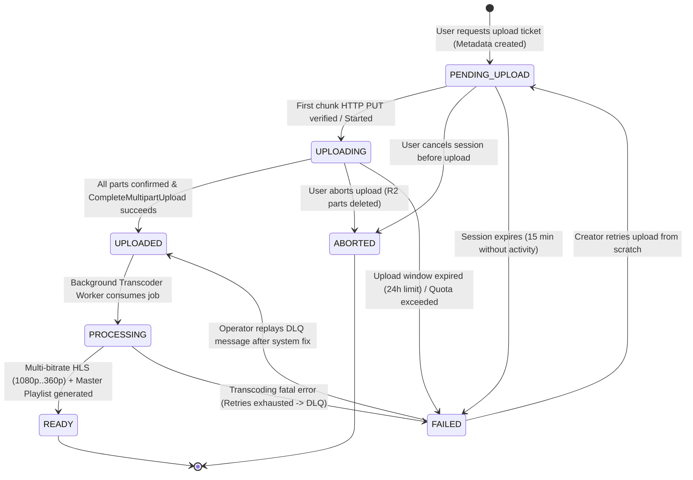
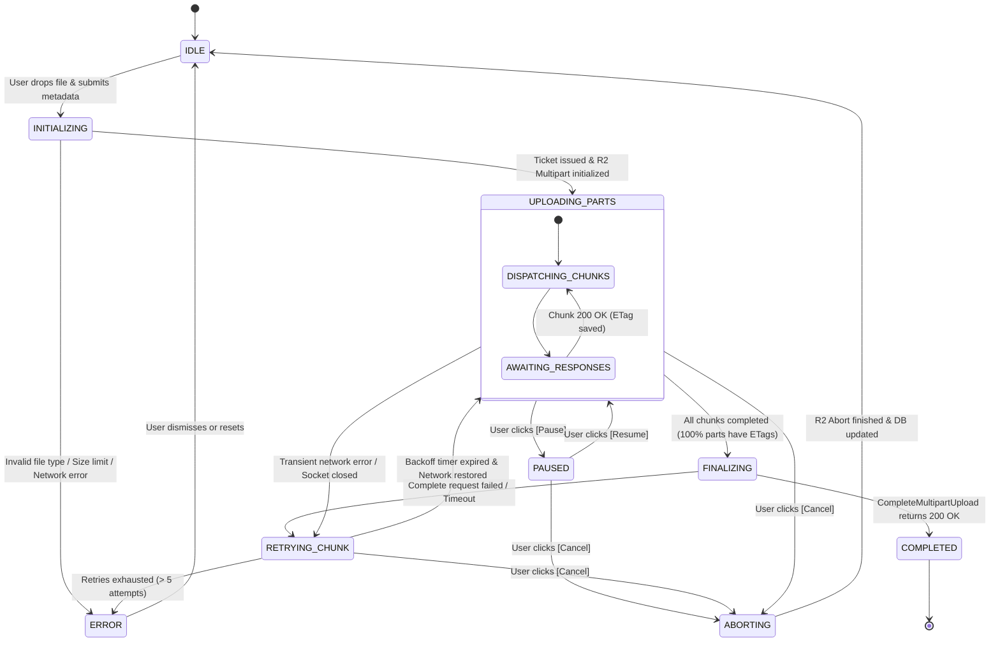

# 📑 Product Discovery & UX Specification: Resumable Video Upload Engine

**Document ID**: `RFC-DISCOVERY-001`  
**Subsystem**: Media Ingestion & Video Lifecycle Management  
**Status**: DRAFT (Review Ready)  
**Author**: Business Analysis & Product UX Specialist  
**Target Storage**: Cloudflare R2 (S3-Compatible Multipart Upload API)  
**Target Codebase**: Bitmill Platform (`go-streaming`)  

---

## 1. Executive Summary & Problem Space

### 1.1. Context & Business Drivers
The Bitmill platform delivers high-performance live streaming and Video-On-Demand (VOD) services. A core differentiator for creator adoption is media ingestion reliability. Content creators frequently upload high-definition, high-bitrate video assets ranging from **50 MB** up to **5 GB+** (e.g., 4K ProRes/H.264 recordings, multi-hour stream archives).

Traditional single-stream HTTP `POST`/`PUT` uploads suffer from catastrophic failure characteristics:
1. **Zero Fault Tolerance**: A network hiccup at 98% of a 5 GB upload forces a 100% re-upload from byte 0, squandering bandwidth, exhausting mobile data caps, and causing severe creator frustration.
2. **Server Buffer Bottlenecks**: Routing raw multi-gigabyte video streams through API application servers incurs heavy memory pressure, high CPU context-switching, and steep cloud egress/compute costs.
3. **Black-Box UX**: Static or jumpy progress bars lack transparency, failing to inform users about actual transfer speeds, chunk completion, or remaining time.

### 1.2. Strategic Objectives
* **Direct-to-Cloud Zero-Server Ingest**: Raw video payloads bypass Bitmill API servers entirely, uploading straight from client user agents to **Cloudflare R2** via presigned S3-compatible Multipart URLs, incurring zero cloud egress costs.
* **Deterministic Fault Recovery**: Support seamless, chunk-level pause, resume, auto-recovery on connection loss (handling drops at 1%, 50%, 99%), and cross-session restoration across browser restarts.
* **High-Fidelity Telemetry**: Provide real-time, smoothed client-side metrics (chunk progress, transfer rate via Exponential Moving Average, accurate Time-to-Remaining).
* **Guaranteed Cleanup & Storage Hygiene**: Prevent runaway R2 storage costs through strict multipart lifecycle policies, automatic session expiration, and explicit abort workflows.

---

## 2. User Personas & Pain Points

```
┌─────────────────────────────────────────────────────────────────────────────────┐
│                           BITMILL INGESTION PERSONAS                            │
├───────────────────────┬────────────────────────────┬────────────────────────────┤
│  1. Marcus (Pro Dev)  │   2. Linh (Field Streamer) │   3. Sarah (Casual Creator)│
│  "Bandwidth Rich,     │   "Unstable 4G/5G,         │   "Easily Confused by      │
│   Workflow Impatient" │    Zero Data Waste"        │    Technical Glitches"     │
└───────────────────────┴────────────────────────────┴────────────────────────────┘
```

### 2.1. Persona Profiles

| Attribute | Marcus (Studio Creator) | Linh (IRL Streamer / Field Reporter) | Sarah (Casual Vlogger) |
| :--- | :--- | :--- | :--- |
| **Role & Volume** | Professional video editor; uploads 3-5 GB 4K video exports daily. | Mobile/remote creator; uploads 500 MB – 2 GB recordings over cellular/hotel Wi-Fi. | Hobbyist creator; uploads 100 MB – 500 MB smartphone clips weekly. |
| **Network Profile** | High-speed FTTH Fiber (100–500 Mbps), stable with occasional ISP resets. | Flaky 4G/LTE (5–20 Mbps), frequent IP handovers, subway dead-zones, high packet loss. | Home Wi-Fi (shared bandwidth, high latency jitter during family peak hours). |
| **Primary Device** | Desktop Chrome/Firefox (macOS/Windows), multi-monitor workspace. | Mobile Chrome/Safari (iOS/Android) or laptop tethered to mobile hotspot. | Mid-range Windows laptop, single browser window. |
| **Key Objectives** | Batch upload queues, maximum throughput, zero tab hang, instant feedback. | Seamless background recovery when reconnecting; never lose already uploaded bytes. | Clear, reassuring visual cues; no scary technical error dialogs. |

### 2.2. Pain Points & UX Mitigation Matrix

| User Pain Point | Real-World Trigger | Psychological Impact | UX Mitigation Requirement |
| :--- | :--- | :--- | :--- |
| **"The 99% Heartbreak"** | Connection dropped during final byte payload or manifest commit. | Rage, loss of trust, abandonment of platform. | Chunk-level isolation: already committed chunks (1% to 98%) remain intact. Auto-retry the 99% chunk with exponential backoff and verify ETag idempotency. |
| **"The Silent Freeze"** | Browser tab loses socket connectivity; upload bar stalls indefinitely with no error. | Confusion, user manually refreshes and loses all progress. | Liveness heartbeat on active chunk socket. If no byte transfer for 10s, mark state `RECONNECTING`, switch visual indicator to amber, and retry. |
| **"The Accidental Tab Close"** | User switches tabs, closes window, or browser runs out of memory. | Despair over lost multi-gigabyte upload. | Local state persistence (IndexedDB). On page reload, detect unfinalized upload, prompt user to re-select file, verify checksum/file signature, and resume from highest chunk. |
| **"Data Hog / Throttling"** | Upload consumes all upstream bandwidth, lagging user's active livestream or work. | Frustration with unconfigurable network greed. | Explicit **Pause / Resume** controls allowing users to suspend upload during critical tasks and resume on demand. |

---

## 3. End-to-End User Journeys & Disruption Scenarios

### 3.1. Overview of Scenarios Analyzed

```
[Scenario 1: Happy Path]
   ──> 100% Smooth Upload ──> Auto-Finalize ──> Background Transcode

[Scenario 2: Early Failure (1%)]
   ──> First chunk fails / Token Expired ──> Auto Token Refresh ──> Retry Chunk 1

[Scenario 3: Mid-Flight Network Cut (50%)]
   ──> Cell tower drop / Wi-Fi toggle ──> Auto-Pause ──> Exponential Backoff ──> Resume at Chunk 51

[Scenario 4: Late-Stage Severance (99%)]
   ──> Final chunk dropped / CompleteMultipartUpload Timeout ──> S3 ListParts Check ──> Idempotent ACK

[Scenario 5: Voluntary Pause / Resume]
   ──> User pauses to free bandwidth ──> Safe pause on chunk boundary ──> User clicks Resume

[Scenario 6: Crash & Recovery (Tab Refresh / Crash)]
   ──> Tab closed / Browser crashed ──> Re-open ──> Local state detected ──> File verified ──> Resume

[Scenario 7: User Cancellation (Abort)]
   ──> User cancels ──> Confirm Dialog ──> Storage Multipart Abort ──> DB cleanup
```

---

### 3.2. Detailed Scenario Blueprints

#### Scenario 1: Happy Path (100% Multi-Chunk Upload)
* **Preconditions**: Authenticated creator, valid video file (e.g. 1.2 GB MP4), stable broadband connection.
1. **Selection & Validation**: User drags video into dropzone. Client validates MIME type (`video/mp4`, `video/quicktime`, etc.) and file size ($\le$ max upload limit 10 GB).
2. **Ticket Issuance**: Client calls `POST /api/v1/videos/upload/initiate` with metadata (`title`, `file_size_bytes`, `mime_type`, `checksum`).
3. **Multipart Allocation**: Backend creates DB record (`status: PENDING_UPLOAD`), requests S3 `CreateMultipartUpload` on Cloudflare R2, generates presigned URLs for each chunk (or in batches of 5-10 parts), and returns `upload_session_id`, `r2_upload_id`, and `part_size` (e.g., 10 MB).
4. **Concurrent Part Uploads**: Client splits file into slices and uploads chunks in parallel (max concurrency: 3 connections) directly to Cloudflare R2 via HTTP `PUT`.
5. **Real-time UX Updates**: Progress bar advances smoothly. ETag received from each successful chunk response is cached locally.
6. **Completion Handshake**: Once the final part is uploaded, client calls `POST /api/v1/videos/upload/complete` containing the sorted list of `{part_number, etag}`.
7. **Storage Finalization**: Backend calls S3 `CompleteMultipartUpload` on R2, updates video status to `UPLOADED`, and enqueues transcode job to RabbitMQ.
8. **UI State Transition**: UI transitions from "Uploading 100%" to "Processing Media (Generating ABR HLS)...".

---

#### Scenario 2: Network Drop at Early Stage (1% - Handshake / Chunk 1 Failure)
* **Disruption Mechanism**: Initial TCP socket timeout, DNS failure, or immediate cellular disconnect during Part 1.
* **UX Flow**:
  1. Chunk 1 HTTP `PUT` fails with network error (`ERR_CONNECTION_RESET` or `Timeout`).
  2. UI immediately transitions upload badge from Blue ("Uploading...") to Amber ("Reconnecting (Attempt 1/5)...").
  3. Client halts spawning subsequent chunks.
  4. Client waits for jittered exponential backoff ($T_1 = 2s \pm 500ms$).
  5. If connection is restored, Part 1 is re-attempted.
  6. If Part 1 passes, upload resumes seamlessly without user intervention.
  7. If 5 attempts fail within 60 seconds, UI transitions to Red ("Upload Paused - Network Unavailable") with a manual **[Retry Now]** CTA.

---

#### Scenario 3: Mid-Flight Network Drop at 50% (Cell Tower Handover / Wi-Fi Cut)
* **Disruption Mechanism**: User is uploading a 2 GB file (200 parts of 10 MB). Parts 1 to 100 are completed and confirmed with ETags in client storage. At part 101, user drives into an underground tunnel or Wi-Fi drops.
* **Detailed Sequence**:
  ```mermaid
  sequenceDiagram
      autonumber
      participant Client as Web Client (Uploader Engine)
      participant Storage as Cloudflare R2 (S3 API)
      participant API as Bitmill API Gateway
      participant DB as Postgres DB

      Note over Client, Storage: Parts 1 to 100 successfully uploaded (1.0 GB / 50%)
      Client->>Storage: PUT Part 101 (Presigned URL)
      Note over Client, Storage: [NETWORK SEVERED - TCP DROP]
      Storage--xClient: Socket Terminated / Timeout (No ETag)
      
      Client->>Client: Detect Socket Error (Navigator offline / Fetch fail)
      Client->>Client: Update UI: Status = 'RECONNECTING', Progress locked at 50.0%
      Client->>Client: Pause Part Queue. Keep Parts 1-100 ETags cached.
      
      loop Exponential Backoff (2s, 4s, 8s...)
          Client->>Client: Probe connection (ping lightweight health check)
      end
      
      Note over Client: Network Restored (Wi-Fi reconnected)
      Client->>Client: Navigator 'online' event triggered
      Client->>API: GET /api/v1/videos/upload/sessions/:id/parts (Verify Server/R2 State)
      API->>Storage: ListParts(UploadId)
      Storage-->>API: Return uploaded parts list (Parts 1-100 verified)
      API-->>Client: Sync state: Parts 1-100 committed on R2
      
      Client->>Client: Resume queue: Re-slice from byte offset 1,000,000,001 (Part 101)
      Client->>Storage: PUT Part 101
      Storage-->>Client: 200 OK (ETag: "etag-101")
      Client->>Client: UI returns to 'UPLOADING' (50.5%...)
  ```

---

#### Scenario 4: Late-Stage Severance at 99% (Final Part / Complete Drop)
* **Disruption Mechanism**: 99 out of 100 parts are completed. Part 100 is uploaded, but either Part 100 drops, or the `complete` call network connection breaks while the backend is waiting for S3 `CompleteMultipartUpload`.
* **The "Ghost Complete" Edge Case**:
  - In some cases, R2 completes the assembly, but the client socket closes before receiving the HTTP 200 response for the `complete` request.
  - If the client mindlessly re-submits `CompleteMultipartUpload`, R2 returns `404 NoSuchUpload` (because the upload is already completed and closed!).
  - **BA Solution & Idempotent Guard**:
    1. If client receives network error on `complete` call, it calls `GET /api/v1/videos/:id`.
    2. If video status in DB is already `UPLOADED` or `PROCESSING`, the client immediately treats the upload as successful!
    3. If video status is still `PENDING_UPLOAD` or `UPLOADING`, backend queries R2: first checks if the finalized object `raw/{video_id}.mp4` exists; if yes, transitions DB to `UPLOADED`; if no, requests `ListParts` and tells client which exact parts remain to be uploaded.
    4. **Zero Duplicate Work**: User never has to re-upload the 99% of data already stored in R2.

---

#### Scenario 5: User-Initiated Voluntary Pause and Resume
* **User Intent**: User needs to attend a video call or launch a game, needing full upstream bandwidth.
* **UX Specification**:
  1. User clicks **[Pause]** button.
  2. The UI immediately changes button state to "Pausing...".
  3. Active chunk uploads in flight are allowed to finish if within 2 seconds of completion, OR aborted cleanly via `AbortController` signal to avoid orphaned billing/bandwidth.
  4. State changes to `PAUSED`. All completed part ETags are safely flushed to IndexedDB.
  5. UI displays: `"Upload Paused at 64% (1.28 GB / 2.00 GB) - All progress saved"`.
  6. When user clicks **[Resume]**, the client reads the session cache, verifies the presigned URLs have not expired (if expired, requests fresh URLs from backend), and immediately resumes uploading next uncommitted chunk.

---

#### Scenario 6: Browser Crash / Tab Refresh / Device Reboot
* **Problem**: In standard HTML uploads, refreshing the page or closing the tab destroys the memory `File` object and upload state.
* **UX & Technical Recovery Architecture**:
  1. The browser's `File` object cannot be restored automatically from disk without user interaction due to browser security sandbox restrictions.
  2. However, the **Upload Session ID, File Metadata (Name, Size, LastModified, Fingerprint), and Completed Part ETags** ARE preserved in `IndexedDB`.
  3. When user revisits the Bitmill Upload page:
     - The page checks IndexedDB for active unfinalized sessions.
     - An alert banner appears:
       > **Unfinished Upload Detected**: *"2026-Stream-Final.mp4" was paused at 74% (3.7 GB of 5.0 GB).*
       > `[Resume Upload]` `[Discard & Delete]`
     - Upon clicking `[Resume Upload]`, the browser prompts the user:
       > *"Please select '2026-Stream-Final.mp4' from your computer to verify and continue without restarting."*
     - User selects the file via native file picker.
     - Client verifies: `selectedFile.name === cached.name && selectedFile.size === cached.size && selectedFile.lastModified === cached.lastModified`.
     - Match confirmed $\rightarrow$ Client skips chunks 1 through 740 and resumes directly from chunk 741!

---

#### Scenario 7: User-Initiated Upload Abort / Cancellation
* **User Intent**: User realized they picked the wrong video file or changed their mind.
* **Specification**:
  1. User clicks **[Cancel Upload]**.
  2. A confirmation modal is shown:
     > *"Are you sure you want to cancel? All uploaded progress (1.4 GB) will be permanently deleted."*
     > `[Keep Uploading]` `[Yes, Cancel & Delete]`
  3. User confirms cancellation.
  4. Client aborts in-flight fetch requests via `AbortController`.
  5. Client calls `DELETE /api/v1/videos/upload/sessions/:id/abort`.
  6. Backend invokes S3 `AbortMultipartUpload` on Cloudflare R2, instantly releasing reserved cloud storage.
  7. Backend transitions video record to `ABORTED` in database.
  8. Client clears local cache in `IndexedDB` and resets upload widget to clean state.

---

## 4. Video & Upload Session State Machine

### 4.1. Dual-Level State Machine Architecture
To prevent confusion between network transmission states (client-side) and domain persistence states (server/database), Bitmill employs a dual-level state model:
1. **Domain Video Entity Lifecycle** (Server Postgres DB).
2. **Client Upload Session State Machine** (Frontend Upload Engine).

```
   ┌─────────────────────────────────────────────────────────────┐
   │             DOMAIN VIDEO LIFECYCLE (DATABASE)               │
   │  [PENDING_UPLOAD] ──> [UPLOADING] ──> [UPLOADED]            │
   │          │                 │              │                 │
   │          v                 v              v                 │
   │      [ABORTED]         [ABORTED]    [PROCESSING]            │
   │          │                 │              │                 │
   │          v                 v              v                 │
   │       [FAILED]          [FAILED]    [READY] / [FAILED]      │
   └─────────────────────────────────────────────────────────────┘
                               ▲
                               │ Driven By Events & Handshakes
                               ▼
   ┌─────────────────────────────────────────────────────────────┐
   │          CLIENT UPLOAD ENGINE (BROWSER / FRONTEND)          │
   │   [IDLE] ──> [INITIALIZING] ──> [UPLOADING_PARTS]           │
   │                     │                 │     ▲               │
   │                     │                 v     │               │
   │                     │             [PAUSED] / [RETRYING]     │
   │                     │                 │                     │
   │                     v                 v                     │
   │                 [ABORTING] ──> [FINALIZING] ──> [COMPLETED] │
   └─────────────────────────────────────────────────────────────┘
```

---

### 4.2. Video Lifecycle State Diagram (Server Domain)



---

### 4.3. Client Upload Engine State Diagram (UX Runtime)



---

### 4.4. State Transition & Invariant Rules Matrix

| Current State | Trigger / Event | Guard Condition | Next State | System Actions & Invariants |
| :--- | :--- | :--- | :--- | :--- |
| **NONE** | File Drop & `initiate` call | File size $\le$ 10 GB, Allowed MIME type | `PENDING_UPLOAD` | Generate UUIDv4, insert DB record, request R2 `CreateMultipartUpload`, issue chunk presigned URLs. |
| `PENDING_UPLOAD` | First byte received on R2 / Client notifies start | Valid token, timestamp within 15 min | `UPLOADING` | Mark upload active, timestamp `upload_started_at`. |
| `PENDING_UPLOAD` | Expiration Cron (15 min) | No chunks uploaded, `is_consumed == false` | `FAILED` | S3 `AbortMultipartUpload` to avoid ghost sessions, mark reason `SESSION_EXPIRED`. |
| `UPLOADING` | Client sends `complete` request | All $N$ parts present with valid ETags | `UPLOADED` | Backend executes S3 `CompleteMultipartUpload`, updates video size, emits RabbitMQ transcode job. |
| `UPLOADING` | User clicks [Pause] | In-flight requests can be cancelled cleanly | `PAUSED` (Client) | Abort active fetch sockets; preserve ETags in IndexedDB. Server remains `UPLOADING`. |
| `UPLOADING` | User clicks [Cancel] | Session active | `ABORTED` | Execute S3 `AbortMultipartUpload`, purge local IndexedDB cache, mark video `ABORTED`. |
| `UPLOADING` | Inactivity Timeout (24h) | Missing parts, no client heartbeat for 24 hours | `FAILED` | Background cleanup worker triggers S3 `AbortMultipartUpload` on R2, sets status to `FAILED`. |
| `UPLOADED` | Worker pulls message | Worker healthy, FFmpeg container ready | `PROCESSING` | Update DB status to `PROCESSING`, set `started_at` timestamp. |
| `PROCESSING` | FFmpeg completes all renditions | Master playlist and min 2 renditions exist | `READY` | Insert `video_renditions`, update master URL, notify creator via WebSocket/Push. |
| `PROCESSING` | FFmpeg crashes / Codec corrupt | Attempt count $\ge$ 3 | `FAILED` | Move message to Dead Letter Queue (DLQ), log error trace, update DB status `FAILED`. |

---

## 5. Client-Side UX & Technical Telemetry Specifications

### 5.1. Dynamic Slicing & Chunk Sizing Strategy
Cloudflare R2 (S3-compatible) limits an object to at most **10,000 parts**, with a minimum part size of **5 MB** (except the final part). To optimize performance across low-end and high-end devices:

$$\text{Minimum Part Size} = 5 \times 1024 \times 1024 \text{ bytes (5 MB)}$$
$$\text{Calculated Part Size} = \max\left(5\text{ MB}, \min\left(50\text{ MB}, \left\lceil \frac{\text{Total File Size}}{5000} \right\rceil \right)\right)$$

| File Size Range | Part Size | Total Parts Count | Concurrency | Rationale |
| :--- | :--- | :--- | :--- | :--- |
| **50 MB – 250 MB** | 5 MB | 10 – 50 parts | 2 parallel | Fast initial ramp-up, minimal memory footprint. |
| **250 MB – 1 GB** | 10 MB | 25 – 100 parts | 3 parallel | Balanced throughput vs socket overhead on 4G/Wi-Fi. |
| **1 GB – 5 GB** | 20 MB | 50 – 250 parts | 3 parallel | High throughput, avoids browser memory bloat on large buffers. |
| **5 GB – 20 GB+** | 50 MB | 100 – 400 parts | 4 parallel | High saturation for gigabit fiber connections; well within 10k parts. |

---

### 5.2. Telemetry & Progress Smoothing Engine

Raw network progress fluctuates erratically due to TCP Slow-Start, Wi-Fi packet retries, and buffer flushes. Displaying raw instantaneous speed results in a chaotic, jumping ETA that frustrates users.

#### 1. Cumulative Transferred Bytes Formula
$$\text{TotalBytesUploaded}(t) = \sum_{p \in \text{CommittedParts}} \text{Size}(p) + \sum_{q \in \text{InFlightParts}} \text{ChunkBytesLoaded}(q, t)$$

#### 2. Progress Percentage
$$\text{Percentage}(t) = \min\left(99.9\%, \frac{\text{TotalBytesUploaded}(t)}{\text{FileSizeBytes}} \times 100\right)$$
*(Note: 100.0% is strictly reserved until the server completes `CompleteMultipartUpload` to avoid freezing at 100% while processing).*

#### 3. Smoothed Upload Speed (Exponential Moving Average - EMA)
To prevent erratic speed swings, the client samples transferred bytes every 500 ms:
$$\Delta \text{Bytes}_k = \text{Bytes}(t_k) - \text{Bytes}(t_{k-1}), \quad \Delta t = t_k - t_{k-1}$$
$$\text{Speed}_{\text{instant}}(k) = \frac{\Delta \text{Bytes}_k}{\Delta t}$$
$$\text{Speed}_{\text{smoothed}}(k) = \alpha \cdot \text{Speed}_{\text{instant}}(k) + (1 - \alpha) \cdot \text{Speed}_{\text{smoothed}}(k-1)$$
* **Smoothing Factor $\alpha$**: Set to `0.2` (gives 80% weight to historical baseline and 20% to latest sample, eliminating burst noise).

#### 4. Estimated Time Remaining (ETA / Time-To-Remaining)
$$\text{RemainingBytes}(t) = \text{FileSizeBytes} - \text{TotalBytesUploaded}(t)$$
$$\text{ETA}_{\text{seconds}} = \begin{cases} 
\frac{\text{RemainingBytes}(t)}{\text{Speed}_{\text{smoothed}}}, & \text{if } \text{Speed}_{\text{smoothed}} > 10\text{ KB/s} \\
\text{undefined (Display: "Calculating..."),} & \text{otherwise}
\end{cases}$$

#### 5. User-Facing Format Rules:
* If $\text{ETA} < 60\text{s}$: `"About 45 seconds remaining"`
* If $60\text{s} \le \text{ETA} < 3600\text{s}$: `"About 14 minutes remaining (at 4.2 MB/s)"`
* If $\text{ETA} \ge 3600\text{s}$: `"About 1 hour 15 minutes remaining (at 1.1 MB/s)"`
* Speed display: Formatted in standard units (`KB/s`, `MB/s`, `GB/s` with 1 decimal place).

---

### 5.3. Local State Persistence Specification (IndexedDB Architecture)
LocalStorage has a strict 5 MB quota and synchronous blocking I/O, making it hazardous for large object upload state. Bitmill mandates **IndexedDB** (`bitmill_uploader_db`) with fallback to memory.

```
┌───────────────────────────────────────────────────────────────────────────────┐
│                     INDEXEDDB SCHEMA: bitmill_uploader_db                    │
├───────────────────────────────────────────────────────────────────────────────┤
│ Store: upload_sessions                                                        │
│ KeyPath: session_id (UUIDv4)                                                  │
│ Indices: file_fingerprint, created_at, status                                 │
│                                                                               │
│ {                                                                             │
│   "session_id": "c71a39f0-f203-4c91-9e8a-028a38efc192",                      │
│   "video_id": "9b1deb4d-3b7d-4bad-9bdd-2b0d7b3dcb6d",                        │
│   "file_fingerprint": "2147483648_1708941200000_sample_video.mp4_a8f9",      │
│   "file_metadata": {                                                          │
│     "name": "sample_video.mp4",                                               │
│     "size": 2147483648,                                                       │
│     "type": "video/mp4",                                                      │
│     "last_modified": 1708941200000                                            │
│   },                                                                          │
│   "multipart_details": {                                                      │
│     "r2_upload_id": "ibn74839201msdf8392",                                    │
│     "part_size": 10485760,                                                    │
│     "total_parts": 205                                                        │
│   },                                                                          │
│   "completed_parts": [                                                        │
│     { "part_number": 1, "etag": "\"d41d8cd98f00b204e9800998ecf8427e\"",       │
│       "size": 10485760, "uploaded_at": 1708941215000 },                      │
│     { "part_number": 2, "etag": "\"0cc175b9c0f1b6a831c399e269772661\"",       │
│       "size": 10485760, "uploaded_at": 1708941219000 }                       │
│   ],                                                                          │
│   "status": "UPLOADING",                                                      │
│   "expires_at": 1709027600000                                                 │
│ }                                                                             │
└───────────────────────────────────────────────────────────────────────────────┘
```

#### Fast File Fingerprinting Algorithm
To uniquely identify a physical file without computing a full SHA-256 over 5 GB (which would freeze the browser for 30+ seconds):
$$\text{Fingerprint} = \text{FileSize} \parallel \text{"\_"} \parallel \text{LastModifiedTimestamp} \parallel \text{"\_"} \parallel \text{FileName} \parallel \text{"\_"} \parallel \text{SHA256}(\text{First 64 KB}) \parallel \text{"\_"} \parallel \text{SHA256}(\text{Last 64 KB})$$
* **Computation Time**: $< 50\text{ ms}$ even on a 10 GB file.
* **Collision Probability**: Virtually zero for user upload operations.

---

### 5.4. Exponential Backoff & Circuit Breaker Policy

```
[Chunk Upload Failure]
       │
       ▼
Attempt <= 5? ──────No──────> [Mark Session PAUSED] ──> [Notify User with CTA]
       │
      Yes
       │
Calculate Delay:
T = min(30s, 1s * 2^(Attempt-1)) + Jitter(0-1000ms)
       │
       ▼
Sleep(T) ──> Check Navigator.onLine ──> [Retry Chunk Upload]
```

* **Max Automatic Retries per Chunk**: `5 attempts`.
* **Base Interval**: `1.0 second`.
* **Multiplier**: `2.0`.
* **Maximum Cap**: `30 seconds`.
* **Full Jitter**: Adds randomized offset between `0` and `1000 ms` to prevent synchronized thundering herd spikes against Cloudflare R2 endpoints.

---

## 6. Edge Cases, Business Invariants & Security Guardrails

### 6.1. Cloudflare R2 CORS & Header Expose Requirements
In direct-to-cloud browser uploads, S3 returns the uploaded chunk's checksum in the HTTP response header `ETag`. By default, browsers restrict JavaScript from reading non-standard headers due to CORS policies.
* **CRITICAL INVARIANT**: Cloudflare R2 Bucket CORS configuration MUST explicitly expose `ETag`:
  ```json
  [
    {
      "AllowedOrigins": ["https://*.bitmill.tv", "http://localhost:3000"],
      "AllowedMethods": ["GET", "PUT", "HEAD", "POST", "DELETE"],
      "AllowedHeaders": ["*"],
      "ExposeHeaders": ["ETag", "Content-Range", "ETag", "x-amz-request-id"],
      "MaxAgeSeconds": 3600
    }
  ]
  ```
* *If `ETag` is omitted from `ExposeHeaders`, `fetch()` responses in browser JavaScript cannot read the part ETag, breaking `CompleteMultipartUpload` entirely.*

---

### 6.2. Incomplete Multipart Storage Leakage & Lifecycle Rule
If a user closes their laptop at 50% and never returns, those parts remain stored in Cloudflare R2 indefinitely, consuming storage fees unless aborted.
1. **R2 Bucket Lifecycle Policy**: Automatically configure Cloudflare R2 lifecycle rule:
   - Rule Action: `AbortIncompleteMultipartUpload`
   - Days after initiation: `7 days` (or `24 hours` for aggressive cost savings).
2. **Backend Reaper Cron**: A scheduled Go background worker queries Postgres every hour for sessions in `UPLOADING` where `updated_at < NOW() - INTERVAL '24 HOURS'`. The reaper calls S3 `AbortMultipartUpload` and marks the DB record `FAILED`.

---

### 6.3. Duplicate Upload & Concurrency Collision Invariant
* **Problem**: A user opens two tabs and accidentally initiates an upload for the exact same 3 GB file simultaneously.
* **Solution**:
  - The client generates the file fingerprint before calling `/initiate`.
  - The API checks if an active `UPLOADING` session with the identical `user_id` and `file_fingerprint` exists within the last 2 hours.
  - If found, the API returns HTTP `200 OK` with the existing `session_id`, `r2_upload_id`, and list of already completed parts instead of creating an expensive duplicate multipart upload!

---

### 6.4. Presigned URL Expiration vs Session Lifetime
* An entire 5 GB upload on a 10 Mbps connection can take **1.5 hours**.
* If a presigned URL is issued with only a 15-minute expiration, parts uploaded after minute 16 will fail with HTTP `403 Forbidden` (`Request has expired`).
* **Architecture Decision**:
  - Presigned URLs for chunk parts are generated with a **2-hour TTL**, OR
  - The client fetches presigned part URLs in **batches of 10 parts** on-demand as the upload queue progresses (`POST /api/v1/videos/upload/sessions/:id/parts/presign-batch`). This guarantees no URL ever expires during long transfers.

---

## 7. BDD Gherkin Acceptance Criteria

### Feature 1: Multi-Chunk Upload Session Initialization
```gherkin
Feature: Multipart Video Upload Session Initialization
  As an authenticated content creator
  I want to register an upload request for a video file
  So that I can upload large media directly to Cloudflare R2 without overloading the API server

  Background:
    Given the creator is logged in with valid bearer credentials
    And the maximum allowable file size is 10737418240 bytes (10 GB)

  Scenario: Successfully initialize a 2 GB video upload session
    When the client submits POST /api/v1/videos/upload/initiate with:
      | field            | value                                              |
      | title            | "DevOps Keynote 2026"                              |
      | file_size_bytes  | 2147483648                                         |
      | mime_type        | "video/mp4"                                        |
      | file_fingerprint | "2147483648_1708941200000_DevOps_Keynote_2026.mp4" |
    Then the system returns HTTP 201 Created
    And the response body contains:
      | field             | type    | rule                              |
      | video_id          | UUIDv4  | not null                          |
      | upload_session_id | UUIDv4  | not null                          |
      | r2_upload_id      | String  | matches S3 multipart ID pattern   |
      | part_size_bytes   | Integer | 10485760 (10 MB)                  |
      | total_parts       | Integer | 205                               |
    And a video record is created in PostgreSQL with status "PENDING_UPLOAD"
    And a session record is cached in client IndexedDB
```

---

### Feature 2: Resilient Mid-Flight Network Drop and Auto-Resume (50% Drop)
```gherkin
Feature: Mid-Flight Network Recovery
  As a content creator on an unstable network
  I want my upload to automatically pause and resume upon network restoration
  So that I do not lose already transferred video chunks

  Background:
    Given an ongoing upload session for a 1 GB video (100 parts of 10 MB)
    And parts 1 through 50 are completed with verified ETags stored in IndexedDB

  Scenario: Connection drops during part 51 upload
    When the client network socket drops while uploading part 51
    Then the client pauses further chunk dispatching
    And the UI state transitions to "RECONNECTING"
    And the UI displays "Connection interrupted. Retrying in 2 seconds..."
    And the progress bar remains stationary at exactly 50.0%
    When the network connection is restored after 5 seconds
    And the client receives an online event
    Then the client re-uploads part 51
    And Cloudflare R2 responds with HTTP 200 OK and ETag
    And the client continues to part 52 without re-uploading parts 1 through 50
    And the UI status returns to "UPLOADING"
```

---

### Feature 3: Late-Stage Severance and Idempotent Finalization (99% Drop)
```gherkin
Feature: 99% Disconnect and Idempotent Assembly
  As a content creator
  I want late-stage network hiccups to be resolved idempotently
  So that my video is safely committed without false failures or duplicated files

  Background:
    Given an upload session where parts 1 through 100 have been uploaded to R2
    And the client has received ETags for all 100 parts

  Scenario: Client disconnects while calling CompleteMultipartUpload
    When the client sends POST /api/v1/videos/upload/complete
    And the network connection drops before the client receives the HTTP response
    And the backend successfully commits CompleteMultipartUpload on Cloudflare R2
    When the client reconnects and queries GET /api/v1/videos/{video_id}
    Then the backend responds with status "UPLOADED"
    And the client marks the local upload state as "COMPLETED"
    And the UI advances progress to 100%
    And displays "Upload Complete! Optimizing video for streaming..."
```

---

### Feature 4: User-Initiated Voluntary Pause and Resume
```gherkin
Feature: Voluntary Pause and Resume
  As a content creator
  I want to manually pause my upload to free up network bandwidth
  So that I can resume later from the exact same point

  Scenario: Creator pauses and resumes upload at 60%
    Given an active upload progressing at 60%
    When the creator clicks the "Pause" button
    Then all in-flight fetch requests are aborted cleanly via AbortController
    And the client records the highest completed part number in IndexedDB
    And the UI displays "Upload Paused (60% completed)"
    And the action button toggles to "Resume"
    When the creator clicks "Resume" after 10 minutes
    Then the client reads cached parts from IndexedDB
    And verifies presigned URLs are still valid
    And resumes uploading from part 61
    And no previously uploaded bytes are retransmitted
```

---

### Feature 5: Cross-Session Restoration after Browser Crash / Tab Refresh
```gherkin
Feature: Browser Session Recovery
  As a content creator whose browser crashed or closed
  I want to resume my interrupted upload without starting over
  So that I do not waste time or bandwidth

  Scenario: User reopens page after closing browser at 75%
    Given a previously active upload session for "MyShow.mp4" (4 GB) at 75%
    And the browser tab was closed abruptly
    When the creator navigates back to the Bitmill Upload page
    Then the client detects an unfinalized session in IndexedDB
    And the UI displays a recovery prompt:
      """
      Unfinished Upload Detected: 'MyShow.mp4' (3.0 GB of 4.0 GB uploaded).
      Select the file to resume where you left off.
      """
    When the creator selects the matching local file "MyShow.mp4"
    Then the client verifies the file size, name, and 64KB boundary checksums
    And the client synchronizes committed parts with Cloudflare R2
    And the upload resumes directly from 75%
```

---

### Feature 6: User-Initiated Upload Abort and Storage Reclamation
```gherkin
Feature: Upload Abort and Resource Cleanup
  As a content creator who uploaded the wrong file
  I want to abort the upload
  So that unneeded data is immediately purged and storage is not wasted

  Scenario: Creator cancels an in-progress upload
    Given an upload session progressing at 30%
    When the creator clicks "Cancel Upload"
    And confirms the action on the confirmation dialog
    Then the client aborts all active network connections
    And calls DELETE /api/v1/videos/upload/sessions/{session_id}/abort
    Then the Bitmill backend calls S3 AbortMultipartUpload on Cloudflare R2
    And all staged parts in Cloudflare R2 are deleted
    And the video status in PostgreSQL is set to "ABORTED"
    And the client clears the session from IndexedDB
    And the UI resets to the initial file dropzone
```

---

### Feature 7: Real-Time Telemetry and Telemetry Display
```gherkin
Feature: Telemetry Display and Speed Smoothing
  As a content creator
  I want to see steady, accurate upload progress, speed, and time remaining
  So that I have clear visibility into upload completion

  Scenario: Display smoothed speed and ETA during transfer
    Given an active upload transferring at an average rate of 5.0 MB/s
    When the network throughput momentarily spikes to 20 MB/s for 500ms
    Then the smoothed upload speed displayed to the user does not spike to 20 MB/s
    And the speed updates smoothly using the Exponential Moving Average formula
    And the estimated time remaining is calculated based on smoothed speed
    And the remaining time is displayed as "About X minutes remaining"
    And the percentage never displays 100% until the server confirms finalization
```

---

## 8. Requirements Traceability & Engineering Handoff Matrix

| BA Requirement ID | Feature Area | Target Subsystem / Package | Architectural Artifact / Spec | Verification Method |
| :--- | :--- | :--- | :--- | :--- |
| **REQ-INGEST-01** | Zero-Server Ingest | `internal/interfaces/http`, Cloudflare R2 | Direct PUT to presigned S3 URLs | Network inspect: 0 raw video bytes traverse Go API port :8080. |
| **REQ-CHUNK-02** | Dynamic Multipart Slicing | Frontend SDK / Uploader Client | Dynamic Chunk Sizing Formula (§5.1) | Unit tests verifying slice boundary calculations for 50MB, 1GB, 5GB. |
| **REQ-CACHE-03** | Local State Recovery | Frontend IndexedDB Storage Adapter | `bitmill_uploader_db` schema (§5.3) | Automated Cypress/Playwright test: reload page at 50%, verify resume from part 51. |
| **REQ-RETRY-04** | Transient Fault Recovery | Frontend Network Transport Engine | Exponential Backoff with Jitter (§5.4) | Mock network drop at 50%: verify 5 retry attempts before pause. |
| **REQ-IDEMP-05** | Late Disconnect Guard | `internal/application/video/upload_service.go` | Idempotent CompleteMultipartUpload (§3.2 Sc. 4) | Unit test: Calling `complete` twice returns 200 OK without S3 404 error. |
| **REQ-ABORT-06** | Storage Hygiene & Abort | `internal/infrastructure/storage/r2_adapter.go` | S3 `AbortMultipartUpload` & Reaper Cron | Integration test: verify aborted upload leaves zero bytes in R2 bucket. |
| **REQ-TELEMETRY-07** | UX Smoothing & ETA | Frontend State / UI Widget | Exponential Moving Average ($\alpha=0.2$) (§5.2) | Telemetry test: erratic stream yields monotonic, non-jittery ETA. |

---

## 9. Conclusion & Next Steps for Architecture Review

This discovery specification establishes the functional and UX foundation for Bitmill's resilient video ingestion. By treating network drops, client restarts, and browser reboots as **first-class normal operations** rather than edge-case exceptions, Bitmill guarantees creator trust, zero wasted bandwidth, and zero server I/O exhaustion.

**Recommended Handoff Actions**:
1. **Architectural Review**: Validate presigned batch URL generation endpoint contracts against `upload-service-decisions.md`.
2. **Database Schema Alignment**: Add `file_fingerprint`, `upload_session_id`, and `r2_upload_id` to `videos` / `upload_sessions` tables in `database-schema.md`.
3. **Frontend SDK Prototype**: Implement the core IndexedDB-backed chunking worker with `AbortController` and EMA telemetry.
