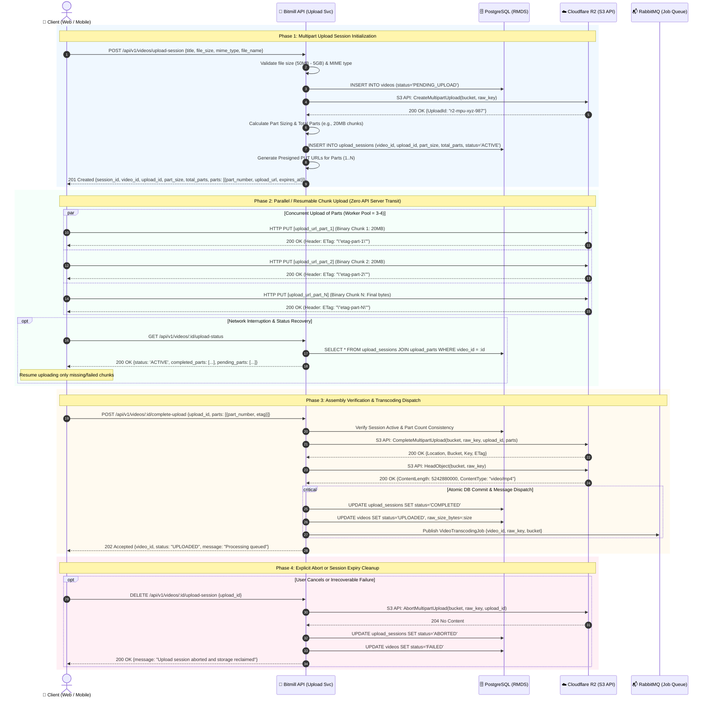
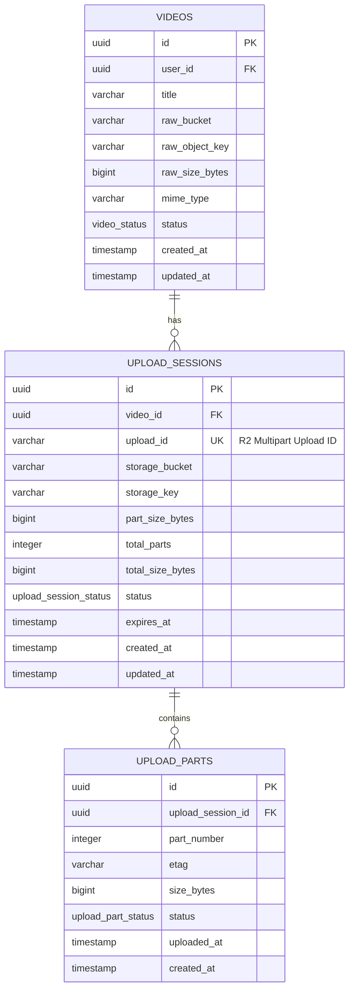

# 🏛️ Technical Architecture & Protocol Specification: Resumable Video Upload via Cloudflare R2 Multipart Ingestion

- **RFC Identifier**: RFC-002-SOLUTIONS-ARCHITECTURE
- **Author**: Principal Solutions & Cloud Architect
- **Status**: PROPOSED / REVIEW
- **Target Subsystem**: Bitmill Video Ingestion & Lifecycle Control Plane
- **Storage Target**: Cloudflare R2 (S3-Compatible Object Storage)
- **Target Payload Scale**: 50MB to 5GB video files
- **Date**: 2026-10-27

---

## 1. Executive Summary & Architectural Overview

The **Bitmill Resumable Video Upload Subsystem** provides a zero-server-bandwidth, high-throughput, fault-tolerant video ingestion pipeline for media files ranging from 50MB to 5GB. 

### 1.1. Core Architectural Tenets
1. **Zero-Byte API Transit (Pure Control Plane)**: The API Gateway and Upload Service instances strictly manage session authorization, ticket issuance, and assembly coordination. Raw binary payloads flow directly from Client runtimes (browsers, mobile applications) to Cloudflare R2 via presigned HTTP `PUT` URLs.
2. **Resilience over Unreliable Networks**: Direct multi-gigabyte uploads over standard HTTP `POST`/`PUT` fail catastrophically if network drops occur midway. S3 Multipart Upload decomposes large files into independently uploaded, retryable chunks.
3. **Strict Inversion of Control (IoC) & Clean Architecture**: Domain logic is defined using pure Go interfaces free of external cloud SDKs or driver dependencies (`aws-sdk-go-v2`, `gin`, `pgx`). Infrastructure adapters implement these contracts and are injected at the composition root.
4. **Deterministic Lifecycle Orchestration**: Upload sessions maintain explicit timeouts, state machines, and lifecycle garbage collection, ensuring no orphaned multipart chunks accumulate in R2 storage.

---

## 2. End-to-End Sequence Diagram

The interaction model coordinates five distinct participants:
- **Client (Web / Mobile)**: The upload initiator.
- **Bitmill API (Upload Service)**: The stateless control plane orchestrating metadata and signing presigned URLs.
- **PostgreSQL (RMDS)**: Relational persistent store for upload sessions, parts, and video states.
- **Cloudflare R2**: S3-compatible object store accepting parallel binary chunk ingestion.
- **RabbitMQ**: Asynchronous message broker delivering transcode tasks to FFmpeg workers.



---

## 3. Part / Chunk Sizing Deep-Dive & Mathematical Trade-Off Analysis

S3-compatible storage engines (including Cloudflare R2 and AWS S3) impose strict protocol boundaries on Multipart Uploads:
- **Minimum Part Size**: $5\text{ MiB}$ ($5,242,880\text{ bytes}$), except for the final part which can be smaller ($1\text{ byte} \le \text{LastPart} \le 5\text{ GiB}$).
- **Maximum Parts Per Object**: $10,000\text{ parts}$.
- **Maximum Single Object Size**: $5\text{ TiB}$.

### 3.1. Mathematical Formulation

Let:
- $S_{\text{file}}$: Total video file size in bytes ($50\text{ MB} \le S_{\text{file}} \le 5\text{ GB}$).
- $S_{\text{part}}$: Uniform chunk size for parts $1 \dots (N-1)$.
- $N_{\text{parts}}$: Total number of parts required:
  $$N_{\text{parts}} = \left\lceil \frac{S_{\text{file}}}{S_{\text{part}}} \right\rceil$$
- $B_{\text{uplink}}$: Effective client network upload bandwidth in bytes per second ($\text{B/s}$).
- $P_{\text{loss}}$: Packet loss or socket disconnect probability during an individual chunk transmission.
- $T_{\text{chunk}}$: Duration to transmit a single chunk:
  $$T_{\text{chunk}} = \frac{S_{\text{part}}}{B_{\text{uplink}}}$$
- $R_{\text{blast}}$: Network Retry Blast Radius (the amount of transmitted data wasted and re-uploaded upon a mid-chunk failure at point $\alpha \in (0, 1]$):
  $$\mathbb{E}[R_{\text{blast}}] = \frac{S_{\text{part}}}{2}$$

### 3.2. Cloudflare R2 Pricing Mechanics

Cloudflare R2 features a **zero data egress fee** model, making it exceptionally economical for video distribution. However, API operations are billed as follows:
- **Class A Operations** (Mutations / Writes): **\$4.50 per 1,000,000 requests** (\$0.0045 / 1k requests).
  - Includes: `CreateMultipartUpload`, `UploadPart`, `CompleteMultipartUpload`, `AbortMultipartUpload`, `ListParts`.
- **Class B Operations** (Reads): **\$0.36 per 1,000,000 requests**.
- **Storage**: **\$0.015 / GB-month**.

For a single video upload session with $N_{\text{parts}}$, the number of Class A operations invoked is:
$$\text{Ops}_{\text{ClassA}} = 1\ (\text{Create}) + N_{\text{parts}}\ (\text{UploadPart}) + 1\ (\text{Complete}) = N_{\text{parts}} + 2$$

$$\text{Cost}_{\text{ClassA}}(N_{\text{parts}}) = (N_{\text{parts}} + 2) \times \frac{\$4.50}{1,000,000} = (N_{\text{parts}} + 2) \times \$4.5 \times 10^{-6}$$

### 3.3. Multi-Dimensional Trade-Off Comparison

We evaluate 4 candidate part sizes ($5\text{ MB}$, $10\text{ MB}$, $20\text{ MB}$, and $50\text{ MB}$) across the target video range:

| File Size ($S_{\text{file}}$) | Metric | 5 MB Part Size | 10 MB Part Size | 20 MB Part Size | 50 MB Part Size |
| :--- | :--- | :---: | :---: | :---: | :---: |
| **50 MB** | Number of Parts ($N$) | 10 | 5 | 3 | 1 |
| | Class A Operations | 12 | 7 | 5 | 3 |
| | Worst-case Retry Data | 5 MB | 10 MB | 20 MB | 50 MB (Entire file) |
| | Retry Time @ 15 Mbps (4G) | 2.67s | 5.33s | 10.67s | 26.67s |
| **500 MB** | Number of Parts ($N$) | 100 | 50 | 25 | 10 |
| | Class A Operations | 102 | 52 | 27 | 12 |
| | Presigned JSON Payload Size | ~28 KB | ~14 KB | ~7 KB | ~3 KB |
| | Retry Time @ 15 Mbps (4G) | 2.67s | 5.33s | 10.67s | 26.67s |
| **1 GB (1,024 MB)** | Number of Parts ($N$) | 205 | 103 | 52 | 21 |
| | Class A Operations | 207 | 105 | 54 | 23 |
| | Presigned JSON Payload Size | ~58 KB | ~29 KB | ~15 KB | ~6 KB |
| | Memory Footprint (Browser) | Low | Low | Moderate | High |
| **5 GB (5,120 MB)** | Number of Parts ($N$) | 1,024 | 512 | 256 | 103 |
| | Class A Operations | 1,026 | 514 | 258 | 105 |
| | Presigned JSON Payload Size | ~280 KB | ~140 KB | ~70 KB | ~28 KB |
| | Class A Cost per 10k Uploads | \$46.17 | \$23.13 | \$11.61 | \$4.72 |
| | HMAC Signing CPU Overhead | ~3.2ms | ~1.6ms | ~0.8ms | ~0.3ms |

### 3.4. Architectural Trade-Off Analysis

#### 1. 5 MB Chunk Size (Protocol Minimum)
- **Strengths**: Minimum blast radius. Highly resilient on poor 3G/unstable mobile networks.
- **Weaknesses**: For a 5GB file, generating 1,024 presigned URLs creates a large JSON response payload (~280 KB), puts heavy pressure on the browser's concurrency pool (browser socket limits max out at 6 connections per domain), and incurs 1,026 Class A operations per video.

#### 2. 10 MB Chunk Size
- **Strengths**: Good balance for mobile-heavy platforms. A 10MB retry takes only 1.6s on 50 Mbps home broadband and 5.3s on 15 Mbps 4G. 
- **Weaknesses**: Still requires 512 parts for a 5GB upload, generating a ~140 KB session response payload.

#### 3. 20 MB Chunk Size (Recommended Standard)
- **Strengths**:
  - **Optimal Part Count**: A 5GB file requires exactly 256 parts; a 1GB file requires 52 parts.
  - **Negligible Payload Overhead**: 256 presigned URL entries take only ~70 KB of JSON, which compresses with Gzip/Brotli to < 18 KB.
  - **Reduced Class A Cost**: 75% fewer write operations compared to 5MB, cutting Cloudflare R2 Class A API costs to \$1.16 per 1,000 uploads of 5GB videos.
  - **Balanced Retry Penalty**: On modern mobile connections (average LTE/5G upload speed: 20-50 Mbps), re-transmitting a failed 20MB chunk takes 3.2 to 8.0 seconds, which is well within acceptable user experience thresholds.

#### 4. 50 MB Chunk Size
- **Strengths**: Lowest API cost and smallest payload.
- **Weaknesses**: Severe retry penalty. A network timeout at 48MB forces the uploader to re-transmit almost the entire 50MB. On a 10 Mbps uplink, this causes a 40-second penalty per dropped connection. For a 50MB file, it degrades into a non-chunked single upload.

### 3.5. Architectural Recommendation

> [!TIP]
> **Recommended Decision: Tiered / Adaptive Part Sizing Engine**
> 
> To maximize network resilience without incurring unnecessary API operation overhead, Bitmill implements an **Adaptive Sizing Strategy**:
> - If $S_{\text{file}} \le 250\text{ MB}$: $S_{\text{part}} = \mathbf{10\text{ MB}}$ ($1 \le N \le 25\text{ parts}$).
> - If $S_{\text{file}} > 250\text{ MB}$: $S_{\text{part}} = \mathbf{20\text{ MB}}$ ($13 \le N \le 256\text{ parts}$).
> - **Fallback Platform Default**: Fixed $\mathbf{20\text{ MB}}$ if dynamic calculation is disabled.

---

## 4. Database Schema Extensions (PostgreSQL DDL)

To transition from single-ticket uploads to resumable multipart uploads, we extend the PostgreSQL RMDS schema with dedicated tables for session tracking (`upload_sessions`) and granular chunk verification (`upload_parts`).



### 4.1. Production DDL Migration Script

```sql
-- Migration: 000002_resumable_multipart_upload.sql
-- Description: Extends schema to track Cloudflare R2 multipart upload sessions and individual part completion

BEGIN;

-- 1. Create Enums for Session and Part States
DO $$ BEGIN
    CREATE TYPE upload_session_status AS ENUM (
        'ACTIVE',       -- Session initialized, client uploading chunks
        'COMPLETING',   -- Client signaled complete, backend verifying R2 assembly
        'COMPLETED',    -- Assembly confirmed in R2, transcoding job enqueued
        'ABORTED',      -- Cancelled explicitly by user or client error
        'EXPIRED'       -- Upload window elapsed without completion
    );
EXCEPTION
    WHEN duplicate_object THEN null;
END $$;

DO $$ BEGIN
    CREATE TYPE upload_part_status AS ENUM (
        'PENDING',      -- Presigned URL generated, awaiting upload
        'COMPLETED',    -- Chunk uploaded to R2, ETag verified
        'FAILED'        -- Upload attempt failed, eligible for retry
    );
EXCEPTION
    WHEN duplicate_object THEN null;
END $$;

-- 2. Drop legacy upload_sessions table if strictly single-upload
DROP TABLE IF EXISTS upload_sessions CASCADE;

-- 3. Create Multi-Part UPLOAD_SESSIONS Table
CREATE TABLE IF NOT EXISTS upload_sessions (
    id UUID PRIMARY KEY DEFAULT gen_random_uuid(),
    video_id UUID NOT NULL REFERENCES videos(id) ON DELETE CASCADE,
    upload_id VARCHAR(255) NOT NULL,
    storage_bucket VARCHAR(128) NOT NULL,
    storage_key VARCHAR(512) NOT NULL,
    part_size_bytes BIGINT NOT NULL,
    total_parts INT NOT NULL,
    total_size_bytes BIGINT NOT NULL,
    status upload_session_status NOT NULL DEFAULT 'ACTIVE',
    client_ip VARCHAR(45),
    user_agent VARCHAR(512),
    expires_at TIMESTAMPTZ NOT NULL,
    created_at TIMESTAMPTZ NOT NULL DEFAULT CURRENT_TIMESTAMP,
    updated_at TIMESTAMPTZ NOT NULL DEFAULT CURRENT_TIMESTAMP,

    CONSTRAINT uq_upload_sessions_upload_id UNIQUE (upload_id),
    CONSTRAINT chk_total_parts_positive CHECK (total_parts > 0 AND total_parts <= 10000),
    CONSTRAINT chk_part_size_min CHECK (part_size_bytes >= 5242880) -- Minimum 5MB S3 limit
);

-- Performance Indices for upload_sessions
CREATE INDEX idx_upload_sessions_video_id ON upload_sessions(video_id);
CREATE INDEX idx_upload_sessions_status ON upload_sessions(status);
CREATE INDEX idx_upload_sessions_expires_at ON upload_sessions(expires_at) WHERE status = 'ACTIVE';

-- 4. Create UPLOAD_PARTS Table
CREATE TABLE IF NOT EXISTS upload_parts (
    id UUID PRIMARY KEY DEFAULT gen_random_uuid(),
    upload_session_id UUID NOT NULL REFERENCES upload_sessions(id) ON DELETE CASCADE,
    part_number INT NOT NULL,
    etag VARCHAR(128),
    size_bytes BIGINT NOT NULL,
    status upload_part_status NOT NULL DEFAULT 'PENDING',
    uploaded_at TIMESTAMPTZ,
    created_at TIMESTAMPTZ NOT NULL DEFAULT CURRENT_TIMESTAMP,

    CONSTRAINT uq_session_part_number UNIQUE (upload_session_id, part_number),
    CONSTRAINT chk_part_number_range CHECK (part_number >= 1 AND part_number <= 10000)
);

-- Performance Indices for upload_parts
CREATE INDEX idx_upload_parts_session_id ON upload_parts(upload_session_id);
CREATE INDEX idx_upload_parts_status ON upload_parts(status);

-- 5. Trigger for updated_at tracking
CREATE OR REPLACE FUNCTION update_timestamp_column()
RETURNS TRIGGER AS $$
BEGIN
    NEW.updated_at = CURRENT_TIMESTAMP;
    RETURN NEW;
END;
$$ LANGUAGE plpgsql;

DROP TRIGGER IF EXISTS trg_upload_sessions_updated_at ON upload_sessions;
CREATE TRIGGER trg_upload_sessions_updated_at
BEFORE UPDATE ON upload_sessions
FOR EACH ROW
EXECUTE FUNCTION update_timestamp_column();

COMMIT;
```

---

## 5. API Contract: REST Endpoints Specification

The REST API implements four core endpoints under the `/api/v1/videos` namespace. All payloads use UTF-8 JSON.

### 5.1. `POST /api/v1/videos/upload-session`
Initializes a new resumable multipart upload session. Calls Cloudflare R2 `CreateMultipartUpload`, calculates chunk size, persists the session, and generates presigned PUT URLs for each part.

#### Request Headers
```http
Content-Type: application/json
Authorization: Bearer <jwt-token>
```

#### Request Payload
```json
{
  "title": "4K High Frame Rate Benchmark",
  "description": "Raw camera capture testing Bitmill ABR transcoder",
  "file_name": "benchmark_4k.mp4",
  "file_size_bytes": 1073741824,
  "mime_type": "video/mp4"
}
```

#### Field Constraints
- `title`: String, $1 \le \text{len} \le 255$, required.
- `file_name`: String, required, alphanumeric with valid extension (`.mp4`, `.mov`, `.mkv`, `.avi`).
- `file_size_bytes`: Integer, $52,428,800 \le \text{size} \le 5,368,709,120$ ($50\text{MB}$ to $5\text{GB}$).
- `mime_type`: String, must be allowed video MIME (`video/mp4`, `video/quicktime`, `video/x-matroska`).

#### Response: `201 Created`
```json
{
  "success": true,
  "data": {
    "session_id": "9b1deb4d-3b7d-4bad-9bdd-2b0d7b3dcb6d",
    "video_id": "c3d4e5f6-a7b8-4c9d-0e1f-2a3b4c5d6e7f",
    "upload_id": "IBw_891kL9mZa02kP_Q9012A",
    "part_size_bytes": 20971520,
    "total_parts": 52,
    "total_size_bytes": 1073741824,
    "expires_at": "2026-10-27T15:30:00Z",
    "parts": [
      {
        "part_number": 1,
        "upload_url": "https://<account_id>.r2.cloudflarestorage.com/bitmill-raw-videos/raw/c3d4e5f6-a7b8.mp4?partNumber=1&uploadId=IBw_891kL9mZa02kP_Q9012A&X-Amz-Algorithm=AWS4-HMAC-SHA256&...",
        "expires_in_seconds": 7200
      },
      {
        "part_number": 2,
        "upload_url": "https://<account_id>.r2.cloudflarestorage.com/bitmill-raw-videos/raw/c3d4e5f6-a7b8.mp4?partNumber=2&uploadId=IBw_891kL9mZa02kP_Q9012A&X-Amz-Algorithm=AWS4-HMAC-SHA256&...",
        "expires_in_seconds": 7200
      }
    ]
  }
}
```

---

### 5.2. `GET /api/v1/videos/:id/upload-status`
Retrieves the current progress and status of a multipart upload. Used by clients to resume an upload after network interruption, determine which parts have succeeded, and refresh expired presigned URLs.

#### Request Headers
```http
Authorization: Bearer <jwt-token>
```

#### Response: `200 OK`
```json
{
  "success": true,
  "data": {
    "session_id": "9b1deb4d-3b7d-4bad-9bdd-2b0d7b3dcb6d",
    "video_id": "c3d4e5f6-a7b8-4c9d-0e1f-2a3b4c5d6e7f",
    "upload_id": "IBw_891kL9mZa02kP_Q9012A",
    "status": "ACTIVE",
    "total_parts": 52,
    "completed_parts_count": 28,
    "progress_percentage": 53.84,
    "expires_at": "2026-10-27T15:30:00Z",
    "parts": [
      {
        "part_number": 1,
        "status": "COMPLETED",
        "etag": "\"1b2cf535f27731c974343645a3985328\"",
        "size_bytes": 20971520,
        "upload_url": null
      },
      {
        "part_number": 29,
        "status": "PENDING",
        "etag": null,
        "size_bytes": 20971520,
        "upload_url": "https://<account_id>.r2.cloudflarestorage.com/bitmill-raw-videos/raw/c3d4e5f6-a7b8.mp4?partNumber=29&uploadId=IBw_891kL9mZa02kP_Q9012A&...",
        "expires_in_seconds": 7200
      }
    ]
  }
}
```

---

### 5.3. `POST /api/v1/videos/:id/complete-upload`
Instructs the control plane to assemble the uploaded parts into a single object in Cloudflare R2 and transition the pipeline to background transcoding.

#### Request Payload
```json
{
  "upload_id": "IBw_891kL9mZa02kP_Q9012A",
  "parts": [
    {
      "part_number": 1,
      "etag": "\"1b2cf535f27731c974343645a3985328\""
    },
    {
      "part_number": 2,
      "etag": "\"ee977806d7286510da8b9a7492ba58e2\""
    },
    {
      "part_number": 52,
      "etag": "\"052c10b430a3b2f735ecd765f082e66f\""
    }
  ]
}
```

#### Response: `202 Accepted`
```json
{
  "success": true,
  "data": {
    "video_id": "c3d4e5f6-a7b8-4c9d-0e1f-2a3b4c5d6e7f",
    "status": "UPLOADED",
    "raw_key": "raw/c3d4e5f6-a7b8-4c9d-0e1f-2a3b4c5d6e7f.mp4",
    "assembled_size_bytes": 1073741824,
    "etag": "\"d41d8cd98f00b204e9800998ecf8427e-52\"",
    "pipeline_job_status": "QUEUED",
    "message": "Multipart upload successfully assembled in Cloudflare R2. Video transcoding pipeline enqueued."
  }
}
```

#### Error Responses
- `400 Bad Request`: Missing parts, parts array out of order, or mismatched total part count.
- `404 Not Found`: Video ID or Upload ID does not exist.
- `409 Conflict`: Upload session is already completed or expired.
- `502 Bad Gateway`: Cloudflare R2 rejected assembly (e.g. invalid part ETag or missing chunk in R2).

---

### 5.4. `DELETE /api/v1/videos/:id/upload-session`
Explicitly cancels an in-flight multipart upload. Triggers S3 `AbortMultipartUpload` to delete any staged parts from Cloudflare R2 and releases all allocated storage.

#### Request Payload
```json
{
  "upload_id": "IBw_891kL9mZa02kP_Q9012A",
  "reason": "USER_CANCELLED"
}
```

#### Response: `200 OK`
```json
{
  "success": true,
  "data": {
    "video_id": "c3d4e5f6-a7b8-4c9d-0e1f-2a3b4c5d6e7f",
    "upload_id": "IBw_891kL9mZa02kP_Q9012A",
    "status": "ABORTED",
    "message": "Multipart upload session aborted. All staged parts deleted from storage."
  }
}
```

---

## 6. Domain Layer Abstraction & Inversion of Control (IoC)

In strict compliance with Clean Architecture and Domain-Driven Design (DDD), high-level business rules and Application Services depend exclusively on abstractions defined within `internal/domain/video/`. 

No third-party cloud SDK packages (e.g. `github.com/aws/aws-sdk-go-v2/service/s3`) or database drivers are permitted inside the `domain` or `application` packages.

### 6.1. Pure Go Domain Interfaces (`internal/domain/video/`)

#### 1. Storage Abstraction (`internal/domain/video/storage.go`)
```go
package video

import (
	"context"
	"time"
)

// CompletedPart represents a successfully uploaded chunk verified by the storage engine
type CompletedPart struct {
	PartNumber int    `json:"part_number"`
	ETag       string `json:"etag"`
}

// CompleteMultipartResult contains the assembly confirmation from the storage engine
type CompleteMultipartResult struct {
	Location string `json:"location"`
	Bucket   string `json:"bucket"`
	Key      string `json:"key"`
	ETag     string `json:"etag"`
}

// StorageProvider encapsulates all object storage interactions (Cloudflare R2 / S3 / MinIO).
// All methods use pure Go primitive types and domain value objects.
type StorageProvider interface {
	// Multipart Upload Operations
	CreateMultipartUpload(ctx context.Context, bucket, objectKey, contentType string) (uploadID string, err error)
	GeneratePresignedPartURL(ctx context.Context, bucket, objectKey, uploadID string, partNumber int, expiry time.Duration) (presignedURL string, err error)
	CompleteMultipartUpload(ctx context.Context, bucket, objectKey, uploadID string, parts []CompletedPart) (result CompleteMultipartResult, err error)
	AbortMultipartUpload(ctx context.Context, bucket, objectKey, uploadID string) error

	// Verification & Inspection
	CheckObjectExists(ctx context.Context, bucket, objectKey string) (bool, error)
	GetObjectSize(ctx context.Context, bucket, objectKey string) (int64, error)
	GetDownloadURL(ctx context.Context, bucket, objectKey string, expiry time.Duration) (string, error)
}
```

#### 2. Domain Entities & Session Value Objects (`internal/domain/video/session.go`)
```go
package video

import (
	"errors"
	"time"
)

type SessionStatus string

const (
	SessionStatusActive     SessionStatus = "ACTIVE"
	SessionStatusCompleting SessionStatus = "COMPLETING"
	SessionStatusCompleted  SessionStatus = "COMPLETED"
	SessionStatusAborted   SessionStatus = "ABORTED"
	SessionStatusExpired   SessionStatus = "EXPIRED"
)

var (
	ErrSessionNotFound     = errors.New("upload session not found")
	ErrSessionInactive     = errors.New("upload session is no longer active")
	ErrInvalidPartCount    = errors.New("part count does not match session specification")
	ErrPartSizeBelowMin    = errors.New("part size cannot be less than 5MB")
)

// UploadSession represents the lifecycle of a multipart upload
type UploadSession struct {
	ID              string        `json:"id"`
	VideoID         string        `json:"video_id"`
	UploadID        string        `json:"upload_id"`
	StorageBucket   string        `json:"storage_bucket"`
	StorageKey      string        `json:"storage_key"`
	PartSizeBytes   int64         `json:"part_size_bytes"`
	TotalParts      int           `json:"total_parts"`
	TotalSizeBytes  int64         `json:"total_size_bytes"`
	Status          SessionStatus `json:"status"`
	ExpiresAt       time.Time     `json:"expires_at"`
	CreatedAt       time.Time     `json:"created_at"`
	UpdatedAt       time.Time     `json:"updated_at"`
}

// IsExpired checks if the session has exceeded its validity window
func (s *UploadSession) IsExpired() bool {
	return time.Now().After(s.ExpiresAt)
}

func (s *UploadSession) MarkCompleted() {
	s.Status = SessionStatusCompleted
	s.UpdatedAt = time.Now()
}

func (s *UploadSession) MarkAborted() {
	s.Status = SessionStatusAborted
	s.UpdatedAt = time.Now()
}
```

#### 3. Repository & Message Queue Abstractions (`internal/domain/video/repository.go`)
```go
package video

import "context"

// Repository manages persistence for Video entities
type Repository interface {
	Save(ctx context.Context, v *Video) error
	FindByID(ctx context.Context, id string) (*Video, error)
	UpdateStatus(ctx context.Context, id string, status Status) error
}

// UploadSessionRepository manages persistence for multipart upload sessions and parts
type UploadSessionRepository interface {
	CreateSession(ctx context.Context, session *UploadSession) error
	GetSessionByVideoID(ctx context.Context, videoID string) (*UploadSession, error)
	GetSessionByUploadID(ctx context.Context, uploadID string) (*UploadSession, error)
	UpdateSessionStatus(ctx context.Context, sessionID string, status SessionStatus) error
	SavePart(ctx context.Context, sessionID string, partNumber int, etag string, sizeBytes int64) error
	ListParts(ctx context.Context, sessionID string) ([]CompletedPart, error)
}

// JobQueue abstracts message dispatch to RabbitMQ
type JobQueue interface {
	PublishTranscodingJob(ctx context.Context, videoID, bucket, objectKey string) error
}
```

---

### 6.2. Application Service Implementation (`internal/application/video/upload_service.go`)

The Application Service orchestrates use cases by interacting exclusively with the domain interfaces. Notice the total absence of AWS SDK imports:

```go
package video

import (
	"context"
	"fmt"
	"math"
	"path/filepath"
	"time"

	"quidb.dev/go-streaming/internal/domain/video"
)

type UploadService struct {
	videoRepo   video.Repository
	sessionRepo video.UploadSessionRepository
	storage     video.StorageProvider
	jobQueue    video.JobQueue
	rawBucket   string
	sessionTTL  time.Duration
}

func NewUploadService(
	vr video.Repository,
	sr video.UploadSessionRepository,
	storage video.StorageProvider,
	queue video.JobQueue,
	rawBucket string,
	sessionTTL time.Duration,
) *UploadService {
	return &UploadService{
		videoRepo:   vr,
		sessionRepo: sr,
		storage:     storage,
		jobQueue:    queue,
		rawBucket:   rawBucket,
		sessionTTL:  sessionTTL,
	}
}

// InitiateUploadSession coordinates R2 Multipart creation and returns presigned part URLs
func (s *UploadService) InitiateUploadSession(ctx context.Context, req InitiateUploadRequest) (*UploadSessionResponse, error) {
	// 1. Calculate optimal part size (Adaptive Sizing: 10MB vs 20MB)
	partSize := calculateOptimalPartSize(req.FileSizeBytes)
	totalParts := int(math.Ceil(float64(req.FileSizeBytes) / float64(partSize)))

	videoID := req.VideoID
	objectKey := fmt.Sprintf("raw/%s%s", videoID, filepath.Ext(req.FileName))

	// 2. Initialize Multipart Upload in Cloudflare R2
	uploadID, err := s.storage.CreateMultipartUpload(ctx, s.rawBucket, objectKey, req.MimeType)
	if err != nil {
		return nil, fmt.Errorf("failed to initiate R2 multipart upload: %w", err)
	}

	// 3. Persist Video entity and UploadSession
	now := time.Now()
	expiresAt := now.Add(s.sessionTTL)

	v := &video.Video{
		ID:           videoID,
		UserID:       req.UserID,
		Title:        req.Title,
		RawBucket:    s.rawBucket,
		RawObjectKey: objectKey,
		RawSizeBytes: req.FileSizeBytes,
		MimeType:     req.MimeType,
		Status:       video.StatusPendingUpload,
		CreatedAt:    now,
		UpdatedAt:    now,
	}
	if err := s.videoRepo.Save(ctx, v); err != nil {
		_ = s.storage.AbortMultipartUpload(ctx, s.rawBucket, objectKey, uploadID)
		return nil, fmt.Errorf("failed to persist video record: %w", err)
	}

	session := &video.UploadSession{
		VideoID:        videoID,
		UploadID:       uploadID,
		StorageBucket:  s.rawBucket,
		StorageKey:     objectKey,
		PartSizeBytes:  partSize,
		TotalParts:     totalParts,
		TotalSizeBytes: req.FileSizeBytes,
		Status:         video.SessionStatusActive,
		ExpiresAt:      expiresAt,
		CreatedAt:      now,
		UpdatedAt:      now,
	}
	if err := s.sessionRepo.CreateSession(ctx, session); err != nil {
		_ = s.storage.AbortMultipartUpload(ctx, s.rawBucket, objectKey, uploadID)
		return nil, fmt.Errorf("failed to persist upload session: %w", err)
	}

	// 4. Generate Presigned PUT URLs for all parts
	parts := make([]PartPresignedURL, totalParts)
	for i := 1; i <= totalParts; i++ {
		url, err := s.storage.GeneratePresignedPartURL(ctx, s.rawBucket, objectKey, uploadID, i, s.sessionTTL)
		if err != nil {
			return nil, fmt.Errorf("failed generating presigned url for part %d: %w", i, err)
		}
		parts[i-1] = PartPresignedURL{
			PartNumber:       i,
			UploadURL:        url,
			ExpiresInSeconds: int64(s.sessionTTL.Seconds()),
		}
	}

	return &UploadSessionResponse{
		SessionID:      session.ID,
		VideoID:        videoID,
		UploadID:       uploadID,
		PartSizeBytes:  partSize,
		TotalParts:     totalParts,
		TotalSizeBytes: req.FileSizeBytes,
		ExpiresAt:      expiresAt,
		Parts:          parts,
	}, nil
}

// CompleteUpload verifies parts and finalizes the object in Cloudflare R2
func (s *UploadService) CompleteUpload(ctx context.Context, videoID, uploadID string, parts []video.CompletedPart) error {
	session, err := s.sessionRepo.GetSessionByUploadID(ctx, uploadID)
	if err != nil {
		return err
	}
	if session.Status != video.SessionStatusActive {
		return video.ErrSessionInactive
	}
	if len(parts) != session.TotalParts {
		return video.ErrInvalidPartCount
	}

	// 1. Finalize multipart upload in R2
	result, err := s.storage.CompleteMultipartUpload(ctx, session.StorageBucket, session.StorageKey, uploadID, parts)
	if err != nil {
		return fmt.Errorf("R2 CompleteMultipartUpload failed: %w", err)
	}

	// 2. Transition Database States atomically
	session.MarkCompleted()
	if err := s.sessionRepo.UpdateSessionStatus(ctx, session.ID, video.SessionStatusCompleted); err != nil {
		return fmt.Errorf("failed to update session state: %w", err)
	}

	if err := s.videoRepo.UpdateStatus(ctx, videoID, video.StatusUploaded); err != nil {
		return fmt.Errorf("failed to update video state: %w", err)
	}

	// 3. Dispatch Transcoding Task to RabbitMQ
	if err := s.jobQueue.PublishTranscodingJob(ctx, videoID, result.Bucket, result.Key); err != nil {
		return fmt.Errorf("failed to enqueue transcoding job: %w", err)
	}

	return nil
}

// Helper: 10MB for <= 250MB, 20MB for > 250MB
func calculateOptimalPartSize(fileSizeBytes int64) int64 {
	const tenMB = 10 * 1024 * 1024
	const twentyMB = 20 * 1024 * 1024
	const threshold = 250 * 1024 * 1024

	if fileSizeBytes <= threshold {
		return tenMB
	}
	return twentyMB
}
```

---

### 6.3. Infrastructure Adapter Implementation (`internal/infrastructure/storage/r2_adapter.go`)

The adapter encapsulates all AWS SDK v2 logic, translating domain calls to Cloudflare R2 endpoints:

```go
package storage

import (
	"context"
	"fmt"
	"sort"
	"time"

	"github.com/aws/aws-sdk-go-v2/aws"
	"github.com/aws/aws-sdk-go-v2/service/s3"
	s3types "github.com/aws/aws-sdk-go-v2/service/s3/types"
	"quidb.dev/go-streaming/internal/domain/video"
)

// Ensure R2Adapter satisfies the pure domain interface
var _ video.StorageProvider = (*R2Adapter)(nil)

// CreateMultipartUpload starts an S3 multipart upload session
func (r *R2Adapter) CreateMultipartUpload(ctx context.Context, bucket, objectKey, contentType string) (string, error) {
	input := &s3.CreateMultipartUploadInput{
		Bucket:      aws.String(bucket),
		Key:         aws.String(objectKey),
		ContentType: aws.String(contentType),
	}

	resp, err := r.client.CreateMultipartUpload(ctx, input)
	if err != nil {
		return "", fmt.Errorf("failed to initiate multipart upload: %w", err)
	}

	return *resp.UploadId, nil
}

// GeneratePresignedPartURL creates a presigned URL for uploading a specific part number
func (r *R2Adapter) GeneratePresignedPartURL(ctx context.Context, bucket, objectKey, uploadID string, partNumber int, expiry time.Duration) (string, error) {
	input := &s3.UploadPartInput{
		Bucket:     aws.String(bucket),
		Key:        aws.String(objectKey),
		UploadId:   aws.String(uploadID),
		PartNumber: aws.Int32(int32(partNumber)),
	}

	req, err := r.presignClient.PresignUploadPart(ctx, input, func(opts *s3.PresignOptions) {
		opts.Expires = expiry
	})
	if err != nil {
		return "", fmt.Errorf("failed generating presigned part url for part %d: %w", partNumber, err)
	}

	return req.URL, nil
}

// CompleteMultipartUpload stitches parts together in S3/R2
func (r *R2Adapter) CompleteMultipartUpload(ctx context.Context, bucket, objectKey, uploadID string, parts []video.CompletedPart) (video.CompleteMultipartResult, error) {
	// S3 requires parts to be strictly sorted by PartNumber ascending
	sort.Slice(parts, func(i, j int) bool {
		return parts[i].PartNumber < parts[j].PartNumber
	})

	completedParts := make([]s3types.CompletedPart, len(parts))
	for i, p := range parts {
		completedParts[i] = s3types.CompletedPart{
			PartNumber: aws.Int32(int32(p.PartNumber)),
			ETag:       aws.String(p.ETag),
		}
	}

	input := &s3.CompleteMultipartUploadInput{
		Bucket:   aws.String(bucket),
		Key:      aws.String(objectKey),
		UploadId: aws.String(uploadID),
		MultipartUpload: &s3types.CompletedMultipartUpload{
			Parts: completedParts,
		},
	}

	resp, err := r.client.CompleteMultipartUpload(ctx, input)
	if err != nil {
		return video.CompleteMultipartResult{}, fmt.Errorf("s3 complete multipart upload failed: %w", err)
	}

	return video.CompleteMultipartResult{
		Location: aws.ToString(resp.Location),
		Bucket:   aws.ToString(resp.Bucket),
		Key:      aws.ToString(resp.Key),
		ETag:     aws.ToString(resp.ETag),
	}, nil
}

// AbortMultipartUpload cleans up staged parts on cancel or failure
func (r *R2Adapter) AbortMultipartUpload(ctx context.Context, bucket, objectKey, uploadID string) error {
	input := &s3.AbortMultipartUploadInput{
		Bucket:   aws.String(bucket),
		Key:      aws.String(objectKey),
		UploadId: aws.String(uploadID),
	}

	_, err := r.client.AbortMultipartUpload(ctx, input)
	if err != nil {
		return fmt.Errorf("failed to abort multipart upload: %w", err)
	}
	return nil
}
```

---

## 7. Operational Resilience, Lifecycle GC & Security Guardrails

### 7.1. Stale Multipart Upload Garbage Collection (Reaper Daemon)
When clients abandon an upload or lose power, incomplete multipart chunks remain staged in Cloudflare R2 indefinitely, consuming storage capacity.

Two layers of defense protect storage integrity:
1. **Cloudflare R2 Bucket Lifecycle Policy**:
   Configure the R2 bucket with an automatic rule:
   ```json
   {
     "Rules": [
       {
         "ID": "AbortIncompleteMultipartUploadsAfter7Days",
         "Status": "Enabled",
         "Filter": { "Prefix": "raw/" },
         "AbortIncompleteMultipartUpload": {
           "DaysAfterInitiation": 7
         }
       }
     ]
   }
   ```
2. **Bitmill Background Reaper Cron**:
   An internal scheduled worker runs every 60 minutes:
   - Queries `upload_sessions` where `status = 'ACTIVE'` AND `expires_at < NOW()`.
   - Invokes `storage.AbortMultipartUpload` for each expired session.
   - Updates session state to `EXPIRED` and marks corresponding video as `FAILED`.

### 7.2. Checksum Verification & ETag Integrity
- When uploading parts, Cloudflare R2 returns an `ETag` (which is typically the hex-encoded MD5 hash of the chunk).
- The client records the `ETag` returned in the HTTP response headers of each chunk upload.
- Upon calling `/complete-upload`, the API submits the array of `{part_number, etag}`. R2 compares each part's checksum before final assembly.
- The assembled object's ETag in S3/R2 follows the format:
  $$\text{ETag}_{\text{composite}} = \text{MD5}(\text{Concat}(\text{MD5}(\text{Part}_1), \dots, \text{MD5}(\text{Part}_N))) - N$$
  This allows workers to verify file integrity end-to-end.

### 7.3. Presigned URL Security & Least Privilege
- **No Shared Credentials**: Clients never receive AWS or R2 access keys. They only receive presigned PUT URLs with signatures valid for a maximum of 2 hours.
- **Strict Method & Query Binding**: The HMAC signature binds:
  - HTTP Verb: `PUT`
  - Canonical Resource: `/<bucket>/<raw_key>?partNumber=<N>&uploadId=<ID>`
  - Expiration timestamp.
- **Client IP & User Isolation**: Sessions are tied to authenticated `user_id`. Users cannot query status or complete upload sessions belonging to another tenant.

---

## 8. Summary of Architectural Decisions

| Decision Area | Selected Specification | Key Rationale |
| :--- | :--- | :--- |
| **Ingestion Protocol** | S3 Multipart Upload with Presigned Part PUT URLs | Zero API server bandwidth, resumable, parallelizable. |
| **Part Sizing** | Adaptive (10MB for $\le 250$MB, 20MB for $> 250$MB) | Balances mobile network retry blast radius with minimal R2 Class A costs (75% savings vs 5MB). |
| **Session Tracking** | PostgreSQL `upload_sessions` & `upload_parts` tables | Atomic lifecycle tracking, state recovery, and duplicate upload prevention. |
| **API Contract** | 4-Endpoint REST API (`/upload-session`, `/upload-status`, `/complete-upload`, DELETE `/upload-session`) | Clean separation of session creation, recovery, assembly, and cleanup. |
| **IoC & Architecture** | Pure Go `StorageProvider` & `Repository` interfaces | Complete decoupling from AWS SDK; 100% unit-testable via mocks. |
| **Downstream Trigger** | Direct AMQP publish to RabbitMQ upon assembly | Sub-millisecond handoff to transcoding worker pool with DLQ safety. |
