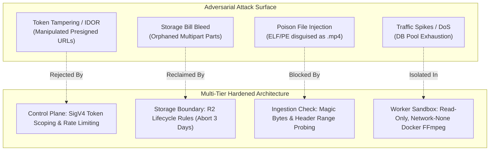
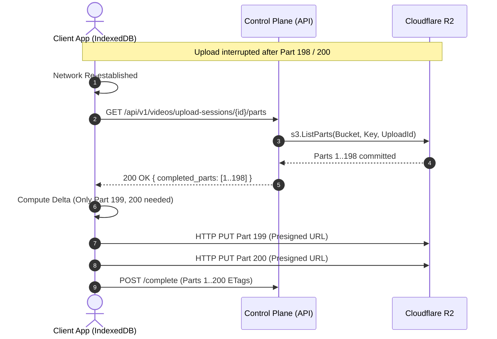
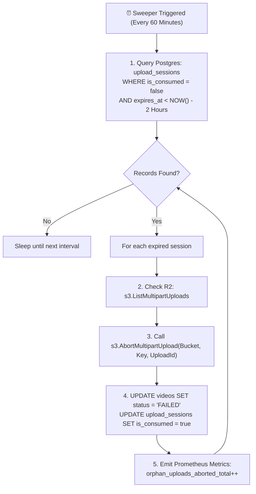
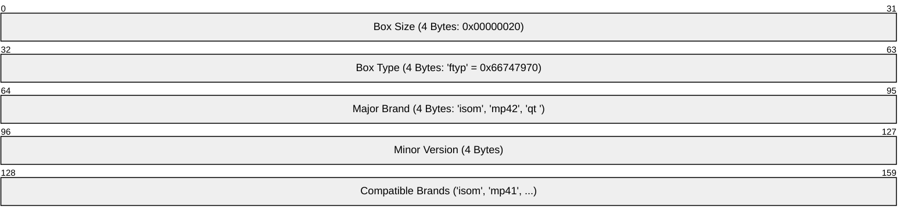
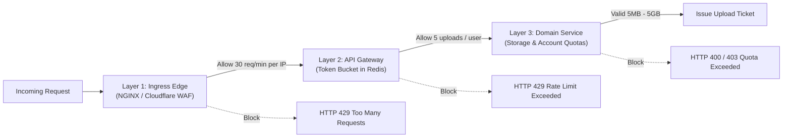
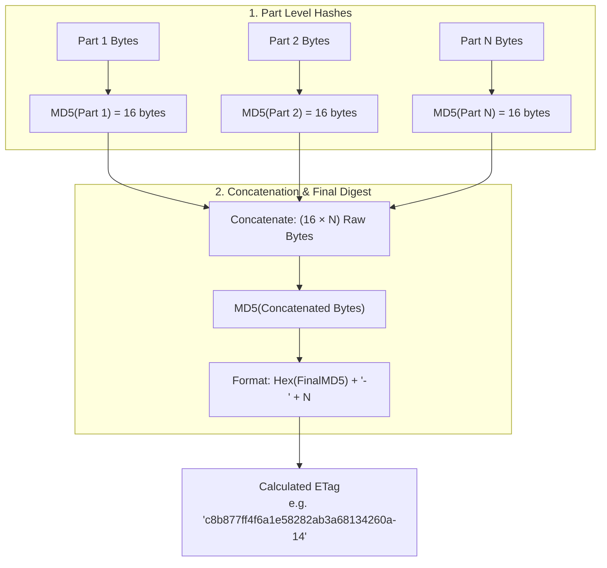
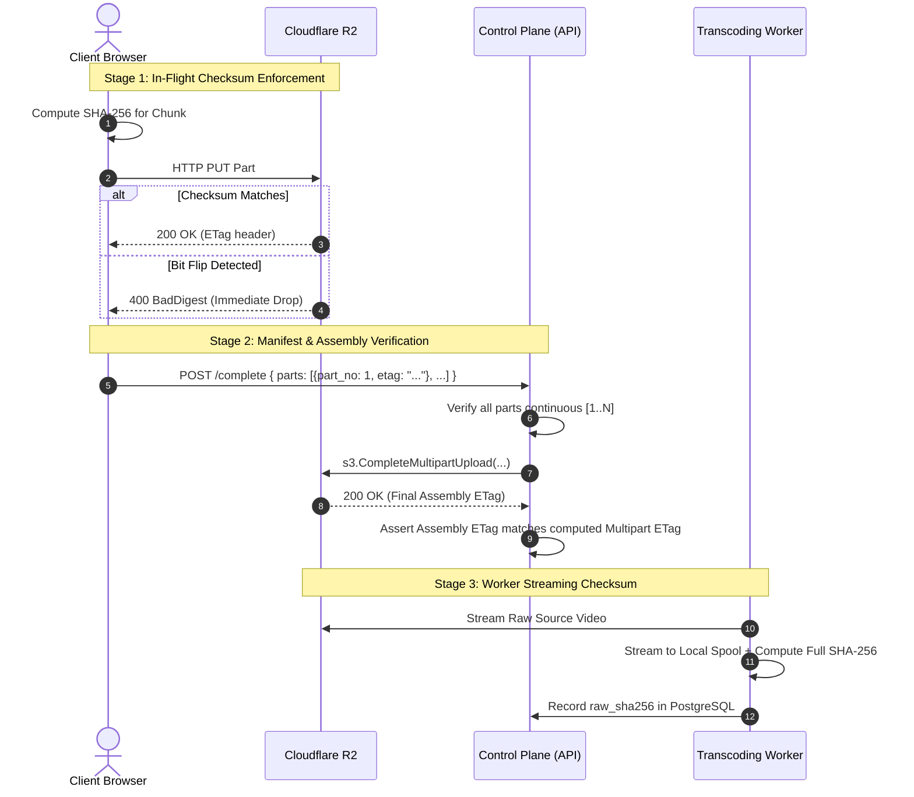
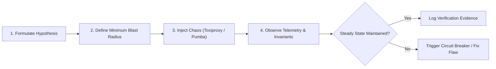

# 🛡️ RFC-003: Adversarial FMEA, Security Hardening & Chaos Engineering Specification

- **Status**: Draft / Proposed
- **Author**: Staff SecOps & Quality Assurance (Chaos Engineering) Specialist
- **Date**: 2026-10-27
- **Target System**: Bitmill Resumable Video Upload & Transcoding Subsystem
- **Scope**: Cloudflare R2 Object Storage, PostgreSQL (RMDS), RabbitMQ Broker, Dockerized Transcoding Worker Pool

---

## 1. Executive Summary & Threat Model

The Bitmill Resumable Video Upload Service ingests large user-generated video assets (50MB to 5GB) directly into Cloudflare R2 via S3-compatible Multipart Upload, orchestrating asynchronous multi-bitrate Adaptive Bitrate (ABR) HLS transcoding through RabbitMQ and isolated Docker FFmpeg workers.

Because the Control Plane deliberately offloads data plane payload transit to direct client-to-storage channels, the service is exposed to a distinct set of adversarial attack vectors, state desynchronization risks, and cost exploitation hazards:
1. **Financial Denial of Service (Storage Bleed)**: Abandoned or aborted multipart uploads leaving orphaned chunks accumulating indefinitely in Cloudflare R2, generating unmonitored storage costs.
2. **Poison File & Host Compromise**: Malicious payloads (executables, shell scripts, decompression bombs, or polyglots) masquerading as valid MP4 media to exploit native vulnerabilities in underlying decoding libraries (`libavcodec`, `libavformat`).
3. **Data Integrity Degradation**: Undetected chunk bit flips, middlebox tampering, or missing parts leading to broken transport streams (`.ts`) or unplayable master playlists.
4. **State Machine Desynchronization**: Race conditions between client completion calls, Cloudflare webhook delivery, presigned URL expiration, and worker node crashes mid-transcode.



This specification provides the formal Failure Modes and Effects Analysis (FMEA), automated storage lifecycle rules, defense-in-depth security hardening, data integrity verification mathematics, and executable Chaos Engineering test suites.

---

## 2. Failure Modes & Effects Analysis (FMEA) Risk Matrix

### 2.1. FMEA Scoring Methodology
The Risk Priority Number (RPN) is calculated as:
$$\text{RPN} = \text{Severity (S)} \times \text{Occurrence (O)} \times \text{Detection (D)}$$

* **Severity (S)**: 1 (Negligible impact) to 10 (Catastrophic: host compromise, uncontained financial loss, silent data corruption).
* **Occurrence (O)**: 1 (Extremely unlikely, < 0.01%) to 10 (Inevitable daily occurrence under load, > 5%).
* **Detection (D)**: 1 (Automated real-time detection & isolation) to 10 (Completely undetectable / silent until user complaint).
* **Action Threshold**: Any failure mode with **RPN $\ge$ 100** or **Severity $\ge$ 8** mandates mandatory automated mitigations.

### 2.2. Master FMEA Risk Table

| ID | Failure Mode | Root Cause | S | O | D | Initial RPN | Automated Recovery & Hardening Mitigation | Revised S | Revised O | Revised D | Final RPN |
| :--- | :--- | :--- | :---: | :---: | :---: | :---: | :--- | :---: | :---: | :---: | :---: |
| **FM-01** | **Client Network Drop at 99%** | Cellular/Wi-Fi interruption during last chunk of multi-gigabyte upload. | 6 | 8 | 3 | **144** | Client-side chunk state saved in IndexedDB; resume via `ListParts` query; re-upload missing chunk only. | 3 | 3 | 2 | **18** |
| **FM-02** | **R2 Transient 503 / SlowDown** | Cloudflare R2 regional rate limiting or transient storage node congestion. | 5 | 6 | 2 | **60** | AWS SDK Full Jitter Exponential Backoff (`base: 200ms`, `max: 10s`, `retries: 5`). Part concurrency capped at 4. | 2 | 2 | 1 | **4** |
| **FM-03** | **ETag / Chunk Mismatch** | Network packet bit flip or middlebox proxy payload truncation. | 8 | 4 | 4 | **128** | Mandatory `Content-MD5` header per part; R2 returns HTTP 400 BadDigest; client retries single corrupted chunk. | 3 | 1 | 1 | **3** |
| **FM-04** | **Presigned URL Expiry Mid-Upload** | Client on high-latency connection uploading 5GB exceeds 15-minute URL TTL. | 7 | 7 | 2 | **98** | Two-tier session tokens: 24h upload session in DB; client autonomously refreshes part presigned URLs via `/refresh-parts`. | 2 | 2 | 2 | **8** |
| **FM-05** | **Postgres Pool Exhaustion** | Ingress traffic spike or leaked DB connections blocking status transitions. | 9 | 4 | 3 | **108** | Bound `pgxpool` (`max_conns: 50`); bounded `context.WithTimeout(3s)`; query circuit breaker; Prometheus pool alerts. | 4 | 1 | 2 | **8** |
| **FM-06** | **Worker OOM / Transcoding Crash** | Corrupted frame or extreme memory surge during 1080p ABR encoding. | 8 | 5 | 2 | **80** | Docker cgroups limit (`--memory=2g`); RabbitMQ ACK deferred until completion; DLX routing after 3 delivery attempts. | 4 | 2 | 2 | **16** |
| **FM-07** | **Double Completion Race** | Concurrent client `/complete` and R2 Webhook event trigger simultaneous jobs. | 7 | 6 | 3 | **126** | PostgreSQL atomic conditional update: `UPDATE videos SET status='UPLOADED' WHERE id=$1 AND status='PENDING_UPLOAD'`. | 2 | 1 | 1 | **2** |
| **FM-08** | **Poison File / Disguised Binary** | Attacker renames malicious Linux ELF or Bash script to `malicious.mp4`. | 10 | 4 | 3 | **120** | Magic Bytes validation (`ftyp` atom check at byte 4-8); FFprobe codec whitelist in unprivileged Docker sandbox. | 2 | 1 | 1 | **2** |
| **FM-09** | **Orphaned Multipart Storage Bleed** | Clients abandon uploads after uploading partial chunks (e.g. 4GB of 5GB). | 8 | 9 | 6 | **432** | R2 Bucket Lifecycle Policy: `AbortIncompleteMultipartUpload` (3 days); Go background sweeper daemon auditing DB. | 3 | 2 | 1 | **6** |
| **FM-10** | **Token Tampering / IDOR** | Attacker tampers with object key or video ID in presigned URL request. | 9 | 3 | 2 | **54** | HMAC-SHA256 SigV4 signing; strict path binding `raw/{tenant_id}/{user_id}/{video_id}.mp4`; JWT ownership check. | 2 | 1 | 1 | **2** |

---

### 2.3. Deep-Dive Analysis on Critical Failure Modes

#### FM-01: Client Network Interruption at 99%
* **Symptom**: User uploads 198 out of 200 parts (each 10MB) of a 2GB video. Network connection drops. The HTTP connection terminates abnormally.
* **Failure Cascade**: If the client lacks resumable persistence, the user restarts the upload from part 1, re-transmitting 1.98GB of data, wasting client bandwidth, consuming upload concurrency quotas, and creating abandoned storage fragments.
* **Autonomous Recovery Mechanism**:
  1. Client persists upload session state (`upload_id`, `video_id`, `parts_map`) in browser `IndexedDB`.
  2. Upon network recovery, client invokes `GET /api/v1/videos/upload-sessions/{id}/parts`.
  3. Control Plane queries R2 via `s3.ListParts` and returns list of already committed `PartNumber`s and `ETag`s.
  4. Client skips all committed parts (1 to 198) and uploads only remaining parts (199 and 200).



#### FM-05: Database Connection Pool Starvation
* **Symptom**: Bursts of incoming upload requests or slow external network calls hold database connections open. Incoming requests receive `ERROR: remaining connection slots are reserved for non-replication superuser connections` or `context deadline exceeded`.
* **Failure Cascade**: Upload ticket generation fails with HTTP 500. R2 webhook confirmations cannot persist video transitions, stalling the entire transcoding pipeline.
* **Autonomous Recovery Mechanism**:
  1. **Strict Connection Caps**: Configure `pgxpool.Config`:
     - `MaxConns = 50`
     - `MinConns = 10`
     - `MaxConnIdleTime = 5m`
     - `MaxConnLifetime = 30m`
  2. **Bounded Request Contexts**: Enforce strict query timeouts:
     ```go
     ctx, cancel := context.WithTimeout(r.Context(), 3*time.Second)
     defer cancel()
     ```
  3. **Control Plane Circuit Breaker**: If DB acquisition latency exceeds 500ms or pool saturation reaches 90%, the API immediately returns HTTP 429 / 503 with a `Retry-After: 5` header, protecting existing connections from cascading failure.

#### FM-06: Transcoding Worker OOM & Container Crash
* **Symptom**: Worker ingests high-resolution (4K 60fps) or maliciously crafted media. FFmpeg memory consumption explodes past physical memory, triggering Linux kernel Out-Of-Memory (OOM) killer (`SIGKILL`).
* **Failure Cascade**: Worker dies abruptly without acknowledging the AMQP message. If message is re-delivered immediately to the same node or peer without safety counters, an infinite poison crash loop ensues.
* **Autonomous Recovery Mechanism**:
  1. **Cgroups Resource Clamping**: Worker processes FFmpeg exclusively inside Docker containers clamped with `--memory=2g --memory-swap=2g --cpus=2.0`.
  2. **Deferred AMQP ACK**: The worker does not ACK the message until the ABR packaging and R2 upload are verified.
  3. **DLQ Quorum Dead-Lettering**: RabbitMQ queue configured with `x-delivery-limit: 3`. Upon the 3rd failed redelivery, the broker automatically routes the message to `video.transcoding.dlq`.
  4. **State Machine Safeguard**: PostgreSQL updates job attempt count. On attempt 3, state is marked `FAILED` with `error_message = 'Fatal worker crash or OOM during transcoding'`.

---

## 3. Storage Cost Protection & Orphan Cleanup

### 3.1. The Orphaned Multipart Upload Dilemma
When a multipart upload is initiated via `CreateMultipartUpload`, Cloudflare R2 allocates an `UploadId`. Each uploaded chunk (`UploadPart`) is written to physical storage.

> [!CAUTION]
> **Cloudflare R2 & AWS S3 Billing Trap**: Incomplete multipart parts do **NOT** appear in standard `ListObjectsV2` calls and do **NOT** show up as accessible video files. However, Cloudflare R2 retains every partial byte uploaded and **charges standard storage fees** until the upload is either committed via `CompleteMultipartUpload` or terminated via `AbortMultipartUpload`!
> An attacker or buggy client uploading 4.9GB of a 5GB file 10,000 times and abandoning it creates **49 Terabytes** of unreferenced, billable storage leakage.

### 3.2. Cloudflare R2 Lifecycle Policy Configuration
To permanently prevent storage leakage, Cloudflare R2 buckets must have an automated lifecycle rule that purges any multipart upload that remains uncommitted after **3 days** (72 hours).

#### Declarative S3 Lifecycle Configuration (`lifecycle.xml`)
```xml
<LifecycleConfiguration>
  <Rule>
    <ID>AbortIncompleteMultipartUploadsAfter3Days</ID>
    <Status>Enabled</Status>
    <Filter>
      <Prefix></Prefix>
    </Filter>
    <AbortIncompleteMultipartUpload>
      <DaysAfterInitiation>3</DaysAfterInitiation>
    </AbortIncompleteMultipartUpload>
  </Rule>
  <Rule>
    <ID>ExpireRawVideoAfter30Days</ID>
    <Status>Enabled</Status>
    <Filter>
      <Prefix>raw/</Prefix>
    </Filter>
    <Expiration>
      <Days>30</Days>
    </Expiration>
  </Rule>
</LifecycleConfiguration>
```

#### Terraform / OpenTofu Infrastructure as Code (`r2_lifecycle.tf`)
```hcl
resource "aws_s3_bucket_lifecycle_configuration" "r2_raw_bucket_lifecycle" {
  bucket = "bitmill-raw-videos"

  # Rule 1: Automatically abort uncompleted multipart uploads after 3 days
  rule {
    id     = "abort-incomplete-multipart-uploads-3d"
    status = "Enabled"

    abort_incomplete_multipart_upload {
      days_after_initiation = 3
    }
  }

  # Rule 2: Expire raw source MP4 files 30 days after transcoding to reclaim space
  rule {
    id     = "purge-raw-source-30d"
    status = "Enabled"

    filter {
      prefix = "raw/"
    }

    expiration {
      days = 30
    }
  }
}
```

### 3.3. Autonomous Application Sweeper Daemon

While R2 lifecycle policies enforce cloud-level safety, they execute on asynchronous batch intervals (typically once every 24 hours). The Bitmill application layer requires a **fast-reconciling sweeper daemon** to keep database states synchronized and abort abandoned uploads within hours.



#### Autonomous Sweeper Implementation (Go Component)
```go
package sweeper

import (
	"context"
	"time"

	"github.com/aws/aws-sdk-go-v2/aws"
	"github.com/aws/aws-sdk-go-v2/service/s3"
	"github.com/prometheus/client_golang/prometheus"
	"github.com/prometheus/client_golang/prometheus/promauto"
	"go.uber.org/zap"
)

var (
	orphansAbortedCounter = promauto.NewCounter(prometheus.CounterOpts{
		Name: "bitmill_orphan_uploads_aborted_total",
		Help: "Total count of abandoned multipart uploads successfully aborted in R2",
	})
	orphanBytesReclaimed = promauto.NewCounter(prometheus.CounterOpts{
		Name: "bitmill_orphan_bytes_reclaimed_total",
		Help: "Estimated bytes reclaimed from aborted multipart uploads",
	})
)

type Sweeper struct {
	s3Client *s3.Client
	db       DatabaseClient
	logger   *zap.Logger
	bucket   string
}

func NewSweeper(s3Client *s3.Client, db DatabaseClient, logger *zap.Logger, bucket string) *Sweeper {
	return &Sweeper{
		s3Client: s3Client,
		db:       db,
		logger:   logger,
		bucket:   bucket,
	}
}

// RunSweepCycle reconciles abandoned uploads in DB and terminates them in R2.
func (s *Sweeper) RunSweepCycle(ctx context.Context, abandonedThreshold time.Duration) error {
	cutoff := time.Now().UTC().Add(-abandonedThreshold)
	sessions, err := s.db.GetAbandonedUploadSessions(ctx, cutoff)
	if err != nil {
		s.logger.Error("Failed to query abandoned upload sessions", zap.Error(err))
		return err
	}

	for _, session := range sessions {
		// 1. Terminate storage-layer multipart upload
		_, err := s.s3Client.AbortMultipartUpload(ctx, &s3.AbortMultipartUploadInput{
			Bucket:   aws.String(s.bucket),
			Key:      aws.String(session.RawObjectKey),
			UploadId: aws.String(session.UploadID),
		})
		if err != nil {
			s.logger.Warn("Failed to abort multipart upload in R2 (may have already expired)",
				zap.String("video_id", session.VideoID.String()),
				zap.String("upload_id", session.UploadID),
				zap.Error(err),
			)
		} else {
			orphansAbortedCounter.Inc()
			orphanBytesReclaimed.Add(float64(session.ExpectedSizeBytes))
		}

		// 2. Mark database record as FAILED to prevent zombie status in UI
		err = s.db.MarkUploadAsAbandoned(ctx, session.VideoID, session.ID, "Upload window expired without completion")
		if err != nil {
			s.logger.Error("Failed to update abandoned state in database",
				zap.String("video_id", session.VideoID.String()),
				zap.Error(err),
			)
		}
	}
	return nil
}
```

---

## 4. Security Hardening & Poison File Prevention

### 4.1. Attack Surface Analysis
In direct S3 ingestion, binary payload bytes never touch the Control Plane. An attacker can easily exploit this architecture:
1. **Extension & Content-Type Spoofing**: An attacker creates an executable (`reverse_shell.elf`), renames it to `innocent.mp4`, and supplies `Content-Type: video/mp4` in the HTTP request.
2. **Polyglot Exploit**: Constructing a valid MP4 header (`ftyp`) prepended to a malicious PHP or Bash script.
3. **Decompression Bomb (Zip Bomb for Video)**: A video with ultra-high dimensions (65536x65536) and extreme GOP lengths engineered to exhaust worker RAM during decoding.
4. **HLS/FFmpeg SSRF (CVE-2016-1897)**: Crafting an internal playlist or video container referencing `file:///etc/passwd` or `http://169.254.169.254/latest/meta-data/`.

### 4.2. Magic Bytes Validation vs. MIME Sniffing
HTTP `Content-Type` headers provided by clients are unverified claims. Verification must be performed using **Magic Bytes (File Signatures)** directly from the file header.

#### The ISO Base Media File Format (ISOBMFF / MP4) Signature
An authentic MP4 / QuickTime file complies with ISO/IEC 14496-12:
* **Byte 0–3**: Size of the `ftyp` box (4-byte unsigned big-endian integer, typically `0x00 0x00 0x00 0x18` or `0x00 0x00 0x00 0x20`).
* **Byte 4–7**: Box Type identifier: MUST match ASCII `ftyp` (`0x66 0x74 0x79 0x70`).
* **Byte 8–11**: Major Brand: MUST match a recognized container brand:
  - `isom` (MP4 Base Media v1)
  - `iso2` (MP4 Base Media v2)
  - `mp41` (MP4 v1)
  - `mp42` (MP4 v2)
  - `avc1` (H.264 bitstream)
  - `qt  ` (Apple QuickTime)
  - `M4V ` (Apple iTunes video)



#### Magic Byte Inspector Implementation
The Transcoding Worker reads the first **512 bytes** of the object via an HTTP Range request (`bytes=0-511`) prior to invoking FFmpeg:

```go
package security

import (
	"bytes"
	"encoding/binary"
	"errors"
	"fmt"
)

var (
	ErrInvalidBoxHeader = errors.New("malformed container header: missing ftyp atom")
	ErrDisguisedBinary  = errors.New("poison file detected: payload contains executable signatures")
	ErrUnsupportedBrand = errors.New("unsupported media brand")
)

var allowedBrands = map[string]bool{
	"isom": true, "iso2": true, "mp41": true, "mp42": true,
	"avc1": true, "qt  ": true, "M4V ": true, "dash": true,
}

// ValidateMediaSignature inspects the first 512 bytes of a candidate video file.
func ValidateMediaSignature(header []byte) error {
	if len(header) < 12 {
		return errors.New("header payload too short")
	}

	// 1. Immediate rejection of known malicious binary signatures
	if bytes.HasPrefix(header, []byte("MZ")) { // Windows PE Executable
		return fmt.Errorf("%w: Windows PE executable signature detected", ErrDisguisedBinary)
	}
	if bytes.HasPrefix(header, []byte("\x7fELF")) { // Linux ELF Executable
		return fmt.Errorf("%w: Linux ELF binary signature detected", ErrDisguisedBinary)
	}
	if bytes.HasPrefix(header, []byte("PK\x03\x04")) { // ZIP / JAR archive
		return fmt.Errorf("%w: Archive archive signature detected", ErrDisguisedBinary)
	}
	if bytes.HasPrefix(header, []byte("#!/bin/")) || bytes.HasPrefix(header, []byte("#!/usr/bin/")) {
		return fmt.Errorf("%w: Shell script signature detected", ErrDisguisedBinary)
	}

	// 2. Validate ISOBMFF 'ftyp' box
	boxSize := binary.BigEndian.Uint32(header[0:4])
	boxType := string(header[4:8])

	if boxType != "ftyp" {
		return fmt.Errorf("%w: expected 'ftyp', found '%s'", ErrInvalidBoxHeader, boxType)
	}
	if boxSize < 12 || int(boxSize) > len(header) {
		return fmt.Errorf("%w: invalid box size %d", ErrInvalidBoxHeader, boxSize)
	}

	// 3. Validate Major Brand
	majorBrand := string(header[8:12])
	if allowedBrands[majorBrand] {
		return nil
	}

	// 4. Scan Compatible Brands in remaining ftyp box bytes
	for i := 16; i+4 <= int(boxSize); i += 4 {
		brand := string(header[i : i+4])
		if allowedBrands[brand] {
			return nil
		}
	}

	return fmt.Errorf("%w: brand '%s' not recognized as safe media", ErrUnsupportedBrand, majorBrand)
}
```

---

### 4.3. Docker Container Sandboxing & FFprobe Hardening
FFmpeg contains millions of lines of C code and has historically suffered from format parser vulnerabilities. All video operations MUST execute inside a **hardened, hermetic sandbox**.

#### Hardened Container Security Profile
1. **Zero Host FFmpeg**: Host machine MUST NEVER install FFmpeg. Execution is strictly via Docker container (`mwader/static-ffmpeg:latest`).
2. **Network Isolation**: `--network none` prohibits outbound egress, preventing SSRF, reverse shells, and external metadata exfiltration.
3. **Read-Only Root Filesystem**: `--read-only` prevents any script from dropping binaries or modifying root paths.
4. **Dropped Kernel Capabilities**: `--cap-drop=ALL` strips all Linux capabilities (no raw sockets, no root privileges).
5. **Security Options**: `--security-opt no-new-privileges:true` prevents privilege escalation.
6. **Resource Ceilings**: Hard limits on memory (`--memory=2g`), swap (`--memory-swap=2g`), CPU shares (`--cpus=2.0`), and processes (`--pids-limit=100`).

#### Two-Stage Transcoding Execution Command
```bash
# STAGE 1: Fast Probe (15-second strict timeout)
docker run --rm \
  --network none \
  --read-only \
  --cap-drop ALL \
  --security-opt no-new-privileges:true \
  --memory 512m \
  --cpus 1.0 \
  --pids-limit 50 \
  -v /var/run/bitmill/staging/{video_id}:/media:ro \
  mwader/static-ffmpeg:latest \
  ffprobe \
    -v error \
    -select_streams v:0 \
    -show_entries stream=codec_name,width,height,duration,r_frame_rate,pix_fmt \
    -show_entries format=format_name,size,bit_rate \
    -of json \
    /media/source.mp4

# STAGE 2: Multi-Bitrate ABR Packaging (Bounded cgroups)
docker run --rm \
  --network none \
  --read-only \
  --cap-drop ALL \
  --security-opt no-new-privileges:true \
  --memory 2048m \
  --memory-swap 2048m \
  --cpus 2.0 \
  --pids-limit 100 \
  -v /var/run/bitmill/staging/{video_id}:/input:ro \
  -v /var/run/bitmill/output/{video_id}:/output:rw \
  mwader/static-ffmpeg:latest \
  ffmpeg -y -v error \
    -i /input/source.mp4 \
    -filter_complex \
      "[0:v]split=3[v1,v2,v3]; \
       [v1]scale=w=1920:h=1080:force_original_aspect_ratio=decrease[v1out]; \
       [v2]scale=w=1280:h=720:force_original_aspect_ratio=decrease[v2out]; \
       [v3]scale=w=854:h=480:force_original_aspect_ratio=decrease[v3out]" \
    -map "[v1out]" -c:v:0 libx264 -b:v:0 4500k -maxrate:v:0 4800k -bufsize:v:0 9000k \
    -map "[v2out]" -c:v:1 libx264 -b:v:1 2500k -maxrate:v:1 2700k -bufsize:v:1 5000k \
    -map "[v3out]" -c:v:2 libx264 -b:v:2 1200k -maxrate:v:2 1300k -bufsize:v:2 2400k \
    -map 0:a? -c:a aac -b:a 128k \
    -f hls \
    -hls_time 4 \
    -hls_playlist_type vod \
    -hls_flags independent_segments \
    -hls_segment_type mpegts \
    -master_pl_name master.m3u8 \
    -var_stream_map "v:0,a:0 v:1,a:0 v:2,a:0" \
    /output/%v/stream.m3u8
```

---

### 4.4. Presigned URL Security & Tamper Prevention

Presigned URLs delegate direct storage access to clients. Without rigorous scoping, they present high-risk vectors for unauthorized data replacement or unauthorized storage consumption.

#### Cryptographic Safeguards
1. **AWS Signature Version 4 (SigV4)**:
   Every presigned URL generates an HMAC-SHA256 signature binding the HTTP method (`PUT`), host, object key, expiration timestamp, and signed headers:
   $$\text{Signature} = \text{HMAC-SHA256}(K_{\text{Signing}}, \text{StringToSign})$$
   Any modification of query parameters (e.g. attempting to extend `X-Amz-Expires` or alter the target bucket/key) produces a cryptographic signature mismatch and is rejected with HTTP 403 Forbidden by Cloudflare R2.
2. **Immutable Key Scoping**:
   Keys MUST NOT be client-defined. They are deterministically generated by the backend:
   $$\text{Key} = \text{raw}/\{\text{tenant\_id}\}/\{\text{user\_id}\}/\{\text{video\_id}\}/\text{source.mp4}$$
   This guarantees complete multi-tenant isolation and prevents Insecure Direct Object References (IDOR).
3. **Signed Headers Enforcement**:
   The Presigned URL MUST bind `Content-Length` and `Content-Type`:
   - `SignedHeaders=content-length;content-type;host;x-amz-checksum-sha256`
   If an attacker attempts to upload a 50GB file when 500MB was declared, the storage node rejects the request immediately.
4. **Time-To-Live (TTL) Policy**:
   - Single-part upload presigned URLs: **15 minutes (900 seconds)**.
   - Multipart part presigned URLs: **30 minutes (1800 seconds)** per batch.
   - Long uploads (> 30 mins) rely on active session ticket refresh via `POST /api/v1/videos/upload-sessions/{id}/refresh-parts`.

---

### 4.5. Multi-Tier Rate Limiting & Quota Controls



| Enforcement Layer | Policy Target | Mechanism | Threshold / Rule | Failure Response |
| :--- | :--- | :--- | :--- | :--- |
| **Layer 1: Ingress Edge** | Client IP | NGINX `limit_req_zone` / Cloudflare WAF | 30 requests/minute per IP on `/upload-ticket` | HTTP 429 `Too Many Requests` |
| **Layer 2: API Gateway** | Authenticated User | Redis Sliding Window Counter | Max 5 upload tickets generated per 10 minutes | HTTP 429 `{ "error": "RATE_LIMIT_EXCEEDED" }` |
| **Layer 3: Storage Quotas** | User Account | PostgreSQL Aggregate Query | Max 3 concurrent active `PENDING_UPLOAD` sessions | HTTP 409 `{ "error": "CONCURRENT_UPLOAD_LIMIT" }` |
| **Layer 4: Ingestion Boundaries** | File Payload | Application Domain Invariant | Min size: **5 MB**, Max size: **5 GB** | HTTP 400 `{ "error": "FILE_SIZE_OUT_OF_BOUNDS" }` |
| **Layer 5: Daily Volume** | User Tier | Redis Daily Ingestion Counter | Free Tier: 20 GB / day; Pro Tier: 100 GB / day | HTTP 402 `{ "error": "DAILY_QUOTA_EXHAUSTED" }` |

---

## 5. Data Integrity & Verification

### 5.1. S3 & Cloudflare R2 ETag Mechanics
Data integrity in S3-compatible storage relies on ETags, which behave differently depending on the upload mode:

1. **Standard `PutObject` (Single Part)**:
   The ETag is the exact hex-encoded MD5 hash of the entire object:
   $$\text{ETag}_{\text{Single}} = \text{"Hex"}(\text{MD5}(\text{PayloadBytes}))$$
2. **Multipart Upload (`CompleteMultipartUpload`)**:
   The ETag is **NOT** the MD5 of the whole assembled file. Instead, it is the MD5 of the concatenated binary MD5 digests of each individual part, followed by a hyphen and the total part count:
   $$\text{ETag}_{\text{Multipart}} = \text{"Hex"}(\text{MD5}(D_1 \parallel D_2 \parallel \dots \parallel D_N)) - N$$
   where $D_i$ is the raw **16-byte binary MD5** digest of Part $i$, and $N$ is the number of parts.



### 5.2. Multipart ETag Calculation Implementation (Go)

```go
package integrity

import (
	"crypto/md5"
	"encoding/hex"
	"errors"
	"fmt"
	"io"
	"os"
)

// PartDigest represents the checksum metadata for a single uploaded chunk.
type PartDigest struct {
	PartNumber int
	HexMD5     string // 32-character hex string from part upload response ETag
}

// ComputeMultipartETag calculates the expected S3/R2 multipart ETag from part MD5s.
func ComputeMultipartETag(parts []PartDigest) (string, error) {
	if len(parts) == 0 {
		return "", errors.New("cannot compute multipart ETag for zero parts")
	}

	var concatenatedBinaryMD5s []byte

	for _, p := range parts {
		binaryDigest, err := hex.DecodeString(cleanETag(p.HexMD5))
		if err != nil {
			return "", fmt.Errorf("invalid hex ETag for part %d: %w", p.PartNumber, err)
		}
		if len(binaryDigest) != 16 {
			return "", fmt.Errorf("part %d digest length is %d, expected 16 bytes", p.PartNumber, len(binaryDigest))
		}
		concatenatedBinaryMD5s = append(concatenatedBinaryMD5s, binaryDigest...)
	}

	finalDigest := md5.Sum(concatenatedBinaryMD5s)
	calculatedETag := fmt.Sprintf("%s-%d", hex.EncodeToString(finalDigest[:]), len(parts))

	return calculatedETag, nil
}

// ComputeFileMultipartETag splits a local file into chunkSize and computes the S3 multipart ETag.
func ComputeFileMultipartETag(filePath string, chunkSize int64) (string, error) {
	file, err := os.Open(filePath)
	if err != nil {
		return "", err
	}
	defer file.Close()

	var concatenatedBinaryMD5s []byte
	partCount := 0
	buffer := make([]byte, chunkSize)

	for {
		bytesRead, err := io.ReadFull(file, buffer)
		if err != nil && err != io.EOF && err != io.ErrUnexpectedEOF {
			return "", err
		}
		if bytesRead == 0 {
			break
		}

		partMD5 := md5.Sum(buffer[:bytesRead])
		concatenatedBinaryMD5s = append(concatenatedBinaryMD5s, partMD5[:]...)
		partCount++

		if err == io.EOF || err == io.ErrUnexpectedEOF {
			break
		}
	}

	finalDigest := md5.Sum(concatenatedBinaryMD5s)
	return fmt.Sprintf("%s-%d", hex.EncodeToString(finalDigest[:]), partCount), nil
}

func cleanETag(raw string) string {
	if len(raw) >= 2 && raw[0] == '"' && raw[len(raw)-1] == '"' {
		return raw[1 : len(raw)-1]
	}
	return raw
}
```

### 5.3. End-to-End Checksum Pipeline

To achieve complete zero-trust data integrity across the entire upload lifecycle, Bitmill enforces a 4-stage checksum validation pipeline:



1. **Stage 1: Chunk Ingest Verification**:
   The client calculates a SHA-256 or MD5 digest before transmitting each chunk and supplies it via `x-amz-checksum-sha256` or `Content-MD5`. R2 recalculates the hash on write. Any corruption in transit immediately aborts the chunk upload with HTTP 400 `BadDigest`.
2. **Stage 2: Assembly Verification**:
   When invoking `CompleteMultipartUpload`, the client sends the ordered array of Part Numbers and ETags. The Control Plane verifies continuity ($1, 2, \dots, N$) and ensures that the final assembly ETag returned by R2 matches the local multipart formula.
3. **Stage 3: Worker Streaming Verification**:
   When the background worker downloads the raw file from R2, it streams bytes through a `crypto/sha256` hash writer, recording the true, authoritative full-file SHA-256 in the PostgreSQL `videos` record.
4. **Stage 4: Transcoded Artifact Signatures**:
   All transcoded HLS chunks (`.ts`) and master playlists are uploaded to Processed R2 with explicit SHA-256 metadata headers for CDN origin verification.

---

## 6. Chaos Testing Plan & Resilience Experiments

### 6.1. Chaos Engineering Principles
Following the *Principles of Chaos Engineering*, all tests are conducted against explicit hypotheses with observable steady-state metrics:
* **Steady-State Invariants**:
  - $SS_1$: Control Plane API HTTP 5xx error rate remains $< 0.1\%$.
  - $SS_2$: Video ingestion success rate for legitimate clients remains $\ge 99.9\%$.
  - $SS_3$: Total orphaned multipart storage growth is $0$ bytes after sweep window.
  - $SS_4$: Zero duplicate messages processed by transcoding workers (strict idempotency).



---

### 6.2. Chaos Experiment Specifications

#### 🧪 Experiment CHAOS-01: Network Interruption at 99% (Late-Stage Dropped Connection)
* **Hypothesis**: Injecting a TCP drop at 99% completion of a 2GB upload will cause the client to gracefully pause, reconnect via exponential backoff, query committed parts, and finish the upload without re-uploading parts 1 to 198.
* **Blast Radius**: Isolated test tenant uploading to test bucket `bitmill-chaos-raw`.
* **Chaos Tool**: `Toxiproxy` simulating network partition.
* **Execution Script**:
  ```bash
  # 1. Start Toxiproxy tunnel to MinIO/R2
  toxiproxy-cli create r2_proxy --listen 0.0.0.0:9002 --upstream minio:9000
  
  # 2. Begin uploading 2GB file (200 parts @ 10MB) through proxy
  python3 scripts/chaos_uploader.py --file 2gb_sample.mp4 --endpoint localhost:9002 &
  UPLOAD_PID=$!

  # 3. Monitor parts. When part 198 is ACKed, inject immediate TCP reset
  python3 scripts/wait_for_part.py --part 198
  toxiproxy-cli toxic add r2_proxy --type reset_peer --toxicity 1.0

  # 4. Wait 10 seconds, then remove toxic to simulate network recovery
  sleep 10
  toxiproxy-cli toxic remove r2_proxy -n reset_peer_upstream

  wait $UPLOAD_PID
  ```
* **Success Criteria**:
  - Part 1 to 198 are NOT re-transmitted (verified via network transfer logs).
  - Part 199 and 200 succeed.
  - Final video state reaches `READY` in PostgreSQL.

---

#### 🧪 Experiment CHAOS-02: Presigned URL Expiration Mid-Upload
* **Hypothesis**: If an upload takes longer than the presigned URL validity window (e.g. simulating a slow 2G connection), the client will detect HTTP 403 `RequestTimeTooSkewed` or `ExpiredToken`, request a fresh batch of presigned URLs using its session token, and complete the upload.
* **Chaos Tool**: Toxiproxy bandwidth throttling (`bandwidth` toxic: 256 kbps) combined with a short 60-second test TTL.
* **Execution Script**:
  ```bash
  # 1. Throttle proxy to 256kbps
  toxiproxy-cli toxic add r2_proxy --type bandwidth --attribute rate=32 # 32 KB/s
  
  # 2. Request upload ticket with test TTL = 60 seconds
  TICKET=$(curl -s -X POST http://localhost:8080/api/v1/videos/upload-ticket \
    -H "Authorization: Bearer $TEST_JWT" \
    -d '{"title": "Slow 3G Video", "file_size_bytes": 52428800, "mime_type": "video/mp4", "test_ttl_seconds": 60}')
  
  # 3. Client executes upload. At t=61s, R2 returns 403 Forbidden.
  # 4. Client intercepts 403, calls /refresh-parts, and continues uploading.
  ```
* **Success Criteria**:
  - Client automatically refreshes URLs without user interaction.
  - All 5 chunks uploaded successfully.
  - Zero stranded multipart fragments.

---

#### 🧪 Experiment CHAOS-03: Transcoding Worker OOM & Container Crash
* **Hypothesis**: Abruptly killing the transcoding worker container (`SIGKILL` or memory ceiling trigger) during 1080p ABR encoding will result in RabbitMQ redelivering the job to another worker. The video will successfully complete without orphaned temporary files or corrupted database state.
* **Chaos Tool**: Docker `SIGKILL` injection via script during active encoding.
* **Execution Script**:
  ```bash
  # 1. Submit valid 500MB video and complete upload
  VIDEO_ID=$(curl -s -X POST http://localhost:8080/api/v1/videos/test-complete | jq -r .video_id)
  
  # 2. Wait until worker transitions state to PROCESSING
  scripts/wait_for_status.sh $VIDEO_ID "PROCESSING"
  
  # 3. Simulate sudden OOM / Host crash by SIGKILLing the transcoding container
  CONTAINER_ID=$(docker ps --filter "ancestor=mwader/static-ffmpeg:latest" -q)
  docker kill -s SIGKILL $CONTAINER_ID
  
  # 4. Observe RabbitMQ unacked message requeue
  sleep 5
  READY_STATE=$(curl -s http://localhost:8080/api/v1/videos/$VIDEO_ID | jq -r .status)
  ```
* **Success Criteria**:
  - Unacknowledged AMQP message is requeued by RabbitMQ broker.
  - Peer worker picks up task, clears stale temporary staging directory (`/tmp/bitmill/{video_id}`), and restarts encode.
  - Attempt count in `processing_jobs` increments to 2.
  - Final video transitions to `READY`.

---

#### 🧪 Experiment CHAOS-04: Malicious Poison File & Decompression Bomb
* **Hypothesis**: Uploading an ELF binary disguised as `exploit.mp4` and a high-compression video bomb will be intercepted and quarantined before worker host exploitation or resource starvation occurs.
* **Test Payloads**:
  1. `payload_elf.mp4`: Linux ELF binary prepended with `.mp4` extension.
  2. `payload_bomb.mp4`: Handcrafted MP4 with declared dimension $65536 \times 65536$.
* **Execution Script**:
  ```bash
  # Case A: Disguised ELF Binary
  curl -X PUT "$PRESIGNED_URL_A" --upload-file /usr/bin/touch
  curl -X POST http://localhost:8080/api/v1/videos/$VIDEO_ID_A/complete
  
  # Case B: Extreme Dimension Bomb
  curl -X PUT "$PRESIGNED_URL_B" --upload-file testdata/decompression_bomb.mp4
  curl -X POST http://localhost:8080/api/v1/videos/$VIDEO_ID_B/complete
  ```
* **Success Criteria**:
  - `payload_elf.mp4`: Rejected at worker pre-probe via Magic Bytes check (`ftyp` missing). Container never launches FFmpeg. Video marked `FAILED` with `REASON_POISON_FILE`.
  - `payload_bomb.mp4`: Caught during stage 1 FFprobe sandbox validation (exceeds $4096 \times 2160$ maximum resolution threshold). Worker immediately rejects task and sends message to DLQ.
  - Worker node memory and CPU remain within steady-state baselines.

---

#### 🧪 Experiment CHAOS-05: Database Connection Pool Exhaustion under Stress
* **Hypothesis**: Saturating the PostgreSQL connection pool with 500 concurrent upload ticket requests will trigger graceful backpressure (HTTP 429 / 503) without crashing the Go server or leaking database connection handles.
* **Chaos Tool**: `k6` distributed load testing tool.
* **Execution Script**:
  ```javascript
  // k6_pool_exhaustion.js
  import http from 'k6/http';
  import { check } from 'k6';

  export let options = {
    vus: 200,
    duration: '30s',
  };

  export default function () {
    let res = http.post('http://localhost:8080/api/v1/videos/upload-ticket', JSON.stringify({
      title: "Load Test Video",
      file_size_bytes: 104857600,
      mime_type: "video/mp4"
    }), {
      headers: { 'Content-Type': 'application/json', 'Authorization': 'Bearer ' + __ENV.TEST_JWT }
    });

    check(res, {
      'status is 201 or 429/503': (r) => r.status === 201 || r.status === 429 || r.status === 503,
      'no fatal 500 crashes': (r) => r.status !== 500,
    });
  }
  ```
* **Success Criteria**:
  - Zero fatal server crashes or goroutine leaks.
  - Connection pool recovers to baseline idle count immediately after the load test stops.

---

#### 🧪 Experiment CHAOS-06: Concurrent Completion Race Condition (Double Enqueue)
* **Hypothesis**: Emitting simultaneous `/complete` HTTP requests while the Cloudflare R2 Webhook arrives concurrently will result in exactly ONE transcoding job enqueued in RabbitMQ.
* **Execution Script**:
  ```bash
  # Fire 3 concurrent completion calls simultaneously
  curl -X POST http://localhost:8080/api/v1/videos/$VIDEO_ID/complete &
  curl -X POST http://localhost:8080/api/v1/videos/$VIDEO_ID/complete &
  curl -X POST http://localhost:8080/api/v1/internal/storage/webhook \
    -H "X-R2-Signature: $VALID_SIG" \
    -d "{\"object_key\": \"raw/tenant/$VIDEO_ID/source.mp4\"}" &
  wait
  ```
* **Success Criteria**:
  - PostgreSQL record for `videos.status` transitions from `PENDING_UPLOAD` to `UPLOADED` exactly once.
  - RabbitMQ queue `video.transcoding.jobs` receives exactly **1 message**.
  - All 3 API calls return HTTP 200/202 without returning HTTP 500 errors.

---

## 7. SecOps Verification Checklist & Production Readiness

Before promoting the Resumable Video Upload Subsystem to staging or production, SecOps and QA must verify and sign off on all items below:

```
[SecOps & Chaos Verification Checklist]
├── 1. Storage & Cost Protection (R2)
│   ├── [ ] Cloudflare R2 bucket lifecycle rule active: AbortIncompleteMultipartUpload <= 3 days.
│   ├── [ ] Raw source retention rule active: Purge raw/{id}.mp4 after 30 days.
│   ├── [ ] Background sweeper daemon enabled and verified via Prometheus metrics.
│   └── [ ] Public bucket access disabled on bitmill-raw-videos (100% private).
├── 2. Ingress & Authentication Hardening
│   ├── [ ] Presigned PUT URLs enforce SigV4 HMAC-SHA256 with exact Content-Length & Content-Type binding.
│   ├── [ ] Object keys cryptographically isolated: raw/{tenant_id}/{user_id}/{video_id}/source.mp4.
│   ├── [ ] Rate limiting enabled: IP level (30 req/min) & User level (5 tickets/10 min).
│   └── [ ] Upload session ticket TTL capped at 15 minutes per part batch.
├── 3. Data Integrity & Verification
│   ├── [ ] Mandatory Content-MD5 / SHA-256 validation enforced on every uploaded part.
│   ├── [ ] Multipart ETag verification mathematically validated in Go against R2 assembly ETag.
│   └── [ ] Worker streams raw video through SHA-256 hasher to record authoritative checksum in RMDS.
├── 4. Worker Sandboxing & Media Hardening
│   ├── [ ] Host machine does NOT have FFmpeg installed (verified via `which ffmpeg` exit code 1).
│   ├── [ ] Docker FFmpeg execution clamped: --network none, --read-only, --cap-drop ALL.
│   ├── [ ] Magic Bytes pre-probe validates ftyp atom before launching FFmpeg.
│   ├── [ ] FFprobe codec whitelist rejects unapproved audio/video codecs.
│   └── [ ] Transcoding execution timeout strictly bounded (context.WithTimeout: 30 minutes).
├── 5. Resilience & Chaos Validation
│   ├── [ ] RabbitMQ Dead Letter Exchange (DLX) and Queue (DLQ) configured with x-delivery-limit: 3.
│   ├── [ ] Double completion race condition validated under concurrent load.
│   ├── [ ] Client network drop at 99% verified to resume via ListParts delta.
│   └── [ ] All 6 Chaos Engineering scenarios passed in staging environment.
```

---

## 8. Summary & Recommendation

The Bitmill Resumable Video Upload architecture successfully decouples control plane metadata from high-throughput binary storage. Implementing the recommendations in this specification mitigates the primary threats:

1. **Storage Leakage**: Neutralized by dual-layer protection (Cloudflare R2 3-day lifecycle rule + 60-minute Go sweeper daemon).
2. **Poison File Attacks**: Neutralized by Magic Byte inspection and isolated, unprivileged, network-less Docker containers.
3. **Data Integrity Hazards**: Guaranteed via continuous per-part MD5/SHA-256 verification and multipart ETag assembly math.
4. **Resilience under Failure**: Validated by 6 concrete Chaos Engineering experiments with automated recovery mechanisms.
