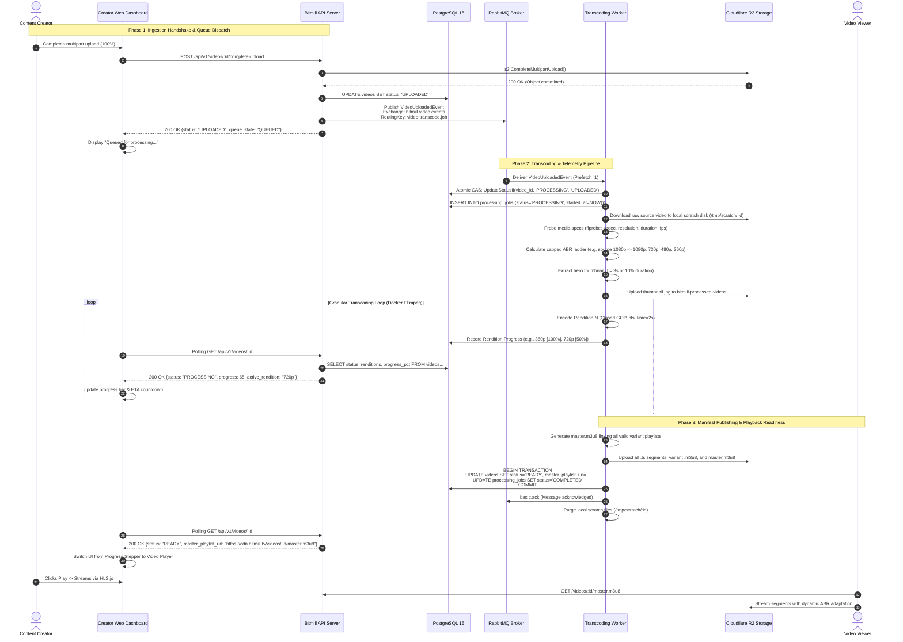

# 📑 Product Discovery & UX Specification: Asynchronous Video Transcoding Worker & RabbitMQ Orchestration

**Document ID**: `RFC-DISCOVERY-002`  
**Subsystem**: Background Media Processing, ABR Transcoding Engine & Message Queue Orchestration  
**Status**: DRAFT (Review Ready)  
**Author**: Business Analyst & Media Streaming Product UX Specialist  
**Target Architecture**: RabbitMQ AMQP 0-9-1 + Docker FFmpeg Media Engine + Cloudflare R2 + PostgreSQL 15  
**Target Codebase**: Bitmill Platform (`go-streaming`)  

---

## 1. Executive Summary & Problem Space

### 1.1. The Synchronous Transcoding Trap
In early video platform architectures, video transcoding is frequently implemented synchronously within the HTTP request lifecycle: the client uploads a video, and the web server invokes an FFmpeg subprocess before returning an HTTP response. While trivial to prototype, synchronous video encoding is a catastrophic anti-pattern for production video-on-demand (VOD) services:

```
┌──────────────────────────────────────────────────────────────────────────────────────────────────┐
│                         SYNCHRONOUS TRANSCODING FAILURE CHARACTERISTICS                         │
├────────────────────────────┬─────────────────────────────┬───────────────────────────────────────┤
│ Failure Mode               │ Technical Mechanism         │ Real-World Creator / Platform Impact  │
├────────────────────────────┼─────────────────────────────┼───────────────────────────────────────┤
│ 1. HTTP Socket Timeouts    │ Gateway/CDN limits (e.g.,   │ Creator upload fails at 99% after 100 │
│                            │ Cloudflare 100s HTTP timeout│ seconds; entire encode wasted.        │
├────────────────────────────┼─────────────────────────────┼───────────────────────────────────────┤
│ 2. Server Resource Blasts  │ CPU hits 100% across all    │ API server stops serving metadata,    │
│                            │ cores during libx264 encode │ auth, and uploads to other users.     │
├────────────────────────────┼─────────────────────────────┼───────────────────────────────────────┤
│ 3. Cascade OOM Crashes     │ Concurrently transcoding 3  │ Web daemon killed by OS kernel OOM    │
│                            │ high-bitrate 1080p files    │ killer; drops all active HTTP conns.  │
├────────────────────────────┼─────────────────────────────┼───────────────────────────────────────┤
│ 4. Zero Fault Recovery     │ Network flicker or process  │ Job lost permanently; creator must    │
│                            │ restart kills transcoding   │ re-upload the entire multi-GB asset.  │
└────────────────────────────┴─────────────────────────────┴───────────────────────────────────────┘
```

### 1.2. Asynchronous Decoupling via Message Queue
Milestone 4 transitions Bitmill into an enterprise-grade, event-driven streaming platform. By decoupling media ingestion from CPU-intensive media processing using **RabbitMQ (AMQP 0-9-1)** and **isolated Docker FFmpeg workers**, we achieve:

1. **Sub-Second API Latency**: When a creator completes an upload (`POST /complete-upload`), the API immediately responds with `200 OK` and status `UPLOADED`/`QUEUED` in under **50ms**, releasing client connections.
2. **Elastic Transcoder Scaling**: Transcoding workers consume jobs based on hardware capacity (via AMQP prefetch QoS `prefetch_count=1`), running on dedicated GPU/CPU nodes without degrading core web API availability.
3. **Deterministic Fault Resilience**: Transient worker crashes do not lose jobs. Unacknowledged messages (`basic.nack` with requeue or routing to Dead Letter Exchange `bitmill.video.dlx`) ensure zero lost media jobs.
4. **Transparent Creator Telemetry**: Creators receive continuous progress feedback, granular resolution milestones (360p, 480p, 720p, 1080p), and estimated time to completion (ETA).

### 1.3. Industry Benchmark Comparison (SLA & Behavior)

| Dimension | YouTube | Mux Video | Vimeo Enterprise | Bitmill Target (Milestone 4) |
| :--- | :--- | :--- | :--- | :--- |
| **Ingress Handshake** | Async (`Processing...`) | Async (`status: preparing`) | Async (`In Progress`) | **Async (`status: QUEUED`)** |
| **Time-to-First-Play** | Progressive (360p ready in < 60s, HD later) | Instant (Single baseline rendition ready fast) | Atomic (All renditions ready together) | **Progressive/Atomic Configurable (Baseline 360p ready first or Complete ABR)** |
| **ABR Formats** | DASH / HLS (VP9, AV1, AVC) | HLS / DASH (H.264, HEVC) | HLS (H.264, HEVC) | **HLS Multi-Bitrate (H.264 / AAC-LC)** |
| **Input Capping** | Strict (Never upscale) | Strict (Never upscale) | Strict (Never upscale) | **Strict (Never upscale, caps at source $W \times H$)** |
| **Real-Time Factor (RTF)** | $0.2 - 0.5 \times$ (Faster than real-time) | $0.4 - 0.7 \times$ | $0.5 - 0.9 \times$ | **$\le 0.8 \times$ on modern multi-core CPU** |
| **Error Feedback** | Humanized with corrective instructions | Structured JSON error codes & Webhooks | Email alert + dashboard warning banner | **Actionable human-readable error reasons + re-upload guidance** |

---

## 2. User Personas & Mental Models

```
┌──────────────────────────────────────────────────────────────────────────────────────────────────┐
│                                   BITMILL TRANSCODING PERSONAS                                   │
├───────────────────────────────┬───────────────────────────────┬──────────────────────────────────┤
│ 1. Marcus (Studio Creator)    │ 2. Linh (Field Streamer)      │ 3. David (Viewer / Consumer)     │
│ "Perfectionist, 4K/60fps,     │ "Bandwidth Capped, Impatient, │ "Variable 4G/Train Wi-Fi, Zero   │
│  Demands Crystal Clarity"     │  Needs Instant Verification"  │  Buffering Tolerance"            │
└───────────────────────────────┴───────────────────────────────┴──────────────────────────────────┘
```

### 2.1. Persona Deep-Dives

#### Persona 1: Marcus (Studio Creator)
* **Profile**: Professional gaming content creator; uploads 10-minute 1080p60 and 4K gameplay videos recorded at 40 Mbps bitrate.
* **Mental Model**: *"My file is 100% uploaded. Why can't people watch it in 1080p yet? Is it broken, or is it encoding? Tell me how much longer I have to wait before publishing my tweet."*
* **Core Expectations**:
  - High fidelity: No muddy artifacts or crushed blacks in 1080p.
  - Transparent ETA: Reliable countdown timer (not a frozen 99% bar).
  - Multi-resolution verification: Confidence that viewers on mobile can fall back to 480p while desktop viewers get full 1080p.

#### Persona 2: Linh (Field Mobile Creator)
* **Profile**: IRL vlogger in Hanoi; uploads 720p 30fps clips (300MB) from mobile hotspots.
* **Mental Model**: *"I uploaded a 720p clip from my phone. I want to share the link immediately. If someone plays it on 4G, it shouldn't stutter."*
* **Core Expectations**:
  - Input Capping Respect: Don't waste time generating a fake 1080p rendition for a 720p phone video.
  - Immediate preview: Ability to preview the 360p stream as soon as it finishes, even while 720p is finalizing.
  - Graceful failure feedback: If the phone saved a corrupt file, tell her why in plain English rather than displaying a cryptic `FFmpeg exit status 1`.

#### Persona 3: David (Viewer / End Consumer)
* **Profile**: Video consumer streaming Bitmill on an iPhone over intermittent 4G on the Metro.
* **Mental Model**: *"When I press play, the video must start instantly. If the subway goes underground, drop the quality to 360p smoothly, don't freeze the screen!"*
* **Core Expectations**:
  - Closed GOP alignment: Seamless ABR switching between 1080p, 720p, 480p, and 360p without audio pop or video desync.
  - Fast startup: 2-second initial segment duration for low Time-to-First-Frame (TTFF).
  - Scrubber thumbnails: Visual timeline scrubbing to jump to favorite moments.

#### Persona 4: Elena (Site Reliability & Platform Operator)
* **Profile**: DevOps engineer responsible for queue health, storage costs, and worker cluster uptime.
* **Mental Model**: *"No single poison video should take down our worker fleet. Stuck jobs must timeout, poison pills must route to DLQ, and disk space must auto-purge."*
* **Core Expectations**:
  - Sandboxed worker processes: Docker containers with memory limits (`--memory 2048m`) and no host network access (`--network none`).
  - Idempotent event handling: Duplicate AMQP messages must not spawn parallel transcoding processes on the same video.
  - Real-time queue telemetry: AMQP queue depth, consumer lag, and transcode error rates.

---

## 3. End-to-End Creator & Viewer Journeys

### 3.1. Complete Creator Journey (Upload to Playback Ready)



---

## 4. State Machine & Lifecycle Transitions

### 4.1. Formal Video Lifecycle State Machine

The media asset transitions through five primary domain statuses, accompanied by granular worker job states:

```
                           ┌────────────────────────┐
                           │     PENDING_UPLOAD     │
                           └───────────┬────────────┘
                                       │ Client completes multipart
                                       │ assembly on Cloudflare R2
                                       ▼
                           ┌────────────────────────┐
                           │        UPLOADED        │
                           └───────────┬────────────┘
                                       │ API emits VideoUploadedEvent
                                       │ to RabbitMQ exchange
                                       ▼
                           ┌────────────────────────┐
               ┌───────────┤   QUEUED / DISPATCHED  ├───────────┐
               │           └───────────┬────────────┘           │
               │ Worker crash          │ Worker consumes &      │ Max attempts
               │ (AMQP basic.nack)     │ acquires DB lock       │ exceeded (3)
               ▼                       ▼                        ▼
      [Re-queued to RMQ]   ┌────────────────────────┐   ┌───────────────┐
               │           │       PROCESSING       │   │  DLQ / FAILED │
               └──────────>└─────┬────────────┬─────┘   └───────────────┘
                                 │            │
            All HLS renditions   │            │ Fatal FFmpeg error /
            validated & uploaded │            │ corrupted video header
                                 ▼            ▼
                     ┌───────────────┐    ┌───────────────┐
                     │     READY     │    │     FAILED    │
                     └───────────────┘    └───────────────┘
```

### 4.2. State Transition Matrix & Database Invariants

| From State | Event / Trigger | To State | Target Entity | Invariants & Guardrails | Side Effects |
| :--- | :--- | :--- | :--- | :--- | :--- |
| `[None]` | Creator initiates upload | `PENDING_UPLOAD` | `videos` | Valid user ID, non-empty title, expected size $\le 5\text{GB}$. | Upload session created in `upload_sessions`. |
| `PENDING_UPLOAD` | Client calls `/complete-upload` | `UPLOADED` | `videos` | R2 `HeadObject` confirms raw file exists, size matches, magic bytes valid. | Publish `VideoUploadedEvent` to `bitmill.video.events`. |
| `UPLOADED` | Worker consumes AMQP message | `PROCESSING` | `videos` & `processing_jobs` | Atomic CAS: `UpdateStatusIf(id, 'PROCESSING', 'UPLOADED')` == true. | Scratch directory created; `started_at` timestamp recorded. |
| `PROCESSING` | Worker finishes all renditions & master playlist | `READY` | `videos` | At least one valid rendition uploaded; `master.m3u8` exists in R2; thumbnail exists. | AMQP `basic.ack`; scratch disk purged; creator dashboard unlocks playback. |
| `PROCESSING` | FFmpeg unrecoverable error or timeout | `FAILED` | `videos` & `processing_jobs` | `error_message` set to human-readable string; attempt count incremented. | AMQP `basic.nack` (requeue if attempts < 3, or route to `bitmill.video.dlx`). |
| `PROCESSING` | Creator explicitly aborts / deletes video | `FAILED` (ABORTED) | `videos` | Worker checks cancellation flag or DB status before uploading chunks. | Container killed (`docker stop`); scratch files deleted; AMQP `basic.ack`. |

### 4.3. Atomic Compare-And-Swap (CAS) Concurrency Invariant

To guarantee that duplicate RabbitMQ messages or concurrent workers never perform redundant encoding on the same video, the database update MUST execute atomically using the domain repository method:

```sql
-- Enforced via sqlc: UpdateVideoStatusIf
UPDATE videos 
SET status = 'PROCESSING', updated_at = NOW() 
WHERE id = $1 AND status = 'UPLOADED';
```

If the SQL execution affects **0 rows**, another worker has already acquired the lock or the video is in an invalid state. The worker immediately acknowledges the message (`basic.ack`) and drops execution cleanly.

---

## 5. Adaptive Bitrate (ABR) Ladder Design & Input Capping Engine

### 5.1. Bitmill Standard ABR Ladder Specification

The ABR ladder is engineered around the industry-standard H.264 (AVC) codec, AAC-LC audio, and 2-second closed GOP segments. This combination guarantees 100% playback compatibility across all client devices (iOS Safari, Android Chrome, Smart TVs, Web browsers).

| Rendition ID | Resolution ($W \times H$) | Aspect Ratio | Target Framerate | Video Bitrate | Audio Bitrate | H.264 Profile & Level | 2-Second Segment Target Size | Target Bandwidth Header (`master.m3u8`) |
| :---: | :---: | :---: | :---: | :---: | :---: | :---: | :---: | :---: |
| **`1080p`** | $1920 \times 1080$ | 16:9 | 30 / 60 fps | 4,500 Kbps | 192 Kbps | High Profile, Level 4.2 | $\sim 1.15 \text{ MB}$ | `BANDWIDTH=4800000, RESOLUTION=1920x1080` |
| **`720p`** | $1280 \times 720$ | 16:9 | 30 / 60 fps | 2,500 Kbps | 128 Kbps | High Profile, Level 3.1 | $\sim 650 \text{ KB}$ | `BANDWIDTH=2700000, RESOLUTION=1280x720` |
| **`480p`** | $854 \times 480$ | 16:9 | 30 fps | 1,200 Kbps | 128 Kbps | Main Profile, Level 3.1 | $\sim 330 \text{ KB}$ | `BANDWIDTH=1400000, RESOLUTION=854x480` |
| **`360p`** | $640 \times 360$ | 16:9 | 30 fps | 600 Kbps | 96 Kbps | Baseline Profile, Level 3.0 | $\sim 175 \text{ KB}$ | `BANDWIDTH=750000, RESOLUTION=640x360` |

### 5.2. The Input Resolution Capping Invariant (NEVER Upscale)

> [!CAUTION]
> **Core Media Invariant**: Under no circumstances shall the transcoding engine generate a rendition whose resolution dimensions exceed the original source media dimensions.

```
Source Video: 720p (1280x720)
                  │
     ┌────────────┴────────────┐
     ▼                         ▼
Allowed Renditions       Forbidden Upscaling
┌──────────────────┐     ┌──────────────────┐
│ • 720p (Native)  │     │ ❌ 1080p          │
│ • 480p (Downscale│     │ (Wastes 4.5 Mbps │
│ • 360p (Downscale│     │  bandwidth for   │
└──────────────────┘     │  zero quality    │
                         │  gain!)          │
                         └──────────────────┘
```

#### Why Upscaling is a Critical Anti-Pattern:
1. **Zero Perceptual Quality Gain**: Upscaling a 720p video to 1080p via bilinear or bicubic interpolation cannot invent missing optical details; it merely blurs pixel boundaries.
2. **Bandwidth & Storage Waste**: Storing and delivering a fake 1080p rendition consumes **4,500 Kbps** of CDN bandwidth and R2 storage—an 80% cost inflation for a degraded user experience.
3. **Creator SLA Penalization**: Encoding an unnecessary 1080p stream triples the worker CPU time, delaying video readiness and frustrating creators.

#### Adaptive Ladder Selection Algorithm:

```
INPUT: SourceWidth, SourceHeight
DECLARE TargetLadder = []

FOR EACH Variant IN [1080p, 720p, 480p, 360p]:
    IF Variant.Width <= SourceWidth AND Variant.Height <= SourceHeight:
        APPEND Variant TO TargetLadder
    ELSE:
        SKIP Variant (Record in audit log: "Capped variant: exceeds source dimensions")

IF TargetLadder IS EMPTY:
    APPEND 360p (Downscale to minimum baseline)

RETURN TargetLadder
```

#### Handling Non-Standard Aspect Ratios & Vertical Video (9:16 Shorts / Reels):
When handling mobile smartphone recordings (vertical $1080 \times 1920$ or $720 \times 1280$):
* Maintain aspect ratio using FFmpeg scale filters with preserving math: `scale='if(gt(a,16/9),1920,-2)':'if(gt(a,16/9),-2,1080)'` or explicit vertical ladder:
  - Vertical 1080p: $1080 \times 1920$ (4,500 Kbps)
  - Vertical 720p: $720 \times 1280$ (2,500 Kbps)
  - Vertical 480p: $480 \times 854$ (1,200 Kbps)
  - Vertical 360p: $360 \times 640$ (600 Kbps)
* **Never add letterbox black bars** unless specifically requested by player configuration. Modern mobile players adaptively resize their viewport.

### 5.3. Keyframe Alignment & Closed GOP Invariant
To ensure glitch-free ABR stream switching in HLS players (e.g., AVPlayer on iOS, Exoplayer on Android, Hls.js on Web):
* **Segment Duration**: Exactly **2.0 seconds** (`-hls_time 2`).
* **GOP Size (Group of Pictures)**: Exactly equal to segment duration $\times$ framerate. For 30fps: `GOP = 60` (`-g 60 -keyint_min 60`).
* **Closed GOP**: `-sc_threshold 0` disables scene change detection from injecting spontaneous I-frames, ensuring keyframes align across all renditions at exact 2.0s boundaries.

---

## 6. Progress Telemetry & Creator Dashboard UX

### 6.1. Telemetry Transport Strategy: Polling vs SSE vs WebSockets

| Evaluation Criteria | Option A: WebSockets | Option B: Server-Sent Events (SSE) | Option C: Smart Adaptive Polling (Selected for MVP) |
| :--- | :--- | :--- | :--- |
| **Edge & CDN Compatibility** | Requires WebSocket passthrough; stateful socket termination. | HTTP/2 friendly, but requires persistent open sockets on API server. | **100% compatible with Cloudflare CDN, standard HTTP cache headers, and API gateways.** |
| **Server Resource Overhead** | High memory per idle connection; difficult to load-balance across multi-instance API servers. | Moderate server memory footprint holding goroutines open per connected creator. | **Zero connection state held on API server. Handled via fast PostgreSQL indexed read (`< 2ms`).** |
| **Client Recovery on Drop** | Must implement custom reconnect, heartbeat, and ping/pong handshake. | Built-in browser reconnection, but lacks multi-tab synchronization. | **Native fetch retry; browser tab can be refreshed at any time with zero loss of telemetry.** |
| **Implementation Complexity** | High (connection registry, pubsub fanout, authentication handshakes). | Medium (requires streaming response headers, event bus adapter). | **Low/Zero Friction (Standard REST `GET /api/v1/videos/:id` endpoint).** |

#### Smart Adaptive Polling Protocol (Option C):
The client dashboard employs an exponential decay polling cadence based on video state:
1. **State `UPLOADED` / `QUEUED`**: Poll every **3,000ms** (fast detection when worker picks up job).
2. **State `PROCESSING`**: Poll every **2,000ms** (smooth progress bar animation and ETA calculation).
3. **State `READY` / `FAILED`**: Stop polling immediately.
4. **Window Inactive / Background Tab**: Throttle polling to **10,000ms** via Page Visibility API (`document.hidden`) to conserve client battery and server RPS.

### 6.2. Granular Progress Calculation Engine

Video transcoding is not linear across resolutions. Rendering a 1080p frame requires $4.25\times$ more pixel computations than 480p. The worker calculates a weighted completion score:

$$\text{TotalProgress} = \sum_{r \in \text{Renditions}} (w_r \times P_r)$$

Where standard weights ($w_r$) for a full 4-tier ladder are:
* $w_{1080p} = 0.45$ (45% weight)
* $w_{720p} = 0.25$ (25% weight)
* $w_{480p} = 0.18$ (18% weight)
* $w_{360p} = 0.12$ (12% weight)

If renditions are capped (e.g., only 720p, 480p, 360p), weights normalize dynamically:
* $w'_{720p} = 0.45$, $w'_{480p} = 0.33$, $w'_{360p} = 0.22$.

#### Estimated Time Remaining (ETA) via Exponential Moving Average (EMA):
The worker updates the estimated time to finish based on encoding frames per second:

$$\text{ETA}_{\text{seconds}} = \frac{\text{TotalEstimatedFrames} - \text{ProcessedFrames}}{\text{FPS}_{\text{EMA}}}$$

### 6.3. Telemetry Payload Schema (`GET /api/v1/videos/:id`)

```json
{
  "video_id": "9b1deb4d-3b7d-4bad-9bdd-2b0d7b3dcb6d",
  "title": "Hanoi Autumn Drone Reel 4K",
  "status": "PROCESSING",
  "source_specs": {
    "width": 1920,
    "height": 1080,
    "duration_seconds": 184.50,
    "codec": "h264",
    "framerate": 30.00
  },
  "transcoding": {
    "overall_progress_pct": 68,
    "estimated_seconds_remaining": 42,
    "current_stage": "ENCODING_RENDITIONS",
    "active_rendition": "720p",
    "renditions": [
      {
        "resolution_name": "360p",
        "status": "READY",
        "progress_pct": 100,
        "segment_count": 92
      },
      {
        "resolution_name": "480p",
        "status": "READY",
        "progress_pct": 100,
        "segment_count": 92
      },
      {
        "resolution_name": "720p",
        "status": "PROCESSING",
        "progress_pct": 65,
        "segment_count": 60
      },
      {
        "resolution_name": "1080p",
        "status": "QUEUED",
        "progress_pct": 0,
        "segment_count": 0
      }
    ]
  },
  "urls": {
    "thumbnail_url": "https://pub-r2.bitmill.tv/processed/9b1deb4d/thumbnail.jpg",
    "master_playlist_url": null
  },
  "updated_at": "2026-10-28T05:55:12Z"
}
```

### 6.4. Creator Dashboard UI Wireframe (ASCII Mockup)

```
┌─────────────────────────────────────────────────────────────────────────────────┐
│  BITMILL STUDIO  >  Content  >  Video Processing Telemetry                      │
├─────────────────────────────────────────────────────────────────────────────────┤
│                                                                                 │
│   [Thumbnail Preview]      Hanoi Autumn Drone Reel 4K                           │
│   ┌───────────────────┐    Status:  [ ⚡ PROCESSING (68%) ]                     │
│   │   [Hero Frame]    │    Duration: 03:04  •  Format: MP4 (H.264 / AAC)        │
│   │    t = 00:03.00   │    Queue ID: q-job-8819  •  Worker: worker-gpu-node-02  │
│   └───────────────────┘                                                         │
│                                                                                 │
│   Overall Progress: [██████████████████████████░░░░░░░░░░░] 68%                 │
│   Time Remaining:   ~42 seconds remaining (Encoding at 1.4x real-time)          │
│                                                                                 │
├─────────────────────────────────────────────────────────────────────────────────┤
│  ADAPTIVE RESOLUTION LADDER STATUS                                              │
├─────────────────────────────────────────────────────────────────────────────────┤
│  Variant   Resolution   Bitrate    Segments   Status         Progress           │
├─────────────────────────────────────────────────────────────────────────────────┤
│  [✓] 360p   640x360      600 Kbps   92/92      READY          [██████████] 100% │
│  [✓] 480p   854x480     1200 Kbps   92/92      READY          [██████████] 100% │
│  [⚡] 720p  1280x720     2500 Kbps   60/92      PROCESSING     [██████░░░░]  65% │
│  [⏳] 1080p 1920x1080    4500 Kbps    0/92      QUEUED         [░░░░░░░░░░]   0% │
├─────────────────────────────────────────────────────────────────────────────────┤
│  [ Cancel Transcoding ]                            [ Preview Baseline (360p) ]  │
└─────────────────────────────────────────────────────────────────────────────────┘
```

---

## 7. Playback Readiness & Master Manifest Strategy

### 7.1. Time-to-First-Play Strategy: Atomic vs Progressive Readiness

We evaluate two fundamental strategies for exposing videos to viewers:

```
Strategy 1: Atomic Master Publication (Selected for Bitmill MVP)
─────────────────────────────────────────────────────────────────────────────
All variants (360p, 480p, 720p, 1080p) + master.m3u8 published together.
Pros: Zero risk of missing quality levels; HLS master playlist is 100% immutable once published.
Cons: Creator must wait until the highest resolution finishes before sharing link.

Strategy 2: Progressive / Fast-Start Publication (Milestone 5 Enhancement)
─────────────────────────────────────────────────────────────────────────────
Worker publishes baseline 360p + initial master.m3u8 in under 30 seconds.
As higher renditions finish, worker appends them to master.m3u8.
Pros: Instant playback capability (YouTube style).
Cons: CDN caching of master.m3u8 requires strict Cache-Control: max-age=1 or ETags to avoid
      stale manifests on client players.
```

> [!TIP]
> **Recommendation**: For Milestone 4, Bitmill implements **Atomic Master Publication** upon full completion of all valid capped renditions. In addition, the API exposes a private **`preview_url`** referencing the completed `360p/playlist.m3u8` directly, allowing the creator to audit audio and video quality immediately without publishing an incomplete master playlist to public viewers.

### 7.2. Master Playlist (`master.m3u8`) Specification

The generated master playlist conforms to **HLS RFC 8216 Version 6**, providing bandwidth declarations, resolution descriptors, frame rates, and codecs:

```m3u8
#EXTM3U
#EXT-X-VERSION:6
#EXT-X-INDEPENDENT-SEGMENTS

#EXT-X-STREAM-INF:BANDWIDTH=750000,AVERAGE-BANDWIDTH=696000,RESOLUTION=640x360,FRAME-RATE=30.000,CODECS="avc1.4d401e,mp4a.40.2"
360p/playlist.m3u8

#EXT-X-STREAM-INF:BANDWIDTH=1400000,AVERAGE-BANDWIDTH=1328000,RESOLUTION=854x480,FRAME-RATE=30.000,CODECS="avc1.4d401f,mp4a.40.2"
480p/playlist.m3u8

#EXT-X-STREAM-INF:BANDWIDTH=2700000,AVERAGE-BANDWIDTH=2628000,RESOLUTION=1280x720,FRAME-RATE=30.000,CODECS="avc1.64001f,mp4a.40.2"
720p/playlist.m3u8

#EXT-X-STREAM-INF:BANDWIDTH=4800000,AVERAGE-BANDWIDTH=4692000,RESOLUTION=1920x1080,FRAME-RATE=30.000,CODECS="avc1.64002a,mp4a.40.2"
1080p/playlist.m3u8
```

### 7.3. Thumbnail & Scrubber Preview Generation

1. **Hero Poster Image (`thumbnail.jpg`)**:
   - Extracted at timestamp $t = \min(3.0, \text{Duration} \times 0.1)$ seconds to avoid opening black frames or intro title screens.
   - Scaled to maximum width of 1280px (`-vf "thumbnail,scale=1280:-2"`).
   - Exported as optimized JPEG (quality 85) and saved to `processed/{video_id}/thumbnail.jpg`.
2. **Storyboard Sprite Sheet & WebVTT (Scrubber Thumbnails)**:
   - Milestone 4 reserves the data contract for storyboard thumbnails (`thumbnail_vtt_url`).
   - Generates a single composite image containing a $10 \times 10$ thumbnail grid (100 frames) sampled across the video duration.
   - Accompanying `.vtt` file maps player scrubber timestamps to sprite coordinates `xywh=...`.

---

## 8. Failure Modes, Human-Friendly UX & Error Recovery

### 8.1. FFmpeg Low-Level Error Translation Dictionary

Raw FFmpeg stderr logs contain dense, cryptographic C-library errors that must never be presented raw to creators. The worker media engine maps exit codes and stderr signatures to actionable UX diagnostics:

| FFmpeg Diagnostic Signal | Root Cause | Creator-Facing Error Message | Actionable Guidance / Remediation |
| :--- | :--- | :--- | :--- |
| `Invalid data found when processing input` | Corrupted media container or partial file write. | **"The uploaded video file appears corrupted or incomplete."** | Please re-export your video from your editing software (MP4/H.264 recommended) and re-upload. |
| `moov atom not found` | Truncated MP4 file; metadata index missing. | **"The video file header is incomplete."** | Your file was likely interrupted while rendering. Ensure your video export finishes completely before uploading. |
| `Unsupported codec: prores` / `hevc` (unlicensed) | Codec not supported by web streaming baseline. | **"Unsupported video format or codec."** | For optimal streaming compatibility, export your video using standard **H.264 (AVC)** video and **AAC** audio. |
| `Resolution too small` ($< 240\text{p}$) | Source media dimensions below streaming floor. | **"Video resolution is below the minimum supported size (360p)."** | Bitmill requires a minimum resolution of 360p ($640 \times 360$). Please upload a higher resolution video. |
| `Cannot allocate memory` / SIGKILL 137 | Worker memory exhaustion (OOM). | **"Processing temporarily interrupted due to server load."** | Our team has been notified. The job will be retried automatically on a high-capacity node. |
| `Command timed out after 3600s` | Transcode exceeded maximum SLA wall-clock threshold. | **"Processing timed out."** | Videos longer than 2 hours or with extremely high bitrates (>50 Mbps) exceed standard processing limits. Contact support for long-form quota. |

### 8.2. Error State UI Patterns & Recovery Actions

When a video enters `FAILED` status:
1. **Visual State**: Progress bar transitions from blue to crimson (`#EF4444`).
2. **Error Banner**: Displays the human-readable explanation alongside a expandable **"Technical Diagnostic Details"** accordion (containing sanitized resolution, duration, and error tag).
3. **Primary Recovery CTA**: **`[ Re-upload Video ]`** button initializes a clean upload session while preserving title, tags, and description.
4. **Secondary CTA**: **`[ Retry Processing ]`** button (available if error is marked transient, e.g. worker OOM or network timeout to R2).

```
┌─────────────────────────────────────────────────────────────────────────────────┐
│  ⚠️ Transcoding Failed: The video file header is incomplete.                    │
│                                                                                 │
│  We were unable to process "vlog_final_cut.mp4" because the file index (moov    │
│  atom) was missing. This usually happens when an export is aborted early.       │
│                                                                                 │
│  Recommended Fix:                                                               │
│  • Open your video editor (Premiere, Final Cut, DaVinci).                       │
│  • Re-export with "Fast Start / Web Optimized" enabled.                         │
│                                                                                 │
│  [ 🔄 Re-Upload Corrected File ]          [ View Technical Diagnostic Report ]  │
└─────────────────────────────────────────────────────────────────────────────────┘
```

---

## 9. Edge Cases, Invariants & Resiliency Matrix

### 9.1. Duplicate AMQP Message Delivery (At-Least-Once Delivery)
* **Risk**: RabbitMQ network disconnects may cause the broker to re-deliver a `VideoUploadedEvent` to a second worker while the first worker is already transcoding.
* **Mitigation**:
  1. The worker must execute atomic CAS on the database:
     `UPDATE videos SET status='PROCESSING' WHERE id=$1 AND status='UPLOADED'`
  2. If the update affects 0 rows, the worker verifies if the video is already `PROCESSING` or `READY`.
  3. If already `PROCESSING`, the second worker discards the duplicate message and calls `basic.ack`.

### 9.2. Creator Cancels / Deletes Video Mid-Transcode
* **Risk**: Creator deletes video while a worker is halfway through a 30-minute encode, burning compute and uploading orphaned segments to R2.
* **Mitigation**:
  1. Worker listens for cancellation signals (checks database status or Redis abort key every 10 segments).
  2. If video status changes to `DELETED` or `ABORTED`:
     - Worker immediately terminates the Docker FFmpeg process (`SIGTERM` followed by `SIGKILL` after 5s).
     - Worker purges all local temporary files in `/tmp/scratch/:video_id`.
     - Worker executes S3 batch delete on any partial segments already uploaded to `bitmill-processed-videos`.
     - Worker calls `basic.ack` to clear the queue.

### 9.3. Re-Transcode Triggers (Admin / Creator Quality Refresh)
* **Use Case**: Platform upgrades encoding presets (e.g., better CRF tuning or AV1 support), or creator requests re-processing.
* **Invariant**: Raw source media stored in `bitmill-raw-videos` is **immutable** and retained for the duration of the video lifecycle.
* **Workflow**:
  1. Admin calls `POST /api/v1/videos/:id/retranscode`.
  2. API validates raw object exists in `bitmill-raw-videos`.
  3. API resets video status to `QUEUED`, resets rendition records in `video_renditions`, and emits a new `VideoUploadedEvent` to RabbitMQ with priority flag.

### 9.4. Worker Scratch Disk Exhaustion (Disk Hygiene)
* **Risk**: High-throughput worker processing multiple 5GB files runs out of `/tmp` disk space, causing FFmpeg to fail with `No space left on device`.
* **Mitigation**:
  1. Worker inspects available disk space (`syscall.Statfs`) before accepting or downloading an asset. Minimum free disk required: $\max(10\text{GB}, 3 \times \text{RawSizeBytes})$.
  2. If disk space is insufficient, worker delays consumption (`basic.nack` with requeue delay) and logs a critical alert.
  3. Temporary directory is strictly bound to `/tmp/scratch/video-{video_id}`. A `defer` cleanup block ensures absolute disk cleanup regardless of whether transcoding succeeds, errors, or panics.

---

## 10. Verification & Acceptance Criteria (Gherkin Scenarios)

### Scenario 1: Standard 1080p Video Transcoded to 4-Tier ABR Ladder
```gherkin
Given a creator has uploaded a valid 1080p MP4 video ("ocean_1080p.mp4")
When the upload is completed and VideoUploadedEvent is consumed by a worker
Then the worker must download the raw video to isolated scratch storage
And ffprobe must detect source resolution as 1920x1080
And the worker must execute Docker FFmpeg generating 4 renditions: 1080p, 720p, 480p, 360p
And all renditions must have 2.0-second closed GOP segment alignment
And master.m3u8 must be generated referencing all 4 variant playlists
And a hero thumbnail must be extracted at timestamp 3.0s
And the video status in PostgreSQL must transition to READY
And the creator dashboard must display the playback player.
```

### Scenario 2: Source Resolution Capping (720p Video Ingest)
```gherkin
Given a creator has uploaded a 720p video ("interview_720p.mp4", 1280x720)
When the worker analyzes media metadata
Then the worker must calculate the capped rendition list containing only 720p, 480p, 360p
And the worker must NOT generate a 1080p rendition
And master.m3u8 must only declare bandwidth tags for 720p, 480p, and 360p
And the audit log must record "Capped variant 1080p: exceeds source dimensions".
```

### Scenario 3: Corrupt Video Header Handling & Actionable UX Feedback
```gherkin
Given an uploaded file with corrupted MP4 header bytes (missing moov atom)
When the transcoding worker attempts to probe the file
Then FFmpeg must fail with exit code > 0
And the worker must catch the error signature "moov atom not found"
And the video status must transition to FAILED
And the database error_message must be set to "The video file header is incomplete."
And the message must be routed to the Dead Letter Queue after max retries
And the creator UI must present the user-friendly remediation prompt with "Re-upload" CTA.
```

### Scenario 4: Worker Idempotency on Duplicate AMQP Delivery
```gherkin
Given a video ("video-123") is currently in PROCESSING status on Worker A
When a duplicate AMQP message for "video-123" is received by Worker B
Then Worker B must attempt atomic CAS: UpdateStatusIf("video-123", 'PROCESSING', 'UPLOADED')
And the query must return 0 affected rows
And Worker B must log "Video already claimed or processing: video-123"
And Worker B must immediately ACK the duplicate message without executing FFmpeg.
```

---

## 11. Cross-Functional Architecture & Implementation Handoff

```
┌──────────────────────────────────────────────────────────────────────────────────────────────────┐
│                                MILESTONE 4 IMPLEMENTATION BLUEPRINT                              │
├─────────────────────────┬───────────────────────────────┬────────────────────────────────────────┤
│ Layer / Component       │ Subsystem Artifact            │ Key Responsibility                     │
├─────────────────────────┼───────────────────────────────┼────────────────────────────────────────┤
│ 1. Domain Layer         │ `internal/domain/video/`      │ Declare pure interfaces: `JobQueue`,   │
│                         │                               │ `MediaProber`, `ABRTranscoder`.        │
├─────────────────────────┼───────────────────────────────┼────────────────────────────────────────┤
│ 2. Application Layer    │ `internal/application/video/` │ Transcoding orchestrator use case:     │
│                         │                               │ state machine, capping rules, cleanup. │
├─────────────────────────┼───────────────────────────────┼────────────────────────────────────────┤
│ 3. AMQP Infrastructure  │ `internal/infrastructure/`    │ RabbitMQ publisher & consumer adapter  │
│                         │ `rabbitmq/`                   │ with prefetch=1, DLX/DLQ routing.      │
├─────────────────────────┼───────────────────────────────┼────────────────────────────────────────┤
│ 4. Media Infrastructure │ `internal/infrastructure/`    │ Docker FFmpeg runner (`static-ffmpeg`),│
│                         │ `transcoder/`                 │ ffprobe parser, closed GOP encoder.    │
├─────────────────────────┼───────────────────────────────┼────────────────────────────────────────┤
│ 5. Storage Adapter      │ `internal/infrastructure/`    │ Upload HLS segments & playlists to     │
│                         │ `storage/r2_adapter.go`       │ `bitmill-processed-videos`.            │
├─────────────────────────┼───────────────────────────────┼────────────────────────────────────────┤
│ 6. Database Layer       │ `migrations/` & `sqlc/`       │ Schema extensions for rendition and job│
│                         │                               │ telemetry tracking.                    │
└─────────────────────────┴───────────────────────────────┴────────────────────────────────────────┘
```

---

*End of Document `RFC-DISCOVERY-002: 01-ba-ux-analysis.md`.*
