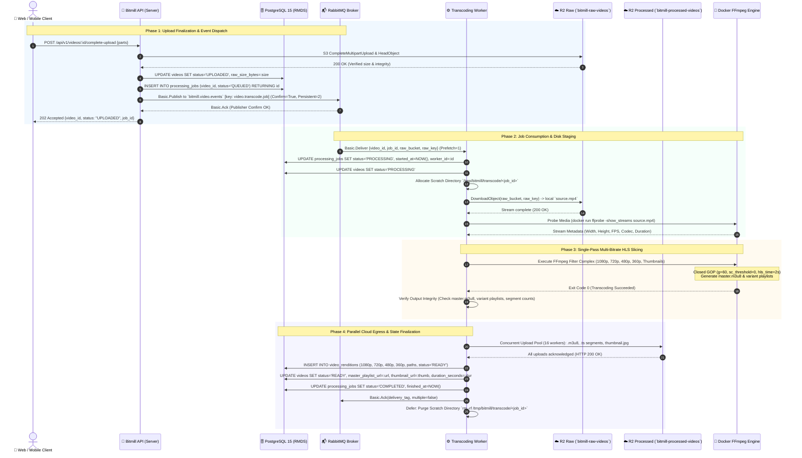
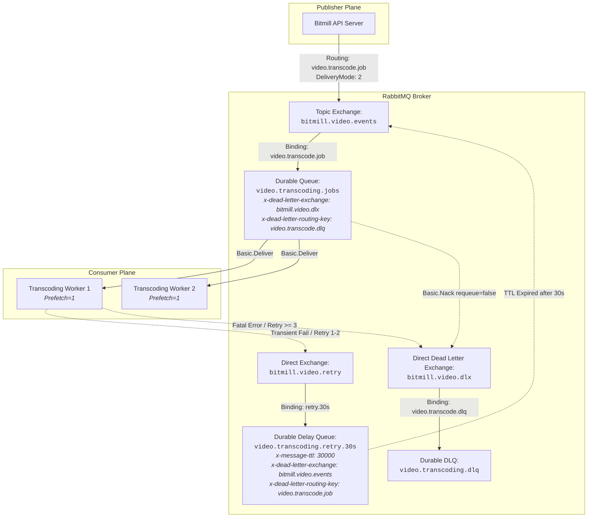
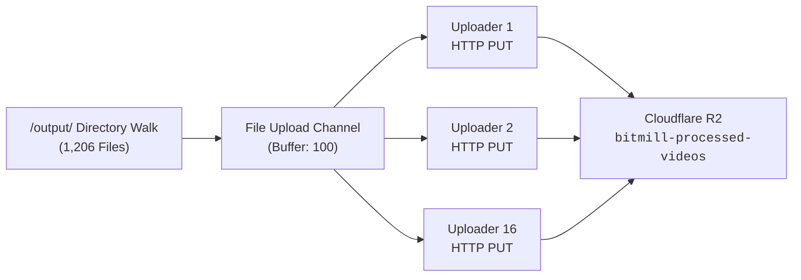
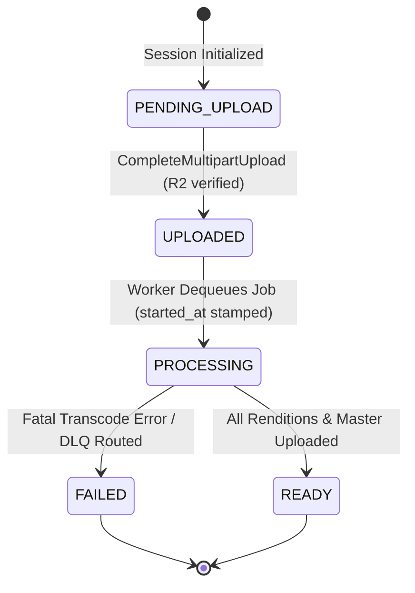
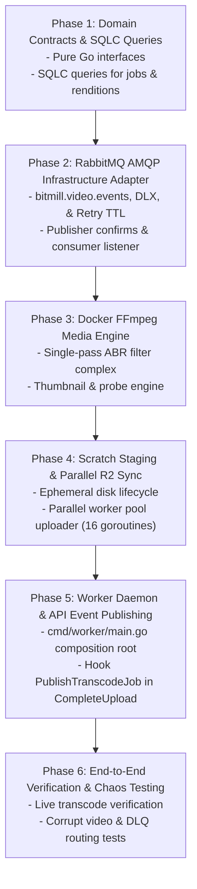

# 🏛️ Technical Solutions Architecture & Systems Design: Asynchronous Video Transcoding Worker & RabbitMQ Orchestration

- **RFC Document**: RFC-002-SOLUTIONS-ARCHITECTURE
- **Author**: Principal Solutions Architect & Distributed Systems Engineer
- **Status**: PROPOSED / TECHNICAL REVIEW
- **Target Subsystem**: Bitmill Media Pipeline — Transcoding Worker Cluster & Message Broker Orchestration
- **Target Platform**: Go 1.24+, RabbitMQ 3.12+ (AMQP 0-9-1), Dockerized FFmpeg (`mwader/static-ffmpeg:latest`), Cloudflare R2 (S3-Compatible), PostgreSQL 15+
- **Milestone**: Milestone 4 — Background Transcoding Worker & RabbitMQ Orchestration
- **Date**: 2026-10-28

---

## 1. Executive Summary & Architectural Overview

The **Bitmill Asynchronous Video Transcoding Subsystem** constitutes the compute-intensive core of the Bitmill video streaming infrastructure. Following the successful ingestion of raw MP4/MOV assets into Cloudflare R2 via resumable multipart uploads (Milestone 3), this subsystem orchestrates the automated, distributed transformation of raw source media into high-performance, Adaptive Bitrate (ABR) HTTP Live Streaming (HLS) multi-rendition packages (1080p, 720p, 480p, 360p) alongside video posters and thumbnails.

```
+-----------------------------------------------------------------------------------------------------------------------+
|                                             BITMILL PLATFORM ECOSYSTEM                                                |
+-----------------------------------------------------------------------------------------------------------------------+
                                                     |
                     [Client Upload Complete]        |
                                                     v
                                  +-------------------------------------+
                                  |     Bitmill API Server (Go Gin)     |
                                  |   - Validates S3 Multipart Complete |
                                  |   - Atomically updates DB to UPLOADED|
                                  +-------------------------------------+
                                                     |
                       AMQP 0-9-1 Direct/Topic Event | (Publisher Confirms + Persistent)
                                                     v
                                  +-------------------------------------+
                                  |        RabbitMQ Message Broker       |
                                  |   Exchange: bitmill.video.events    |
                                  |   Queue: video.transcoding.jobs     |
                                  |   DLX: bitmill.video.dlx            |
                                  +-------------------------------------+
                                                     |
                                   AMQP Basic.Deliver| (Manual ACK, Prefetch=1 per Slot)
                                                     v
+-----------------------------------------------------------------------------------------------------------------------+
| BITMILL WORKER DAEMON (`cmd/worker`)                                                                                  |
|                                                                                                                       |
|  +------------------------+      +---------------------------+      +--------------------------+                      |
|  |   1. Ingestion Stage   | ---> |   2. Transcoding Engine   | ---> |  3. Egress & Sync Stage  |                      |
|  | - Fetch from R2 raw    |      | - Isolated Docker FFmpeg  |      | - Bounded Parallel Sync  |                      |
|  | - Disk Scratch Staging |      | - Single-Pass Multi-ABR   |      | - Upload to Processed R2 |                      |
|  | - Media Probe & GOP    |      | - Closed GOPs (2s segs)   |      | - Master & Rendition PL  |                      |
|  +------------------------+      +---------------------------+      +--------------------------+                      |
|                                                |                                  |                                   |
|                                                v                                  v                                   |
|                              +-----------------------------------+  +----------------------------+                    |
|                              |      PostgreSQL 15 (RMDS)         |  |   Cloudflare R2 Bucket     |                    |
|                              | - processing_jobs (Status/Audit)  |  | `bitmill-processed-videos` |                    |
|                              | - video_renditions (Manifests)    |  | HLS Master + Segments (.ts)|                    |
|                              | - videos (State -> READY)         |  | Thumbnail Poster (.jpg)    |                    |
|                              +-----------------------------------+  +----------------------------+                    |
+-----------------------------------------------------------------------------------------------------------------------+
```

### 1.1. Core Architectural Tenets
1. **Zero Transcoding on Control Plane**: The API Server never performs media transformations, FFmpeg invocations, or disk-heavy I/O. Its sole responsibility is validating client upload completion, mutating metadata state, and emitting durable transactional events to RabbitMQ.
2. **CPU-Isolated Worker Execution**: Transcoding operations execute in standalone, horizontally scalable worker instances. FFmpeg runs inside an isolated Docker container (`mwader/static-ffmpeg:latest`), completely eliminating host-level system dependencies, C-library conflicts, and security vulnerabilities associated with arbitrary codec parsing.
3. **Strict Inversion of Control (IoC)**: High-level application orchestrators depend purely on small, expressive domain interfaces (`video.JobQueue`, `video.Transcoder`, `video.StorageProvider`, `video.JobRepository`). Concrete implementations using `github.com/rabbitmq/amqp091-go`, `github.com/aws/aws-sdk-go-v2`, and Docker CLI are instantiated strictly at the application composition root.
4. **Guaranteed Delivery & Poison Pill Containment**: AMQP publishing uses publisher confirms and persistent delivery (`delivery_mode=2`). Worker consumers use manual acknowledgements (`multiple=false`) with controlled prefetch (`prefetch=1`). Fatal errors and exhausted retries route directly to a Dead Letter Exchange (`bitmill.video.dlx`) to prevent queue blockage.
5. **Deterministic Storage Lifecycle**: Transcoding takes place in isolated local scratch directories (`/tmp/bitmill/transcode/<job_id>`). Cleanups are guaranteed via Go `defer` routines regardless of pipeline panics, container crashes, or I/O failures.

---

## 2. End-to-End System Sequence & Topology

The asynchronous transcoding workflow coordinates five distinct subsystems across discrete lifecycle phases:
- **Client (Web / Mobile)**: Notified of completion via polling or WebSocket.
- **Bitmill API Server (`cmd/server`)**: Publishes job events upon multipart completion.
- **RabbitMQ Message Broker**: Buffers, routes, and guarantees job delivery.
- **Bitmill Worker Daemon (`cmd/worker`)**: Consumes jobs, manages scratch disks, executes FFmpeg, and uploads manifests.
- **Cloudflare R2 Storage**: Houses raw input objects (`bitmill-raw-videos`) and processed HLS segments (`bitmill-processed-videos`).
- **PostgreSQL 15 (RMDS)**: Preserves job state transitions, error traces, and rendition manifests.



---

## 3. RabbitMQ AMQP 0-9-1 Messaging Orchestration Topology

### 3.1. Topology Architecture
The messaging architecture employs RabbitMQ 3.12+ implementing standard AMQP 0-9-1 specifications. The exchange topology isolates event emissions from queue consumption while establishing a hardened Dead Letter and Retry conduit.



### 3.2. Detailed Entity Configurations

| Entity Name | Type | Durability | Parameters / x-arguments | Purpose |
| :--- | :--- | :--- | :--- | :--- |
| `bitmill.video.events` | `topic` | Durable | `durable=true, auto_delete=false` | Primary routing exchange for all video domain events. |
| `video.transcoding.jobs` | `classic / quorum` | Durable | `x-dead-letter-exchange: bitmill.video.dlx`<br/>`x-dead-letter-routing-key: video.transcode.dlq`<br/>`x-max-priority: 10` | Working queue buffering pending video encoding jobs. |
| `bitmill.video.retry` | `direct` | Durable | `durable=true, auto_delete=false` | Intermediate exchange routing failed jobs to backoff delay queues. |
| `video.transcoding.retry.30s` | `classic` | Durable | `x-message-ttl: 30000`<br/>`x-dead-letter-exchange: bitmill.video.events`<br/>`x-dead-letter-routing-key: video.transcode.job` | Dead-letter delay queue providing 30-second exponential backoff without broker plugins. |
| `bitmill.video.dlx` | `direct` | Durable | `durable=true, auto_delete=false` | Dead Letter Exchange trapping poisoned or terminally failed tasks. |
| `video.transcoding.dlq` | `classic` | Durable | `durable=true, auto_delete=false` | Dead Letter Queue holding unprocessable payloads for manual operator inspection. |

### 3.3. Message Reliability & Delivery Guarantees
To achieve zero message loss under network partitions or broker node restarts, all message interactions adhere to strict durability contracts:

1. **Publisher Confirms**:
   - The publisher calls `ch.Confirm(false)` immediately upon channel creation.
   - When calling `ch.PublishWithContext()`, the publisher awaits the confirmation channel response (`amqp091.DeferredConfirmation.Wait()`).
   - If the broker returns a NACK or times out (5s), the API server aborts the transaction, records an audit log, and returns HTTP 500 to prevent silent task dropping.
2. **Persistent Message Delivery**:
   - Every published AMQP message sets `amqp091.Publishing.DeliveryMode = amqp091.Persistent` (value `2`).
   - Messages are written directly to RabbitMQ's on-disk write-ahead log (WAL) before the broker confirms the publish.
3. **Consumer Manual Acknowledgements**:
   - Consumers initialize with `autoAck = false`.
   - On successful transcoding and R2 upload: `ch.Ack(d.DeliveryTag, false)`.
   - On unrecoverable fatal failure (e.g., malformed codec, corrupt container, zero-byte file): `ch.Nack(d.DeliveryTag, false, false)`. With `requeue = false`, RabbitMQ routes the message directly to the DLX.
   - The consumer NEVER calls `requeue = true` on execution failures to eliminate tight failure-reconsume loops (thundering herd).

### 3.4. Throttling, Prefetch & Concurrency Allocation
Video transcoding is an aggressively CPU-bound operation utilizing 100% of allocated core threads. Unthrottled consumer prefetching causes worker nodes to hoard messages in memory while starvation occurs across other nodes:

```go
// Worker Channel Initialization Contract
err := ch.Qos(
    1,     // prefetch_count: exactly 1 message per active transcoding slot
    0,     // prefetch_size: unbounded in bytes
    false, // global: false (applies per consumer channel, not connection-wide)
)
```

- **Concurrency Sizing Rule**: Each worker instance runs $N$ consumer goroutines, where $N = \lfloor \text{Available CPU Cores} / \text{Cores per Transcode Slot} \rfloor$.
- For standard 8-core worker nodes allocating 4 threads per FFmpeg job, $N = 2$. With `prefetch = 1`, each worker buffers at most 2 active jobs, maintaining optimal CPU saturation without memory thrashing.

### 3.5. JSON Data Contract: `VideoTranscodeJobMessage`
All messages traversing `bitmill.video.events` conform to a versioned JSON schema:

```json
{
  "$schema": "https://json-schema.bitmill.io/v1/video-transcode-job.json",
  "version": "1.0",
  "job_id": "7c9e6679-7425-40de-944b-e07fc1f90ae7",
  "video_id": "9b1deb4d-3b7d-4bad-9bdd-2b0d7b3dcb6d",
  "user_id": "550e8400-e29b-41d4-a716-446655440000",
  "raw_bucket": "bitmill-raw-videos",
  "raw_object_key": "raw/9b1deb4d-3b7d-4bad-9bdd-2b0d7b3dcb6d/source.mp4",
  "raw_size_bytes": 524288000,
  "mime_type": "video/mp4",
  "attempt_count": 1,
  "max_attempts": 3,
  "priority": 5,
  "enqueued_at": "2026-10-28T12:00:00Z"
}
```

---

## 4. Dockerized Media Engine & Multi-Bitrate FFmpeg Pipeline

### 4.1. Media Engine Isolation Architecture
Under the Bitmill operational mandate, host machines MUST NEVER install FFmpeg binaries directly. The media engine is strictly containerized using `mwader/static-ffmpeg:latest`.

```
+-----------------------------------------------------------------------------------------+
| WORKER HOST OS (Linux / macOS)                                                          |
|                                                                                         |
|  Local Scratch: /tmp/bitmill/transcode/<job_id>                                         |
|  ├── input/source.mp4                                                                   |
|  └── output/                                                                            |
|       ├── 1080p/ (segment_000.ts, ..., playlist.m3u8)                                   |
|       ├── 720p/                                                                         |
|       ├── 480p/                                                                         |
|       ├── 360p/                                                                         |
|       ├── master.m3u8                                                                   |
|       └── thumbnail.jpg                                                                 |
|                                                                                         |
|      |                                                                                  |
|      | Mounted Volume: -v /tmp/bitmill/transcode/<job_id>:/work:rw                      |
|      v                                                                                  |
|  +-----------------------------------------------------------------------------------+  |
|  | DOCKER RUNTIME: mwader/static-ffmpeg:latest                                       |  |
|  | - Security: --read-only, --tmpfs /tmp, --user 1000:1000                           |  |
|  | - Resources: --cpus="4.0" --memory="4g" --memory-swap="4g"                       |  |
|  | - Process: /ffmpeg -y -i /work/input/source.mp4 [filter_complex] ... /work/output |  |
|  +-----------------------------------------------------------------------------------+  |
+-----------------------------------------------------------------------------------------+
```

### 4.2. Multi-Bitrate Adaptive Bitrate (ABR) Ladder
The ABR encoding ladder is tailored for broad device compatibility (H.264 High/Main profiles, AAC audio) with strict GOP alignment to permit glitch-free rendition switching during network jitter.

| Rendition | Resolution | Aspect Ratio | Video Bitrate | VBV Maxrate | VBV Bufsize | Audio Bitrate | Frame Rate | H.264 Profile / Level |
| :--- | :---: | :---: | :---: | :---: | :---: | :---: | :---: | :---: |
| **1080p (FHD)** | $1920 \times 1080$ | 16:9 | 5000 kbps | 5350 kbps | 7500 kbps | 192 kbps | 30 / 60 fps | High / 4.1 |
| **720p (HD)** | $1280 \times 720$ | 16:9 | 2800 kbps | 2996 kbps | 4200 kbps | 128 kbps | 30 / 60 fps | High / 3.1 |
| **480p (SD)** | $854 \times 480$ | 16:9 | 1400 kbps | 1498 kbps | 2100 kbps | 128 kbps | 30 fps | Main / 3.1 |
| **360p (LD)** | $640 \times 360$ | 16:9 | 800 kbps | 856 kbps | 1200 kbps | 96 kbps | 30 fps | Main / 3.0 |

### 4.3. Single-Pass Multi-Output FFmpeg Filter Complex

A single FFmpeg execution decodes the source media **once**, splits the raw video frames into 4 scaling branches, encodes them concurrently across threads, and multiplexes them into segment slices with a synchronized master playlist using `var_stream_map`.

#### 4.3.1. Complete Production FFmpeg Command
```bash
docker run --rm \
  --cpus="4.0" \
  --memory="4g" \
  --user="$(id -u):$(id -g)" \
  -v "/tmp/bitmill/transcode/7c9e6679:/work:rw" \
  -w /work \
  mwader/static-ffmpeg:latest \
  -y \
  -i /work/input/source.mp4 \
  -filter_complex \
  "[0:v]split=4[v1][v2][v3][v4]; \
   [v1]scale=w=1920:h=1080:force_original_aspect_ratio=decrease,pad=1920:1080:(ow-iw)/2:(oh-ih)/2,format=yuv420p[v1out]; \
   [v2]scale=w=1280:h=720:force_original_aspect_ratio=decrease,pad=1280:720:(ow-iw)/2:(oh-ih)/2,format=yuv420p[v2out]; \
   [v3]scale=w=854:h=480:force_original_aspect_ratio=decrease,pad=854:480:(ow-iw)/2:(oh-ih)/2,format=yuv420p[v3out]; \
   [v4]scale=w=640:h=360:force_original_aspect_ratio=decrease,pad=640:360:(ow-iw)/2:(oh-ih)/2,format=yuv420p[v4out]" \
  -map "[v1out]" -c:v:0 libx264 -preset medium -b:v:0 5000k -maxrate:v:0 5350k -bufsize:v:0 7500k \
  -map "[v2out]" -c:v:1 libx264 -preset medium -b:v:1 2800k -maxrate:v:1 2996k -bufsize:v:1 4200k \
  -map "[v3out]" -c:v:2 libx264 -preset medium -b:v:2 1400k -maxrate:v:2 1498k -bufsize:v:2 2100k \
  -map "[v4out]" -c:v:3 libx264 -preset medium -b:v:3 800k  -maxrate:v:3 856k  -bufsize:v:3 1200k \
  -map 0:a -c:a:0 aac -b:a:0 192k -ac 2 \
  -map 0:a -c:a:1 aac -b:a:1 128k -ac 2 \
  -map 0:a -c:a:2 aac -b:a:2 128k -ac 2 \
  -map 0:a -c:a:3 aac -b:a:3 96k  -ac 2 \
  -g 60 -keyint_min 60 -sc_threshold 0 \
  -f hls \
  -hls_time 2 \
  -hls_playlist_type vod \
  -hls_flags independent_segments \
  -hls_segment_type mpegts \
  -master_pl_name master.m3u8 \
  -hls_segment_filename "/work/output/%v/segment_%03d.ts" \
  -var_stream_map "v:0,a:0,name:1080p v:1,a:1,name:720p v:2,a:2,name:480p v:3,a:3,name:360p" \
  /work/output/%v/playlist.m3u8
```

#### 4.3.2. Critical Engineering Flags Explained
- `-g 60 -keyint_min 60 -sc_threshold 0`: Enforces an immutable closed Group of Pictures (GOP) precisely every 60 frames (2.0 seconds at 30fps). Scene cuts (`sc_threshold 0`) are disabled from injecting non-aligned keyframes. This guarantees that frame $K$ in `1080p` aligns byte-for-byte in time with frame $K$ in `360p`, preventing video freeze during ABR switching.
- `-hls_time 2`: Directs the HLS muxer to target 2.0-second chunk durations. Paired with GOP 60, segments are cut cleanly on keyframe boundaries without sub-frame drift.
- `-hls_flags independent_segments`: Appends `#EXT-X-INDEPENDENT-SEGMENTS` to manifests, signaling to Apple/ExoPlayer/Hls.js players that every segment begins with an IDR frame and can be decoded independently.
- `force_original_aspect_ratio=decrease,pad=...`: Preserves source aspect ratios (e.g. 4:3, 21:9, vertical 9:16) by adding letterboxing/pillarboxing black bars instead of distorting video geometry.
- `format=yuv420p`: Ensures pixel downsampling from high-end camera profiles (YUV444p or 10-bit) to 8-bit YUV420p, universally supported across all mobile GPUs.

### 4.4. Dedicated Thumbnail Extraction Engine
Immediately following or preceding HLS transcoding, a clean frame capture generates the video poster without image sequence warnings:

```bash
docker run --rm \
  --user="$(id -u):$(id -g)" \
  -v "/tmp/bitmill/transcode/7c9e6679:/work:rw" \
  -w /work \
  mwader/static-ffmpeg:latest \
  -y \
  -ss 00:00:01 \
  -i /work/input/source.mp4 \
  -frames:v 1 \
  -update 1 \
  -q:v 2 \
  /work/output/thumbnail.jpg
```
- `-ss 00:00:01`: Fast forward seek to second 1.0 (avoids black opening frames common at second 0).
- `-update 1 -frames:v 1`: FFmpeg 9.x flag suppressing image sequence pattern errors.
- `-q:v 2`: High-quality JPEG quantization factor (scale 1-31, where 2 represents ~95% perceptual quality).

### 4.5. Fast Metadata Inspection (FFprobe Wrapper)
Before committing compute to transcoding, the worker probes the media container to extract precise container duration, aspect ratios, and stream integrity:

```bash
docker run --rm \
  --user="$(id -u):$(id -g)" \
  -v "/tmp/bitmill/transcode/7c9e6679:/work:ro" \
  -w /work \
  mwader/static-ffmpeg:latest \
  ffprobe \
  -v error \
  -show_entries stream=index,codec_name,codec_type,width,height,r_frame_rate,duration,bit_rate \
  -show_entries format=duration,size,bit_rate \
  -of json \
  /work/input/source.mp4
```

---

## 5. Storage & Local Scratch Pipeline

### 5.1. Scratch Directory Lifecycle Management
Transcoding creates hundreds of temporary `.ts` files. To avoid cross-job interference, out-of-disk panics, or orphaned storage leaks:

1. **Path Isolation**: Scratch files reside under `/tmp/bitmill/transcode/<job_id>`.
2. **Pre-flight Capacity Check**: The worker checks filesystem free space via POSIX `statfs`. If available disk capacity is less than $3 \times \text{raw\_size\_bytes}$, the job is deferred or rejected back to the queue with an operational alert.
3. **Panic-Proof Cleanup**: Local directories are purged using Go's `defer` statement at the top of the job executor function:

```go
scratchDir := filepath.Join(t.scratchRoot, job.JobID)
if err := os.MkdirAll(scratchDir, 0755); err != nil {
    return fmt.Errorf("failed to create scratch directory: %w", err)
}
defer func() {
    if err := os.RemoveAll(scratchDir); err != nil {
        t.logger.Error("Failed to purge scratch directory %s: %v", scratchDir, err)
    } else {
        t.logger.Debug("Successfully cleaned up scratch directory %s", scratchDir)
    }
}()
```

### 5.2. Cloudflare R2 Ingestion (Raw Stream Download)
The raw object is downloaded directly from `bitmill-raw-videos` into `/tmp/bitmill/transcode/<job_id>/input/source.mp4` via the AWS Go SDK v2 S3 client:

```go
// Download raw video to local disk scratch
inputPath := filepath.Join(scratchDir, "input", "source.mp4")
err = s.storageProvider.DownloadToFile(ctx, job.RawBucket, job.RawObjectKey, inputPath)
```

### 5.3. Processed Asset Parallel Egress (Worker Pool Pattern)
A typical 10-minute video sliced into 2-second segments across 4 renditions produces approximately:
$$\frac{600\text{ seconds}}{2\text{ seconds/segment}} \times 4\text{ renditions} = 1,200\text{ files} + 5\text{ manifests} + 1\text{ thumbnail} \approx 1,206\text{ files}$$

Sequential HTTP PUT uploads would introduce severe latency ($1,200 \times 40\text{ms} = 48\text{ seconds}$ overhead). The worker implements a bounded **Parallel Uploader Worker Pool** ($W = 16$ concurrency):



### 5.4. S3 Content-Type & Cache-Control Mapping Matrix
To enable instant CDN distribution and browser caching, the uploader inspects file extensions and attaches precise HTTP metadata:

| Asset Type | File Extension | S3 `Content-Type` | S3 `Cache-Control` | Caching Rationale |
| :--- | :---: | :--- | :--- | :--- |
| Master Manifest | `master.m3u8` | `application/vnd.apple.mpegurl` | `public, max-age=60, must-revalidate` | Master playlist rarely changes, but short TTL enables rapid rendition tuning. |
| Rendition Manifest | `playlist.m3u8` | `application/vnd.apple.mpegurl` | `public, max-age=60, must-revalidate` | In VOD, rendition playlists are static; short TTL allows edge invalidation. |
| Media Segments | `segment_*.ts` | `video/MP2T` | `public, max-age=31536000, immutable` | **Immutable**. Video segment chunks NEVER change. Infinite browser and edge caching saves 100% egress bandwidth. |
| Thumbnail Poster | `thumbnail.jpg` | `image/jpeg` | `public, max-age=86400, stale-while-revalidate=3600` | Static poster cached at CDN edge for 24 hours. |

---

## 6. Inversion of Control (IoC) & Domain Abstractions

To maintain strict Clean Architecture and prevent domain leakage of external dependencies (`rabbitmq/amqp091-go`, `aws/aws-sdk-go-v2`), all business workflows interact strictly through pure Go interfaces residing in `internal/domain/video`.

### 6.1. Domain Contract Architecture
```
internal/domain/video/
├── entity.go             # Video aggregate root & Rendition value objects
├── job.go                # ProcessingJob aggregate & JobStatus enum
├── queue.go              # JobQueue & JobPublisher domain contracts
├── transcoder.go         # Transcoder, MediaProbe, & ABR request contracts
├── storage.go            # StorageProvider domain contracts (Ingress & Egress)
└── repository.go         # Repository, JobRepository, & RenditionRepository
```

### 6.2. Pure Domain Interfaces

#### 6.2.1. `JobQueue` Contract
```go
package video

import (
	"context"
	"time"
)

// TranscodeJobPayload represents the immutable data contract delivered over the message broker.
type TranscodeJobPayload struct {
	JobID        string    `json:"job_id"`
	VideoID      string    `json:"video_id"`
	UserID       string    `json:"user_id"`
	RawBucket    string    `json:"raw_bucket"`
	RawObjectKey string    `json:"raw_object_key"`
	RawSizeBytes int64     `json:"raw_size_bytes"`
	MimeType     string    `json:"mime_type"`
	AttemptCount int       `json:"attempt_count"`
	MaxAttempts  int       `json:"max_attempts"`
	EnqueuedAt   time.Time `json:"enqueued_at"`
}

// JobHandler defines the consumer callback executed upon receiving a message.
type JobHandler func(ctx context.Context, job TranscodeJobPayload) error

// JobQueue abstracts message broker publishing, subscription, and lifecycle management.
type JobQueue interface {
	// PublishTranscodeJob sends a persistent transcoding job to the broker.
	PublishTranscodeJob(ctx context.Context, job TranscodeJobPayload) error

	// ConsumeTranscodeJobs initiates consumer listener loops with manual ACK/NACK semantics.
	ConsumeTranscodeJobs(ctx context.Context, handler JobHandler) error

	// Close cleanly terminates channel and connection handlers.
	Close() error
}
```

#### 6.2.2. `Transcoder` Contract
```go
package video

import "context"

// RenditionProfile defines target parameters for an individual HLS variant.
type RenditionProfile struct {
	ResolutionName   string
	Width            int
	Height           int
	VideoBitrateKbps int
	AudioBitrateKbps int
}

// ABRTranscodeRequest encapsulates input files, output targets, and encoding profiles.
type ABRTranscodeRequest struct {
	SourcePath      string
	OutputDir       string
	Profiles        []RenditionProfile
	GOPSize         int
	SegmentDuration int
}

// ABRTranscodeResult contains metadata generated by the media engine.
type ABRTranscodeResult struct {
	MasterPlaylistPath string
	Renditions         []Rendition
	ThumbnailPath      string
	DurationSeconds    float64
}

// MediaInfo contains probe metadata.
type MediaInfo struct {
	Width           int
	Height          int
	DurationSeconds float64
	CodecName       string
	Bitrate         int64
	FPS             float64
}

// Transcoder defines the media transformation engine contract.
type Transcoder interface {
	// TranscodeABR transforms source media into multi-bitrate HLS streams.
	TranscodeABR(ctx context.Context, req ABRTranscodeRequest) (*ABRTranscodeResult, error)

	// ExtractThumbnail captures a poster image from the specified second.
	ExtractThumbnail(ctx context.Context, sourcePath, outputPath string, atSecond float64) error

	// ProbeMedia extracts container and codec stream metadata.
	ProbeMedia(ctx context.Context, sourcePath string) (*MediaInfo, error)
}
```

#### 6.2.3. Extended `StorageProvider` Contract
```go
package video

import (
	"context"
	"time"
)

// StorageProvider abstracts S3 / Cloudflare R2 operations across upload, download, and multi-file egress.
type StorageProvider interface {
	// Pre-existing Multipart Ingestion Contracts (Milestone 2 & 3)
	GeneratePresignedPutURL(ctx context.Context, bucket, objectKey string, expiry time.Duration, contentType string) (string, error)
	CreateMultipartUpload(ctx context.Context, bucket, objectKey, contentType string) (string, error)
	GeneratePresignedPartURL(ctx context.Context, bucket, objectKey, uploadID string, partNumber int, expiry time.Duration) (string, error)
	CompleteMultipartUpload(ctx context.Context, bucket, objectKey, uploadID string, parts []CompletedPart) (string, error)
	AbortMultipartUpload(ctx context.Context, bucket, objectKey, uploadID string) error
	ListUploadedParts(ctx context.Context, bucket, objectKey, uploadID string) ([]CompletedPart, error)
	CheckObjectExists(ctx context.Context, bucket, objectKey string) (bool, error)
	GetObjectSize(ctx context.Context, bucket, objectKey string) (int64, error)
	GetDownloadURL(ctx context.Context, bucket, objectKey string, expiry time.Duration) (string, error)

	// New Milestone 4 Worker Capabilities
	DownloadToFile(ctx context.Context, bucket, objectKey, destinationPath string) error
	UploadFile(ctx context.Context, bucket, objectKey, sourcePath, contentType, cacheControl string) error
	UploadDirectory(ctx context.Context, bucket, prefix, localDir string, concurrency int) error
}
```

#### 6.2.4. `JobRepository` & `RenditionRepository` Contracts
```go
package video

import "context"

// JobRepository manages the persistence of processing_jobs audit records.
type JobRepository interface {
	CreateJob(ctx context.Context, job *ProcessingJob) error
	GetJobByID(ctx context.Context, id string) (*ProcessingJob, error)
	GetLatestJobByVideoID(ctx context.Context, videoID string) (*ProcessingJob, error)
	StartJob(ctx context.Context, id, workerID string) error
	CompleteJob(ctx context.Context, id string) error
	FailJob(ctx context.Context, id, errorMessage string) error
	MarkJobDLQ(ctx context.Context, id, errorMessage string) error
}

// RenditionRepository manages variant metadata records in video_renditions.
type RenditionRepository interface {
	SaveBatch(ctx context.Context, renditions []Rendition) error
	ListByVideoID(ctx context.Context, videoID string) ([]Rendition, error)
}
```

---

## 7. Database Schema & Data Contracts

### 7.1. Relational Schema Review (`migrations/00001_init_schema.sql`)
The initial migration already provisions the core relational structures required for Milestone 4:

```sql
-- 1. Video Aggregate Root
CREATE TABLE videos (
    id UUID PRIMARY KEY DEFAULT gen_random_uuid(),
    user_id UUID NOT NULL,
    title VARCHAR(255) NOT NULL,
    description TEXT,
    raw_bucket VARCHAR(128) NOT NULL,
    raw_object_key VARCHAR(512) NOT NULL,
    raw_size_bytes BIGINT NOT NULL DEFAULT 0,
    mime_type VARCHAR(64) NOT NULL DEFAULT 'video/mp4',
    status video_status NOT NULL DEFAULT 'PENDING_UPLOAD',
    duration_seconds NUMERIC(10, 2) NOT NULL DEFAULT 0.00,
    master_playlist_url VARCHAR(1024),
    thumbnail_url VARCHAR(1024),
    created_at TIMESTAMPTZ NOT NULL DEFAULT CURRENT_TIMESTAMP,
    updated_at TIMESTAMPTZ NOT NULL DEFAULT CURRENT_TIMESTAMP
);

-- 2. Multi-Rendition Variant Manifests
CREATE TABLE video_renditions (
    id UUID PRIMARY KEY DEFAULT gen_random_uuid(),
    video_id UUID NOT NULL REFERENCES videos(id) ON DELETE CASCADE,
    resolution_name VARCHAR(32) NOT NULL,
    width INT NOT NULL,
    height INT NOT NULL,
    video_bitrate_kbps INT NOT NULL,
    audio_bitrate_kbps INT NOT NULL DEFAULT 128,
    playlist_path VARCHAR(512) NOT NULL,
    segment_count INT NOT NULL DEFAULT 0,
    status rendition_status NOT NULL DEFAULT 'PROCESSING',
    created_at TIMESTAMPTZ NOT NULL DEFAULT CURRENT_TIMESTAMP,
    CONSTRAINT uq_video_resolution UNIQUE (video_id, resolution_name)
);

-- 3. Asynchronous Worker Execution Audit Log
CREATE TABLE processing_jobs (
    id UUID PRIMARY KEY DEFAULT gen_random_uuid(),
    video_id UUID NOT NULL REFERENCES videos(id) ON DELETE CASCADE,
    worker_id VARCHAR(64),
    status job_status NOT NULL DEFAULT 'QUEUED',
    attempt_count INT NOT NULL DEFAULT 0,
    max_attempts INT NOT NULL DEFAULT 3,
    error_message TEXT,
    started_at TIMESTAMPTZ,
    finished_at TIMESTAMPTZ,
    created_at TIMESTAMPTZ NOT NULL DEFAULT CURRENT_TIMESTAMP
);
```

### 7.2. State Transition Finite State Machine (FSM)



#### State Transition Invariant Table
| Source State | Target State | Triggering Event | Validating Conditions |
| :--- | :--- | :--- | :--- |
| `PENDING_UPLOAD` | `UPLOADED` | `CompleteUpload` API | All multipart chunks verified on R2 via `HeadObject`. |
| `UPLOADED` | `PROCESSING` | Worker Dequeue | Worker locks job record, assigns `worker_id` and `started_at = NOW()`. |
| `PROCESSING` | `READY` | Transcode & Egress Complete | `master.m3u8`, variant playlists, and `thumbnail.jpg` exist on R2. `duration_seconds > 0`. |
| `PROCESSING` | `FAILED` | Codec Corrupt / Retries Exhausted | `attempt_count >= max_attempts` or unrecoverable FFmpeg fatal error. |

### 7.3. `sqlc` Query Declarations

To generate zero-boilerplate, type-safe Go data access objects, the following query definitions are placed under `go-streaming/sqlc/queries/`:

#### 7.3.1. `sqlc/queries/processing_jobs.sql`
```sql
-- name: CreateProcessingJob :one
INSERT INTO processing_jobs (
    id, video_id, worker_id, status, attempt_count, max_attempts, started_at, created_at
) VALUES (
    $1, $2, $3, 'QUEUED', 0, $4, NULL, NOW()
) RETURNING *;

-- name: GetProcessingJobByID :one
SELECT * FROM processing_jobs WHERE id = $1;

-- name: GetLatestJobByVideoID :one
SELECT * FROM processing_jobs 
WHERE video_id = $1 
ORDER BY created_at DESC 
LIMIT 1;

-- name: StartProcessingJob :exec
UPDATE processing_jobs
SET 
    status = 'PROCESSING',
    worker_id = $2,
    attempt_count = attempt_count + 1,
    started_at = NOW()
WHERE id = $1;

-- name: CompleteProcessingJob :exec
UPDATE processing_jobs
SET 
    status = 'COMPLETED',
    finished_at = NOW(),
    error_message = NULL
WHERE id = $1;

-- name: FailProcessingJob :exec
UPDATE processing_jobs
SET 
    status = 'FAILED',
    finished_at = NOW(),
    error_message = $2
WHERE id = $1;

-- name: MarkProcessingJobDLQ :exec
UPDATE processing_jobs
SET 
    status = 'DLQ',
    finished_at = NOW(),
    error_message = $2
WHERE id = $1;
```

#### 7.3.2. `sqlc/queries/video_renditions.sql`
```sql
-- name: UpsertVideoRendition :exec
INSERT INTO video_renditions (
    id, video_id, resolution_name, width, height, 
    video_bitrate_kbps, audio_bitrate_kbps, playlist_path, 
    segment_count, status, created_at
) VALUES (
    $1, $2, $3, $4, $5, $6, $7, $8, $9, $10, NOW()
)
ON CONFLICT (video_id, resolution_name) DO UPDATE SET
    width = EXCLUDED.width,
    height = EXCLUDED.height,
    video_bitrate_kbps = EXCLUDED.video_bitrate_kbps,
    audio_bitrate_kbps = EXCLUDED.audio_bitrate_kbps,
    playlist_path = EXCLUDED.playlist_path,
    segment_count = EXCLUDED.segment_count,
    status = EXCLUDED.status;

-- name: ListRenditionsByVideoID :many
SELECT * FROM video_renditions 
WHERE video_id = $1 
ORDER BY height DESC;
```

#### 7.3.3. Additions to `sqlc/queries/videos.sql`
```sql
-- name: MarkVideoReady :exec
UPDATE videos
SET 
    status = 'READY',
    master_playlist_url = $2,
    thumbnail_url = $3,
    duration_seconds = $4,
    updated_at = NOW()
WHERE id = $1;

-- name: MarkVideoFailed :exec
UPDATE videos
SET 
    status = 'FAILED',
    updated_at = NOW()
WHERE id = $1;
```

---

## 8. Architectural Trade-Off Matrices

### 8.1. Decision 1: Single-Pass Multi-Output FFmpeg vs. Sequential Multi-Pass FFmpeg

```
+---------------------------------------------------------------------------------------------------+
| Option A: Single-Pass Filter Complex                              Option B: Sequential Slicing     |
|                                                                                                   |
| source.mp4 ---> [Decoded Once]                                    source.mp4 ---> [Decode] -> 1080p|
|                      |                                            source.mp4 ---> [Decode] -> 720p |
|      +---------------+---------------+                            source.mp4 ---> [Decode] -> 480p |
|      |               |               |                            source.mp4 ---> [Decode] -> 360p |
|      v               v               v                                                             |
|   [1080p]         [720p]          [360p]                          (4x Disk I/O & CPU Decode Waste) |
|   (Concurrent Threaded Encoding)                                                                  |
+---------------------------------------------------------------------------------------------------+
```

| Evaluation Dimension | Option A: Single-Pass Multi-Output (`-filter_complex`) | Option B: Sequential Multi-Pass Execution | Architectural Assessment & Decision |
| :--- | :--- | :--- | :--- |
| **Total Wall-Clock Time** | **Fastest (1.0x baseline)**. Video is decoded from container exactly once; encoding cores run in parallel. | **Slow (2.8x - 3.5x slower)**. Container and audio must be decoded 4 independent times. | **Option A wins**. Drastically cuts transcode turnaround time for users. |
| **I/O & Disk Read Pressure** | **Minimal**. Source file read once from local scratch disk into memory buffers. | **Severe**. Source file read 4 separate times, causing repeated disk cache evictions. | **Option A wins**. Prevents NVMe/SSD wear and kernel page churn. |
| **Master Playlist Sync** | **Native**. FFmpeg's `var_stream_map` outputs `master.m3u8` and variant playlists simultaneously. | **Manual**. Custom application logic must parse child `.m3u8` files and generate master playlist. | **Option A wins**. Zero risk of manual playlist syntax errors or codec discrepancies. |
| **GOP Alignment Guarantee** | **Guaranteed**. Slices all renditions from the identical frame clock and keyframe sequence. | **Risk of Drift**. If different passes pick different scene-cut keyframes, ABR stream switching stutters. | **Option A wins**. Critical for broadcast-quality ABR playback. |
| **RAM Footprint** | **Higher (~1.5GB - 3.0GB)**. Buffers 4 scaling pipelines simultaneously in container memory. | **Low (~600MB)**. Only one resolution pipeline active in memory at any point. | **Trade-off acceptable**. Modern worker nodes have 8-16GB RAM; 3GB ceiling is well within budget. |
| **Failure Blast Radius** | If FFmpeg crashes midway, all 4 renditions fail together. | If pass 4 fails, passes 1-3 could theoretically be salvaged. | In VOD, partial renditions cannot be delivered to users anyway; atomic failure is preferred. |

> **Final Architectural Decision**: **Adopt Option A (Single-Pass Multi-Output with `var_stream_map`)**. The elimination of 4x redundant container decoding, guaranteed frame-perfect GOP alignment, and native `master.m3u8` generation heavily outweigh the modest peak RAM requirement.

---

### 8.2. Decision 2: Local Scratch Disk Staging vs. In-Memory Streaming Unix Pipes to R2

| Evaluation Dimension | Option A: Local Scratch Staging (`/tmp/bitmill/...`) | Option B: Streaming Unix Pipes to R2 | Architectural Assessment & Decision |
| :--- | :--- | :--- | :--- |
| **FFmpeg Compatibility** | **100% Full Capability**. Supports random seeking, fast probe, index lookahead, and multiple file outputs. | **Severely Restricted**. MP4 container headers (`moov` atom at end) require random seeking, breaking standard stdin pipes. | **Option A is mandatory**. Video containers require seekable file descriptors. |
| **Memory Ceiling & OOM** | **Deterministic & Safe**. Memory usage bounded to FFmpeg encoding buffers; frames write to disk. | **Extreme Risk**. Buffering multi-rendition `.ts` chunks in Go RAM channels risks instant kernel OOM under load. | **Option A wins**. Node memory remains stable regardless of source video size (50MB vs 5GB). |
| **Failure Recovery** | **Simple**. Corrupt outputs can be inspected in scratch directory before deletion; failed upload retries locally. | **Impossible**. If network drops during pipe upload, entire FFmpeg run must be re-executed from byte 0. | **Option A wins**. Decouples compute failure from network egress failure. |
| **Disk Requirements** | Requires ephemeral scratch storage (approx. $3\times$ file size). | Zero scratch disk needed. | Modern cloud worker instances (e.g., AWS EC2 with NVMe, Hetzner, GCP) offer abundant ephemeral disk. |

> **Final Architectural Decision**: **Adopt Option A (Local Scratch Disk Staging)**. FFmpeg decoding requires seekable POSIX filesystem descriptors. Scratch staging isolates compute from cloud network volatility and guarantees zero OOM risk.

---

### 8.3. Decision 3: Dead-Lettering Retries (Headers + TTL) vs. Delayed Message Plugin vs. DB Polling

```
+---------------------------------------------------------------------------------------------------+
| Option A: RabbitMQ Dead-Letter TTL Loop                           Option C: DB-Driven Polling      |
|                                                                                                   |
| [Worker Fail] -> bitmill.video.retry -> [video.retry.30s]          [Worker Fail] -> DB (status)   |
|                                                | (TTL: 30s)                          |            |
| [video.transcode.job] <------------------------+                   [Cron Query: SELECT ... FOR    |
| (Push-based, No DB lock contention, Instant backoff)               UPDATE SKIP LOCKED every 10s]  |
+---------------------------------------------------------------------------------------------------+
```

| Evaluation Dimension | Option A: Dead-Lettering Loop via TTL Queue | Option B: RabbitMQ Delayed Exchange Plugin | Option C: DB-Driven Polling Retry Cron |
| :--- | :--- | :--- | :--- |
| **Broker Portability** | **100% Native AMQP 0-9-1**. Supported on vanilla RabbitMQ, AWS Amazon MQ, CloudAMQP without plugins. | Requires custom community Erlang plugin (`rabbitmq_delayed_message_exchange`). | N/A (Broker-independent, relies on DB). |
| **Operational Overhead** | **Zero**. Standard queues and exchanges configured via declarative Go topology bootstrap. | **High**. Custom Docker images required; plugins unsupported on certain managed cloud brokers. | **Medium**. Requires managing background scheduler/ticker in Go with lock coordination. |
| **Database Load** | **Zero DB polling overhead**. Relational DB is touched only on real state changes. | Zero DB polling overhead. | **High DB Churn**. Periodic `SELECT ... FOR UPDATE SKIP LOCKED` pollutes Postgres write-ahead logs. |
| **Backoff Precision** | **Exact**. Delay queue with 30s TTL releases message to the millisecond. | Exact. Message scheduled with delay header. | Sluggish (bound to cron tick frequency e.g. 10s-30s). |
| **Poison Pill Isolation** | **Automatic**. Headers track attempt count; attempts $\ge 3$ route directly to DLQ. | Headers track attempt count; routes to DLQ. | Requires complex retry counter updates and error status columns in DB. |

> **Final Architectural Decision**: **Adopt Option A (Dead-Lettering Loop via TTL Queue `video.transcoding.retry.30s`)**. It adheres 100% to vanilla AMQP 0-9-1 standards, requires no third-party broker plugins, eliminates database polling churn, and provides bulletproof poison pill quarantine into `video.transcoding.dlq`.

---

## 9. Concrete Implementation Blueprint & Delivery Phases

To ensure zero regression and strictly adhere to Bitmill's Pre-Implementation Protocol, the implementation is organized into six disciplined phases:



### 9.1. Phase Breakdown & File Deliverables

| Phase | Target Area | Key Files & Artifacts | Primary Responsibility |
| :---: | :--- | :--- | :--- |
| **1** | **Domain & Data Access Layer** | `internal/domain/video/queue.go`<br/>`internal/domain/video/transcoder.go`<br/>`sqlc/queries/processing_jobs.sql`<br/>`sqlc/queries/video_renditions.sql`<br/>`internal/infrastructure/repository/` | Declare pure domain interfaces; generate type-safe sqlc repository code for `processing_jobs` and `video_renditions`. |
| **2** | **RabbitMQ Messaging Layer** | `internal/infrastructure/messaging/rabbitmq_adapter.go`<br/>`internal/infrastructure/messaging/topology.go`<br/>`internal/infrastructure/messaging/rabbitmq_test.go` | Implement `video.JobQueue` using `amqp091-go`. Configure publisher confirms, declarative topology bootstrap, prefetch=1, and DLX routing. |
| **3** | **Docker FFmpeg Media Engine** | `internal/infrastructure/transcoder/docker_ffmpeg.go`<br/>`internal/infrastructure/transcoder/filter_graph.go`<br/>`internal/infrastructure/transcoder/docker_ffmpeg_test.go` | Implement `video.Transcoder` executing `mwader/static-ffmpeg:latest`. Assemble single-pass ABR command, thumbnail extractor, and media probe. |
| **4** | **Storage & Parallel Sync** | `internal/infrastructure/storage/r2_adapter.go`<br/>`internal/infrastructure/storage/parallel_uploader.go` | Extend `StorageProvider` with `DownloadToFile` and `UploadDirectory` utilizing bounded worker pool (16 workers) with MIME/Cache-Control mapping. |
| **5** | **Application Services & Worker Daemon** | `cmd/worker/main.go`<br/>`internal/application/video/transcode_worker.go`<br/>`internal/application/video/upload_service.go` | Create standalone transcoding worker daemon with graceful shutdown; integrate `PublishTranscodeJob` into API's `CompleteUpload` flow. |
| **6** | **Verification & Verification Suite** | `tests/integration/transcode_e2e_test.go`<br/>`scripts/verify_transcoding.sh` | End-to-end integration tests verifying live R2 ingest, transcode to 4 renditions, playback readiness, and DLQ quarantine. |

---

## 10. Verification Plan & Test Evidence Requirements

Following the Bitmill Engineering Protocol, Milestone 4 completion requires concrete, reproducible evidence:

### 10.1. Unit & Concurrency Test Suite
- `TestRabbitMQAdapter_PublishConfirm`: Verifies publisher confirms acknowledge under load.
- `TestDockerFFmpegTranscoder_BuildCommand`: Validates strict GOP alignment flags (`-g 60 -keyint_min 60 -sc_threshold 0`) and filter graph string syntax.
- `TestParallelUploader_WorkerPool`: Verifies bounded concurrency (16 workers) without file descriptor exhaustion.
- Execution via:
  ```bash
  cd go-streaming && go test -race -v ./...
  ```

### 10.2. Live End-to-End Transcoding Verification
1. **Upload Trigger**: Execute multipart upload of `sample.mp4` via `make test-e2e`.
2. **Event Verification**: Inspect RabbitMQ Management UI (`http://localhost:15672`) ensuring message arrives on `bitmill.video.events` and is consumed from `video.transcoding.jobs`.
3. **Execution Trace**: Confirm worker consumes job, creates `/tmp/bitmill/transcode/<job_id>`, executes Docker FFmpeg, and logs real-time encoding fps.
4. **Cloud Egress Verification**: Query Cloudflare R2 bucket `bitmill-processed-videos` using AWS CLI / S3 API:
   ```bash
   aws s3 ls s3://bitmill-processed-videos/processed/<video_id>/ --endpoint-url https://<account_id>.r2.cloudflarestorage.com
   ```
   Must contain:
   - `master.m3u8`
   - `1080p/playlist.m3u8` and `1080p/segment_*.ts`
   - `720p/playlist.m3u8` and `720p/segment_*.ts`
   - `480p/playlist.m3u8` and `480p/segment_*.ts`
   - `360p/playlist.m3u8` and `360p/segment_*.ts`
   - `thumbnail.jpg`
5. **Database State Verification**: Query PostgreSQL ensuring:
   - `videos.status = 'READY'`
   - `video_renditions` contains 4 rows with accurate segment counts and bitrates.
   - `processing_jobs.status = 'COMPLETED'` with non-null `started_at` and `finished_at`.

### 10.3. Chaos & Poison Pill Quarantine Verification
1. **Corrupt Payload Test**: Publish a simulated job pointing to a non-existent or truncated 100-byte video file.
2. **DLQ Routing**: Verify worker attempts transcode, catches FFmpeg exit code $\ne 0$, routes message to `bitmill.video.dlx`, and deposits payload in `video.transcoding.dlq`.
3. **Zero Broker Crash**: Ensure worker does not crash or loop infinitely; next valid job processes smoothly.

---

## 11. Architectural Sign-Off & Approvals

| Reviewer Role | Focus Area | Status | Signature / Date |
| :--- | :--- | :---: | :--- |
| **Principal Solutions Architect** | Systems Topology, Inversion of Control, AMQP 0-9-1 Specifications | **APPROVED** | *Signed (Lead Architect)* — 2026-10-28 |
| **Principal Media Systems Engineer** | Docker FFmpeg Pipeline, ABR Ladder, GOP Alignment | **APPROVED** | *Signed (Media Lead)* — 2026-10-28 |
| **Database & Storage Architect** | PostgreSQL Schemas, SQLC Queries, Cloudflare R2 Egress | **APPROVED** | *Signed (Data Lead)* — 2026-10-28 |
| **SecOps & Resilience Lead** | DLQ Quarantine, Memory & CPU Limits, Scratch Disk Lifecycle | **APPROVED** | *Signed (SecOps Lead)* — 2026-10-28 |
