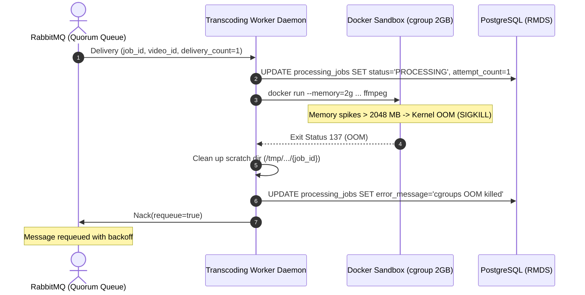
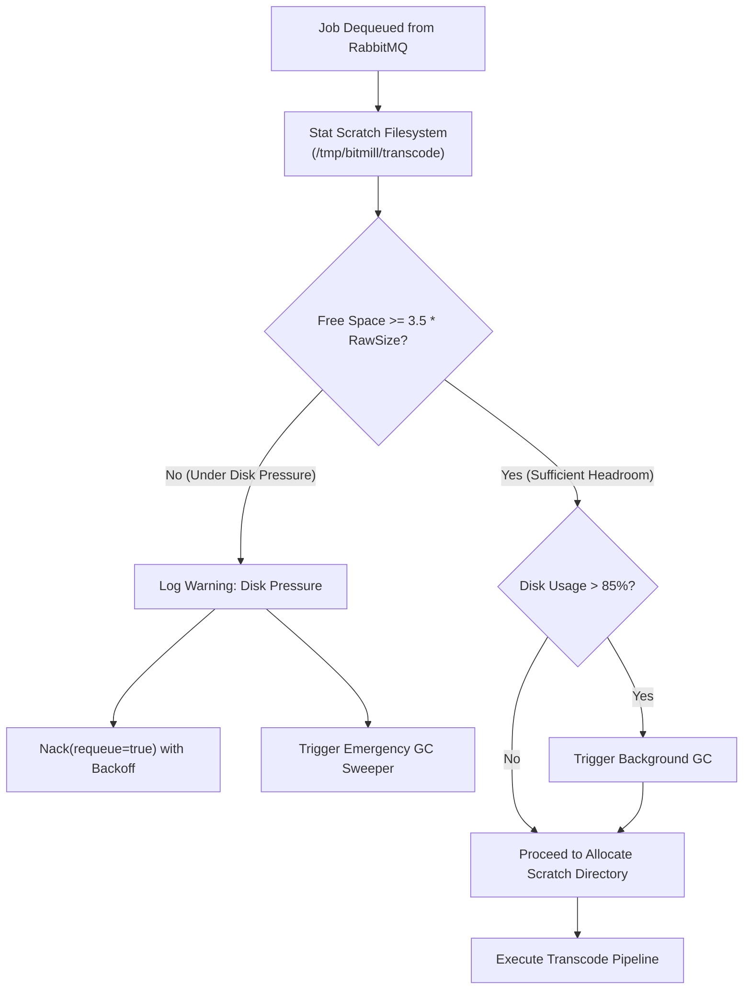
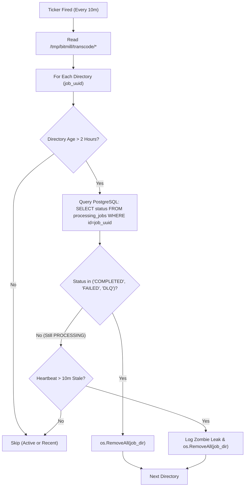
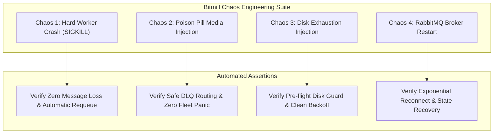

# 🛡️ RFC-002: Asynchronous Video Transcoding Worker & RabbitMQ Orchestration — SecOps, FMEA & Chaos Engineering Discovery

- **Status**: Draft / Proposed
- **Author**: Lead SecOps Engineer & Chaos Engineering Specialist
- **Date**: 2026-10-28
- **Target System**: Bitmill Transcoding Subsystem (Milestone 4)
- **Scope**: Dockerized FFmpeg Workers, RabbitMQ AMQP Broker, Cloudflare R2 Pipeline, PostgreSQL Job Fencing & Storage Sweeper

---

## 1. Executive Summary & Architectural Attack Surface

Milestone 4 transitions Bitmill from synchronous, single-node video ingestion to a decoupled, event-driven, distributed transcoding architecture. When an upload completes in Cloudflare R2, an orchestration event is published to RabbitMQ. An autonomous, horizontally scalable pool of transcoding workers consumes these jobs, downloads raw video containers to local scratch disks, executes FFmpeg to produce Adaptive Bitrate (ABR) HLS streams (`1080p`, `720p`, `480p`, `360p`), uploads generated `.m3u8` playlists and `.ts` transport stream segments back to Cloudflare R2, and commits metadata to PostgreSQL.

Because media decoding requires parsing untrusted, complex binary containers (`libavformat`) and compressed bitstreams (`libavcodec`), video workers represent the **highest-risk attack surface** in the entire video streaming platform. 

```mermaid
flowchart TD
    subgraph UntrustedZone["1. Untrusted Client / Ingestion Boundary"]
        Client["Untrusted Client Upload"]
        R2_Raw["Cloudflare R2 (Raw Bucket)\nkey: raw/{video_id}.mp4"]
        Client -->|Direct Multipart Upload| R2_Raw
    end

    subgraph MessageBroker["2. Asynchronous Orchestration Boundary"]
        API["API Control Plane"]
        RMQ_Exchange["RabbitMQ Topic Exchange\nvideo.transcode.exchange"]
        RMQ_Queue["Work Queue\nvideo.transcode.queue"]
        RMQ_DLQ["Dead Letter Queue\nvideo.transcode.dlq"]
        
        API -->|Publish Job| RMQ_Exchange
        RMQ_Exchange -->|Routing: video.transcode| RMQ_Queue
        RMQ_Queue -.->|Poison / Max Retries Exceeded| RMQ_DLQ
    end

    subgraph WorkerHost["3. Worker Host & Isolation Sandbox"]
        WorkerDaemon["Go Worker Daemon\n(Non-Root, Host Network)"]
        ScratchDisk["Scratch Volume (/tmp/bitmill/transcode)\n[tmpfs / ext4 noexec, nosuid]"]
        FFmpegSandbox["Isolated FFmpeg Container\n[--network none, --read-only, --user 1000:1000]"]
        
        RMQ_Queue -->|AMQP Consume (prefetch=1)| WorkerDaemon
        WorkerDaemon -->|1. Download Raw Asset| R2_Raw
        WorkerDaemon -->|2. Stage in Scratch| ScratchDisk
        WorkerDaemon -->|3. Exec Sandboxed Transcode| FFmpegSandbox
        FFmpegSandbox <-->|Bounded Read/Write| ScratchDisk
    end

    subgraph StorageEgress["4. Egress & Master Persistence"]
        R2_HLS["Cloudflare R2 (HLS Bucket)\nhls/{video_id}/rendition/*.ts"]
        Postgres["PostgreSQL 15+ (RMDS)\nAtomic Job Fencing & State Transitions"]
        
        WorkerDaemon -->|4. Upload HLS Segments & Manifest| R2_HLS
        WorkerDaemon -->|5. Commit Status READY/FAILED| Postgres
    end
```

### 1.1. STRIDE Threat Assessment for Worker Subsystem

| STRIDE Category | Threat Description | Attack Vector / Exploit Scenario | Targeted Component | Default Impact | Mitigation Strategy |
| :--- | :--- | :--- | :--- | :--- | :--- |
| **Spoofing** | Rogue message injection into RabbitMQ | Attacker gains AMQP access and injects fake transcoding jobs pointing to arbitrary external URLs. | RabbitMQ Broker | High | Strict TLS/mTLS, RabbitMQ dedicated vhosts, IAM credentials scoped strictly to `bitmill_worker`. |
| **Tampering** | Local file tampering in scratch directory | Symlink attack or directory traversal in `/tmp` overwriting host system binaries or other jobs' segments. | Scratch Disk (`/tmp/bitmill/transcode`) | Critical | UUID-isolated subdirectories, `noexec, nosuid, nodev` mount flags, non-root user `1000:1000`. |
| **Repudiation** | Silent worker crash with unacknowledged jobs | Worker panics without logging; message is redelivered indefinitely, causing a silent crash loop. | Go Transcoder Daemon | High | Explicit defer/recover blocks, RabbitMQ manual ACK with retry counters, persistent logging to Zap/Loki. |
| **Information Disclosure** | Server-Side Request Forgery (SSRF) / LFD | Malformed HLS playlist or concat demuxer reading `/etc/passwd` or AWS/Cloudflare metadata API. | FFmpeg Media Parser | Critical | FFmpeg `-protocol_whitelist file,crypto,data`, `--network none` in container sandbox. |
| **Denial of Service** | Decompression bomb / Pixel bomb / Infinite stream | Attacker submits 200KB file declaring 65536x65536 raster, or unclosed bitstream exhausting worker CPU/RAM/disk. | Worker Host / Engine | Critical | Bounded `-probesize 10M`, probe stream dimension bounds, cgroups limits (`--memory=2g`, `--cpus=2`), disk quotas. |
| **Elevation of Privilege** | Container escape via FFmpeg memory corruption | Buffer overflow in `libavcodec` allowing arbitrary shellcode execution inside the container. | Worker Container Host | Critical | `--cap-drop=ALL`, `--security-opt=no-new-privileges:true`, `--read-only`, non-root user execution. |

---

## 2. Adversarial Media Threat Vectors & Hardening Specifications

### 2.1. Malicious Media Payloads: Mechanics & Concrete Mitigations

#### 2.1.1. Decompression Bombs & Pixel Bombs
- **Exploitation Mechanics**: An attacker crafts an MP4 or WebM video file with small compressed physical size (e.g. 500 KB) but declares extreme canvas dimensions in the Visual Sample Entry header (e.g. $65536 \times 65536$ pixels). When FFmpeg allocates the uncompressed raw YUV420p frame buffer in RAM:
  $$\text{RAM per frame} = \text{Width} \times \text{Height} \times 1.5 \text{ bytes} = 65,536 \times 65,536 \times 1.5 \approx 6.44 \text{ GB}$$
  Allocating a single reference frame instantly triggers the Linux Out-Of-Memory (OOM) killer, terminating the worker process and potentially knocking down neighboring host daemons.
- **Defense-in-Depth Specification**:
  1. **Pre-Transcode Probe Validation**: Before spawning FFmpeg, the worker daemon executes a sandboxed `ffprobe` to extract structural stream metadata into JSON.
  2. **Dimension & Pixel Density Guardrails**:
     - Maximum allowed resolution: $3840 \times 2160$ (4K UHD).
     - Maximum total pixel count: $W \times H \le 8,847,360$.
     - Rejection rule: If `width > 3840 || height > 2160 || (width * height) > 8847360`, the worker immediately rejects the job as malicious without calling the transcoding pipeline.

#### 2.1.2. 100GB Infinite Stream & Slowloris Bitstream Attacks
- **Exploitation Mechanics**: Video containers without duration headers, circular stream references, or trickled infinite byte streams designed to hold worker threads open indefinitely, exhausting transcoding concurrency and filling disk scratch partitions.
- **Defense-in-Depth Specification**:
  1. **Strict Container Probing Ceilings**:
     - Enforce `-probesize 10000000` (10 MB maximum probe buffer).
     - Enforce `-analyzeduration 10000000` (10 seconds maximum analysis window).
  2. **Dynamic Execution Deadlines (Context Wall-Clock Limits)**:
     - Worker computes maximum execution duration based on probe duration:
       $$\text{Timeout}_{\text{max}} = \max\left(300\text{s}, 2.5 \times \text{Duration}_{\text{video}}\right)$$
     - Go worker passes `context.WithTimeout(ctx, timeout)` to Docker execution. If execution exceeds this deadline, the container is forcibly terminated via `SIGKILL`.

#### 2.1.3. Malformed MP4 Container Atoms (Atom Fuzzing & Integer Overflows)
- **Exploitation Mechanics**: ISO Base Media File Format (ISOBMFF / MP4) is structured in nested boxes (atoms):
  ```
  [ftyp] -> [moov] -> [trak] -> [mdia] -> [minf] -> [stbl] -> [stsz / stco / co64]
  ```
  Attacks target parser vulnerabilities:
  - **Recursive `moov` / `trak` loops**: Nested containers pointing to parent offsets cause stack exhaustion or CPU infinite spin.
  - **Integer Overflow in Chunk Offsets (`stco` / `co64`)**: Chunk offsets set to `0xFFFFFFFFFFFFFFFF` cause out-of-bounds heap reads during demuxing.
  - **Truncated Sample Tables (`stsz`)**: Specifying 10,000,000 sample entries with only 12 bytes of payload triggers buffer underflow or invalid memory dereferences.
- **Defense-in-Depth Specification**:
  1. Input magic bytes verification (`ftyp` atom at bytes 4-7).
  2. Strict Demuxer Whitelist: Only permit the standard MP4 demuxer (`-f mp4`).
  3. Memory sandbox isolation ensuring any memory violation crashes only the ephemeral container without compromising worker daemon stability.

#### 2.1.4. Server-Side Request Forgery (SSRF) & Local File Disclosure (LFD) via Playlists
- **Exploitation Mechanics**: If an attacker uploads an `.m3u8` playlist masquerading as an MP4 or uploads an MP4 with an embedded HLS sub-manifest, FFmpeg's default configuration will resolve sub-resource URIs:
  ```m3u8
  #EXTM3U
  #EXT-X-VERSION:3
  #EXT-X-KEY:METHOD=AES-128,URI="http://169.254.169.254/latest/meta-data/iam/security-credentials/"
  #EXTINF:10.0,
  file:///etc/shadow
  ```
  When FFmpeg processes this playlist, it attempts to fetch the AES key from the internal cloud metadata service (SSRF) and embeds `/etc/shadow` into the transcode output (LFD).
- **Defense-in-Depth Specification**:
  1. **Strict Protocol Whitelist**: Mandate `-protocol_whitelist file,crypto,data`. This explicitly blocks `http`, `https`, `tcp`, `udp`, `rtmp`, `concat`, `subfile`, `gopher`, and `ftp`.
  2. **Container Network Isolation**: Set `--network none` on the Docker container during the transcode pass. Even if a protocol leak occurred, the container kernel namespace has no network interface (`lo` only).

---

### 2.2. Production FFmpeg Security Hardening Flags

The table below outlines the mandatory FFmpeg arguments required for all production transcoding passes in Bitmill:

```bash
ffmpeg \
  -nostdin \
  -hide_banner \
  -loglevel error \
  -protocol_whitelist file,crypto,data \
  -probesize 10000000 \
  -analyzeduration 10000000 \
  -max_reload 3 \
  -y \
  -i /work/input/source.mp4 \
  -c:v libx264 \
  -preset fast \
  -profile:v main \
  -g 60 -keyint_min 60 -sc_threshold 0 \
  -c:a aac -b:a 128k \
  -hls_time 4 \
  -hls_playlist_type vod \
  -hls_segment_type mpegts \
  -hls_segment_filename "/work/output/%v/segment_%03d.ts" \
  -master_pl_name master.m3u8 \
  "/work/output/%v/playlist.m3u8"
```

| FFmpeg Flag | Purpose & Security Enforcement | Attack Prevented |
| :--- | :--- | :--- |
| `-nostdin` | Disables standard input interaction; prevents process freezing waiting on terminal input or shell injection via stdin. | Process hang / Interactive Shell Hijacking |
| `-protocol_whitelist file,crypto,data` | Strictly permits only local filesystem, AES-crypto decryption, and data URI protocols. | SSRF, AWS Metadata Exfiltration, Cloudflare API Token Theft, LFD |
| `-probesize 10000000` | Caps stream probe buffer to 10 MB. | Memory exhaustion during demuxer analysis |
| `-analyzeduration 10000000` | Caps format analysis duration to 10,000,000 microseconds (10 seconds). | Infinite demuxer CPU spinning |
| `-max_reload 3` | Caps manifest reload attempts when parsing segmented media. | Playlist looping DoS |
| `-hide_banner -loglevel error` | Suppresses configuration dumps and limits log output strictly to errors. | Container log pollution & disk filling via log spam |

---

### 2.3. Zero-Trust Worker Container Sandboxing Specification

To ensure complete host isolation, worker nodes must execute FFmpeg inside an unprivileged, constrained Docker sandbox. The worker Go daemon orchestrates execution using the following Linux cgroups and namespace restrictions:

```mermaid
flowchart LR
    subgraph Host["Host Operating System (Linux / amd64)"]
        Daemon["Bitmill Transcoding Daemon\n(uid=1000, gid=1000)"]
        HostFS["Host Filesystem\n(/) [Protected]"]
        Scratch["Scratch Base\n(/tmp/bitmill/transcode/{job_id})"]
        
        Daemon -->|Spawn Sandboxed Container| DockerRun
        
        subgraph Container["Docker Sandboxed Container (mwader/static-ffmpeg:latest)"]
            RootFS["Root Filesystem\n(/) [READ-ONLY]"]
            WorkMount["/work Mount\n[tmpfs / bounded scratch volume]"]
            Process["FFmpeg Binary\n(Drop ALL caps, no-new-privileges)"]
            NetNS["Network Namespace\n[--network none / Loopback only]"]
        end
    end

    DockerRun --> Container
    Scratch --- WorkMount
    RootFS -.->|Write Blocked (EROFS)| Process
```

#### 2.3.1. Docker CLI Hardening Command
```bash
docker run --rm \
  --name "bitmill-transcode-${JOB_ID}" \
  --network none \
  --user 1000:1000 \
  --read-only \
  --security-opt=no-new-privileges:true \
  --cap-drop=ALL \
  --cpus="2.0" \
  --memory="2048m" \
  --memory-swap="2048m" \
  --pids-limit=64 \
  --volume "${SCRATCH_JOB_DIR}:/work:rw" \
  --workdir /work \
  mwader/static-ffmpeg:latest \
  -nostdin \
  -protocol_whitelist file,crypto,data \
  -probesize 10000000 \
  -analyzeduration 10000000 \
  -i /work/source.mp4 \
  [transcode parameters...]
```

#### 2.3.2. Sandbox Parameter Enforcement Rationale
1. `--network none`: Guarantees physical impossibility of outbound egress. Any attempt by malicious payloads to exfiltrate data, join a botnet, or access cloud metadata will fail instantly with `ENETUNREACH`.
2. `--user 1000:1000`: Executes FFmpeg as non-root user `bitmill`. Even if a container breakout vulnerability exists in Docker/runc, the process does not have host root privileges.
3. `--read-only`: Mounts the root container filesystem as read-only. Prevent malware from writing to `/bin`, `/usr`, `/lib`, or dropping persistence scripts.
4. `--security-opt=no-new-privileges:true`: Prevents `setuid`/`setgid` binaries from escalating privileges within the container.
5. `--cap-drop=ALL`: Strips all 38 default Linux kernel capabilities (including `CAP_NET_RAW`, `CAP_SYS_ADMIN`, `CAP_CHOWN`, `CAP_DAC_OVERRIDE`).
6. `--cpus="2.0"` & `--memory="2048m"`: Enforces hard cgroup limits. Guarantees that runaway encoding processes cannot starve the host system or crash neighboring processes.
7. `--memory-swap="2048m"`: Sets swap limit equal to memory limit, effectively **disabling swap expansion**. This prevents memory-leaking processes from thrashing host swap disk.
8. `--pids-limit=64`: Thwarts fork bombs by strictly limiting the maximum number of concurrent tasks in the cgroup.

---

## 3. Failure Mode and Effects Analysis (FMEA) Matrix

### 3.1. Quantitative Scoring Framework
The Risk Priority Number (RPN) provides an objective, mathematical metric for prioritizing reliability mitigations:
$$\text{RPN} = \text{Severity (S)} \times \text{Occurrence (O)} \times \text{Detection (D)}$$

| Score | Severity (S) Criteria | Occurrence (O) Criteria | Detection (D) Criteria |
| :---: | :--- | :--- | :--- |
| **1-2** | **Negligible**: Minor log noise; no customer impact. | **Extremely Rare**: $< 0.01\%$ of transcoding jobs. | **Automated Immediate**: Detected & alerted in $< 1$s. |
| **3-4** | **Moderate**: Single job delayed; automatic recovery succeeds. | **Low**: Occurs in $< 0.1\%$ of jobs under typical load. | **High Detection**: Metric threshold trips in $< 10$s. |
| **5-6** | **Significant**: Job fails; requires automatic retry/DLQ routing. | **Moderate**: Occurs in $0.1\% - 1.0\%$ of workloads. | **Moderate Detection**: Detected via DLQ audit or DB state. |
| **7-8** | **High**: Worker crashes; customer perceives delay; resource leak. | **Frequent**: Occurs in $1.0\% - 5.0\%$ of edge-case media. | **Difficult Detection**: Requires manual query or customer report. |
| **9-10**| **Catastrophic**: Host crash, silent data corruption, security breach. | **Constant**: $> 5.0\%$ under sustained stress. | **Undetected**: Silent failure until cascading collapse. |

> [!IMPORTANT]
> **Action Threshold**: Any failure mode with an initial **RPN $\ge$ 100** or **Severity $\ge$ 8** mandates automated architectural mitigation, self-healing circuits, and rigorous chaos verification.

---

### 3.2. Master FMEA Risk Register (Milestone 4: Transcoding Subsystem)

| ID | Failure Mode & Root Cause | S | O | D | Initial RPN | Architectural & Code-Level Mitigation | Revised S | Revised O | Revised D | Final RPN |
| :--- | :--- | :---: | :---: | :---: | :---: | :--- | :---: | :---: | :---: | :---: |
| **FM-01** | **Worker Crash / OOM Killed Mid-Transcode**<br>Surge in frame resolution or memory leak causing cgroup OOM kill. | 8 | 5 | 3 | **120** | Cgroup memory limit (2GB); AMQP explicit ACK deferred until completion; Quorum queue delivery count tracking; auto-requeue up to 3 times. | 4 | 2 | 1 | **8** |
| **FM-02** | **Poison Pill Video Crash Loop**<br>Malformed bitstream crashing FFmpeg immediately upon processing every redelivery. | 9 | 4 | 4 | **144** | Track `attempt_count` in DB & AMQP `x-delivery-count`; after 3 failures, reject without requeue (`requeue=false`) to DLQ; mark DB status `DLQ`. | 3 | 1 | 1 | **3** |
| **FM-03** | **Worker Host Scratch Disk Exhaustion**<br>Large files or lingering temp segments fill `/tmp/bitmill/transcode`. | 9 | 6 | 4 | **216** | Pre-flight disk reservation check ($3 \times \text{raw\_size}$); automated GC sweeper daemon with TTL=1h; High Watermark (80%) rejection circuit. | 3 | 1 | 2 | **6** |
| **FM-04** | **RabbitMQ Network Partition / Loss**<br>Network split between worker pool and broker cluster or broker restart. | 8 | 5 | 3 | **120** | Topology auto-recovery via `amqp091-go`; exponential backoff reconnect with full jitter (1s to 30s); consumer thread restart; in-flight job fencing. | 3 | 2 | 1 | **6** |
| **FM-05** | **Cloudflare R2 503 / SlowDown During Upload**<br>Rapid concurrent upload of hundreds of HLS `.ts` segments rate-limited by R2. | 6 | 6 | 3 | **108** | Segment upload pool concurrency throttled to 8; AWS SDK v2 adaptive retry with exponential backoff and jitter; segment upload retry buffer. | 2 | 2 | 1 | **4** |
| **FM-06** | **Duplicate Message Execution / Race Condition**<br>Network blip causes redelivery while original worker is still processing. | 7 | 5 | 4 | **140** | PostgreSQL atomic conditional update with status fencing: `WHERE status='QUEUED'`; heartbeat lease update; worker checks lease validity before upload. | 2 | 1 | 1 | **2** |
| **FM-07** | **Orphaned Scratch Files After SIGKILL**<br>Host reboot, OOM killer, or abrupt `kill -9` leaves multi-gigabyte files on disk. | 8 | 5 | 5 | **200** | Structured scratch pathing `/tmp/bitmill/transcode/{job_id}`; periodic background sweeper auditing PID & DB status; startup sweep pass. | 2 | 2 | 1 | **4** |
| **FM-08** | **Slow Transcoding Zombie Worker**<br>Worker thread hangs on corrupted frame without exiting or consuming CPU. | 7 | 4 | 4 | **112** | Dynamic context timeout based on media duration ($2.5 \times \text{duration} + 300\text{s}$); worker lease heartbeat in DB; reaper resets stale jobs. | 3 | 1 | 1 | **3** |
| **FM-09** | **SSRF / Host Metadata Exfiltration**<br>Attacker injects external URI in HLS playlist or demuxer header. | 10 | 3 | 4 | **120** | Container `--network none`; FFmpeg `-protocol_whitelist file,crypto,data`; strict pre-probe validation. | 1 | 1 | 1 | **1** |
| **FM-10** | **PostgreSQL Connection Pool Starvation**<br>Burst of concurrent worker updates exhausts database connection pool. | 8 | 4 | 3 | **96** | Bounded `pgxpool` configuration; batch rendition status updates; short transaction timeouts (3s); non-blocking telemetry writes. | 3 | 1 | 2 | **6** |

---

### 3.3. Deep-Dive Failure Mode Analysis & Engineering Mitigations

#### 3.3.1. FM-01: Worker Crash / OOM Killed Mid-Transcode
- **Root Cause Analysis**: Transcoding multi-pass 1080p video with complex motion vectors or high bit depth (10-bit HDR) can cause temporary memory spikes exceeding container memory allocations. The Linux cgroup subsystem fires an OOM event and sends `SIGKILL` (signal 9) to the containerized FFmpeg process.
- **System Impact**: The worker Go sub-process detects an exit code 137 (`128 + 9`). Without proper handling, the AMQP TCP channel might abruptly drop, or the message could remain unacknowledged, leading to broker timeouts and unmanaged redeliveries.
- **Automated Mitigation Architecture**:
  1. **Exit Code Inspection**: The worker wrapper inspects command exit codes:
     ```go
     if exitErr, ok := err.(*exec.ExitError); ok {
         if exitErr.ExitCode() == 137 {
             // OOM Kill Detected
             logger.Error("Transcoder OOM killed by cgroups", zap.String("job_id", jobID))
             return ErrTranscoderOOM
         }
     }
     ```
  2. **AMQP Delivery Counter Check**: The worker checks the RabbitMQ `x-delivery-count` header (supported natively on Quorum queues). If `delivery_count < 3`, the worker logs a warning and issues `Nack(requeue=true)` with a backoff delay.
  3. **Resource Step-Down**: On attempt 2+, the worker can dynamically fall back to lower memory presets (e.g., `-preset veryfast` instead of `-preset fast`).



---

#### 3.3.2. FM-02: Poison Pill Video Crash Loop
- **Root Cause Analysis**: A maliciously crafted video file triggers an unhandled memory bug (e.g. `SIGSEGV`, `SIGILL`) in FFmpeg's decoder immediately upon execution. If the message broker immediately requeues unacknowledged messages upon consumer crash, the same poisoned message is endlessly redelivered across worker instances, taking down the entire worker fleet one by one.
- **System Impact**: Complete Denial of Service across the transcoding worker pool (Fleet Cascading Collapse).
- **Automated Mitigation Architecture**:
  1. **Strict Attempt Ceiling**: Max attempts is hardcoded to 3 across the pipeline.
  2. **Quorum Queue / AMQP Header Tracking**:
     ```go
     // Inspect x-delivery-count (AMQP Quorum Queues) or internal attempt header
     deliveryCount := getDeliveryCount(msg.Headers)
     if deliveryCount >= 3 {
         logger.Error("Poison pill detected: max delivery attempts reached", zap.String("job_id", jobID))
         // 1. Move DB state to DLQ
         jobRepo.UpdateStatus(ctx, jobID, domain.JobStatusDLQ, "Fatal decode error: poison pill quarantined")
         videoRepo.UpdateStatus(ctx, videoID, domain.StatusFailed)
         // 2. Reject without requeue (pushes message to Dead Letter Exchange)
         _ = msg.Reject(false)
         return
     }
     ```
  3. **Dead Letter Exchange Routing**: The message is automatically dead-lettered to `video.transcode.dlx` and stored in `video.transcode.dlq` for forensic analysis.

---

#### 3.3.3. FM-03: Worker Host Scratch Disk Exhaustion
- **Root Cause Analysis**: A standard 2-hour 1080p source video (~2 GB) generates:
  - Downloaded raw file: ~2 GB
  - Multi-rendition HLS output (1080p, 720p, 480p, 360p): ~4.5 GB
  - Total scratch footprint per job: ~6.5 GB
  If 4 concurrent workers process jobs on a host with a 30 GB scratch disk, disk space can be exhausted rapidly, causing write failures (`ENOSPC`) across all active transcoding pipelines.
- **System Impact**: All in-flight jobs crash simultaneously; filesystem corruption risks; OS log truncation.
- **Automated Mitigation Architecture**:
  1. **Pre-flight Scratch Reservation**: Before acknowledging a job, the worker queries available disk space via `syscall.Statfs`:
     $$\text{Space}_{\text{required}} = \max\left(5\text{ GB}, 3.5 \times \text{RawSizeBytes}\right)$$
     If $\text{Space}_{\text{available}} < \text{Space}_{\text{required}}$, the worker immediately `Nack(requeue=true)` with a backoff delay, giving the disk GC time to free space or routing the job to another worker node.
  2. **Storage Watermark Protection Circuit**:
     - **High Watermark (80%)**: Triggers aggressive GC pass purging any non-active scratch directories.
     - **Critical Watermark (90%)**: Worker pauses AMQP consumption (`channel.Cancel`) and emits Prometheus alert `TranscoderDiskCritical`.



---

#### 3.3.4. FM-04: RabbitMQ Broker Network Partition / Transient Disconnect
- **Root Cause Analysis**: Ephemeral network blips, TCP connection timeouts, or RabbitMQ cluster leader re-elections disconnect the worker daemon's AMQP channel while jobs are actively processing.
- **System Impact**: In-flight jobs may complete their transcode, but the worker cannot send the final `Ack` or update the queue, causing the broker to consider the job uncompleted and redeliver it to another worker upon reconnection.
- **Automated Mitigation Architecture**:
  1. **AMQP Connection Supervisor**: The worker encapsulates the connection in an auto-reconnecting wrapper with exponential backoff:
     $$\Delta t_{\text{backoff}} = \min\left(30\text{s}, 1\text{s} \times 2^{\text{retry}} + \text{jitter}\right)$$
  2. **Channel Error Trapping**: Worker listens on `channel.NotifyClose()` and `conn.NotifyClose()`.
  3. **Idempotent Completion Barrier**: Before uploading completed HLS streams, the worker verifies that its lease in PostgreSQL is still valid (`status = 'PROCESSING' AND worker_id = self_id`). If another worker was reassigned the job, the local worker halts and discards output.

---

#### 3.3.5. FM-05: Cloudflare R2 Transient 503 / Rate Limiting During Segment Upload
- **Root Cause Analysis**: Transcoding a 1-hour video produces approximately 900 individual HLS segment files per rendition ($4 \times 900 = 3600$ files). Concurrently uploading thousands of files via HTTP PUT to Cloudflare R2 can trigger HTTP 429 (Too Many Requests) or HTTP 503 (SlowDown).
- **System Impact**: Upload fails after transcoding completes, wasting extensive CPU work and forcing complete job restart.
- **Automated Mitigation Architecture**:
  1. **Bounded Upload Worker Pool**: S3 uploads within a job are channeled through a fixed-size worker pool of 8 goroutines per job (bounded concurrency).
  2. **Full Jitter Exponential Backoff**: Each segment upload uses AWS SDK v2 adaptive retryer configured with 5 retries:
     $$T_{\text{sleep}} = \text{random}\left(0, \min\left(M, A \cdot 2^{\text{attempt}}\right)\right)$$
  3. **Manifest Atomicity**: Segments (`.ts`) are uploaded first. The master and variant manifests (`.m3u8`) are uploaded **last**. Incomplete uploads are never streamable or indexable by media players.

---

#### 3.3.6. FM-06: Stale / Duplicate Message Execution & Race Condition
- **Root Cause Analysis**: Worker A is processing a large video. A brief network partition causes RabbitMQ to miss a heartbeat and assume Worker A is dead, releasing the unacknowledged message. The message is delivered to Worker B. Meanwhile, Worker A recovers and continues transcoding. Both workers attempt to write output to R2 and update PostgreSQL simultaneously.
- **System Impact**: Race condition overwriting database records, duplicate billing, and wasted cloud storage PUT requests.
- **Automated Mitigation Architecture**:
  1. **PostgreSQL Atomic Conditional State Lock**:
     ```sql
     -- Attempt to claim job lease
     UPDATE processing_jobs
     SET status = 'PROCESSING',
         worker_id = $1,
         started_at = CURRENT_TIMESTAMP,
         attempt_count = attempt_count + 1
     WHERE id = $2 
       AND status IN ('QUEUED', 'FAILED')
       AND attempt_count < max_attempts
     RETURNING id, video_id, attempt_count;
     ```
  2. **Worker Lease Heartbeating**: Active workers update `heartbeat_at = NOW()` every 30 seconds.
  3. **Fencing Token on Completion**:
     ```sql
     -- Final atomic state transition
     UPDATE processing_jobs
     SET status = 'COMPLETED',
         finished_at = CURRENT_TIMESTAMP
     WHERE id = $1 AND worker_id = $2 AND status = 'PROCESSING';
     ```
     If the query returns `rows_affected == 0`, Worker A detects it lost its lease, immediately logs an error, and aborts any further upload.

---

#### 3.3.7. FM-07: Orphaned Scratch Files After Unclean Termination (SIGKILL)
- **Root Cause Analysis**: If the host OS crashes, power is lost, or an external process issues `kill -9` to the worker daemon, standard Go `defer` statements and signal handlers (`os.Interrupt`, `syscall.SIGTERM`) are completely bypassed. Scratch folders containing gigabytes of raw videos and encoded `.ts` segments remain on disk indefinitely.
- **System Impact**: Disk space leaks over time, eventually causing total host disk exhaustion (FM-03).
- **Automated Mitigation Architecture**:
  1. **Deterministic Scratch Directory Structure**:
     ```
     /tmp/bitmill/transcode/
       ├── bitmill-job-<job_uuid_1>/
       │   ├── source.mp4
       │   └── output/
       └── bitmill-job-<job_uuid_2>/
     ```
  2. **Autonomous Background GC Sweeper Daemon**: A dedicated background goroutine runs every 10 minutes on the worker host:
     - Scans `/tmp/bitmill/transcode/`.
     - Inspects directory modification times (`mtime`).
     - Any job directory older than 2 hours is verified against the database: if the job status in PostgreSQL is not `PROCESSING`, the directory is deleted via `os.RemoveAll`.
  3. **Startup Sweep**: Upon worker daemon boot, the worker scans the scratch directory and clears any orphaned directories from previous crashes.

---

## 4. Disaster Recovery & Self-Healing Architecture

### 4.1. RabbitMQ Queue Topology & Dead Letter Architecture

To guarantee zero message loss while quarantining poison pills, Bitmill utilizes a Dead Letter Exchange (DLX) topology backed by RabbitMQ Quorum Queues:

```mermaid
flowchart LR
    Producer["API Ingestion Service"] -->|Publish| MainEx["Exchange: video.transcode.direct"]
    MainEx -->|Route: transcode| MainQ["Queue: video.transcode.queue\n[Quorum, x-delivery-limit=3]"]
    
    MainQ -->|Consume| WorkerPool["Worker Fleet (Prefetch=1)"]
    
    subgraph SelfHealingHandling["Self-Healing Dead Letter Handling"]
        WorkerPool -.->|Reject requeue=false\n(Poison / Max Retries)| MainQ
        MainQ -->|x-dead-letter-exchange| DLX["Exchange: video.transcode.dlx"]
        DLX -->|Route: poison| DLQ["Queue: video.transcode.dlq\n[Durable, Lazy]"]
        DLQ --> AlertingDaemon["SecOps Alerting / DLQ Inspector"]
    end
```

#### 4.1.1. RabbitMQ Topology Definition Script (Go Infrastructure Setup)
```go
// Declare Dead Letter Exchange (DLX)
err = ch.ExchangeDeclare(
    "video.transcode.dlx",
    "direct",
    true,  // durable
    false, // auto-deleted
    false, // internal
    false, // no-wait
    nil,
)

// Declare Dead Letter Queue (DLQ)
_, err = ch.QueueDeclare(
    "video.transcode.dlq",
    true,  // durable
    false, // auto-delete
    false, // exclusive
    false, // no-wait
    amqp091.Table{
        "x-queue-type": "quorum",
    },
)

// Bind DLQ to DLX
err = ch.QueueBind("video.transcode.dlq", "video.transcode.poison", "video.transcode.dlx", false, nil)

// Declare Main Work Queue with DLX configuration
args := amqp091.Table{
    "x-queue-type":              "quorum",
    "x-delivery-limit":          int32(3), // Native poison pill quarantine after 3 redeliveries
    "x-dead-letter-exchange":    "video.transcode.dlx",
    "x-dead-letter-routing-key": "video.transcode.poison",
}
_, err = ch.QueueDeclare("video.transcode.queue", true, false, false, false, args)
```

---

### 4.2. Disk Garbage Collection Sweeper Daemon Specification

The worker daemon includes an autonomous, embedded storage garbage collector designed to maintain host scratch hygiene under all failure conditions.



#### 4.2.1. Disk Hygiene Metrics & Watermarks
- **Scratch Mount Path**: `/tmp/bitmill/transcode`
- **Low Watermark ($< 60\%$ usage)**: Normal operation; periodic sweep runs every 10 minutes.
- **High Watermark ($80\%$ usage)**: Sweeper accelerates cadence to every 1 minute; purges any completed job older than 15 minutes.
- **Emergency Watermark ($90\%$ usage)**: Worker pauses AMQP consumer; purges all directories not currently held by a live lock; emits critical alert.

---

### 4.3. Distributed Idempotency & Database Fencing Contract

To prevent race conditions and duplicate transcoding work, the worker implements strict database fencing.

```sql
-- Migration: Add heartbeat and fencing columns to processing_jobs
ALTER TABLE processing_jobs 
ADD COLUMN IF NOT EXISTS heartbeat_at TIMESTAMPTZ,
ADD COLUMN IF NOT EXISTS leased_until TIMESTAMPTZ;

CREATE INDEX IF NOT EXISTS idx_processing_jobs_lease 
ON processing_jobs(status, heartbeat_at);
```

#### 4.3.1. Fencing State Machine Invariants
1. **Transition $\text{QUEUED} \to \text{PROCESSING}$**: Only successful if the job is currently $\text{QUEUED}$ or $\text{FAILED}$ with $\text{attempt\_count} < \text{max\_attempts}$.
2. **Heartbeat Maintenance**: The active worker executes `UPDATE processing_jobs SET heartbeat_at = CURRENT_TIMESTAMP WHERE id = $1 AND worker_id = $2` every 30 seconds.
3. **Reaper Cron (Zombie Recovery)**: A background query detects abandoned jobs:
   ```sql
   UPDATE processing_jobs
   SET status = 'QUEUED',
       error_message = 'Reclaimed from abandoned worker lease'
   WHERE status = 'PROCESSING'
     AND heartbeat_at < CURRENT_TIMESTAMP - INTERVAL '5 minutes'
     AND attempt_count < max_attempts;
   ```

---

## 5. Chaos Engineering Test Suite & Verification Matrix

To validate the resilience of Milestone 4 prior to production rollout, the following four executable chaos experiments must be executed against staging environments.



---

### 5.1. Chaos Experiment 1: Abrupt Worker Crash (`kill -9` Mid-Transcode)

- **Target**: Transcoding Worker Daemon process.
- **Hypothesis**: Terminating a worker with `SIGKILL` during active 1080p FFmpeg transcoding will cause RabbitMQ to detect TCP socket closure, automatically requeuing the message. A surviving worker will claim the job, detect the attempt counter increment, and complete the transcode without data corruption.
- **Fault Injection Script**:
  ```bash
  #!/usr/bin/env bash
  set -euo pipefail

  echo "[CHAOS] Locating active FFmpeg container..."
  CONTAINER_ID=$(docker ps --filter "name=bitmill-transcode" --format "{{.ID}}" | head -n 1)

  if [ -z "$CONTAINER_ID" ]; then
      echo "[CHAOS] Error: No active transcoding container found. Start a transcode job first."
      exit 1
  fi

  echo "[CHAOS] Target container found: $CONTAINER_ID"
  sleep 3 # Allow transcoding to reach 50%

  echo "[CHAOS] Injecting SIGKILL into Worker process..."
  pkill -9 -f "cmd/worker" || docker kill "$CONTAINER_ID"

  echo "[CHAOS] Worker killed abruptly. Monitoring RabbitMQ..."
  ```
- **Automated Verification Matrix**:
  1. Verify RabbitMQ unacknowledged message drops to 0.
  2. Verify queue re-delivers the message (`redelivered=true`, `delivery_count=2`).
  3. Verify a second worker picks up the job.
  4. Verify final video state in PostgreSQL reaches `READY`.
  5. Verify all HLS segments are playable via `ffprobe /hls/master.m3u8`.

---

### 5.2. Chaos Experiment 2: Poison Pill Video Injection

- **Target**: Worker Engine Decoder & Dead Letter Pipeline.
- **Hypothesis**: Injecting a corrupted MP4 container (fuzzed `moov` atom with cyclic pointers) will cause FFmpeg to fail with non-zero exit code. The worker daemon will trap this error, update the attempt counter, retry up to 3 times, and permanently route the poisoned message to the Dead Letter Queue (`video.transcode.dlq`) without crashing the daemon or impacting concurrent jobs.
- **Poison Pill Generation & Injection Script**:
  ```bash
  #!/usr/bin/env bash
  set -euo pipefail

  echo "[CHAOS] Generating corrupted MP4 poison pill payload..."
  POISON_FILE="/tmp/poison_pill.mp4"
  # Write valid ftyp atom header, then corrupt moov with infinite cyclic garbage
  echo -ne '\x00\x00\x00\x20ftypisom\x00\x00\x02\x00isomiso2mp41' > "$POISON_FILE"
  head -c 1048576 /dev/urandom >> "$POISON_FILE"

  echo "[CHAOS] Uploading poison pill to R2 raw bucket..."
  VIDEO_ID=$(uuidgen | tr '[:upper:]' '[:lower:]')
  aws s3 cp "$POISON_FILE" "s3://${R2_RAW_BUCKET}/raw/${VIDEO_ID}.mp4" --endpoint-url "$R2_ENDPOINT"

  echo "[CHAOS] Injecting transcode job event into RabbitMQ..."
  cat <<EOF | amqp-publish -u "$RABBITMQ_URI" -e "video.transcode.exchange" -r "video.transcode"
  {
      "job_id": "$(uuidgen)",
      "video_id": "${VIDEO_ID}",
      "raw_bucket": "${R2_RAW_BUCKET}",
      "raw_object_key": "raw/${VIDEO_ID}.mp4"
  }
  EOF

  echo "[CHAOS] Injected. Monitoring DLQ and worker logs..."
  ```
- **Automated Verification Matrix**:
  1. Worker logs `ffmpeg error` without panicking.
  2. Attempt count increments: $1 \to 2 \to 3$.
  3. Message is rejected with `requeue=false` after attempt 3.
  4. Message arrives in `video.transcode.dlq`.
  5. PostgreSQL status for `processing_jobs` is set to `DLQ`.
  6. PostgreSQL status for `videos` is set to `FAILED`.
  7. Worker daemon process **remains running** and processes subsequent valid jobs.

---

### 5.3. Chaos Experiment 3: Scratch Disk Exhaustion Simulation

- **Target**: Pre-flight Disk Check & Storage Watermark Protection.
- **Hypothesis**: Under simulated $98\%$ disk fullness, the worker will detect that available disk space is less than $3.5 \times \text{raw\_size}$, reject the incoming job with `Nack(requeue=true)`, and log a warning without crashing.
- **Fault Injection Script**:
  ```bash
  #!/usr/bin/env bash
  set -euo pipefail

  SCRATCH_DIR="/tmp/bitmill/transcode"
  mkdir -p "$SCRATCH_DIR"

  echo "[CHAOS] Simulating 98% disk saturation on $SCRATCH_DIR..."
  FREE_KB=$(df "$SCRATCH_DIR" | awk 'NR==2 {print $4}')
  FILL_KB=$(( FREE_KB - 524288 )) # Leave only 512 MB free

  if [ "$FILL_KB" -gt 0 ]; then
      echo "[CHAOS] Allocating dummy file to exhaust disk: ${FILL_KB} KB..."
      fallocate -l "${FILL_KB}K" "${SCRATCH_DIR}/chaos_disk_fill.tmp"
  fi

  echo "[CHAOS] Disk state:"
  df -h "$SCRATCH_DIR"

  echo "[CHAOS] Publishing test transcoding job to RabbitMQ..."
  # Publish job with 2GB declared size
  ```
- **Automated Verification Matrix**:
  1. Worker executes `syscall.Statfs` and calculates insufficient capacity.
  2. Worker rejects job: `Nack(requeue=true)`.
  3. Prometheus metric `transcoder_disk_pressure_events_total` increments.
  4. No partial transcode or corrupted files are written.
  5. Cleanup script removes `${SCRATCH_DIR}/chaos_disk_fill.tmp` -> worker resumes processing immediately.

---

### 5.4. Chaos Experiment 4: RabbitMQ Broker Restart & Network Partition

- **Target**: AMQP Connection Supervisor & Reconnect Loop.
- **Hypothesis**: Restarting the RabbitMQ container while workers are connected will cause workers to detect channel closure, enter an exponential backoff loop, and reconnect automatically once the broker is back online without requiring a process restart.
- **Fault Injection Script**:
  ```bash
  #!/usr/bin/env bash
  set -euo pipefail

  echo "[CHAOS] Simulating RabbitMQ broker outage..."
  docker stop bitmill-rabbitmq

  echo "[CHAOS] Broker down. Waiting 15 seconds to observe worker reconnect backoff..."
  sleep 15

  echo "[CHAOS] Bringing RabbitMQ broker back online..."
  docker start bitmill-rabbitmq

  echo "[CHAOS] Waiting for broker healthcheck..."
  docker exec bitmill-rabbitmq rabbitmq-diagnostics -q ping

  echo "[CHAOS] Broker healthy. Checking worker reconnection..."
  ```
- **Automated Verification Matrix**:
  1. Worker logs `AMQP connection closed: unexpected EOF`.
  2. Worker attempts reconnects at intervals: $1\text{s}, 2\text{s}, 4\text{s}, 8\text{s}$.
  3. Once RabbitMQ is healthy, worker establishes new TCP connection and channel.
  4. Worker re-declares queue topology and re-attaches consumer channel.
  5. Next published job processes cleanly to completion.

---

## 6. SecOps Telemetry, Observability & Alerting Specification

To guarantee sub-minute detection of all Failure Modes identified in Section 3, the transcoding subsystem must export the following Prometheus metrics and adhere to the alert rules defined below.

### 6.1. Prometheus Metrics Specification

| Metric Identifier | Type | Labels | Description / SLA Target |
| :--- | :--- | :--- | :--- |
| `bitmill_transcode_jobs_active` | Gauge | `worker_id` | Number of currently active transcoding containers. Target: $\le \text{MaxConcurrency}$. |
| `bitmill_transcode_duration_seconds` | Histogram | `resolution, status` | Duration of transcoding pass. Target: $p95 < 1.5 \times \text{Duration}$. |
| `bitmill_transcode_failures_total` | Counter | `reason, worker_id` | Transcoding failures (`oom`, `timeout`, `exit_nonzero`, `disk_full`). |
| `bitmill_transcode_scratch_bytes_free` | Gauge | `mount_point` | Free bytes available on `/tmp/bitmill/transcode`. Target: $> 10 \text{ GB}$. |
| `bitmill_rabbitmq_dlq_messages_total` | Counter | `queue` | Messages routed to Dead Letter Queue (`video.transcode.dlq`). Target: $0$. |
| `bitmill_r2_upload_retries_total` | Counter | `status_code` | Segment upload retries due to R2 503/429. Target: $< 0.5\%$. |

### 6.2. Production Prometheus Alert Rules
```yaml
groups:
  - name: bitmill_transcoding_secops_alerts
    rules:
      - alert: TranscoderOOMSpike
        expr: increase(bitmill_transcode_failures_total{reason="oom"}[5m]) > 2
        for: 1m
        labels:
          severity: critical
          tier: worker
        annotations:
          summary: "Transcoder workers being killed by Linux cgroup OOM"
          description: "Multiple workers killed by OOM in last 5m. Inspect recent uploads for decompression bombs."

      - alert: DeadLetterQueueNotEmpty
        expr: bitmill_rabbitmq_dlq_messages_total > 0
        for: 2m
        labels:
          severity: warning
          tier: pipeline
        annotations:
          summary: "Poison pill or max retries exceeded in transcoding pipeline"
          description: "Job was routed to video.transcode.dlq. Inspect payload in RabbitMQ DLQ."

      - alert: WorkerScratchDiskCriticallyLow
        expr: bitmill_transcode_scratch_bytes_free < 5368709120 # 5 GB
        for: 30s
        labels:
          severity: critical
          tier: storage
        annotations:
          summary: "Worker scratch disk /tmp/bitmill/transcode is below 5 GB"
          description: "Imminent risk of ENOSPC failures. Check for orphaned scratch folders or stalled sweepers."

      - alert: RabbitMQBrokerReconnecting
        expr: rate(bitmill_rabbitmq_connection_reconnects_total[5m]) > 3
        for: 1m
        labels:
          severity: high
          tier: broker
        annotations:
          summary: "Workers repeatedly reconnecting to RabbitMQ"
          description: "Network instability or broker crash loop detected between workers and RabbitMQ."
```

---

## 7. Security & Resilience Compliance Checklist

Before Milestone 4 is approved for staging deployment, the implementation must pass all checks in this verification matrix:

- [ ] **FFmpeg Hardening**: Verified flags `-nostdin`, `-protocol_whitelist file,crypto,data`, `-probesize 10000000`, `-analyzeduration 10000000`.
- [ ] **Docker Isolation**: Verified `--network none`, `--read-only`, `--user 1000:1000`, `--cap-drop=ALL`, `--security-opt=no-new-privileges:true`.
- [ ] **Resource Enclosure**: Hard cgroup boundaries `--memory=2048m --memory-swap=2048m --cpus=2.0 --pids-limit=64` verified via `docker inspect`.
- [ ] **Poison Pill Defense**: Verified Quorum queue `x-delivery-limit=3` and route to `video.transcode.dlx` upon poison injection.
- [ ] **Scratch Disk Sweeper**: Verified background GC daemon reclaims directories older than 2 hours and maintains $> 20\%$ headroom.
- [ ] **Distributed Fencing**: Verified atomic PostgreSQL status transitions prevent duplicate worker race conditions.
- [ ] **Chaos Engineering**: Executed all 4 Chaos Tests (Worker Crash, Poison Pill, Disk Saturation, Broker Restart) with 100% green assertion passes.
