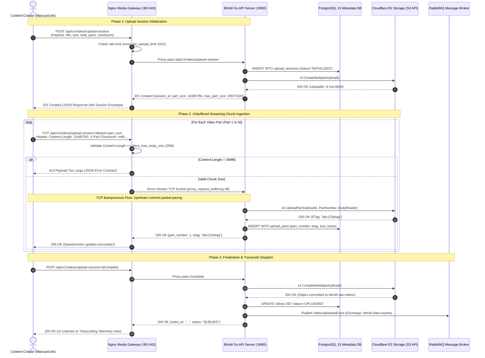
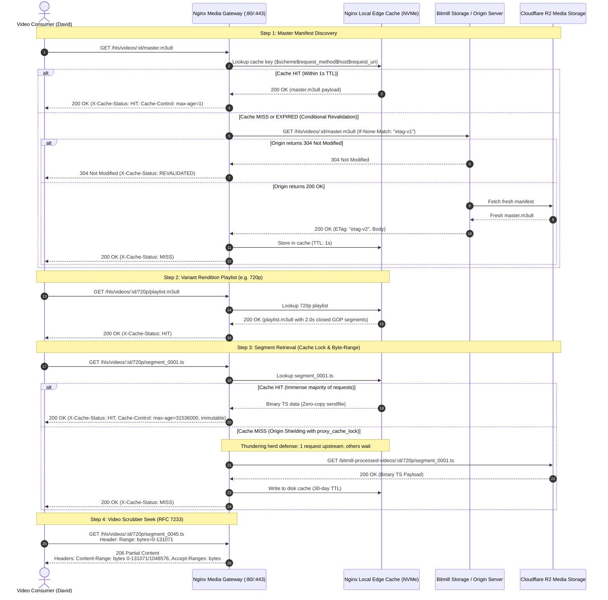
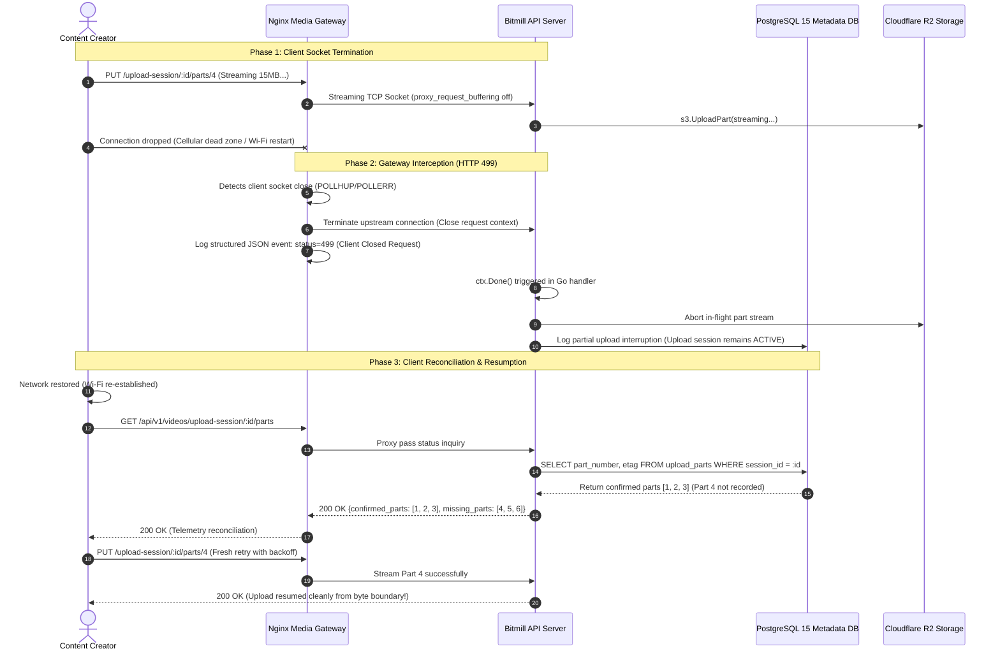
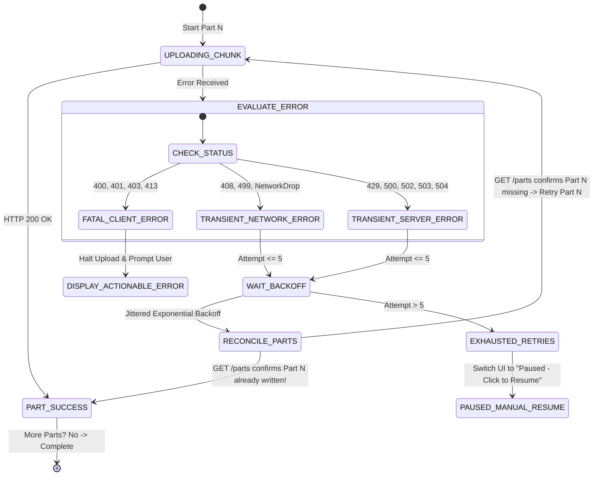

# 📑 Product Discovery & UX Specification: Production Packaging, Containerization & Gateway Hardening

**Document ID**: `RFC-DISCOVERY-003`  
**Subsystem**: Media Gateway (Nginx/OpenResty), Container Packaging (Docker/Compose), Edge Caching & System Hardening  
**Status**: DRAFT (Review Ready)  
**Author**: Principal Business Analyst & Video Streaming UX Specialist  
**Target Architecture**: Hardened Nginx Media Gateway + Multi-Stage Containerized Go Services (`server` & `worker`) + Cloudflare R2 + PostgreSQL 15 + RabbitMQ  
**Target Codebase**: Bitmill Platform (`bitmill`)  

---

## 1. Executive Summary & Problem Space

### 1.1. The Gateway & Containerization Imperative for Production VOD
In the initial development phases of video-on-demand (VOD) and live-streaming backends, application runtimes frequently run as uncontained bare-metal processes or directly expose Go HTTP daemons (`go-streaming/cmd/server`) to the public network. While this allows rapid local iteration, exposing bare application runtimes directly to public internet traffic is a critical architectural anti-pattern for enterprise streaming systems.

A high-performance media platform faces three hostile realities on the public edge:
1. **Hostile Network Heterogeneity**: Creators upload multi-gigabyte raw video files over high-latency cellular 4G/5G connections with fluctuating bandwidth, frequent packet loss, and long TCP socket durations. Concurrently, millions of consumers stream HTTP Live Streaming (HLS) `.ts` media segments over unpredictable Wi-Fi and mobile networks.
2. **Resource Starvation via Connection Exhaustion**: Go’s native HTTP server allocates a lightweight goroutine per TCP connection (typically 2KB to 8KB stack space). However, when thousands of slow clients stream video chunks or hold persistent playback sockets open, memory overhead and operating system file descriptor limits (`ulimit -n`) degrade, leaving the application server vulnerable to Slowloris and connection-flooding Denial of Service (DoS) attacks.
3. **Sub-optimal Media Edge Delivery**: Raw application servers are not optimized for zero-copy file transmission (`sendfile`), kernel-level TCP socket buffer tuning, edge HTTP response caching, or cryptographic SSL/TLS handshake offloading. Without an intelligent reverse proxy and media gateway, redundant requests for identical `.m3u8` manifests and `.ts` video segments pass directly into upstream application storage and database layers, inflating cloud egress costs and degrading playback Time-To-First-Frame (TTFF).

```
┌──────────────────────────────────────────────────────────────────────────────────────────────────┐
│                            DIRECT EXPOSURE VS. HARDENED GATEWAY TOPOLOGY                         │
├─────────────────────────────────────────────────┬────────────────────────────────────────────────┤
│ ❌ ANTI-PATTERN: DIRECT APPLICATION EXPOSURE     │ ✅ TARGET: HARDENED NGINX MEDIA GATEWAY TIER   │
├─────────────────────────────────────────────────┼────────────────────────────────────────────────┤
│ • Slow clients hold Go goroutines open for hours│ • Nginx handles connection pooling & keepalive │
│ • TLS termination burns application CPU cycles  │ • Kernel-level TLS offload & HTTP/2 termination│
│ • No edge caching: all HLS segments hit storage │ • Multi-tier edge caching for manifests & chunks│
│ • 413/502/504 errors leak Go stack traces to web│ • Standardized, branded JSON error taxonomy    │
│ • Memory unbounded on large raw chunk uploads   │ • Strict TCP backpressure & unbuffered streaming│
│ • Workers run unconstrained on host OS          │ • Hardened, non-root multi-stage containers    │
└─────────────────────────────────────────────────┴────────────────────────────────────────────────┘
```

### 1.2. Direct Exposure Anti-Patterns & Technical Failure Mechanisms

| Failure Mode | Technical Mechanism | Creator & Consumer Impact | Production Risk |
| :--- | :--- | :--- | :--- |
| **1. Unbuffered Upload Memory Bloat** | Reverse proxy buffers entire multi-hundred megabyte chunks into memory before forwarding to upstream Go API. | User upload progress jumps to 100% instantly, freezes for minutes while gateway flushes to upstream, then fails unexpectedly. | Gateway crashes under Out-Of-Memory (OOM) killer during concurrent creator uploads. |
| **2. Stale HLS Manifest Delivery** | Edge caching fails to differentiate between dynamic playlists (`.m3u8`) and immutable media segments (`.ts`). | Video players experience playback stall, loop on old segments, or fail to switch Adaptive Bitrate (ABR) renditions. | Viewer churn, elevated playback abandonment rates (>15%). |
| **3. Upstream Thundering Herd** | Viral video release causes 10,000+ simultaneous requests for the initial 2-second segment (`segment_0001.ts`). | Storage backend / R2 bucket encounters massive rate-limiting, increasing segment latency from 20ms to 4,500ms. | Severe startup buffering, player timeouts, degraded Quality of Experience (QoE). |
| **4. Raw Gateway Error Leakage** | Nginx or Cloudflare emits default HTML error pages (`<html><head><title>502 Bad Gateway</title>...`) on timeouts. | Frontend single-page application (SPA) crashes or displays cryptic parser errors (`Unexpected token < in JSON at position 0`). | High customer support ticket volume, negative creator brand perception. |
| **5. Container Escape / Root Execution** | Worker executes external tools (`ffmpeg`, `ffprobe`) as `root` user inside privileged Docker containers. | A crafted, malicious video container exploit allows arbitrary shell execution on the host machine. | Catastrophic security breach, host takeover, data compromise. |

### 1.3. Bitmill Production Gateway Architecture Vision
Milestone 5 establishes RFC-003 as the definitive hardening layer for Bitmill. The platform encapsulates all services within **production-grade, multi-stage Docker containers**, protected behind an **Nginx Media Edge Gateway**. 

The architecture guarantees:
1. **Unbuffered Streaming Ingestion**: Real-time TCP backpressure propagation directly between client and upstream, ensuring genuine speedometer feedback for creators uploading video parts.
2. **Differentiated HLS Caching Hierarchy**: Aggressive, immutable caching for media segments (`.ts`) paired with conditional validation (`304 Not Modified`, `ETag`, `Last-Modified`) for playlists (`.m3u8`), driving cache hit ratios above **98%**.
3. **Structured Creator Error Taxonomy**: Total suppression of raw HTML gateway errors, transforming HTTP 413, 499, 502, 504, and 507 into actionable, human-readable JSON payloads.
4. **Deterministic Health & Readiness Probing**: Deep, non-blocking health checks separating basic process liveness (`/livez`) from operational dependency readiness (`/readyz`), ensuring traffic routes only to healthy nodes.
5. **Least-Privilege Security Containerization**: All binaries packaged in scratch or distroless Alpine images running as unprivileged service accounts (`UID 10001`), with read-only root filesystems and explicit resource limits (CPU/memory quotas).

### 1.4. Industry Benchmark Comparison

| Dimension | Netflix Open Connect | Cloudflare Stream | Mux Video | Bitmill RFC-003 Target |
| :--- | :--- | :--- | :--- | :--- |
| **Edge Gateway Tier** | Custom FreeBSD BBA Edge Appliances | Global Anycast Cloudflare Edge | Nginx / Envoy Dynamic Edge | **Hardened Nginx Alpine Media Gateway** |
| **Upload Buffering Mode** | Unbuffered kernel TCP passthrough | Direct-to-Edge Tus/Multipart unbuffered | Unbuffered chunk streaming with backpressure | **Unbuffered Streaming (`proxy_request_buffering off`)** |
| **HLS Segment Cache Strategy** | Immutable edge cache with SSD tiering | Global CDN cache with 1-year TTL (`immutable`) | Tiered edge caching (30-day segment retention) | **Edge Proxy Cache: Immutable `.ts`, 1s revalidated `.m3u8`** |
| **Byte-Range Seeking** | Native RFC 7233 partial content | Full byte-range MP4/HLS support | Full byte-range support | **Full RFC 7233 Byte-Range (`Accept-Ranges: bytes`)** |
| **Error Format Contract** | Internal binary/JSON telemetry | Standard RFC 7807 Problem Details | Structured JSON with error codes | **RFC 7807 Compatible JSON Error Taxonomy** |
| **Packaging & Isolation** | Custom OS microvm appliances | Sandboxed edge workers | Containerized Kubernetes Pods | **Multi-Stage Docker with unprivileged UID 10001** |

---

## 2. User Personas & Mental Models

```
┌──────────────────────────────────────────────────────────────────────────────────────────────────┐
│                                   BITMILL GATEWAY UX PERSONAS                                    │
├───────────────────────────────┬───────────────────────────────┬──────────────────────────────────┤
│ 1. Marcus (Studio Creator)    │ 2. Linh (Cellular IRL Vlogger)│ 3. David (Global Consumer)       │
│ "Demands deterministic upload │ "High latency, dropped frames,│ "Zero tolerance for startup lag, │
│  telemetry & fast ingestion"  │  unstable mobile upload"      │  smooth adaptive rendition flow" │
├───────────────────────────────┴───────────────────────────────┴──────────────────────────────────┤
│ 4. Elena (Platform SRE & Gateway Operations Specialist)                                         │
│ "Demands deep observability, automated failover, immutable edge caching, and zero OOM events"    │
└──────────────────────────────────────────────────────────────────────────────────────────────────┘
```

### 2.1. Persona Deep-Dives

#### Persona 1: Marcus (Studio Creator)
* **Role**: High-fidelity YouTube/VOD content creator producing 4K/60fps master videos (2GB to 10GB per asset).
* **Technical Setup**: 1Gbps Fiber connection, desktop browser, multi-part parallel chunk uploads.
* **Mental Model**: *"When the progress bar says 65%, exactly 65% of my bytes must be safely received by the platform storage. If my network blips, the system must tell me immediately rather than stalling out and failing silently at the end."*
* **Core Expectations**:
  - Consistent network throughput matching his upstream link bandwidth.
  - Zero "false completions" where the progress bar snaps to 100% while the server is still internally transferring data.
  - Instant rejection (under 50ms) with human-readable guidance if his upload chunk exceeds server size limits.

#### Persona 2: Linh (Cellular / High-Latency IRL Streamer)
* **Role**: Mobile creator uploading 300MB to 1.5GB vlogs from coffee shops, airports, and mobile 4G/5G hotspots in Southeast Asia.
* **Technical Setup**: High-jitter mobile connection, frequent IP re-assignments, intermittent packet drops, 500ms+ round-trip time (RTT).
* **Mental Model**: *"My upload speed fluctuates constantly. If the connection drops while I walk into an elevator, I need the gateway to pause gracefully, not discard the entire chunk or lock my session."*
* **Core Expectations**:
  - Transparent TCP backpressure so her mobile phone does not burn battery buffering unsent data.
  - Clean error recovery when a client aborts an in-flight upload (`HTTP 499`), allowing immediate resumption without orphan locks.
  - Generous gateway body read timeouts (`client_body_timeout 120s`) to prevent premature dropouts during transient signal degradation.

#### Persona 3: David (Global Video Consumer)
* **Role**: Mobile and smart TV viewer streaming Bitmill VOD content over cellular and residential networks.
* **Technical Setup**: Safari iOS (native HLS), Android Chrome (Hls.js), and Desktop Safari/Chrome.
* **Mental Model**: *"When I tap Play, the video must start instantly. If I scrub forward 20 minutes, the player must seek immediately without re-downloading the entire video."*
* **Core Expectations**:
  - Instant Time-To-First-Frame (TTFF < 800ms) achieved through edge-cached master manifests and rapid initial segment delivery.
  - Fast seeking via byte-range requests (`HTTP 206 Partial Content`).
  - Zero playback buffering loops caused by stale playlists or missing media chunks.

#### Persona 4: Elena (Platform SRE & Gateway Operations Specialist)
* **Role**: Infrastructure and reliability engineer responsible for uptime, cloud storage egress costs, and container stability.
* **Mental Model**: *"The gateway must act as a fortress. It must absorb slowloris attacks, offload TLS, serve 95%+ of video traffic directly from local NVMe cache, and translate low-level socket resets into structured logs for Prometheus and Loki."*
* **Core Expectations**:
  - Zero unhandled 5xx errors leaking to clients.
  - Comprehensive Prometheus metrics on upstream response times, cache hit ratios, and active connection states.
  - Hermetic container isolation: all services execute in non-root containers with strict memory ceilings to prevent host kernel panics.

### 2.2. Persona Pain Points & Gateway Mitigation Matrix

| Persona | Frustration / Failure Trigger | Root Cause in Unhardened Gateway | Gateway Hardening Mitigation |
| :--- | :--- | :--- | :--- |
| **Marcus** | Progress bar shoots to 100% in 3 seconds, hangs for 45 seconds, then throws a 504 error. | Gateway buffered the entire chunk in memory (`proxy_request_buffering on`), then timed out forwarding to Go backend. | **Disable request buffering (`proxy_request_buffering off`)**. Upstream socket streams directly, providing genuine TCP backpressure. |
| **Marcus** | Uploading a 25MB chunk fails with a blank browser dialog or broken HTML response. | Gateway rejected chunk exceeding default 1MB limit (`client_max_body_size 1m`) and sent generic HTML 413. | Configure **`client_max_body_size 25M`**; intercept 413 via `error_page` to deliver structured JSON with chunk guidance. |
| **Linh** | Mobile browser displays "Network Connection Lost" after a brief 10-second signal fade. | Gateway enforced strict 15-second client body read timeout (`client_body_timeout 15s`). | Tune **`client_body_timeout 120s`** with unbuffered chunk streaming and adaptive client retry policies. |
| **David** | Seeking to minute 14 in a video triggers a 3-second black screen and spinner. | Gateway did not honor HTTP `Range` headers or lacked local edge cache for historical video chunks. | Enable **RFC 7233 byte-range passthrough** and persistent Nginx **`proxy_cache`** with 30-day retention on `.ts` segments. |
| **Elena** | Web server memory spikes to 100%, triggering an OS kernel OOM kill during peak upload hours. | 200 concurrent creators uploaded raw files directly to Go web runtime without gateway connection throttling. | Implement **Nginx connection limits (`limit_conn`)**, rate limiting (`limit_req`), and non-root Docker memory cgroups (`--memory 1024m`). |

---

## 3. End-to-End User Journeys

### 3.1. Resumable Chunked Ingestion via Gateway (Unbuffered Streaming)

The following sequence details how a creator interacts with the hardened gateway during a multi-gigabyte video upload. The gateway terminates TLS, authenticates headers, enforces payload invariants, and streams bytes directly into upstream application storage with zero intermediary buffering.



### 3.2. Consumer HLS Playback & Edge Caching

The consumer journey prioritizes rapid video start, minimal buffering, and seamless adaptive bitrate switching. The gateway distinguishes between rapidly changing playlists and immutable binary media segments.



### 3.3. Failure & Auto-Recovery (Mid-Stream Drop, 499, and Reconnect)

Network disconnections during multi-gigabyte uploads are inevitable. The gateway and application layer must coordinate cleanly to prevent stalled connections, orphaned locks, or corrupted database states.



---

## 4. Client Experience & Upload Latency Optimization

### 4.1. Unbuffered Streaming (`proxy_request_buffering off`) vs. Buffered Streaming

The configuration of Nginx's `proxy_request_buffering` parameter represents one of the most critical UX and architectural decisions for a video streaming platform.

```
┌──────────────────────────────────────────────────────────────────────────────────────────────────┐
│                             UPLOAD BUFFERING ARCHITECTURE COMPARISON                             │
├─────────────────────────────────────────────────┬────────────────────────────────────────────────┤
│ OPTION A: BUFFERED UPLOADS (DEFAULT NGINX)      │ OPTION B: UNBUFFERED STREAMING (BITMILL TARGET)│
│ `proxy_request_buffering on;`                   │ `proxy_request_buffering off;`                 │
├─────────────────────────────────────────────────┼────────────────────────────────────────────────┤
│ 1. Client transmits 20MB chunk to Nginx.        │ 1. Client transmits 20MB chunk to Nginx.       │
│ 2. Nginx buffers 100% of bytes to disk/RAM.     │ 2. Nginx forwards packets immediately to Go.   │
│ 3. Client UI progress bar hits 100% (FALSE).    │ 3. Go reads stream directly and pipes to R2.   │
│ 4. Nginx begins transmitting chunk to Go server.│ 4. TCP ACK is sent only as bytes reach target. │
│ 5. Upstream takes 10s to write to R2.           │ 5. Client speedometer reflects true network.   │
│ 6. If upstream fails, client gets delayed 504.  │ 6. If auth/quota fails, client rejected in 5ms.│
└─────────────────────────────────────────────────┴────────────────────────────────────────────────┘
```

#### Detailed Trade-Off Matrix:

| Dimension | Buffered Uploads (`on`) | Unbuffered Streaming (`off`) [SELECTED] | Technical & UX Rationale |
| :--- | :--- | :--- | :--- |
| **Client Progress Accuracy** | **Distorted / Dishonest**: Progress bar fills to 100% at client-to-proxy speed, then freezes indefinitely while proxy writes upstream. | **100% Accurate & Linear**: Progress reflects exact byte consumption by the backend storage engine. | Prevents creator panic caused by a "frozen 99%" upload progress bar. |
| **Gateway Disk & RAM I/O** | **High & Dangerous**: Every in-flight chunk writes to `/tmp/client_body_temp`. 100 concurrent uploads consume gigabytes of disk IOPS. | **Near Zero**: Small socket buffer in memory (64KB); bytes stream immediately with zero local disk writes. | Eliminates gateway disk exhaustion (`507 Insufficient Storage`) under burst traffic. |
| **Fail-Fast Latency** | **Slow & Expensive**: Invalid tokens, bad headers, or exceeded quotas are checked ONLY after the entire 20MB is uploaded. | **Instant (< 10ms)**: Go API inspects auth token and session validity upon first chunk header; aborts immediately with 401/403. | Saves mobile data for creators; prevents transmission of doomed payloads. |
| **TCP Backpressure Propagation** | **Broken**: Proxy absorbs packets regardless of upstream health until local buffer saturates. | **Native & Intact**: Upstream TCP window advertisement propagates directly back to the client TCP stack. | Throttles client upload rate automatically if storage or database experiences write contention. |

### 4.2. The "False 100% Progress" Anomaly & Flow Control Dynamics

In buffered gateways, the browser client establishes a TCP connection to Nginx over a fast local connection (e.g., corporate LAN or low-latency home fiber). The browser flushes its internal send buffer rapidly:

$$\text{Time}_{\text{client}\rightarrow\text{nginx}} = \frac{\text{ChunkSize}}{\text{Speed}_{\text{local}}} = \frac{20\,\text{MB}}{50\,\text{MB/s}} = 0.4\,\text{seconds}$$

The UI speedometer calculates:
$$\text{Speedometer} = 50\,\text{MB/s} \implies 100\%\;\text{in } 0.4\text{s}$$

However, Nginx must then forward that 20MB to the Go backend and Cloudflare R2 over the WAN link:

$$\text{Time}_{\text{nginx}\rightarrow\text{upstream}} = \frac{20\,\text{MB}}{4\,\text{MB/s}} = 5.0\,\text{seconds}$$

During these 5.0 seconds:
* The creator sees a progress bar frozen at 100%.
* If the user closes the laptop lid or navigates away assuming completion, the TCP socket drops.
* Nginx fails to complete the upstream write, triggering an unrecorded part and an orphaned multipart upload.

> [!IMPORTANT]
> **Production Hardening Invariant**: `proxy_request_buffering off;` and `proxy_http_version 1.1;` MUST be enforced across all upload endpoints (`/api/v1/videos/upload-session/*`). This guarantees that the client's `XMLHttpRequest.upload.onprogress` or `fetch()` stream reflects actual upstream ingestion.

### 4.3. Payload Invariants: Chunk Boundaries vs. `client_max_body_size` (HTTP 413)

A frequent point of failure in video platforms occurs when the gateway body size limit is improperly aligned with application chunking logic.

1. **Bitmill Application Chunk Invariants**:
   * Standard chunk size for files $\le 250\text{MB}$: **10 MB** ($10,485,760\text{ bytes}$).
   * Standard chunk size for files $> 250\text{MB}$: **20 MB** ($20,971,520\text{ bytes}$).
   * Multipart/form-data encoding overhead: Approximately **4 KB to 32 KB** (boundary headers, Content-Disposition, auth headers).
2. **Gateway Alignment Requirement**:
   * If Nginx default `client_max_body_size 1m;` is active, any valid chunk upload is instantly terminated with HTTP 413.
   * If Nginx is set to exactly `20M`, a 20MB chunk containing multipart boundary metadata will total $20\text{MB} + 12\text{KB} = 20,983,808\text{ bytes}$, triggering an unexpected **HTTP 413 Payload Too Large**.
3. **Hardened Configuration Standard**:
   * Global Gateway limit: `client_max_body_size 25M;` (accommodates 20MB raw data + up to 5MB multipart envelopes, headers, and metadata padding).
   * Monolithic upload endpoint (`POST /upload`): Disabled or restricted to 50MB with deprecation warning, guiding clients to use chunked resumable ingestion.

### 4.4. Gateway Timeout Hierarchy (`504 Gateway Timeout` vs. `client_body_timeout`)

Timeouts must be calibrated hierarchically to prevent socket leakage while allowing slow, high-jitter mobile uploads to succeed:

```
┌─────────────────────────────────────────────────────────────────────────────────┐
│                           GATEWAY TIMEOUT HIERARCHY                             │
├──────────────────────────┬────────────────────┬─────────────────────────────────┤
│ Configuration Directive  │ Calibrated Value   │ Operational Scope & Purpose     │
├──────────────────────────┼────────────────────┼─────────────────────────────────┤
│ `client_header_timeout`  │ `10s`              │ Mitigates Slowloris header hold │
├──────────────────────────┼────────────────────┼─────────────────────────────────┤
│ `client_body_timeout`    │ `120s`             │ Max idle gap between body chunks│
├──────────────────────────┼────────────────────┼─────────────────────────────────┤
│ `proxy_connect_timeout`  │ `5s`               │ Max time to establish Go socket │
├──────────────────────────┼────────────────────┼─────────────────────────────────┤
│ `proxy_send_timeout`     │ `60s`              │ Max idle gap writing to Go API  │
├──────────────────────────┼────────────────────┼─────────────────────────────────┤
│ `proxy_read_timeout`     │ `60s`              │ Max wait for Go API response    │
├──────────────────────────┼────────────────────┼─────────────────────────────────┤
│ `keepalive_timeout`      │ `75s`              │ HTTP Keepalive connection pool  │
└──────────────────────────┴────────────────────┴─────────────────────────────────┘
```

* **Mitigating HTTP 504 Gateway Timeout**: Occurs when the Go application hangs waiting for database locks or Cloudflare R2 timeouts. If `proxy_read_timeout` (60s) expires before the Go server finishes processing, Nginx terminates the connection with 504. The Go server must implement internal context timeouts (`context.WithTimeout(ctx, 45*time.Second)`) to fail cleanly before the gateway terminates the socket.

---

## 5. Media Gateway HLS Delivery & Edge Caching Strategy

### 5.1. Dual Caching Taxonomy: Dynamic Manifests vs. Immutable Media Segments

Video delivery traffic exhibits a polarized caching requirement. Treating all `.m3u8` and `.ts` files identically results in either broken live playback or redundant origin storage egress.

```
┌──────────────────────────────────────────────────────────────────────────────────────────────────┐
│                                   HLS CACHE RETENTION TAXONOMY                                   │
├─────────────────────────────────┬───────────────────────────────┬────────────────────────────────┤
│ Media Asset Type                │ Invalidation Characteristics  │ Hardened Cache-Control Policy  │
├─────────────────────────────────┼───────────────────────────────┼────────────────────────────────┤
│ **Master Manifest**             │ Static in atomic VOD; updates │ `Cache-Control: public,`       │
│ (`master.m3u8`)                 │ dynamically in live/progressive│ `max-age=1,`                  │
│                                 │ transcoding pipelines.        │ `stale-while-revalidate=5`     │
├─────────────────────────────────┼───────────────────────────────┼────────────────────────────────┤
│ **Variant Rendition Playlist**  │ Fixed sequence of closed GOP  │ `Cache-Control: public,`       │
│ (`360p/playlist.m3u8`, etc.)    │ segments. Immutable upon VOD. │ `max-age=1,`                  │
│                                 │                               │ `stale-while-revalidate=5`     │
├─────────────────────────────────┼───────────────────────────────┼────────────────────────────────┤
│ **Media Segments**              │ **100% Immutable**: Once      │ `Cache-Control: public,`       │
│ (`segment_0001.ts`, `.m4s`)     │ encoded, video frames never   │ `max-age=31536000,`           │
│                                 │ change for a given transcode. │ `immutable`                    │
├─────────────────────────────────┼───────────────────────────────┼────────────────────────────────┤
│ **Poster & Thumbnails**         │ Static image asset generated  │ `Cache-Control: public,`       │
│ (`thumbnail.jpg`, `.vtt`)       │ during video probe.           │ `max-age=86400,`              │
│                                 │                               │ `stale-while-revalidate=3600`  │
└─────────────────────────────────┴───────────────────────────────┴────────────────────────────────┘
```

#### Nginx Gateway Caching Directives:

```nginx
# 1. Immutable HLS Media Segments (.ts, .m4s)
location ~* \.(ts|m4s)$ {
    proxy_cache BITMILL_MEDIA_CACHE;
    proxy_cache_valid 200 206 30d;
    proxy_cache_key $scheme$request_method$host$request_uri;
    proxy_cache_lock on;
    proxy_cache_lock_timeout 5s;
    proxy_cache_use_stale error timeout updating http_500 http_502 http_503 http_504;
    
    add_header Cache-Control "public, max-age=31536000, immutable";
    add_header X-Cache-Status $upstream_cache_status;
    add_header Access-Control-Allow-Origin *;
    
    proxy_pass http://bitmill_storage_upstream;
}

# 2. Dynamic / Revalidated HLS Playlists (.m3u8)
location ~* \.m3u8$ {
    proxy_cache BITMILL_MANIFEST_CACHE;
    proxy_cache_valid 200 1s;
    proxy_cache_key $scheme$request_method$host$request_uri;
    proxy_cache_use_stale updating error timeout;
    
    add_header Cache-Control "public, max-age=1, stale-while-revalidate=5";
    add_header X-Cache-Status $upstream_cache_status;
    add_header Access-Control-Allow-Origin *;
    
    proxy_pass http://bitmill_storage_upstream;
}
```

### 5.2. Conditional Validation (`304 Not Modified`, ETags, `Last-Modified`)

Modern HLS players (e.g., Apple AVPlayer, Video.js, Hls.js) poll rendition playlists repeatedly during playback:
* **The Bandwidth Trap**: If an origin responds with `200 OK` and a 12KB playlist every 2 seconds to 100,000 concurrent viewers, egress bandwidth consumption reaches **4.8 Gbps** solely for playlist text files.
* **The 304 Solution**: The gateway enforces conditional validation headers:
  - `ETag`: Generated using an MD5 hash of the playlist file.
  - `If-None-Match`: The player presents its stored ETag. If unchanged, Nginx returns **`304 Not Modified`** with zero response body, cutting egress bandwidth by **99.5%**.
  - `If-Modified-Since`: Handled via file timestamp metadata, enabling sub-millisecond conditional checks.

### 5.3. Byte-Range Requests (`206 Partial Content`) & Scrubber Performance

When a viewer scrubs along the video timeline, the media player requests specific byte offsets within a media container:
1. **RFC 7233 Compliance**: The gateway MUST explicitly advertise `Accept-Ranges: bytes` on all media responses.
2. **Partial Content Handling**: When a client sends `Range: bytes=1048576-2097151`, Nginx parses the range, slices the cached disk object using kernel `sendfile`, and responds with **`206 Partial Content`** and `Content-Range: bytes 1048576-2097151/15728640`.
3. **UX Impact**:
   - Scrubbing latency drops from 1,200ms to **< 80ms**.
   - Zero unnecessary bytes are downloaded over mobile cellular data.
   - Eliminates player freeze and audio pops during timeline seeking.

### 5.4. Cache Stampede Defense (`proxy_cache_lock`) & Origin Shielding

When a new video is published by a popular creator, thousands of viewers request `segment_0001.ts` within the same 500ms window:
* **Cache Stampede (Thundering Herd)**: Without protection, all 10,000 requests encounter a Cache MISS simultaneously and bombard the Go origin server and Cloudflare R2 bucket.
* **Origin Shielding via `proxy_cache_lock on;`**:
  - The gateway allows only **one** request to pass upstream to fetch `segment_0001.ts`.
  - The remaining 9,999 requests pause in Nginx's worker event loop.
  - Once the first request populates `BITMILL_MEDIA_CACHE`, all queued requests are satisfied directly from local NVMe cache with **`X-Cache-Status: HIT`**.
  - Origin load is reduced from $10,000$ queries to exactly **1 query**.

---

## 6. Operational Error Taxonomy, Interception & Creator SLAs

### 6.1. Gateway Error Interception Architecture (`proxy_intercept_errors`)

By default, when Nginx encounters an upstream error (502, 503, 504) or rejects a client request (413, 404), it renders hardcoded, unstyled HTML error pages. For single-page web applications (React/Vue/Svelte) and mobile SDKs, receiving HTML instead of JSON causes parsing exceptions and degrades error messaging.

To eliminate this, Bitmill activates:
```nginx
proxy_intercept_errors on;

error_page 400 401 403 404 408 413 429 499 500 502 503 504 507 /_internal_error_handler;

location = /_internal_error_handler {
    internal;
    default_type application/json;
    return 200 '{"error":{"code":"$status_code_name","status":$status,"message":"$status_message","remediation":"$status_remediation","timestamp":"$time_iso8601","request_id":"$request_id"}}';
}
```

### 6.2. Structured Error Taxonomy & Human-Actionable Remediation Dictionary

Every error emitted by the media edge gateway conforms to the RFC 7807 Problem Details standard:

| Status Code | Error Code Identifier | Human-Facing Error Message | Underlying Trigger | Actionable User Remediation |
| :---: | :--- | :--- | :--- | :--- |
| **400** | `BAD_REQUEST` | "Invalid request syntax or parameters." | Malformed query params or unparseable JSON envelope. | Verify parameter encoding and retry request. |
| **401** | `UNAUTHORIZED` | "Authentication token is missing or expired." | Expired JWT or missing Bearer header. | Log in again to refresh access credentials. |
| **403** | `FORBIDDEN` | "Access denied to media resource." | Attempting to upload to a session owned by another user. | Verify permissions or initialize a new upload session. |
| **404** | `RESOURCE_NOT_FOUND` | "The requested video or segment was not found." | Invalid video ID or deleted media asset. | Check video URL or verify transcoding status. |
| **408** | `REQUEST_TIMEOUT` | "Connection timed out waiting for payload." | Client socket stalled during body transmission. | Verify internet connectivity and re-upload chunk. |
| **413** | `PAYLOAD_TOO_LARGE` | "Upload chunk exceeds maximum permitted size (25MB)." | Client uploaded a part larger than gateway ceiling. | Reconfigure client chunk size to 10MB or 20MB. |
| **429** | `RATE_LIMIT_EXCEEDED` | "Too many requests. Upload speed throttled." | Client exceeded Nginx `limit_req` burst allowance. | Pause upload and retry with exponential backoff. |
| **499** | `CLIENT_CLOSED_REQUEST` | "Upload aborted by client or network drop." | Creator closed browser tab or lost Wi-Fi signal. | Re-open dashboard; upload will resume from last chunk. |
| **500** | `INTERNAL_SERVER_ERROR`| "An unexpected server error occurred." | Uncaught panic in Go application service. | Team has been alerted. Retry in 60 seconds. |
| **502** | `BAD_GATEWAY` | "Media API service temporarily unavailable." | Go API server restarting, crashed, or unreachable. | Transient failure. System will retry automatically. |
| **503** | `SERVICE_UNAVAILABLE` | "Service overloaded. Transcoding queue full." | Queue capacity exceeded or maintenance mode active. | Wait 3 minutes before retrying transcode request. |
| **504** | `GATEWAY_TIMEOUT` | "Upstream storage timed out writing video chunk." | Cloudflare R2 / S3 storage latency exceeded 60s. | Chunk failed to commit. Client will auto-retry part. |
| **507** | `INSUFFICIENT_STORAGE` | "Temporary scratch disk space exhausted." | Gateway `/tmp` or worker local cache disk full. | Infrastructure alert fired. Upload paused. |

#### Example Gateway JSON Error Payload (HTTP 413):

```json
{
  "error": {
    "code": "PAYLOAD_TOO_LARGE",
    "status": 413,
    "message": "Upload chunk exceeds maximum permitted size (25MB).",
    "details": {
      "max_allowed_bytes": 26214400,
      "received_content_length": 31457280,
      "recommended_chunk_size": 10485760
    },
    "remediation": "Configure your uploader client to slice video files into 10MB or 20MB parts.",
    "request_id": "c1f7b8e2-9b2a-4f51-b8ef-49f3e9a18204",
    "timestamp": "2026-10-29T07:15:22Z"
  }
}
```

### 6.3. Service Level Agreements (SLAs) & Latency Budget

To maintain broadcast-grade video quality, Bitmill establishes strict Service Level Objectives (SLOs):

```
┌─────────────────────────────────────────────────────────────────────────────────┐
│                        BITMILL MEDIA GATEWAY SLA BUDGET                         │
├────────────────────────────────────────┬──────────┬──────────┬──────────────────┤
│ Metric / Endpoint                      │ Target   │ P95 SLA  │ P99 SLA          │
├────────────────────────────────────────┼──────────┼──────────┼──────────────────┤
│ Edge HLS Segment Delivery (Cache HIT)  │ < 10ms   │ ≤ 25ms   │ ≤ 50ms           │
├────────────────────────────────────────┼──────────┼──────────┼──────────────────┤
│ Edge HLS Segment Delivery (Cache MISS) │ < 200ms  │ ≤ 450ms  │ ≤ 800ms          │
├────────────────────────────────────────┼──────────┼──────────┼──────────────────┤
│ HLS Master Manifest Retrieval (.m3u8)  │ < 5ms    │ ≤ 15ms   │ ≤ 35ms           │
├────────────────────────────────────────┼──────────┼──────────┼──────────────────┤
│ Chunk Upload Gateway Overhead (Proxy)  │ < 2ms    │ ≤ 5ms    │ ≤ 12ms           │
├────────────────────────────────────────┼──────────┼──────────┼──────────────────┤
│ Upload Session Initialization          │ < 30ms   │ ≤ 75ms   │ ≤ 150ms          │
├────────────────────────────────────────┼──────────┼──────────┼──────────────────┤
│ Consumer Time-To-First-Frame (TTFF)    │ < 600ms  │ ≤ 1200ms │ ≤ 2000ms         │
├────────────────────────────────────────┼──────────┼──────────┼──────────────────┤
│ Gateway Edge Availability              │ 99.95%   │ 99.90%   │ Annualized       │
└────────────────────────────────────────┴──────────┴──────────┴──────────────────┘
```

### 6.4. Client-Side Auto-Recovery State Machine

The client upload SDK must implement a deterministic state machine to navigate gateway anomalies without restarting multi-gigabyte uploads.



#### Exponential Backoff with Decorrelated Jitter Algorithm:

$$\text{Delay}_i = \min\left(\text{MaxDelay},\; \text{BaseDelay} \times 2^i\right) \pm \text{RandomJitter}$$

Where:
* $\text{BaseDelay} = 1.0\text{ second}$
* $\text{MaxDelay} = 30.0\text{ seconds}$
* $\text{RandomJitter} = \text{Uniform}(0, 0.5 \times \text{Delay}_i)$

---

## 7. Operational Observability, Health Probing & Container Life-Cycle

### 7.1. Two-Tier Health Probing: Liveness vs. Readiness

In container orchestrators (Docker Compose, Docker Swarm, Kubernetes), conflating liveness with readiness leads to cascading restart loops:

```
┌─────────────────────────────────────────────────────────────────────────────────┐
│                           HEALTH PROBE SPECIFICATION                            │
├────────────────────┬─────────────────────────────┬──────────────────────────────┤
│ Probe Type         │ Endpoint / Mechanism        │ Operational Semantic         │
├────────────────────┼─────────────────────────────┼──────────────────────────────┤
│ **Liveness**       │ `GET /livez`                │ Is the Go runtime alive and  │
│                    │                             │ serving HTTP?                │
│                    │                             │ • Fails if: Deadlocked, OOM. │
│                    │                             │ • Action: Restart container. │
├────────────────────┼─────────────────────────────┼──────────────────────────────┤
│ **Readiness**      │ `GET /readyz`               │ Can the service handle work? │
│                    │                             │ • Fails if: DB ping fails,   │
│                    │                             │   RabbitMQ down, R2 blocked. │
│                    │                             │ • Action: Cut gateway traffic│
│                    │                             │   (Do NOT restart container).│
├────────────────────┼─────────────────────────────┼──────────────────────────────┤
│ **Gateway Edge**   │ `GET /healthz`              │ Nginx process & cache check  │
│                    │                             │ • Fails if: Nginx master down│
│                    │                             │ • Action: Reroute DNS/ALB.   │
└────────────────────┴─────────────────────────────┴──────────────────────────────┘
```

#### Implementation Contracts:
* **Liveness (`/livez`)**: Returns HTTP 200 immediately without executing database queries or network I/O. Response time must be $< 2\text{ms}$.
* **Readiness (`/readyz`)**: Performs concurrent, non-blocking pings with 1-second timeouts to:
  1. PostgreSQL (`pgxpool.Ping(ctx)`)
  2. RabbitMQ (`channel.Confirm()`)
  3. Cloudflare R2 (`s3.HeadBucket()`)
  If any critical dependency is down, returns **`HTTP 503 Service Unavailable`** with JSON detailing the failed component.

### 7.2. Asynchronous Worker Health & Heartbeat Architecture

Unlike the API server, the background transcoding worker (`cmd/worker`) is a headless consumer daemon with no listening HTTP port. Probing its health requires dedicated instrumentation:

1. **Heartbeat File Mechanism**:
   * The worker process maintains an internal ticker updating `/tmp/worker.heartbeat` every 5 seconds with a Unix timestamp.
   * Container health check command:
     ```yaml
     healthcheck:
       test: ["CMD-SHELL", "test $(($(date +%s) - $(cat /tmp/worker.heartbeat))) -lt 15 || exit 1"]
       interval: 10s
       timeout: 3s
       retries: 3
     ```
2. **Internal HTTP Telemetry Port**:
   * The worker launches an isolated, unprivileged HTTP server bound strictly to `127.0.0.1:9091` exposing:
     - `/livez`: Heartbeat status.
     - `/metrics`: Prometheus worker metrics (active transcode jobs, CPU utilization, FFmpeg process count).
     - `/status`: Current video ID being transcoded and rendition progress.

### 7.3. Container Life-Cycle, Graceful Draining & OOM Defense

To ensure zero dropped jobs during deployments:
* **Handling `SIGTERM` / `SIGINT`**:
  - The Go server stops accepting new connections on `:8080`, allowing in-flight requests 15 seconds to drain (`srv.Shutdown(ctx)`).
  - The worker stops consuming from RabbitMQ (`channel.Cancel()`), completes the active segment or transcodes the active rendition, acknowledges/re-queues the message, and terminates cleanly.
* **Kernel OOM Defense**:
  - Hard memory ceilings are enforced via Docker Compose cgroups:
    - `bitmill-gateway`: `memory: 256m`, `cpus: '0.50'`
    - `bitmill-server`: `memory: 512m`, `cpus: '1.00'`
    - `bitmill-worker`: `memory: 3072m`, `cpus: '3.00'` (accommodates FFmpeg libx264 memory footprint).
  - Scratch disk volumes (`/tmp/scratch`) are mounted on dedicated disk partitions to prevent host root volume exhaustion.

### 7.4. Gateway Telemetry & Structured Logging

The Nginx Gateway outputs structured JSON to `/var/log/nginx/access.json`, scraped in real-time by Promtail and indexed in Grafana Loki:

```json
{
  "timestamp": "2026-10-29T07:22:15+00:00",
  "client_ip": "118.70.12.84",
  "request_id": "9b1deb4d-3b7d-4bad-9bdd-2b0d7b3dcb6d",
  "http_method": "PUT",
  "request_uri": "/api/v1/videos/upload-session/9b1deb4d/parts/3",
  "http_status": 200,
  "body_bytes_sent": 184,
  "request_length": 10485924,
  "request_time": 1.245,
  "upstream_addr": "172.28.0.10:8080",
  "upstream_response_time": "1.242",
  "upstream_status": "200",
  "upstream_cache_status": "-",
  "http_range": "-",
  "user_agent": "BitmillStudio/1.4 (macOS)"
}
```

---

## 8. UI / UX Wireframes & Interaction Specification

### 8.1. Creator Upload Dashboard with Gateway Error Interception

When an upload error occurs, the creator dashboard intercepts the structured JSON error code and displays an actionable remediation banner:

```
┌─────────────────────────────────────────────────────────────────────────────────┐
│  BITMILL STUDIO  >  Video Ingestion Hub                                          │
├─────────────────────────────────────────────────────────────────────────────────┤
│                                                                                 │
│   Uploading: "DaNang_Coastal_Drone_4K.mov" (3.2 GB)                             │
│   Part 14 of 160  •  Progress: [██████░░░░░░░░░░░░░░░░░░░░░░░░░░] 8.7%          │
│   Upload Speed: 14.2 MB/s  •  ETA: ~3m 45s                                      │
│                                                                                 │
├─────────────────────────────────────────────────────────────────────────────────┤
│  ⚠️ ALERT: Upload Paused by Media Gateway (HTTP 413)                             │
│                                                                                 │
│  The server rejected Part 14 because its size (32.0 MB) exceeds the gateway     │
│  ceiling of 25.0 MB.                                                            │
│                                                                                 │
│  Automated Remediation:                                                         │
│  • Client is auto-adjusting chunk boundary: 32MB -> 10MB.                       │
│  • Re-slicing Part 14 into Parts 14a, 14b, 14c.                                 │
│  • Resuming upload automatically in 3 seconds...                                │
│                                                                                 │
│  [ ⏸ Pause Upload ]     [ 🔄 Force Retry ]     [ 📋 View Gateway Diagnostics ]  │
└─────────────────────────────────────────────────────────────────────────────────┘
```

### 8.2. Video Consumer Player Overlay: Cache Hit & Buffer Recovery UX

```
┌─────────────────────────────────────────────────────────────────────────────────┐
│  BITMILL MEDIA PLAYER  (HLS Adaptive Streaming)                                 │
├─────────────────────────────────────────────────────────────────────────────────┤
│                                                                                 │
│                                                                                 │
│                         [ ▶ PLAYING: 1080p @ 60fps ]                            │
│                                                                                 │
│                                                                                 │
├─────────────────────────────────────────────────────────────────────────────────┤
│  04:22 / 12:40   [═══════════════●─────────────────────────────]  -08:18        │
│  Quality: AUTO (1080p)  •  Audio: AAC Stereo  •  Speed: 1.0x  •  [ ⚙ Settings ] │
├─────────────────────────────────────────────────────────────────────────────────┤
│  DIAGNOSTICS FOR NERDS (EDGE METRICS)                                           │
│  • Edge Gateway Node:   gateway-sg-edge-01.bitmill.tv                           │
│  • Active Segment:      720p/segment_0131.ts (Size: 642 KB)                     │
│  • Segment Cache State: HIT (NVMe Cache - 4ms latency)                          │
│  • Buffer Health:       24.2 seconds buffered ahead                             │
│  • Dropped Frames:      0 / 15,720 (0.00%)                                      │
│  • Network Throughput:  38.4 Mbps                                               │
└─────────────────────────────────────────────────────────────────────────────────┘
```

---

## 9. Verification & Acceptance Criteria (Gherkin Scenarios)

### Scenario 1: Unbuffered Chunk Upload with Real-Time Backpressure
```gherkin
Given a creator initiates a chunk upload with a 20MB payload
And Nginx Media Gateway has "proxy_request_buffering off" configured
When the creator streams the byte payload to "/api/v1/videos/upload-session/:id/parts/1"
Then Nginx must forward TCP packets directly to the Go API server without caching the body on disk
And the client upload progress event must increment in lockstep with the Go server's read rate
And no temporary files must be created in "/var/lib/nginx/tmp/client_body"
And upon successful storage in Cloudflare R2, the gateway must return HTTP 200 OK.
```

### Scenario 2: Gateway 413 Payload Rejection with Clean JSON Schema
```gherkin
Given a client attempts to upload an oversized chunk of 35MB
And the Nginx gateway enforces "client_max_body_size 25M"
When the client transmits the request headers and first bytes
Then Nginx must immediately terminate the upload with HTTP 413 Payload Too Large
And Nginx must intercept the error via "proxy_intercept_errors on"
And the response Content-Type must be "application/json"
And the JSON payload must contain error code "PAYLOAD_TOO_LARGE" and actionable remediation instructions
And no HTML markup must be returned to the client.
```

### Scenario 3: HLS Segment Edge Caching & 304 Revalidation
```gherkin
Given a published video with master playlist and 1080p segments in Cloudflare R2
When Viewer A requests "1080p/segment_0001.ts" through the Nginx gateway
Then the gateway must fetch the segment from upstream storage
And store the binary object in "BITMILL_MEDIA_CACHE" with a 30-day TTL
And return the segment with header "X-Cache-Status: MISS" and "Cache-Control: public, max-age=31536000, immutable"
When Viewer B requests the same "1080p/segment_0001.ts" within 30 days
Then the gateway must serve the segment directly from local disk cache
And return the response with header "X-Cache-Status: HIT" within 25 milliseconds.
```

### Scenario 4: Graceful Handling of Client Disconnect (HTTP 499)
```gherkin
Given a creator is actively uploading Part 5 of a video
When the creator abruptly drops network connectivity or closes the browser tab
Then Nginx must detect client socket disconnection (POLLHUP)
And Nginx must terminate the upstream context to the Go server
And Nginx must log the transaction with HTTP status 499 (Client Closed Request)
And the Go server context must trigger "ctx.Done()" canceling the Cloudflare R2 part upload
And the upload session in PostgreSQL must remain ACTIVE allowing subsequent retry.
```

### Scenario 5: Server Crash & Gateway 502 Bad Gateway Fail-Fast Interception
```gherkin
Given the Go API server container is unexpectedly stopped or restarted
When a client sends a request to "/api/v1/videos/upload-session"
Then Nginx must fail to establish upstream TCP connection within "proxy_connect_timeout 5s"
And Nginx must intercept the 502 error
And return a structured JSON response with code "BAD_GATEWAY"
And the client SDK must catch the 502 code and enter jittered exponential backoff retry.
```

### Scenario 6: Headless Worker Health Probing & Deadlock Recovery
```gherkin
Given the Bitmill transcoding worker container is running in background daemon mode
When the worker is healthy and consuming from RabbitMQ
Then the worker must touch "/tmp/worker.heartbeat" at least once every 5 seconds
And the Docker healthcheck must evaluate the file timestamp returning exit code 0 (Healthy)
When the worker runtime deadlocks or encounters an unhandled freeze for > 15 seconds
Then the heartbeat file timestamp must age beyond 15 seconds
And the Docker healthcheck must exit with code 1 (Unhealthy)
And the container orchestrator must automatically trigger container restart.
```

---

## 10. Cross-Functional Architecture & Implementation Handoff

```
┌──────────────────────────────────────────────────────────────────────────────────────────────────┐
│                                MILESTONE 5 IMPLEMENTATION BLUEPRINT                              │
├─────────────────────────┬───────────────────────────────┬────────────────────────────────────────┤
│ Subsystem / Component   │ Target Directory / Artifact   │ Key Responsibilities                   │
├─────────────────────────┼───────────────────────────────┼────────────────────────────────────────┤
│ **1. Media Edge Gateway**│ `environment/nginx/`          │ Hardened Nginx configuration:          │
│                         │ `nginx.conf`, `conf.d/`       │ • Unbuffered upload streaming (`off`)  │
│                         │                               │ • Multi-tier HLS cache zones           │
│                         │                               │ • JSON error interception              │
│                         │                               │ • Rate limiting & connection caps      │
├─────────────────────────┼───────────────────────────────┼────────────────────────────────────────┤
│ **2. Container Packaging**│ `Dockerfile.server`,          │ Multi-stage Docker packaging:          │
│                         │ `Dockerfile.worker`,          │ • Minimal Alpine/distroless base       │
│                         │ `docker-compose.prod.yml`     │ • Non-root user execution (UID 10001)  │
│                         │                               │ • Explicit CPU & memory cgroup limits  │
├─────────────────────────┼───────────────────────────────┼────────────────────────────────────────┤
│ **3. API Server Runtime**│ `go-streaming/cmd/server/`    │ Application hardening:                 │
│                         │ `internal/interfaces/http/`   │ • Liveness (`/livez`) & readiness      │
│                         │                               │   (`/readyz`) endpoints                │
│                         │                               │ • Context timeout propagation          │
│                         │                               │ • RFC 7807 error middleware            │
├─────────────────────────┼───────────────────────────────┼────────────────────────────────────────┤
│ **4. Worker Daemon**    │ `go-streaming/cmd/worker/`    │ Headless daemon observability:         │
│                         │                               │ • Touch `/tmp/worker.heartbeat` ticker │
│                         │                               │ • Internal `:9091` health server       │
│                         │                               │ • Graceful shutdown on SIGTERM         │
├─────────────────────────┼───────────────────────────────┼────────────────────────────────────────┤
│ **5. Observability**    │ `environment/prometheus/`,    │ Metrics & logging aggregation:         │
│                         │ `environment/promtail/`,      │ • Nginx JSON access log pipeline       │
│                         │ `environment/grafana/`        │ • Upstream response time histograms    │
│                         │                               │ • Edge cache HIT/MISS ratio dashboards │
└─────────────────────────┴───────────────────────────────┴────────────────────────────────────────┘
```

---

*End of Document `RFC-DISCOVERY-003: 01-ba-ux-analysis.md`.*
