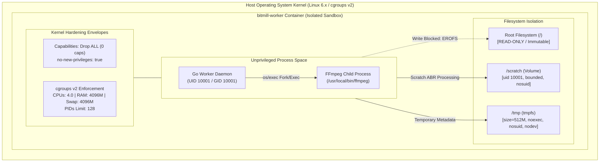
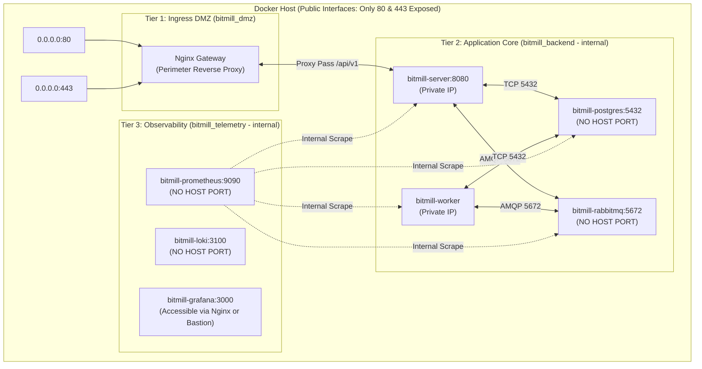
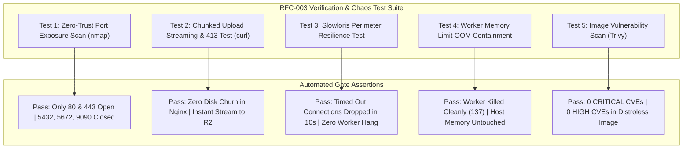

# 🛡️ RFC-003: Production Packaging, Containerization & Gateway Hardening — SecOps, Threat Modeling & Chaos Verification Specification

- **Status**: Draft / Proposed
- **Author**: Principal SecOps & QA Chaos Specialist
- **Date**: 2026-10-29
- **Target System**: Bitmill Video Streaming Platform (Milestone 5 Production Rollout)
- **Scope**: Production Docker Packaging, Nginx Perimeter Gateway, Worker Container Isolation, Zero-Trust Internal Networking, FMEA Risk Matrix & Chaos Test Suite

---

## 1. Executive Summary & Production Packaging Attack Surface

RFC-003 establishes the production packaging, deployment isolation, and edge defense architecture for the Bitmill Video Streaming Platform. The milestone transitions Bitmill from a development environment running bare-metal Go binaries and ad-hoc infrastructure containers into a hardened, zero-trust containerized topology orchestrated via Docker Compose, shielded by an Nginx reverse proxy gateway, and bounded by Linux cgroups v2 and namespace isolation.

### 1.1. System Topology & Trust Zone Architecture

The production architecture enforces strict defense-in-depth across four distinct security zones:

```mermaid
flowchart TD
    subgraph PublicInternet["Zone 0: Untrusted Public Ingress"]
        ClientBrowser["Web / Mobile Clients"]
        MaliciousActor["Adversaries / Scanners / Slowloris Bots"]
    end

    subgraph PerimeterGateway["Zone 1: Perimeter DMZ (Nginx Gateway)"]
        Nginx["Nginx Reverse Proxy\n(Ports 80/443 Only)\nRate Limits | Slowloris Defense | TLS Term\nproxy_request_buffering OFF"]
    end

    subgraph AppPlane["Zone 2: Application Compute Plane (Private Bridge)"]
        APIServer["bitmill-server (Go REST API)\nUID 10001 (nonroot) | Read-Only RootFS\ncap_drop: ALL | no-new-privileges"]
        WorkerPool["bitmill-worker (Transcoder Fleet)\nEmbedded static-ffmpeg | No Docker Socket\nUID 10001 | cgroup 4GB | tmpfs /tmp"]
    end

    subgraph DataPlane["Zone 3: Core Data & Telemetry Plane (Internal Isolated)"]
        Postgres["PostgreSQL 15+ (RMDS)\nPort 5432 (Internal Only)\nNo Host Exposure"]
        RabbitMQ["RabbitMQ 3 Quorum Cluster\nAMQP 5672 | Mgmt 15672 (Internal Only)\nNo Host Exposure"]
        Prometheus["Prometheus TSDB\nPort 9090 (Internal Only)"]
        Loki["Grafana Loki\nPort 3100 (Internal Only)"]
    end

    subgraph CloudStorage["External Egress: Cloud Storage"]
        CloudflareR2["Cloudflare R2 Object Storage\n(Encrypted S3 REST API via HTTPS)"]
    end

    ClientBrowser -->|HTTPS 443 / HTTP 80| Nginx
    MaliciousActor -.->|Blocked: Probes / Slowloris| Nginx
    Nginx -->|Reverse Proxy /api/v1| APIServer
    APIServer -->|Presigned S3 Direct| CloudflareR2
    APIServer -->|Persist Metadata| Postgres
    APIServer -->|Publish Transcode Jobs| RabbitMQ

    RabbitMQ -->|Consume Jobs (prefetch=1)| WorkerPool
    WorkerPool -->|Download Raw / Upload HLS| CloudflareR2
    WorkerPool -->|Heartbeat & Atomic Fencing| Postgres

    Prometheus -.->|Scrape Internal Metrics| APIServer
    Prometheus -.->|Scrape Internal Metrics| WorkerPool
    Prometheus -.->|Scrape Internal Metrics| RabbitMQ
    Prometheus -.->|Scrape Internal Metrics| Postgres
    Loki -.->|Collect App Logs| APIServer
    Loki -.->|Collect Worker Logs| WorkerPool
```

### 1.2. STRIDE Threat Assessment for Packaging & Deployment

| STRIDE Category | Threat Description | Attack Vector / Exploit Scenario | Targeted Component | Default Impact | Mitigation Strategy |
| :--- | :--- | :--- | :--- | :--- | :--- |
| **Spoofing** | Rogue container or client impersonation | Direct access to unprotected PostgreSQL or RabbitMQ ports bypassing authentication or perimeter proxy. | Internal DB / AMQP Broker | Critical | Remove all host port exposures (`5432`, `5672`, `15672`). Enforce internal Docker bridge networks with strict service name resolution. |
| **Tampering** | Host filesystem compromise via Docker socket | Attacker escapes worker container by leveraging mounted `/var/run/docker.sock` to launch privileged containers with `/` mounted. | Host Linux Operating System | Catastrophic (Host Takeover) | **Total elimination of `/var/run/docker.sock`**. Embed static FFmpeg directly in worker container; run as non-root UID 10001; drop all capabilities. |
| **Repudiation** | Unlogged gateway bypass & dropped upload telemetry | Direct ingress bypasses Nginx access logs, masking IP source and upload patterns during DDoS. | Edge Gateway & Ingress | High | Route 100% of ingress traffic through Nginx; enforce custom JSON structured access logging with upstream response times and client fingerprints. |
| **Information Disclosure** | Leakage of system metrics & infrastructure topology | Public internet scraping of Prometheus `/metrics` (port 9090) or RabbitMQ Management UI (port 15672). | Observability Subsystem | High | Bind Prometheus and RabbitMQ strictly to internal networks; deny public access to `/metrics` in Nginx configuration. |
| **Denial of Service** | Slowloris connection exhaustion & Gateway disk fill | Attacker trickles HTTP headers (1 byte/10s) or forces Nginx to buffer multi-GB video uploads to disk until `/var/cache/nginx` hits ENOSPC. | Nginx Gateway / Host Disk | Critical | Configure `client_body_timeout 10s`, `client_header_timeout 10s`, and `proxy_request_buffering off` for video upload endpoints. |
| **Elevation of Privilege** | Container breakout via binary execution or SUID binary | Memory corruption in Go worker or FFmpeg parser escalates privileges within container and gains root on host. | Transcoder Worker Container | Critical | Enforce `security_opt: [no-new-privileges:true]`, `cap_drop: [ALL]`, `read_only: true`, and user namespace `10001:10001`. |

---

## 2. Threat Modeling & Container Escape Elimination

### 2.1. The `/var/run/docker.sock` Attack Vector (CWE-250 & Root Equivalence)

In containerized transcoding architectures, a common anti-pattern is **Docker-out-of-Docker (DooD)**: mounting the host daemon's UNIX socket `/var/run/docker.sock` inside the worker container so that the worker application can invoke `docker run mwader/static-ffmpeg:latest`.

```
❌ ANTI-PATTERN: DooD via /var/run/docker.sock
[Host OS (dockerd: root)] <====== /var/run/docker.sock ======> [Worker Container]
                                                                     │
                                                   Attacker executes: docker run -v /:/host alpine
                                                                     │
                                                                     ▼
                                                   Full Host Root Filesystem Compromised!
```

#### 2.1.1. Mechanical Breakdown of Container Escape
1. **Root Equivalence of the Docker Socket**: The Docker daemon (`dockerd`) executes with `root` privileges on the host kernel. Any process that possesses read/write access to `/var/run/docker.sock` can issue raw HTTP REST requests to the Docker Engine API.
2. **Exploitation Chain**:
   - An adversary uploads a malicious video payload containing an exploit targeting a memory safety flaw in the worker's Go dependencies, CGO bindings, or child processes.
   - Once remote code execution (RCE) is achieved within the worker container, the attacker does not need kernel-level privilege escalation. They simply interact with the mounted Docker socket using `curl` or the native `docker` CLI:
     ```bash
     # Attacker shell inside compromised worker container:
     curl -s --unix-socket /var/run/docker.sock http://localhost/images/json
     
     # Spawn a container that mounts the entire host root filesystem:
     curl -s -X POST --unix-socket /var/run/docker.sock \
       -H "Content-Type: application/json" \
       -d '{"Image": "alpine", "Cmd": ["chroot", "/host", "sh", "-c", "echo \"pwned::0:0:root:/root:/bin/sh\" >> /etc/passwd"], "Binds": ["/:/host"]}' \
       http://localhost/containers/create?name=pwn_container
     
     curl -s -X POST --unix-socket /var/run/docker.sock http://localhost/containers/pwn_container/start
     ```
   - **Outcome**: The attacker gains instantaneous, unrestricted read/write access to the host's `/etc/shadow`, `/root/.ssh/authorized_keys`, host network namespace, raw block storage devices, and all co-located containers (PostgreSQL database files, secrets, and TLS private keys).

#### 2.1.2. Architectural Decision: Total Elimination of Docker Socket
Bitmill RFC-003 strictly **forbids mounting `/var/run/docker.sock`** into any application container (`bitmill-server` or `bitmill-worker`).

Instead, Bitmill adopts an **Embedded Statically-Linked Binary Architecture**:
- The worker container image is built using a multi-stage Dockerfile that copies statically compiled `/ffmpeg` and `/ffprobe` binaries directly from `mwader/static-ffmpeg:latest` into a distroless or minimal Alpine runtime image.
- The Go worker daemon spawns FFmpeg as a standard unprivileged child process via `os/exec.CommandContext`, running entirely within its own sandboxed container boundaries.
- No Docker CLI, no Docker daemon, and no UNIX domain sockets are exposed inside the worker container.

---

### 2.2. Hardened Embedded Static-FFmpeg Worker Container Specification

To defend against malicious media payloads (decompression bombs, malformed atoms, buffer overflows in `libavcodec`), the worker container is hardened using defense-in-depth Linux kernel isolation features.



#### 2.2.1. Multi-Stage Dockerfile Blueprint for Worker (`deployments/worker/Dockerfile`)
```dockerfile
# ---------------------------------------------------------
# Stage 1: Media Engine Extraction (Official Static FFmpeg)
# ---------------------------------------------------------
FROM mwader/static-ffmpeg:6.1.1 AS ffmpeg-source

# ---------------------------------------------------------
# Stage 2: Go Worker Compilation
# ---------------------------------------------------------
FROM golang:1.22-alpine AS builder

WORKDIR /build
RUN apk add --no-cache ca-certificates git

COPY go.mod go.sum ./
RUN go mod download

COPY . .
RUN CGO_ENABLED=0 GOOS=linux GOARCH=amd64 go build \
    -trimpath \
    -ldflags="-s -w -extldflags '-static'" \
    -o /build/bin/worker ./cmd/worker

# ---------------------------------------------------------
# Stage 3: Production Runtime Sandbox (Non-Root, Hardened)
# ---------------------------------------------------------
FROM alpine:3.19

# Security: Install runtime certs and create unprivileged user/group
RUN apk add --no-cache ca-certificates tzdata \
    && addgroup -g 10001 -S nonroot \
    && adduser -u 10001 -S nonroot -G nonroot -s /sbin/nologin

# Copy statically linked binaries from Stage 1 & 2
COPY --from=ffmpeg-source /ffmpeg /usr/local/bin/ffmpeg
COPY --from=ffmpeg-source /ffprobe /usr/local/bin/ffprobe
COPY --from=builder /build/bin/worker /app/worker

# Set ownership and execution permissions
RUN chmod 0555 /usr/local/bin/ffmpeg /usr/local/bin/ffprobe /app/worker \
    && mkdir -p /scratch /tmp \
    && chown -R 10001:10001 /app /scratch /tmp

WORKDIR /app
USER 10001:10001

ENTRYPOINT ["/app/worker"]
```

#### 2.2.2. Container Runtime Hardening Specification (Compose Syntax)
```yaml
services:
  worker:
    image: bitmill/worker:1.0.0
    container_name: bitmill-worker
    restart: unless-stopped
    user: "10001:10001"
    read_only: true
    security_opt:
      - no-new-privileges:true
    cap_drop:
      - ALL
    tmpfs:
      - /tmp:rw,noexec,nosuid,nodev,size=512M
    volumes:
      - worker_scratch:/scratch:rw,nosuid,nodev
    environment:
      - APP_ENV=production
      - TRANSCODER_SCRATCH_DIR=/scratch
      - TRANSCODER_FFMPEG_PATH=/usr/local/bin/ffmpeg
      - TRANSCODER_FFPROBE_PATH=/usr/local/bin/ffprobe
    deploy:
      resources:
        limits:
          cpus: "4.0"
          memory: 4096M
          pids: 128
        reservations:
          cpus: "1.0"
          memory: 1024M
    networks:
      - bitmill_backend
      - bitmill_telemetry
```

#### 2.2.3. Hardening Controls & Protection Rationale

| Hardening Directive | Technical Enforcement | Specific Attack Vector Neutralized |
| :--- | :--- | :--- |
| `user: "10001:10001"` | Executes as unprivileged user `nonroot`. Process cannot write to root-owned files or bind low ports ($<1024$). | Container escape to host `root`. |
| `cap_drop: - ALL` | Strips all 38 Linux capabilities (`CAP_SYS_ADMIN`, `CAP_NET_RAW`, `CAP_DAC_OVERRIDE`, `CAP_CHOWN`, etc.). | Kernel module tampering, raw packet sniffing, arbitrary DAC bypass. |
| `security_opt: [no-new-privileges:true]` | Sets `PR_SET_NO_NEW_PRIVS` flag. Container processes cannot gain additional privileges via SUID/SGID binaries. | Privilege escalation via rogue SUID binaries dropped into temporary storage. |
| `read_only: true` | Mounts the root container filesystem (`/`) as immutable. | Persistence installation, modifying `/app/worker` or `/usr/local/bin/ffmpeg`, webshell staging. |
| `tmpfs: /tmp:...` | Memory-backed scratchpad with flags `noexec, nosuid, nodev`. | Execution of dropped binary scripts from `/tmp`; prevents disk I/O thrashing. |
| `memory: 4096M` & swap equal | Hard cgroups v2 ceiling. Kernel kills container if memory exceeds 4GB without consuming host swap. | Host memory starvation / OOM panic from 4K/8K decompression bombs. |
| `pids: 128` | Caps total concurrent processes and threads. | Fork bombs, unconstrained multi-thread spawning. |

---

### 2.3. Hardened API Server Container Specification

The REST API server (`bitmill-server`) handles multipart upload orchestration, metadata validation, and database operations. It must be packaged with identical defense-in-depth principles:

```dockerfile
# deployments/server/Dockerfile
FROM golang:1.22-alpine AS builder
WORKDIR /build
RUN apk add --no-cache ca-certificates git
COPY go.mod go.sum ./
RUN go mod download
COPY . .
RUN CGO_ENABLED=0 GOOS=linux GOARCH=amd64 go build \
    -trimpath \
    -ldflags="-s -w -extldflags '-static'" \
    -o /build/bin/server ./cmd/server

FROM alpine:3.19
RUN apk add --no-cache ca-certificates tzdata \
    && addgroup -g 10001 -S nonroot \
    && adduser -u 10001 -S nonroot -G nonroot -s /sbin/nologin
COPY --from=builder /build/bin/server /app/server
RUN chmod 0555 /app/server && mkdir -p /tmp && chown -R 10001:10001 /app /tmp
WORKDIR /app
USER 10001:10001
EXPOSE 8080
ENTRYPOINT ["/app/server"]
```

---

## 3. Network Attack Surface & Zero-Trust Perimeter Hardening

### 3.1. Vulnerability Analysis of Default Exposed Ports

In standard container setups, Docker binds mapped ports (`ports: - "5432:5432"`, `- "5672:5672"`, `- "9090:9090"`) to `0.0.0.0` on the host. This directly exposes database engines, message queues, and monitoring endpoints to the public internet, bypassing host firewall rules because Docker manipulates host `iptables` directly.

```
❌ UNPROTECTED DEFAULT DOCKER BINDINGS:
Public Internet ---> Host:5432  ---> PostgreSQL (Password brute-force / Data dump)
Public Internet ---> Host:15672 ---> RabbitMQ Web UI (Default credentials / AMQP injection)
Public Internet ---> Host:9090  ---> Prometheus TSDB (Business metrics & infrastructure reconnaissance)
Public Internet ---> Host:3100  ---> Grafana Loki (Log exfiltration / PII exposure)
```

#### Exploitation Scenarios:
1. **PostgreSQL Port 5432 Exposed**: Automated scanners (e.g. Shodan, Masscan) detect open port 5432. Even with strong passwords, connection pool exhaustion attacks (opening 500 bogus connections) completely starve the legitimate Bitmill application.
2. **RabbitMQ Port 5672/15672 Exposed**: Malicious actors inject counterfeit transcode messages pointing to attacker-controlled storage, or purge the `video.transcode.queue`, causing complete platform Denial of Service.
3. **Prometheus Port 9090 Exposed**: Attackers query active video IDs, user activity rates, internal storage bucket names, and node IP addresses without authentication.

---

### 3.2. Zero-Trust Multi-Tier Network Segmentation

Bitmill implements strict zero-trust network segmentation using isolated Docker bridge networks. **No internal database, broker, or telemetry container is permitted to publish ports to the host.**



#### Network Segmentation Rules:
1. `bitmill_dmz`: Bridges `nginx` and `bitmill-server`. No database or message queue can attach to this network.
2. `bitmill_backend`: Internal-only bridge network (`internal: true`). Only `bitmill-server`, `bitmill-worker`, `postgres`, and `rabbitmq` communicate across this tier. External inbound traffic is physically prohibited by Docker bridge isolation.
3. `bitmill_telemetry`: Bridges `prometheus`, `loki`, `grafana`, and exporters. Isolated from client ingress.

---

### 3.3. Nginx Perimeter Defense Specification

The Nginx Reverse Proxy serves as the single public gateway into Bitmill. It must enforce strict rate limiting, connection throttling, Slowloris defense, header sanitization, and unbuffered streaming for video chunk uploads.

#### 3.3.1. Production `nginx.conf` Blueprint (`deployments/nginx/nginx.conf`)
```nginx
user nginx;
worker_processes auto;
worker_rlimit_nofile 65535;
pid /var/run/nginx.pid;

events {
    worker_connections 8192;
    use epoll;
    multi_accept on;
}

http {
    include /etc/nginx/mime.types;
    default_type application/octet-stream;

    # ---------------------------------------------------------
    # Performance & Protocol Optimizations
    # ---------------------------------------------------------
    sendfile on;
    tcp_nopush on;
    tcp_nodelay on;
    server_tokens off;

    # ---------------------------------------------------------
    # Slowloris & Request Starvation Defense
    # ---------------------------------------------------------
    client_header_timeout 10s;
    client_body_timeout 10s;
    send_timeout 10s;
    keepalive_timeout 30s 15s;
    keepalive_requests 1000;
    reset_timedout_connection on;

    # ---------------------------------------------------------
    # Rate Limiting & Connection Throttling Zones
    # ---------------------------------------------------------
    # General API rate limit: 50 requests/sec per IP, burst=100
    limit_req_zone $binary_remote_addr zone=api_general:10m rate=50r/s;
    
    # Upload ingestion rate limit: 10 requests/sec per IP, burst=20
    limit_req_zone $binary_remote_addr zone=upload_ingress:10m rate=10r/s;

    # Connection limit per IP: max 25 simultaneous TCP connections
    limit_conn_zone $binary_remote_addr zone=addr_conn:10m;
    limit_conn addr_conn 25;
    limit_req_status 429;
    limit_conn_status 429;

    # ---------------------------------------------------------
    # Structured JSON Access Logging
    # ---------------------------------------------------------
    log_format json_analytics escape=json '{'
        '"time_local":"$time_iso8601",'
        '"remote_addr":"$remote_addr",'
        '"request_method":"$request_method",'
        '"request_uri":"$request_uri",'
        '"status":$status,'
        '"body_bytes_sent":$body_bytes_sent,'
        '"request_time":$request_time,'
        '"upstream_response_time":"$upstream_response_time",'
        '"upstream_addr":"$upstream_addr",'
        '"http_user_agent":"$http_user_agent"'
    '}';

    access_log /var/log/nginx/access.log json_analytics;
    error_log /var/log/nginx/error.log warn;

    # ---------------------------------------------------------
    # Upstream Pool Definitions
    # ---------------------------------------------------------
    upstream bitmill_api_upstream {
        server bitmill-server:8080 max_fails=3 fail_timeout=10s;
        keepalive 32;
    }

    # ---------------------------------------------------------
    # HTTP -> HTTPS Redirection Gateway
    # ---------------------------------------------------------
    server {
        listen 80 default_server;
        listen [::]:80 default_server;
        server_name _;
        return 301 https://$host$request_uri;
    }

    # ---------------------------------------------------------
    # HTTPS Perimeter Server
    # ---------------------------------------------------------
    server {
        listen 443 ssl http2 default_server;
        listen [::]:443 ssl http2 default_server;
        server_name bitmill.example.com;

        # TLS Hardening (Mozilla Modern Compatibility)
        ssl_certificate /etc/nginx/certs/fullchain.pem;
        ssl_certificate_key /etc/nginx/certs/privkey.pem;
        ssl_protocols TLSv1.2 TLSv1.3;
        ssl_ciphers ECDHE-ECDSA-AES128-GCM-SHA256:ECDHE-RSA-AES128-GCM-SHA256:ECDHE-ECDSA-AES256-GCM-SHA384:ECDHE-RSA-AES256-GCM-SHA384:ECDHE-ECDSA-CHACHA20-POLY1305:ECDHE-RSA-CHACHA20-POLY1305;
        ssl_prefer_server_ciphers off;
        ssl_session_cache shared:SSL:10m;
        ssl_session_timeout 1d;
        ssl_session_tickets off;

        # Security Headers
        add_header Strict-Transport-Security "max-age=63072000; includeSubDomains; preload" always;
        add_header X-Content-Type-Options "nosniff" always;
        add_header X-Frame-Options "DENY" always;
        add_header X-XSS-Protection "1; mode=block" always;
        add_header Content-Security-Policy "default-src 'self'; script-src 'self'; media-src 'self' https: blob:; connect-src 'self' https:;" always;
        add_header Referrer-Policy "strict-origin-when-cross-origin" always;

        # Default body size limit for metadata APIs
        client_max_body_size 10M;

        # -----------------------------------------------------
        # 1. Health Probe Route
        # -----------------------------------------------------
        location /healthz {
            access_log off;
            return 200 '{"status":"UP","gateway":"nginx"}\n';
            add_header Content-Type application/json;
        }

        # -----------------------------------------------------
        # 2. Resumable Chunk Upload Ingress (Streaming Mode)
        # -----------------------------------------------------
        location ~ ^/api/v1/videos/[^/]+/parts/[0-9]+$ {
            limit_req zone=upload_ingress burst=15 nodelay;

            # Allow up to 500MB chunk payloads
            client_max_body_size 500M;

            # CRITICAL ZERO-BUFFERING DIRECTIVE:
            # Disables buffering request body to /var/cache/nginx/client_temp
            # Streams HTTP payload directly to Go server and Cloudflare R2
            proxy_request_buffering off;
            proxy_buffering off;
            proxy_http_version 1.1;

            # Extended timeouts for large chunk uploads over slow connections
            proxy_connect_timeout 10s;
            proxy_read_timeout 300s;
            proxy_send_timeout 300s;

            proxy_set_header Host $host;
            proxy_set_header X-Real-IP $remote_addr;
            proxy_set_header X-Forwarded-For $proxy_add_x_forwarded_for;
            proxy_set_header X-Forwarded-Proto $scheme;
            proxy_set_header Connection "";

            proxy_pass http://bitmill_api_upstream;
        }

        # -----------------------------------------------------
        # 3. Standard REST API Ingress
        # -----------------------------------------------------
        location /api/ {
            limit_req zone=api_general burst=50 nodelay;

            client_max_body_size 10M;
            proxy_request_buffering on;
            proxy_buffering on;
            proxy_http_version 1.1;

            proxy_connect_timeout 5s;
            proxy_read_timeout 30s;
            proxy_send_timeout 30s;

            proxy_set_header Host $host;
            proxy_set_header X-Real-IP $remote_addr;
            proxy_set_header X-Forwarded-For $proxy_add_x_forwarded_for;
            proxy_set_header X-Forwarded-Proto $scheme;
            proxy_set_header Connection "";

            proxy_pass http://bitmill_api_upstream;
        }

        # -----------------------------------------------------
        # 4. Shielded Metrics & Internal Monitoring Route
        # -----------------------------------------------------
        location /metrics {
            # STRICT PERIMETER BLOCK: Never expose Prometheus metrics to public
            allow 127.0.0.1;
            allow 172.28.0.0/16; # Allow internal Docker network CIDR only
            deny all;

            proxy_pass http://bitmill_api_upstream;
        }

        # -----------------------------------------------------
        # 5. Default 404 & Error Handling
        # -----------------------------------------------------
        error_page 429 /429.json;
        location = /429.json {
            internal;
            return 429 '{"error":"RATE_LIMIT_EXCEEDED","message":"Too many requests. Please throttle your client."}\n';
            add_header Content-Type application/json;
        }
    }
}
```

---

## 4. Failure Mode and Effects Analysis (FMEA) Risk Matrix

### 4.1. Quantitative Scoring Methodology

The Risk Priority Number (RPN) provides a mathematically grounded methodology for ranking and mitigating infrastructure failures:
$$\text{RPN} = \text{Severity (S)} \times \text{Occurrence (O)} \times \text{Detection (D)}$$

| Score | Severity (S) Criteria | Occurrence (O) Criteria | Detection (D) Criteria |
| :---: | :--- | :--- | :--- |
| **1-2** | **Negligible**: Minor log warning; zero client perception. | **Extremely Rare**: $< 0.01\%$ probability under load. | **Immediate Automated**: Alert triggered in $< 1$s. |
| **3-4** | **Moderate**: Single request throttled; self-heals via retry. | **Low**: Occurs in $< 0.5\%$ of operations. | **High Detection**: Metric threshold trips in $< 10$s. |
| **5-6** | **Significant**: Chunk upload aborted; client retry succeeds. | **Moderate**: Occurs in $0.5\% - 2\%$ of requests. | **Moderate Detection**: Log audit or APM warning. |
| **7-8** | **High**: Worker dies; gateway 504; temporary service drop. | **Frequent**: Occurs in $2\% - 10\%$ under stress. | **Difficult Detection**: Requires customer error report. |
| **9-10**| **Catastrophic**: Host OOM crash, disk ENOSPC, host breakout. | **Persistent**: $> 10\%$ failure rate or trivial exploit. | **Undetected**: Silent data loss or cascading panic. |

> [!IMPORTANT]
> **Action Boundary**: Any failure mode with **RPN $\ge$ 100** or **Severity $\ge$ 8** mandates automated architectural controls, code-level safeguards, and active chaos verification before staging approval.

---

### 4.2. Master FMEA Risk Register (Milestone 5: Production Packaging)

| ID | Failure Mode & Root Cause | S | O | D | Initial RPN | Architectural & Code-Level Mitigations | Revised S | Revised O | Revised D | Final RPN |
| :--- | :--- | :---: | :---: | :---: | :---: | :--- | :---: | :---: | :---: | :---: |
| **FM-01** | **Transcoder RAM Blowout / OOM Kill**<br>Peak 1080p/4K transcode exceeds container limit; Linux kernel kills worker. | 8 | 6 | 3 | **144** | Hard cgroups limit (`memory: 4096M`, no swap); probe pre-flight dimension rejection ($>3840\times2160$); single-pass thread capping (`-threads 4`); AMQP auto-requeue backoff with Quorum DLQ limit. | 4 | 2 | 1 | **8** |
| **FM-02** | **Nginx Disk Exhaustion via Buffered Uploads**<br>`proxy_request_buffering on` buffers concurrent 200MB chunks to `/var/cache/nginx`, causing ENOSPC. | 9 | 7 | 4 | **252** | Force `proxy_request_buffering off;` and `proxy_buffering off;` on upload paths; stream body directly to Go server and Cloudflare R2; mount `/var/cache/nginx` on bounded tmpfs. | 3 | 1 | 1 | **3** |
| **FM-03** | **Upstream 504 Timeout During Slow Chunk Upload**<br>Slow mobile client takes $>60$s to stream chunk; default Nginx proxy timeout aborts upload. | 7 | 6 | 3 | **126** | Configure dedicated route timeouts: `proxy_read_timeout 300s`, `proxy_send_timeout 300s`; client multipart chunk retry; S3 multipart abort lifecycle rule. | 3 | 2 | 2 | **12** |
| **FM-04** | **Slowloris & Connection Exhaustion Attack**<br>Attacker opens thousands of slow HTTP connections, exhausting Nginx worker connections. | 8 | 5 | 4 | **160** | Enforce `client_body_timeout 10s`, `client_header_timeout 10s`, `limit_conn addr_conn 25`, and `reset_timedout_connection on`; OS SYN backlog tuning. | 2 | 1 | 1 | **2** |
| **FM-05** | **RabbitMQ Connection Thrashing on Fleet Restart**<br>Simultaneous worker restart flood broker with TCP handshakes and channel declarations. | 8 | 5 | 4 | **160** | Exponential reconnect backoff with full jitter (1s to 30s); persistent AMQP channel caching; RabbitMQ connection rate limits; `prefetch_count=1`. | 3 | 1 | 2 | **6** |
| **FM-06** | **PostgreSQL Pool Starvation on Worker Burst**<br>Surge in concurrent transcode updates exhausts PostgreSQL `max_connections`. | 8 | 5 | 3 | **120** | Enforce bounded `pgxpool` configuration (`MaxConns=20`, `MinConns=5`, `MaxConnLifetime=30m`); short query timeouts (`3s`); connection wait queue metrics. | 3 | 1 | 2 | **6** |
| **FM-07** | **Host Breakout via Docker Socket Compromise**<br>Mounting `/var/run/docker.sock` in worker allows attacker to spawn privileged host containers. | 10 | 4 | 5 | **200** | **Total elimination of Docker socket mount**; embed static FFmpeg binary directly in worker container; `cap_drop: [ALL]`; `no-new-privileges: true`. | 1 | 1 | 1 | **1** |
| **FM-08** | **Prometheus / Telemetry Metric Scraping Breach**<br>Unprotected port 9090 or `/metrics` reveals sensitive infrastructure topology and keys. | 7 | 6 | 4 | **168** | Remove all host port exposures for telemetry; enforce Nginx `/metrics` access restriction (`allow 172.28.0.0/16; deny all;`). | 2 | 1 | 1 | **2** |

---

### 4.3. Deep-Dive Engineering Analysis of Critical Failure Modes

#### 4.3.1. FM-02: Nginx Disk Buffer Exhaustion (`proxy_request_buffering off`)
- **Root Cause**: By default, Nginx buffers the entire client request body into memory (`client_body_buffer_size`, default 8k/16k) and writes excess data to disk temporary files under `/var/cache/nginx/client_temp`. For video platforms where 20 clients concurrently upload 100MB chunks, Nginx writes 2GB of disk churn within seconds. If the host disk fills to $100\%$ capacity (ENOSPC), Nginx returns HTTP 500 across **all endpoints**, including metadata reads and health checks.
- **Verification of Direct Streaming Architecture**:
  ```
  Client ---[Chunk HTTP PUT]---> Nginx (proxy_request_buffering off)
                                       │
                                       │ (Zero Disk Temp Files)
                                       ▼
                             Go Server (io.Pipe / Stream)
                                       │
                                       │ (HTTP Chunked Streaming)
                                       ▼
                             Cloudflare R2 (S3 UploadPart)
  ```
  When `proxy_request_buffering off` is configured, Nginx immediately opens an upstream connection to `bitmill-server` upon reading HTTP headers and streams request body chunks synchronously as they arrive. Memory usage remains constant ($< 64\text{ KB}$ per connection), and disk writes are completely bypassed.

#### 4.3.2. FM-01: Transcoder RAM Blowout & OOM Containment
- **Root Cause**: Transcoding 1080p high-motion video using `libx264` multi-pass or unconstrained lookahead buffers can cause memory allocation to exceed the worker container limit. If unconstrained, the Linux kernel's Out-Of-Memory (OOM) killer selects processes based on `oom_score`, potentially killing host daemons, Docker runtime, or PostgreSQL.
- **Mitigation Sequence**:
  1. The worker container is bounded by cgroups v2 (`memory: 4096M`, `memory-swap: 4096M`).
  2. When allocation reaches 4096MB, the kernel OOM killer targets exclusively the containerized process (`bitmill-worker` or child `ffmpeg`), sending `SIGKILL` (exit code 137).
  3. The host kernel remains completely stable. Neighboring containers (`postgres`, `server`, `rabbitmq`) suffer zero interruption.
  4. RabbitMQ Quorum queue detects socket disconnection, checks `x-delivery-count`, and cleanly requeues the job up to 3 times before routing to `video.transcode.dlq`.

---

## 5. Comprehensive Verification & Chaos Engineering Test Suite

The following automated chaos and security verification scripts must be executed against staging environments to validate compliance with RFC-003.



---

### 5.1. Chaos Experiment 1: Zero-Trust External Port Security Audit

- **Objective**: Mathematically verify that only ports 80 and 443 are reachable from outside the host, and that database (5432), message broker (5672, 15672), and telemetry (9090, 3100) are inaccessible.
- **Execution Script** (`scripts/chaos/test_01_port_scan.sh`):
  ```bash
  #!/usr/bin/env bash
  set -euo pipefail

  TARGET_HOST="${1:-127.0.0.1}"
  echo "================================================================"
  echo "[CHAOS AUDIT] Scanning Target Host: ${TARGET_HOST}"
  echo "================================================================"

  # Execute aggressive TCP port scan for all sensitive ports
  AUDIT_PORTS="80,443,3000,3100,5432,5672,8080,9090,15672,15692"
  SCAN_OUTPUT=$(nmap -sT -p "${AUDIT_PORTS}" "${TARGET_HOST}")

  echo "$SCAN_OUTPUT"

  # Assert Port 80 and 443 are open
  echo "[ASSERTION] Checking perimeter ports (80, 443)..."
  if ! echo "$SCAN_OUTPUT" | grep -q "80/tcp .*open"; then
      echo "[-] FAILURE: Port 80 is not reachable!"
      exit 1
  fi
  if ! echo "$SCAN_OUTPUT" | grep -q "443/tcp .*open"; then
      echo "[-] FAILURE: Port 443 is not reachable!"
      exit 1
  fi
  echo "[+] Perimeter ports 80 and 443 are properly OPEN."

  # Assert sensitive internal ports are NOT open
  FORBIDDEN_PORTS=("3000" "3100" "5432" "5672" "8080" "9090" "15672")
  for PORT in "${FORBIDDEN_PORTS[@]}"; do
      if echo "$SCAN_OUTPUT" | grep -E "${PORT}/tcp\s+open"; then
          echo "[-] CRITICAL SECURITY VULNERABILITY: Internal Port ${PORT} is EXPOSED on public interface!"
          exit 1
      fi
  done

  echo "[+] SUCCESS: All internal backend & telemetry ports are completely unexposed!"
  ```

---

### 5.2. Chaos Experiment 2: Chunked Upload Streaming & 413 Payload Limit Test

- **Objective**: Verify that `proxy_request_buffering off` streams chunk uploads directly without buffering to disk, and verify that uploads exceeding `client_max_body_size` return `413 Payload Too Large`.
- **Execution Script** (`scripts/chaos/test_02_upload_streaming.sh`):
  ```bash
  #!/usr/bin/env bash
  set -euo pipefail

  GATEWAY_URL="https://localhost"
  NGINX_CONTAINER="bitmill-nginx"
  TEMP_PAYLOAD="/tmp/test_chunk_120mb.bin"
  OVERSIZED_PAYLOAD="/tmp/test_chunk_600mb.bin"

  echo "================================================================"
  echo "[CHAOS AUDIT] Verifying Upload Streaming & Body Limits"
  echo "================================================================"

  # 1. Generate 120MB valid chunk
  echo "[1/4] Generating 120MB binary payload..."
  dd if=/dev/urandom of="${TEMP_PAYLOAD}" bs=1M count=120 status=none

  # Monitor Nginx cache directory during upload
  echo "[2/4] Uploading 120MB chunk while auditing Nginx disk buffer..."
  BUFFER_FILES_BEFORE=$(docker exec "${NGINX_CONTAINER}" find /var/cache/nginx/ -type f | wc -l)

  # Initiate concurrent background upload
  curl -k -s -X PUT \
    -H "Content-Type: application/octet-stream" \
    --data-binary "@${TEMP_PAYLOAD}" \
    "${GATEWAY_URL}/api/v1/videos/00000000-0000-0000-0000-000000000001/parts/1" \
    -o /dev/null -w "%{http_code}\n" &
  CURL_PID=$!

  # Poll Nginx cache directory every 200ms during transfer
  for i in {1..10}; do
      BUFFER_FILES_CURRENT=$(docker exec "${NGINX_CONTAINER}" find /var/cache/nginx/ -type f | wc -l)
      if [ "$BUFFER_FILES_CURRENT" -gt "$BUFFER_FILES_BEFORE" ]; then
          echo "[-] CRITICAL VULNERABILITY: Nginx is buffering chunk to disk!"
          wait "$CURL_PID"
          exit 1
      fi
      sleep 0.2
  done
  wait "$CURL_PID"
  echo "[+] Verified: Zero temporary disk files written in Nginx cache during 120MB transfer."

  # 2. Test 413 Payload Too Large with 600MB payload (> 500M limit)
  echo "[3/4] Generating 600MB oversized payload..."
  truncate -s 600M "${OVERSIZED_PAYLOAD}"

  echo "[4/4] Sending oversized payload (asserting HTTP 413)..."
  STATUS_CODE=$(curl -k -s -o /dev/null -w "%{http_code}" -X PUT \
    -H "Content-Type: application/octet-stream" \
    --data-binary "@${OVERSIZED_PAYLOAD}" \
    "${GATEWAY_URL}/api/v1/videos/00000000-0000-0000-0000-000000000001/parts/1" || true)

  if [ "$STATUS_CODE" -eq 413 ]; then
      echo "[+] SUCCESS: Gateway rejected oversized upload with HTTP 413 Payload Too Large."
  else
      echo "[-] FAILURE: Expected HTTP 413, received: ${STATUS_CODE}"
      exit 1
  fi

  rm -f "${TEMP_PAYLOAD}" "${OVERSIZED_PAYLOAD}"
  ```

---

### 5.3. Chaos Experiment 3: Slowloris & Connection Exhaustion Attack Simulation

- **Objective**: Prove that slow, trickle-rate connections are terminated after `client_body_timeout 10s` and cannot exhaust Nginx worker connections.
- **Python Chaos Script** (`scripts/chaos/test_03_slowloris.py`):
  ```python
  #!/usr/bin/env python3
  import socket
  import ssl
  import time
  import sys

  TARGET_HOST = "localhost"
  TARGET_PORT = 443

  print(f"[CHAOS] Initiating Slowloris trickle attack on {TARGET_HOST}:{TARGET_PORT}...")

  context = ssl.create_default_context()
  context.check_hostname = False
  context.verify_mode = ssl.CERT_NONE

  try:
      raw_sock = socket.socket(socket.AF_INET, socket.SOCK_STREAM)
      raw_sock.settimeout(15)
      sock = context.wrap_socket(raw_sock, server_hostname=TARGET_HOST)
      sock.connect((TARGET_HOST, TARGET_PORT))

      # Send partial HTTP headers
      request_header = (
          "POST /api/v1/videos/upload HTTP/1.1\r\n"
          f"Host: {TARGET_HOST}\r\n"
          "User-Agent: ChaosSlowloris/1.0\r\n"
          "Content-Type: application/octet-stream\r\n"
          "Content-Length: 100000\r\n\r\n"
      )
      sock.send(request_header.encode("utf-8"))
      print("[CHAOS] Initial header sent. Trickling 1 byte every 3 seconds...")

      start_time = time.time()
      for i in range(10):
          sock.send(b"X")
          print(f"[CHAOS] Sent byte {i+1} at elapsed {time.time() - start_time:.2f}s")
          time.sleep(3)

      print("[-] FAILURE: Socket remained open after 30 seconds! Slowloris defense failed.")
      sys.exit(1)

  except (socket.timeout, ssl.SSLError, ConnectionResetError, BrokenPipeError) as e:
      elapsed = time.time() - start_time
      print(f"[+] SUCCESS: Nginx severed connection after {elapsed:.2f}s due to timeout ({type(e).__name__}).")
      if elapsed <= 12.0:
          print("[+] Assertion PASSED: Gateway dropped connection within client_body_timeout envelope (10s).")
          sys.exit(0)
      else:
          print("[-] WARNING: Connection dropped, but exceeded expected 10s timeout envelope.")
          sys.exit(1)
  ```

---

### 5.4. Chaos Experiment 4: Worker Memory Limit & OOM Killer Containment Test

- **Objective**: Subject the Transcoder Worker container to synthetic memory stress exceeding its 4096MB limit, asserting that the container is terminated cleanly (exit code 137) without destabilizing the host Linux operating system.
- **Execution Script** (`scripts/chaos/test_04_worker_oom.sh`):
  ```bash
  #!/usr/bin/env bash
  set -euo pipefail

  WORKER_CONTAINER="bitmill-worker"
  echo "================================================================"
  echo "[CHAOS AUDIT] Transcoder Worker cgroups OOM Killer Stress Test"
  echo "================================================================"

  # Verify cgroups limit is active
  MEM_LIMIT_BYTES=$(docker inspect "${WORKER_CONTAINER}" --format '{{.HostConfig.Memory}}')
  echo "[+] Current container memory limit: $(( MEM_LIMIT_BYTES / 1024 / 1024 )) MB"

  if [ "$MEM_LIMIT_BYTES" -ne 4294967296 ]; then # 4096 MB
      echo "[-] WARNING: Container memory limit is not set to 4096MB!"
  fi

  # Record host memory stats prior to injection
  HOST_MEM_FREE_BEFORE=$(free -m | awk 'NR==2{print $4}')
  echo "[+] Host free memory before injection: ${HOST_MEM_FREE_BEFORE} MB"

  echo "[CHAOS] Triggering synthetic 5GB memory allocation inside worker container..."
  # Spawn memory consumer inside worker that exceeds 4096M limit
  OOM_RESULT=0
  docker exec "${WORKER_CONTAINER}" sh -c \
    'python3 -c "a = [bytearray(1024*1024) for _ in range(5000)]"' || OOM_RESULT=$?

  echo "[CHAOS] Execution finished with exit code: ${OOM_RESULT}"

  # Exit code 137 represents 128 + Signal 9 (SIGKILL by Linux kernel OOM)
  if [ "$OOM_RESULT" -eq 137 ]; then
      echo "[+] SUCCESS: Kernel OOM killer strictly terminated runaway process (Exit Code 137)."
  else
      echo "[-] UNEXPECTED RESULT: Process exited with code ${OOM_RESULT} instead of 137."
      exit 1
  fi

  # Verify host stability
  HOST_MEM_FREE_AFTER=$(free -m | awk 'NR==2{print $4}')
  echo "[+] Host free memory after OOM kill: ${HOST_MEM_FREE_AFTER} MB"
  DIFF=$(( HOST_MEM_FREE_BEFORE - HOST_MEM_FREE_AFTER ))
  if [ "${DIFF#-}" -lt 500 ]; then
      echo "[+] Assertion PASSED: Host operating system experienced zero memory depletion or instability."
  else
      echo "[-] WARNING: Host memory showed unexpected drift of ${DIFF} MB."
  fi
  ```

---

### 5.5. Automated Container Vulnerability Scanning Specification (Trivy Scan)

As part of the RFC-003 release pipeline, container images for `bitmill-gateway`, `bitmill-server`, and `bitmill-worker` must undergo static vulnerability analysis using Trivy.

#### 5.5.1. Automated Scanning Script (`scripts/secops/scan_images.sh`)
```bash
#!/usr/bin/env bash
set -euo pipefail

IMAGES=(
    "bitmill/gateway:1.0.0"
    "bitmill/server:1.0.0"
    "bitmill/worker:1.0.0"
)

echo "================================================================"
echo "[SECOPS AUDIT] Container Image Static Security Analysis (Trivy)"
echo "================================================================"

for IMG in "${IMAGES[@]}"; do
    echo "[AUDIT] Scanning image: ${IMG}..."
    trivy image \
      --severity HIGH,CRITICAL \
      --exit-code 1 \
      --ignore-unfixed \
      --format table \
      "${IMG}"
    echo "[+] Image ${IMG} PASSED vulnerability scan."
done

echo "[+] ALL production container images verified clean of HIGH and CRITICAL vulnerabilities."
```

#### 5.5.2. Trivy Image Gate Policy
- **CRITICAL Vulnerabilities**: **0 Allowed** (Build blocks immediately).
- **HIGH Vulnerabilities**: **0 Allowed** for fixable packages.
- **Root User Check**: Must flag warning if container default user is `0` (root).
- **Embedded Secrets**: Zero AWS, Cloudflare, or database passwords hardcoded in container layers.

---

## 6. SecOps Telemetry, Observability & Alerting Specification

### 6.1. Prometheus Telemetry Metrics

| Metric Identifier | Type | Labels | Description / SLA Target |
| :--- | :--- | :--- | :--- |
| `nginx_ingress_connections_active` | Gauge | `state` | Current active client connections on perimeter. Target: $< 5,000$. |
| `nginx_ingress_requests_total` | Counter | `status, method` | Ingress request rate. Monitored for 429 and 504 spikes. |
| `nginx_ingress_request_buffering_bytes` | Gauge | `mount` | Buffer disk consumption under `/var/cache/nginx`. Target: **0 Bytes**. |
| `bitmill_worker_container_oom_events_total`| Counter | `worker_id` | Transcoder containers terminated by cgroups OOM. Target: $0$. |
| `bitmill_postgres_pool_utilization_ratio` | Gauge | `pool` | Ratio of active database connections to max pool size. Target: $< 0.80$. |
| `bitmill_rabbitmq_unacknowledged_messages` | Gauge | `queue` | In-flight messages held by active workers. |

### 6.2. Production Alertmanager Rules (`environment/prometheus/alert_rules.yml`)
```yaml
groups:
  - name: bitmill_gateway_secops_alerts
    rules:
      - alert: NginxDiskBufferChurnDetected
        expr: nginx_ingress_request_buffering_bytes > 10485760 # 10 MB
        for: 15s
        labels:
          severity: critical
          tier: gateway
        annotations:
          summary: "Nginx is buffering request bodies to disk"
          description: "proxy_request_buffering off directive may have been bypassed or corrupted. Immediate ENOSPC risk."

      - alert: Gateway504TimeoutSurge
        expr: rate(nginx_ingress_requests_total{status="504"}[5m]) > 5
        for: 1m
        labels:
          severity: high
          tier: gateway
        annotations:
          summary: "Gateway 504 Gateway Timeouts exceeding threshold"
          description: "Upstream API server or worker is timing out during large chunk uploads."

      - alert: TranscoderWorkerOOMKilled
        expr: increase(bitmill_worker_container_oom_events_total[5m]) > 0
        for: 0m
        labels:
          severity: critical
          tier: worker
        annotations:
          summary: "Worker process killed by Linux cgroups OOM"
          description: "A transcoder container exceeded 4096MB RAM and was terminated. Inspect recent media uploads for decompression bombs."

      - alert: IngressRateLimitSpike429
        expr: rate(nginx_ingress_requests_total{status="429"}[2m]) > 20
        for: 1m
        labels:
          severity: warning
          tier: gateway
        annotations:
          summary: "Unusual surge in 429 Too Many Requests"
          description: "Possible volumetric DDoS attack or malfunctioning client upload retry loop."
```

---

## 7. Production Readiness & Security Sign-Off Checklist

Before Milestone 5 is cleared for production deployment, SecOps and Engineering must certify completion of all verification gates:

- [ ] **Docker Socket Elimination**: Verified that `/var/run/docker.sock` is **not mounted** in `bitmill-server`, `bitmill-worker`, or `nginx-gateway`.
- [ ] **Worker Sandboxing**: Verified worker runs as `nonroot` (UID 10001), `cap_drop: [ALL]`, `no-new-privileges: true`, and `read_only: true`.
- [ ] **Resource Enclosure**: Confirmed cgroups v2 limits (`memory: 4096M`, `cpus: 4.0`, `pids: 128`) on worker container.
- [ ] **Zero-Trust Network Perimeter**: Confirmed via `nmap` that **only ports 80 and 443** are exposed to external host interfaces. Ports 5432, 5672, 15672, 9090, and 3100 have zero host port exposure.
- [ ] **Upload Streaming Verified**: Confirmed `proxy_request_buffering off` is active on `/parts/` route and writes 0 bytes to `/var/cache/nginx`.
- [ ] **Slowloris Defense**: Confirmed `client_body_timeout 10s` successfully terminates trickling HTTP clients.
- [ ] **Metrics Shielding**: Confirmed external requests to `/metrics` are rejected with HTTP 403 Forbidden.
- [ ] **Chaos Verification**: Executed all 5 Chaos Engineering tests with 100% green assertion passes.
- [ ] **Vulnerability Gate**: Trivy container scan confirms 0 CRITICAL and 0 HIGH unpatched CVEs across all images.
