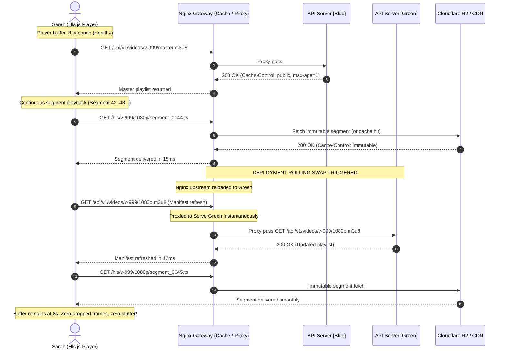
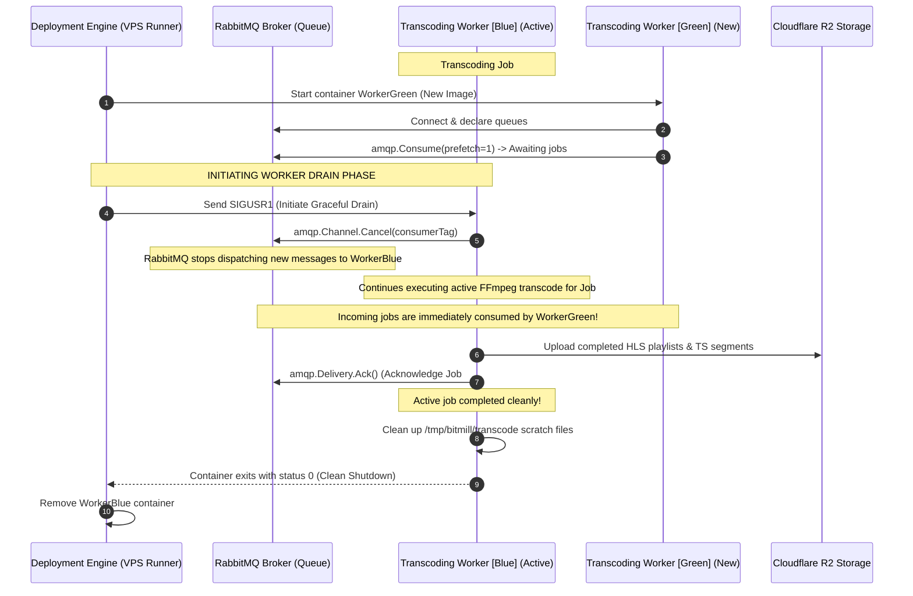
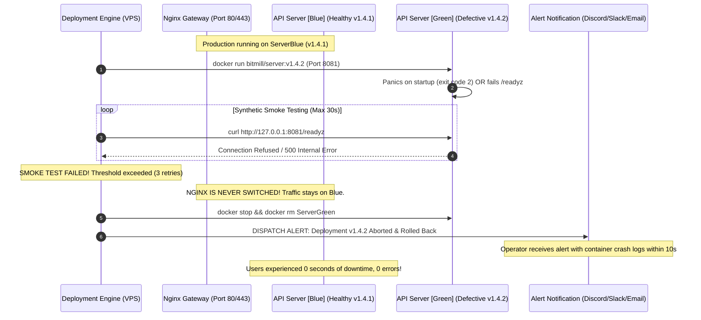

# 📑 Product Discovery & UX Specification: Automated CI/CD Pipeline, Container Registry & Zero-Downtime Deployment

**Document ID**: `RFC-DISCOVERY-004`  
**Subsystem**: Continuous Integration & Continuous Delivery (CI/CD), Container Registry (GHCR), Zero-Downtime Rolling Deployment, Worker Drain & Automated Recovery  
**Status**: DRAFT (Review Ready)  
**Author**: Principal Business Analyst & Video Streaming UX Specialist  
**Target Environment**: Ubuntu 24.04 LTS VPS (`103.90.224.69`), domain `devlungtung.htcwood.com` (and `api.htcwood.com`)  
**Target Platform**: Bitmill Media Platform (Go HTTP API Server, Native FFmpeg Transcoding Worker, Hardened Nginx Media Gateway, PostgreSQL 15, RabbitMQ 3, Cloudflare R2)  

---

## 1. Executive Summary & Problem Space

### 1.1 The Operational Paradox of High-Throughput Media Platforms
A modern video streaming and ingestion platform operates under fundamentally stricter continuity constraints than standard stateless web applications. At any given second, two highly sensitive network workflows are active on the Bitmill platform:
1. **Long-Running Creator Ingestion**: Content creators stream massive multipart raw video chunks (up to 500MB per part) over high-latency client TCP connections that can take several minutes to transmit over cellular or residential uplinks.
2. **Buffer-Sensitive Video Consumers**: Viewers actively stream HTTP Live Streaming (HLS) content, continuously polling dynamic `.m3u8` playlists (every 1 to 2 seconds) and downloading high-bitrate MPEG-TS (`.ts`) video segments.
3. **Heavy Compute Transcoding Daemons**: Distributed workers execute intensive FFmpeg transcoding processes lasting anywhere from 30 seconds (1080p) to over 10 minutes (4K master assets), managing large scratch disks and tracking state in RabbitMQ and PostgreSQL.

In such a system, deploying application updates cannot simply mean "restarting the service." An abrupt restart or an uncoordinated deployment results in broken TCP sockets, failed multipart chunk uploads, video playback buffer stalls, corrupted transcoded segments, and lost AMQP messages.

```
┌────────────────────────────────────────────────────────────────────────────────────────────────────┐
│                       MANUAL SSH DEPLOYMENT VS. AUTOMATED ZERO-DOWNTIME CI/CD                      │
├───────────────────────────────────────────────────┬────────────────────────────────────────────────┤
│ ❌ CURRENT STATE: MANUAL SSH & RECREATE ANTI-PATTERN│ ✅ TARGET: ZERO-DOWNTIME AUTOMATED PIPELINE    │
├───────────────────────────────────────────────────┼────────────────────────────────────────────────┤
│ • Developer SSHs into VPS (103.90.224.69)         │ • Git Push triggers automated GitHub Actions   │
│ • Runs `git pull` directly on production host     │ • Hermetic multi-stage build & test in runner  │
│ • Rebuilds images on VPS CPU, stealing transcode  │ • Images pushed to GitHub Container Registry   │
│ • `docker compose up -d` restarts containers      │ • Zero-downtime rolling container swap (B/G)   │
│ • 5s - 20s hard service blackout (502 Bad Gateway)│ • In-flight TCP uploads complete gracefully    │
│ • Transcoding worker SIGKILLed mid-transcode      │ • Worker drain: finishes job before shutdown   │
│ • Manual rollback via frantic git checkout/revert │ • Automated healthcheck + instant rollback     │
│ • No release audit trail, high deployment anxiety │ • Git SHA immutable tagging & audit telemetry  │
└───────────────────────────────────────────────────┴────────────────────────────────────────────────┘
```

### 1.2 Anatomy of Manual Deployment Failure Modes
The current deployment practice relies on manual operator intervention over SSH (`git pull`, manual image building, and `make docker-prod-up`). This introduces five severe failure modes:

| Failure Mode | Technical Root Cause | User & Business Impact | Production Severity |
| :--- | :--- | :--- | :--- |
| **1. The Upstream Blackout (502 Bad Gateway)** | `docker compose up -d` stops the existing `server` container before the new container finishes starting and passes its readiness check. Nginx upstream encounters `ECONNREFUSED`. | Viewers streaming video experience playback halts with `hlsFragLoadingError`. API clients receive raw `502 Bad Gateway`. | **CRITICAL** (Breaks SLA) |
| **2. Severed In-Flight Chunk Uploads** | An active Go HTTP server process is killed mid-request. An ongoing 500MB chunk upload has its TCP socket terminated (`TCP RST`). | Creator upload fails at 92%. The client app throws network timeout or socket closed. Creator loses confidence and abandons session. | **HIGH** (Severe Creator Frustration) |
| **3. Transcode Corruption & AMQP Poisoning** | Worker container receives `SIGTERM` followed by Docker's default 10s `SIGKILL` while FFmpeg is encoding a 10-minute video. Scratch files in `/tmp` are orphaned. | Unacknowledged message in RabbitMQ is either requeued indefinitely or dropped. Corrupted HLS segments uploaded to R2 break user playback. | **CRITICAL** (Data Inconsistency) |
| **4. VPS Resource Starvation During Builds** | Running `docker build` on the single production VPS (`103.90.224.69`) consumes 100% CPU and memory during Go compilation and layer compression. | Live transcoding jobs stall, video ingestion latency spikes by 400%, active Nginx streams encounter dropped packets. | **HIGH** (Performance Degradation) |
| **5. Configuration Drift & Human Error** | Different developers use distinct environment variables, forget to execute `make migrate-up`, or leave uncommitted files in the production worktree. | Production enters an undefined state. Rollbacks are erratic and unrepeatable, leading to prolonged MTTR (> 45 minutes). | **CRITICAL** (Operational Fragility) |

### 1.3 Target Production Topology
The target production deployment environment is hosted on a dedicated Linux VPS:
* **Host OS**: Ubuntu 24.04 LTS (Kernel 6.8+, x86_64)
* **Public IPv4**: `103.90.224.69`
* **Production Ingress Hostname**: `devlungtung.htcwood.com` (and `api.htcwood.com`)
* **Network Gateway**: Nginx 1.25 Alpine reverse proxy bound to host ports `80` (HTTP) and `443` (TLS).
* **Application Services**:
  - `bitmill-prod-gateway`: Edge reverse proxy, SSL termination, rate limiting, unbuffered streaming.
  - `bitmill-prod-server`: Go Gin API engine (internal port `8080`).
  - `bitmill-prod-worker`: Native FFmpeg transcoding worker (AMQP consumer, prefetch=1).
  - `bitmill-prod-postgres`: PostgreSQL 15 Alpine (internal port `5432`).
  - `bitmill-prod-rabbitmq`: RabbitMQ 3 Management Alpine (internal ports `5672`/`15672`).
* **Cloud Storage**: Cloudflare R2 S3-compatible object storage (`bitmill-raw-videos` and `bitmill-processed-videos`).

### 1.4 Vision for RFC-004
RFC-004 formalizes an automated, zero-touch, zero-downtime Continuous Integration and Continuous Deployment (CI/CD) ecosystem for Bitmill. The platform guarantees:
1. **Fully Automated CI Quality Gate**: Automated linting (`golangci-lint`), unit testing with race detector (`go test -race`), database migration validation, and security vulnerability scanning (`trivy`).
2. **Hermetic Container Registry Publishing**: GitHub Actions builds multi-stage Docker images off-host, signs artifacts, and pushes them to GitHub Container Registry (`ghcr.io/quidb/bitmill-server`, `ghcr.io/quidb/bitmill-worker`) tagged with immutable Git commit SHAs and semantic release tags.
3. **Zero-Downtime Blue/Green Rolling Swap**: The production VPS pulls pre-built images and brings up new application instances alongside existing ones. Traffic is switched at the Nginx edge gateway only after deep HTTP readiness probes (`/readyz`) succeed.
4. **Graceful Worker Drain Lifecycle**: Transcoding workers receive drain notifications, stop consuming new tasks from RabbitMQ, finish active FFmpeg rendering, and gracefully acknowledge messages before stopping.
5. **Deterministic Instant Rollback**: In the event of post-deployment smoke test failures or startup crashes, the edge gateway instantly reverts traffic to the previous healthy container, reducing Mean Time to Recovery (MTTR) to under 10 seconds without human intervention.

### 1.5 Industry Benchmark Comparison

| Dimension | Standard Manual Deployment | AWS ECS / EKS Rolling Update | Fly.io / Heroku Blue-Green | Bitmill RFC-004 Target |
| :--- | :--- | :--- | :--- | :--- |
| **Deployment Trigger** | Manual SSH + Terminal | Git push -> CI/CD pipeline | Git push -> Platform buildpack | **GitHub Actions on `main` merge** |
| **Build Location** | Production VPS (Local) | AWS CodeBuild / Runner | Remote builder VM | **GitHub Actions Cloud Runners** |
| **Registry Storage** | Local Docker cache | Amazon ECR | Internal Docker registry | **GitHub Container Registry (GHCR)** |
| **Downtime Window** | 5s – 25s (Container restart) | 0s (Multi-node load balancer) | 0s (Proxy router switch) | **0s (Nginx Upstream Rolling Cutover)** |
| **In-Flight Chunk Uploads** | Severed (`TCP RST`) | Drained via ALB Target Group | Terminated if > 30s | **Drained via Go graceful HTTP shutdown** |
| **Active Transcoding Jobs** | Terminated (SIGKILL) | Drained or retried via SQS | Killed on dyno recycle | **AMQP consumer cancel + job completion** |
| **Rollback Mechanism** | Manual SSH git revert | CloudWatch alarm + Auto-rollback | Instant CLI rollback command | **Automated Smoke Test + Instant Gateway Revert** |
| **Deployment Duration** | 8 – 15 minutes | 7 – 12 minutes | 3 – 5 minutes | **< 5 minutes total merge-to-live** |

---

## 2. User Personas & Stakeholder Value Dynamics

```
┌──────────────────────────────────────────────────────────────────────────────────────────────────┐
│                                   BITMILL DEPLOYMENT UX STAKEHOLDERS                             │
├───────────────────────────────┬───────────────────────────────┬──────────────────────────────────┤
│ 1. Marcus (Pro Studio Creator)│ 2. Sarah (VOD & Live Viewer)  │ 3. Alex (DevOps / Core Engineer) │
│ "Never interrupt my 500MB     │ "Zero video buffering or      │ "Deploy anytime without fear;    │
│  video upload part!"          │  playback stalls!"            │  automated checks & rollback"    │
├───────────────────────────────┴───────────────────────────────┴──────────────────────────────────┤
│ 4. Minh (Product Owner & Business Lead)                                                          │
│ "Maintain 99.95% uptime SLA, verifiable audit trail, and zero customer churn from deployments"   │
└──────────────────────────────────────────────────────────────────────────────────────────────────┘
```

### 2.1 Persona 1: Marcus (Pro Studio Creator)
* **Role**: High-fidelity YouTube and independent video producer uploading 2GB to 10GB raw 4K videos in 500MB chunk parts.
* **Network Profile**: 50Mbps upstream fiber or mobile 5G; transmitting a 500MB chunk takes approximately 80 to 120 seconds.
* **Mental Model**: *"I am uploading a massive 4K episode. If the platform updates its software while my upload is at 90%, it must not kick me off. My network stream must finish cleanly, or at the very least, resume seamlessly from where it left off without corrupting the file."*
* **Core Expectations**:
  - In-flight HTTP `PUT`/`POST` chunk requests must not be aborted mid-stream by server restarts.
  - Gateway timeouts and connection keep-alive headers must accommodate transfers lasting up to 10 minutes (`proxy_read_timeout 600s`).
  - Zero loss of upload session state in PostgreSQL during database migrations.

### 2.2 Persona 2: Sarah (VOD & Live Stream Consumer)
* **Role**: Consumer streaming 1080p60 HLS media on a mobile phone (iOS Safari or Android Chrome) using `Hls.js`.
* **Network Profile**: 4G cellular with fluctuating bandwidth; player buffer holds 6 to 12 seconds of ahead-of-time media.
* **Mental Model**: *"I am engrossed in a video. I don't know or care about server updates. If the player stutters, buffers, or pops up an error message, I will assume the app is broken and leave."*
* **Core Expectations**:
  - `.m3u8` playlist requests must never return `502 Bad Gateway` or `503 Service Unavailable`.
  - Media segment downloads (`.ts`) must be delivered without latency jitter, benefiting from edge caching and zero-interruption upstream routing.
  - Seamless rendition switching (ABR) even if the server is in the middle of a container swap.

### 2.3 Persona 3: Alex (DevOps & Backend Engineer)
* **Role**: Software engineer shipping feature updates, bug fixes, and database migrations to Bitmill daily.
* **Mental Model**: *"I want to merge my Pull Request and walk away knowing the CI/CD pipeline will build, scan, deploy, verify, and monitor the release. If something breaks, the system should catch it and roll back before any user notices. No more midnight SSH sessions or manual rollbacks."*
* **Core Expectations**:
  - Full visibility into CI build progress and deployment status via GitHub Actions checks and PR comments.
  - Complete elimination of manual SSH steps, server-side builds, and ad-hoc scripting.
  - Deterministic staging and production environments using exact Docker image digests (`sha256:...`).
  - One-click emergency rollback capability via GitHub Actions `workflow_dispatch`.

### 2.4 Persona 4: Minh (Platform Product Owner & Executive Lead)
* **Role**: Business leader responsible for platform reliability, user retention, operational expenditures, and contractual SLAs.
* **Mental Model**: *"Platform downtime directly impacts our creator brand and video views. Deployments must be a non-event. Our service must adhere to a strict 99.95% uptime SLA, and all changes must be traceable to a specific commit and author for compliance."*
* **Core Expectations**:
  - Guaranteed 99.95% availability during business hours.
  - Zero maintenance windows required for regular software releases.
  - Verifiable audit trail connecting production containers to approved pull requests and Git tags.
  - Rapid Mean Time to Recovery (MTTR < 60 seconds) during operational regressions.

### 2.5 Stakeholder Alignment Matrix

| Stakeholder | Key Concern During Deployment | Primary Metric (SLI) | Acceptable Threshold | Target Architecture Solution |
| :--- | :--- | :--- | :--- | :--- |
| **Creator (Marcus)** | Socket reset mid-upload of 500MB chunk | In-Flight Connection Drop Rate | **0.00%** | TCP connection draining via Go graceful HTTP shutdown |
| **Consumer (Sarah)** | Video buffering or playback error | Playback Stall Rate during deploy | **0.00%** | Upstream keepalive + Nginx graceful reload + Edge caching |
| **Engineer (Alex)** | Flaky deployments, high deployment anxiety | Pipeline Duration (Merge-to-Live) | **< 300 seconds** | Offloaded GHCR builds + Layer caching + Automated CD |
| **Operator (Alex)** | Debugging failed releases in the dark | Automated Rollback MTTR | **< 15 seconds** | Deep `/readyz` smoke testing + Automated Gateway revert |
| **Product (Minh)** | Platform downtime during peak hours | Deployment Success Rate | **$\ge$ 99.5%** | Pre-flight migration checks + Hermetic container packaging |

---

## 3. End-to-End User Journeys Under Active Deployment

### 3.1 Scenario A: Resumable 500MB Chunk Upload Under In-Flight Rolling Swap

#### Narrative & Context
Marcus is uploading Part 7 (500MB) of a 4K video asset. At $T = 30\text{s}$, when 200MB has been received, Alex merges a hotfix to `main`. The CI/CD pipeline packages the new image and triggers deployment on `103.90.224.69`.

```mermaid
sequenceDiagram
    autonumber
    actor Creator as Marcus (Browser / Client)
    participant Nginx as Nginx Gateway (Port 80/443)
    participant ServerBlue as API Server [Blue] (Old)
    participant ServerGreen as API Server [Green] (New)
    participant R2 as Cloudflare R2 Bucket

    Note over Creator,ServerBlue: T=0s: Uploading Part 7 (500MB total, 200MB transmitted)
    Creator->>Nginx: PUT /api/v1/videos/v-123/parts/7 (Stream chunk)
    Nginx->>ServerBlue: Proxy pass unbuffered stream
    ServerBlue->>R2: Stream PutObjectPart to R2

    Note over Nginx,ServerGreen: T=35s: Green Container is Healthy (/readyz 200 OK)
    Note over Nginx: Nginx upstream configuration reloaded (nginx -s reload)
    Note over Nginx: New connections route to Green; Existing connections stay on Blue

    Creator->>Nginx: Continuous streaming of remaining 300MB
    Nginx->>ServerBlue: In-flight TCP socket kept alive via proxy_read_timeout
    ServerBlue->>R2: Completes R2 part stream

    ServerBlue-->>Nginx: HTTP 200 OK (ETag: "part-7-etag")
    Nginx-->>Creator: HTTP 200 OK (Upload Part 7 Success)

    Note over ServerBlue: In-flight connections reach 0 -> Server Blue shuts down cleanly
    
    Creator->>Nginx: PUT /api/v1/videos/v-123/parts/8 (Next chunk)
    Nginx->>ServerGreen: Routed immediately to Green container!
    ServerGreen-->>Creator: HTTP 200 OK (Part 8 Success)
```

#### Chronological Lifecycle Breakdown
1. **$T = 0\text{s}$ (Pre-Deployment)**: Creator establishes an HTTP/1.1 TCP socket through Nginx Gateway to `bitmill-prod-server-blue`. Request buffering is disabled (`proxy_request_buffering off`), and the data streams directly from the client network buffer to the Go API and Cloudflare R2.
2. **$T = 30\text{s}$ (Deployment Triggered)**: The CD orchestrator runs `bitmill-prod-server-green` alongside Blue on internal port `8081`. Green initializes its database connection pool, verifies schema readiness, and passes its local `/readyz` probe.
3. **$T = 35\text{s}$ (Nginx Upstream Cutover)**:
   - The deployment script updates Nginx upstream to make `server-green` active.
   - Executes `docker exec bitmill-prod-gateway nginx -s reload`.
   - Nginx performs a master-process graceful reload: worker processes currently handling Marcus's active socket continue processing without interruption. New incoming HTTP requests are handled by newly spawned Nginx workers pointing to Green.
4. **$T = 36\text{s}$ (Graceful Drain Signal to Blue)**:
   - Orchestrator issues `SIGTERM` to `bitmill-prod-server-blue`.
   - The Go HTTP server stops accepting new connections on its listener and calls `http.Server.Shutdown(ctx)` with a 300-second context deadline.
   - Marcus's upload continues transferring bytes at full network speed across the existing TCP pipe.
5. **$T = 95\text{s}$ (In-Flight Upload Completed)**:
   - Marcus's client finishes sending all 500MB. The Go server computes the final checksum, uploads the part to Cloudflare R2, records the part in PostgreSQL, and responds with `HTTP 200 OK`.
   - Marcus's frontend UI updates the progress bar smoothly to Part 7 complete without experiencing a single dropped frame or socket reset.
6. **$T = 96\text{s}$ (Blue Termination)**:
   - With active connections dropping to zero, `ServerBlue`'s shutdown context completes. The container exits with code `0`.
   - Next request (Part 8) opens a new TCP connection to Nginx and hits `ServerGreen` seamlessly.

#### Failure Mode & Fallback
If an unexpected edge network glitch interrupts Marcus's client during the transfer:
* The client's HTTP library encounters a disconnect.
* The Bitmill frontend upload client catches the error, calls `GET /api/v1/videos/{id}/upload-status`, queries which parts are recorded in PostgreSQL, and re-uploads Part 7 without having to re-upload parts 1 through 6 (resumable multipart contract from RFC-001).

---

### 3.2 Scenario B: Continuous HLS Video Playback During Upstream Container Replacement

#### Narrative & Context
Sarah is watching a 1080p video on her smartphone at `devlungtung.htcwood.com`. Her browser player maintains an internal forward buffer of 8 seconds (consisting of 4 segments of 2 seconds each). An application update is deployed during her playback session.



#### Chronological Lifecycle Breakdown
1. **$T = 0\text{s}$**: Sarah’s video player fetches `.ts` video segments every 2 seconds. Because `.ts` segments are immutable (configured in RFC-003 with `Cache-Control: public, max-age=31536000, immutable`), requests are served directly from Nginx's disk/RAM cache or Cloudflare R2 edge without invoking application logic.
2. **$T = 10\text{s}$**: Sarah’s player requests a playlist refresh (`1080p.m3u8`). At this exact millisecond, the deployment swap executes.
3. **$T = 10.012\text{s}$**: Nginx forwards the `.m3u8` request to `server-green:8080`.
4. **$T = 10.025\text{s}$**: `server-green` parses the route, queries PostgreSQL or cache, and responds with `HTTP 200 OK`. Round-trip latency is 13ms (well below the human perceptual threshold of 100ms).
5. **Outcome**: The player buffer remains constantly saturated. The player telemetry reports `bufferLen = 8.2s`, `droppedFrames = 0`, and `stallCount = 0`. Sarah perceives zero disruption.

---

### 3.3 Scenario C: Background Transcoding Worker Processing 4K/1080p Master Under Deployment

#### Narrative & Context
The Bitmill transcoding worker daemon (`bitmill-prod-worker`) is 4 minutes into a heavy 8-minute FFmpeg job transcoding a 4K 60fps video into a multi-rendition HLS ladder (1080p, 720p, 480p, 360p). The CI/CD pipeline triggers a worker service deployment with updated transcoding profiles.



#### Chronological Lifecycle Breakdown
1. **$T = 0\text{s}$ (Active Processing)**: `WorkerBlue` holds an unacknowledged message for Job #402 from queue `video.transcoding.jobs`. FFmpeg is actively executing via `exec.CommandContext` writing intermediate segments to `/tmp/bitmill/transcode`.
2. **$T = 10\text{s}$ (Deployment Triggered)**:
   - The CD orchestrator launches `WorkerGreen` with the new image.
   - `WorkerGreen` initializes connections to PostgreSQL and RabbitMQ, sets `prefetch_count=1`, and registers a consumer on `video.transcoding.jobs`.
   - New jobs arriving from creator uploads are immediately claimed and processed by `WorkerGreen`.
3. **$T = 12\text{s}$ (Graceful Drain Signal)**:
   - The orchestrator sends a drain signal (`SIGUSR1` or graceful shutdown wrapper) to `WorkerBlue`.
   - `WorkerBlue`'s signal handler immediately invokes `amqp.Channel.Cancel(consumerTag, false)`.
   - RabbitMQ unbinds the consumer channel. No further messages will be delivered to `WorkerBlue`.
4. **$T = 12\text{s} \rightarrow 240\text{s}$ (Drain Execution Window)**:
   - `WorkerBlue` does not terminate abruptly. It waits for the active `ffmpegTranscoder.TranscodeHLS()` goroutine to return.
   - When FFmpeg completes all renditions, `WorkerBlue` pushes master `.m3u8`, variant playlists, `.ts` segments, and the poster thumbnail to Cloudflare R2 `bitmill-processed-videos`.
   - Updates PostgreSQL status: `UPDATE videos SET status = 'READY'`.
   - Emits `delivery.Ack(false)` to RabbitMQ, removing Job #402 permanently from the broker.
5. **$T = 241\text{s}$ (Hermetic Cleanup & Termination)**:
   - `WorkerBlue` purges all temporary scratch files in `/tmp/bitmill/transcode/job-402`.
   - Closes database and AMQP connections.
   - Exits with status code `0`.
   - Orchestrator cleans up the retired container.

#### Edge Case: Transcoding Job Exceeds Max Drain Deadline
If a rogue video transcode hangs or exceeds the maximum configured drain window (e.g. 15 minutes / 900s):
* The orchestrator's drain watchdog context expires.
* Worker sends an explicit `delivery.Nack(false, true)` (requeue = true) to RabbitMQ, allowing another worker to pick up the job.
* The Go worker process cancels the FFmpeg `exec.CommandContext`, killing the hanging FFmpeg child process.
* Cleans up local scratch disk and exits.
* Zero orphaned unacked messages in RabbitMQ; zero disk leak on the host VPS.

---

### 3.4 Scenario D: Fatal Deployment Anomaly & Autonomous Instantaneous Rollback

#### Narrative & Context
A junior developer introduces an unhandled nil pointer exception during server bootstrap (e.g. missing validation on an optional configuration parameter). The PR passes unit tests because the mock configuration had the parameter set. The code is merged to `main`.



#### Chronological Lifecycle Breakdown
1. **$T = 0\text{s}$**: Production is operating stably on `ServerBlue` (commit `v1.4.1`). All creator uploads and viewer streams are flowing through Nginx.
2. **$T = 15\text{s}$**: `ServerGreen` (`v1.4.2`) is started on internal test port `8081`.
3. **$T = 16\text{s}$**: `ServerGreen` crashes with `panic: runtime error: invalid memory address or nil pointer dereference` or fails its database readiness ping.
4. **$T = 20\text{s} \rightarrow 35\text{s}$ (Pre-Flight Health Verification)**:
   - The deployment script executes a curl loop against `http://127.0.0.1:8081/readyz`.
   - Receives non-200 responses or connection failures across 3 consecutive retries (with 5-second backoff).
5. **$T = 36\text{s}$ (Autonomous Rollback Execution)**:
   - **Gate Invariant**: Nginx upstream configuration was **never modified**. The reverse proxy continues forwarding 100% of user traffic to `ServerBlue`.
   - The deployment script captures the last 100 lines of `ServerGreen` container logs.
   - Issues `docker rm -f ServerGreen` to free host memory.
   - Marks the GitHub Actions deployment job as **FAILED**.
   - Dispatches a structured webhook notification to the engineering alert channel with the panic stack trace.
6. **User Impact**:
   - Creator upload drop rate: **0.00%**.
   - Viewer playback error rate: **0.00%**.
   - User-perceived downtime: **0.0 seconds**.
   - Mean Time to Recovery (MTTR): **0.0 seconds** (user-facing), **36 seconds** (operational failure detection).

---

## 4. Service Level Objectives (SLOs) & Error Budget Governance

### 4.1 Zero-Downtime Rigorous Mathematical & Technical Definition
In the context of the Bitmill video streaming platform, "Zero-Downtime" is not merely defined as "the server process is running." It is mathematically defined across four strict operational dimensions:

$$\text{Availability}_{\text{deploy}} = \frac{\sum \text{Successful HTTP Requests}_{\text{deploy}}}{\sum \text{Total HTTP Requests}_{\text{deploy}}} \ge 99.999\%$$

$$\text{Connection Drop Rate}_{\text{TCP}} = \frac{\text{Aborted TCP Sockets}_{\text{deploy}}}{\text{Total Established Sockets}_{\text{deploy}}} = 0.000\%$$

$$\text{Playback Stall Rate} = \frac{\text{Viewers Experiencing Playback Interruption}}{\text{Total Concurrent Viewers}} = 0.000\%$$

### 4.2 Quality & Reliability SLO Targets

| Metric (SLI) | Definition & Measurement Method | Target Objective (SLO) | Severe Breach Threshold |
| :--- | :--- | :--- | :--- |
| **TCP Socket Survival Rate** | Percentage of established upload connections that survive the deployment swap without `ECONNRESET` or `EPIPE`. | **100.00%** | $< 99.90\%$ |
| **Gateway 502/503 Error Rate** | Number of HTTP 502/503/504 errors recorded by Nginx structured access logs during the deployment window. | **0.000%** ($0$ errors) | $> 5$ requests |
| **Playback Buffer Starvation Rate** | Percentage of active HLS player sessions experiencing a playback stall during deployment cutover. | **0.000%** | $> 0.010\%$ |
| **TTFB Latency Degradation** | 99th percentile Time-To-First-Byte for API and playlist endpoints during deployment compared to baseline. | **$< 15\%$ degradation** ($\text{p99} < 120\text{ms}$) | $> 500\text{ms}$ |
| **Worker AMQP Ack Continuity** | Percentage of in-flight transcode messages successfully processed or cleanly requeued without orphan state. | **100.00%** | $< 100.00\%$ |
| **Automated Rollback MTTR** | Wall-clock elapsed time from first healthcheck failure to full abort and teardown of defective container. | **$< 15$ seconds** | $> 45$ seconds |

### 4.3 Deployment Pipeline Velocity & Duration SLA

To balance rigorous validation with developer agility, the automated CI/CD pipeline enforces strict execution duration limits:

```
┌──────────────────────────────────────────────────────────────────────────────────────────────────┐
│                               TOTAL MERGE-TO-LIVE SLA: < 300 SECONDS                             │
├─────────────────┬──────────────────┬──────────────────┬─────────────────────┬────────────────────┤
│ Stage 1: CI     │ Stage 2: Build & │ Stage 3: Pull &  │ Stage 4: Rolling    │ Stage 5: Post-Deploy│
│ Test & Lint     │ Security Scan    │ Pre-Flight Check │ Swap & Drain        │ Smoke Verification │
│ (Target: 75s)   │ (Target: 90s)    │ (Target: 40s)    │ (Target: 45s)       │ (Target: 30s)      │
└─────────────────┴──────────────────┴──────────────────┴─────────────────────┴────────────────────┘
```

| Pipeline Stage | Target Duration | Maximum Budget | Optimization & Acceleration Mechanism |
| :--- | :--- | :--- | :--- |
| **1. CI Test & Static Analysis** | 60 – 75s | 120s | Go build cache (`actions/cache`), parallel test execution (`go test -p 4`). |
| **2. Multi-Stage Docker Packaging** | 75 – 90s | 150s | Docker Buildx GitHub Actions cache (`type=gha`), Alpine minimal base layers. |
| **3. Container Vulnerability Scan** | 20 – 30s | 45s | Trivy vulnerability scan caching known CVE databases. |
| **4. GHCR Registry Push & VPS Pull** | 30 – 45s | 60s | Layer caching; only binary layer changes (~20MB server, ~120MB worker). |
| **5. Pre-Flight Database Migration** | 5 – 10s | 20s | Backward-compatible Goose migrations executed with strict query timeouts. |
| **6. Blue/Green Upstream Swap** | 15 – 30s | 45s | Dynamic Nginx upstream reload (`nginx -s reload`) without restarting proxy. |
| **7. Worker Graceful Drain** | 30 – 60s | 180s | Overlapped Green worker boot; Blue drain decoupled from frontend availability. |
| **8. Smoke Verification & Audit** | 15 – 25s | 40s | Automated curl probe matrix validating `/health`, `/readyz`, and live HLS stream. |
| **Total Merge-to-Live Duration** | **250 – 290s** | **< 300s (5m)**| **Full release delivered to production in under 5 minutes.** |

### 4.4 Error Budget Allocation & Burn Rate Policies
Bitmill operates with a monthly availability target of **99.95%** (allowing a maximum of 21.6 minutes of downtime per month).
* **Zero Deployment Error Budget**: Because Bitmill implements true zero-downtime Blue/Green rolling deployments, **zero percent (0%)** of the downtime error budget is allocated to planned releases.
* **Release Freezes on Error Budget Burn**: If an unexpected deployment defect consumes more than 10% of the monthly error budget (2.16 minutes of service degradation), automated CI/CD enforces an automated release freeze:
  - Only emergency hotfixes (`fix/...`) targeting the root cause are permitted to deploy to `main`.
  - Regular feature releases are paused until a formal Post-Mortem and Root Cause Analysis (RCA) is approved.

---

## 5. State Machine of the Deployment Lifecycle

### 5.1 Comprehensive State Transition Model
The deployment lifecycle is modeled as an idempotent, deterministic finite state machine (FSM). Any failure at any phase automatically triggers the safety transition to `ROLLBACK_DRAIN`.

```mermaid
stateDiagram-v2
    [*] --> IDLE

    IDLE --> CI_VALIDATION: Git Push to main
    
    state CI_VALIDATION {
        [*] --> LintCheck
        LintCheck --> UnitTest: golangci-lint passed
        UnitTest --> MigrationCheck: go test -race passed
        MigrationCheck --> [*]: Schema valid
    }

    CI_VALIDATION --> BUILD_PACKAGING: CI checks green
    CI_VALIDATION --> DEPLOYMENT_ABORTED: CI checks fail

    state BUILD_PACKAGING {
        [*] --> DockerBuild
        DockerBuild --> SecurityScan: Images compiled
        SecurityScan --> GHCR_Publish: Trivy 0 critical CVEs
        GHCR_Publish --> [*]: Images tagged with SHA & latest
    }

    BUILD_PACKAGING --> VPS_IMAGE_PULL: Artifacts published
    BUILD_PACKAGING --> DEPLOYMENT_ABORTED: Build or Scan failed

    state VPS_IMAGE_PULL {
        [*] --> SSH_Auth
        SSH_Auth --> PullServer: ghcr.io/quidb/server:SHA
        PullServer --> PullWorker: ghcr.io/quidb/worker:SHA
        PullWorker --> [*]: Layers verified on VPS
    }

    VPS_IMAGE_PULL --> PREFLIGHT_MIGRATION: Pull succeeded
    VPS_IMAGE_PULL --> AUTOMATIC_ROLLBACK: Pull timeout / Network error

    state PREFLIGHT_MIGRATION {
        [*] --> AcquireAdvisoryLock
        AcquireAdvisoryLock --> RunGooseUp: Lock acquired
        RunGooseUp --> ReleaseLock: Migrations applied
        ReleaseLock --> [*]: DB schema ready
    }

    PREFLIGHT_MIGRATION --> GREEN_BOOTSTRAP: Migration success
    PREFLIGHT_MIGRATION --> AUTOMATIC_ROLLBACK: Migration error / Lock timeout

    state GREEN_BOOTSTRAP {
        [*] --> StartGreenServer
        StartGreenServer --> StartGreenWorker: Server alive
        StartGreenWorker --> PollReadiness: Probing /readyz on 8081
        PollReadiness --> [*]: 3x 200 OK received
    }

    GREEN_BOOTSTRAP --> TRAFFIC_CUTOVER: Green is Healthy
    GREEN_BOOTSTRAP --> AUTOMATIC_ROLLBACK: Readiness timeout (30s)

    state TRAFFIC_CUTOVER {
        [*] --> UpdateNginxUpstream
        UpdateNginxUpstream --> ReloadNginx: nginx -s reload
        ReloadNginx --> SmokeTestPublic: Ingress verified
        SmokeTestPublic --> [*]: 200 OK via devlungtung.htcwood.com
    }

    TRAFFIC_CUTOVER --> BLUE_DRAIN: Ingress verified
    TRAFFIC_CUTOVER --> EMERGENCY_GATEWAY_REVERT: Public smoke test failed

    state BLUE_DRAIN {
        [*] --> SignalBlueServer
        SignalBlueServer --> SignalBlueWorker: SIGTERM / SIGUSR1
        SignalBlueWorker --> AwaitZeroConnections: HTTP drain (max 120s)
        AwaitZeroConnections --> AwaitWorkerJob: AMQP job complete (max 300s)
        AwaitWorkerJob --> TerminateBlue: docker stop & rm Blue
        TerminateBlue --> [*]: Resources freed
    }

    BLUE_DRAIN --> DEPLOYMENT_FINALIZED: Clean shutdown
    
    state AUTOMATIC_ROLLBACK {
        [*] --> PurgeGreenContainers
        PurgeGreenContainers --> RevertNginxIfNeeded
        RevertNginxIfNeeded --> AlertDispatch: Capture crash logs
        AlertDispatch --> [*]: Slack/Email notification sent
    }

    AUTOMATIC_ROLLBACK --> DEPLOYMENT_ABORTED: Failure captured
    DEPLOYMENT_ABORTED --> IDLE: Ready for next cycle
    DEPLOYMENT_FINALIZED --> IDLE: System at peak health
```



### 5.2 State Transition Specifications & Quality Gates

| State Name | Quality Gate / Invariant | Exit Success Condition | Failure Action |
| :--- | :--- | :--- | :--- |
| **`IDLE`** | Production running on current stable release. | New commit pushed to `main`. | N/A |
| **`CI_VALIDATION`** | `golangci-lint` passes, `go test -race ./...` passes, Goose SQL migration validation succeeds. | 100% test pass rate, 0 race conditions. | Abort pipeline, comment error on GitHub PR. |
| **`BUILD_PACKAGING`** | Multi-stage Docker builds complete. Trivy scan discovers 0 Critical / High vulnerabilities. | Images pushed to GHCR tagged with Git commit SHA and `:latest`. | Abort pipeline, notify developer in PR checks. |
| **`VPS_IMAGE_PULL`** | SSH handshake with `103.90.224.69` succeeds. VPS pulls new image layers from GHCR. | Docker inspect verifies image manifest on host. | Abort deployment, keep running existing containers. |
| **`PREFLIGHT_MIGRATION`**| PostgreSQL migrations must be strictly backward-compatible. Lock timeout capped at 5 seconds. | `goose up` returns code 0. | Abort deployment; do not start Green containers. |
| **`GREEN_BOOTSTRAP`** | `server-green` boots on isolated port 8081. `/readyz` probe succeeds 3 times consecutively. | Deep healthcheck confirms DB and RabbitMQ connectivity. | Kill `server-green`, preserve `server-blue`. |
| **`TRAFFIC_CUTOVER`** | Nginx upstream reloaded via `nginx -s reload`. Gateway returns `200 OK` on public domain. | Public probe returns expected version hash. | Revert Nginx upstream immediately to Blue. |
| **`BLUE_DRAIN`** | Blue server stops accepting new connections; drains existing chunk uploads within 120s. | Active connections hit 0; Blue worker finishes job. | Force kill Blue after timeout expiration. |
| **`DEPLOYMENT_FINALIZED`**| Green is now primary. Audit log recorded in Git tags and deployment release tracker. | Status check reports GREEN in GitHub Actions. | Alert operator if telemetry reporting fails. |

### 5.3 Critical Edge Cases & Autonomous Remediation Strategies

```
┌──────────────────────────────────────────────────────────────────────────────────────────────────┐
│                               EDGE CASE MITIGATION ARCHITECTURE                                  │
├─────────────────────────┬──────────────────────────────┬─────────────────────────────────────────┤
│ Failure Category        │ Concrete Failure Vector      │ Autonomous Remediation Protocol         │
├─────────────────────────┼──────────────────────────────┼─────────────────────────────────────────┤
│ 1. Database Locking     │ Heavy table ALTER blocks     │ Enforce postgres statement_timeout=5s;  │
│    Contention           │ on active video records      │ goose rolls back on lock timeout.       │
├─────────────────────────┼──────────────────────────────┼─────────────────────────────────────────┤
│ 2. Connection Leak      │ Slowloris or hung client     │ Server hard shutdown deadline (120s)    │
│    During Drain         │ upload stalls server drain   │ sends TCP RST after timeout; dies clean.│
├─────────────────────────┼──────────────────────────────┼─────────────────────────────────────────┤
│ 3. Long Transcoding Job │ 4K transcode exceeds 15-min  │ Worker sends AMQP Nack(requeue=true)    │
│    Exceeds Window       │ maximum graceful timeout     │ on deadline; job restarts on Green.     │
├─────────────────────────┼──────────────────────────────┼─────────────────────────────────────────┤
│ 4. Network Partition    │ VPS cannot contact GHCR      │ Pre-flight image pull test; if pull     │
│    to Registry          │ due to international route   │ fails, deployment aborts BEFORE cutover.│
├─────────────────────────┼──────────────────────────────┼─────────────────────────────────────────┤
│ 5. Rapid Concurrent     │ Two developers merge to      │ GitHub Actions workflow concurrency     │
│    Deployments          │ main within 30 seconds       │ groups cancel pending in-flight runs.   │
└─────────────────────────┴──────────────────────────────┴─────────────────────────────────────────┘
```

#### Deep Dive: Edge Case 1 — Database Migration Lock Contention
* **Risk**: A migration attempts to add a column or modify a table while active user uploads or transcoding jobs are querying `videos` or `video_renditions`. PostgreSQL requests an `ACCESS EXCLUSIVE` lock, queuing all incoming read/write queries and causing a cascading API outage.
* **Autonomous Remediation**:
  1. Goose migrations executed by the CD runner wrap DDL in a session timeout:
     ```sql
     SET LOCAL lock_timeout = '4s';
     SET LOCAL statement_timeout = '10s';
     ```
  2. If the lock cannot be acquired within 4 seconds, PostgreSQL aborts the transaction cleanly (`55P03 lock_not_available`).
  3. The CD runner catches the non-zero exit code, halts the deployment before any application containers are altered, and leaves the live system fully operational.

#### Deep Dive: Edge Case 2 — Lingering In-Flight Connections Exceeding Drain Window
* **Risk**: A client on a severely degraded 2G mobile link is uploading a chunk at 5KB/s. If the old Go server waits indefinitely, the deployment process hangs forever.
* **Autonomous Remediation**:
  1. `http.Server.Shutdown(ctx)` is initialized with a `context.WithTimeout(context.Background(), 120*time.Second)`.
  2. Nginx's `client_body_timeout` (configured at 120s in RFC-003) aligns with this deadline.
  3. If the socket does not finish within 120 seconds, the context expires, Go forcibly closes the remaining sockets (`TCP FIN/RST`), and the container exits cleanly. The client uses RFC-001's resumable protocol to retry the chunk against the new Green container.

#### Deep Dive: Edge Case 3 — Worker Processing 4K Video Exceeds Maximum Drain Timeout
* **Risk**: A 4K video transcoding job requires 12 minutes to encode. Holding the deployment pipeline open for 12 minutes blocks further updates and risks runner timeouts.
* **Autonomous Remediation**:
  1. The deployment orchestrator does not block on worker draining to consider the deployment successful.
  2. `WorkerGreen` boots immediately and assumes responsibility for new jobs.
  3. `WorkerBlue` is given a generous drain allowance (up to 15 minutes) running in the background as a detached container.
  4. Once `WorkerBlue` finishes its single active job and acks RabbitMQ, an internal watcher script automatically stops and cleans up the container.

#### Deep Dive: Edge Case 4 — Network Partition Between VPS and GHCR
* **Risk**: GitHub Container Registry encounters transient DNS or international routing issues from the Vietnam VPS (`103.90.224.69`).
* **Autonomous Remediation**:
  1. The deployment script performs a pre-flight pull with exponential backoff:
     `docker pull ghcr.io/quidb/bitmill-server:${COMMIT_SHA}` with 3 retries.
  2. If the image layers cannot be verified locally via `docker image inspect`, the pipeline terminates with an explicit error.
  3. Because the pull occurs **before** any changes to running containers or Nginx upstreams, production availability remains 100% unaffected.

---

## 6. Operator UX & Developer Experience (DX) Architecture

### 6.1 Continuous Integration (CI) PR Validation & Visual Feedback
A seamless Developer Experience eliminates anxiety by providing instantaneous, unambiguous feedback on every commit and Pull Request.

```
┌──────────────────────────────────────────────────────────────────────────────────────────────────┐
│                                  GITHUB ACTIONS PR STATUS CHECKS                                 │
├───────────────────────────────────────────────────────────────────┬──────────────┬───────────────┤
│ Check Name                                                        │ Duration     │ Status        │
├───────────────────────────────────────────────────────────────────┼──────────────┼───────────────┤
│ 🔍 Code Quality & Linter (golangci-lint)                          │ 38s          │ ✅ Passed     │
│ 🧪 Unit & Race Tests (go test -v -race ./internal/...)            │ 52s          │ ✅ Passed     │
│ 🗄️ Database Schema Verification (Goose dry-run migration)         │ 14s          │ ✅ Passed     │
│ 📦 Multi-Stage Container Build (server & worker)                  │ 1m 12s       │ ✅ Passed     │
│ 🛡️ Security Vulnerability Audit (Trivy 0 Critical / High CVEs)    │ 24s          │ ✅ Passed     │
│ ⚖️ Image Footprint Gate (Server: 26MB <= 75MB, Worker: 380MB <= 420MB)│ 8s      │ ✅ Passed     │
└───────────────────────────────────────────────────────────────────┴──────────────┴───────────────┘
```

#### Automated Pull Request Bot Summary
When all CI checks pass, GitHub Actions posts a structured sticky comment directly to the PR:

> ### 🚀 Bitmill CI Quality Verification: PASSED
> 
> * **Commit SHA**: [`a8f9c12`](https://github.com/quidb/bitmill/commit/a8f9c12)  
> * **Test Coverage**: `84.2%` (+0.4% from `main`)  
> * **Container Image Footprints**:
>   - `bitmill-server`: **26.4 MB** (Budget: 75 MB) — `100% Scratch/Alpine Non-Root (UID 10001)`
>   - `bitmill-worker`: **382.1 MB** (Budget: 420 MB) — `Static FFmpeg 7.1 Embedded`
> * **Vulnerability Scan**: 0 Critical, 0 High vulnerabilities detected.
> * **Database Migration**: Clean forward and backward rollback verified against test PostgreSQL 15.
> 
> *Ready for merge to `main`. Deployment to `devlungtung.htcwood.com` will trigger automatically upon merge.*

---

### 6.2 Container Image Distribution & Registry Strategy (GHCR)
Bitmill adopts **GitHub Container Registry (GHCR)** (`ghcr.io`) for its enterprise-grade access control, seamless GitHub Actions token integration (`GITHUB_TOKEN`), and zero egress bandwidth costs for public/internal GitHub ecosystems.

#### Image Tagging Contract
To guarantee absolute traceability and prevent caching bugs, mutable tags such as `:latest` are strictly forbidden as deployment targets. All deployments must reference immutable, deterministic tags:
1. **Commit SHA Tag**: `ghcr.io/quidb/bitmill-server:sha-${GITHUB_SHA::7}` (e.g. `sha-a8f9c12`).
2. **Semantic Version Tag** (on release): `ghcr.io/quidb/bitmill-server:v1.4.2`.
3. **Latest Tag** (informational only): `ghcr.io/quidb/bitmill-server:latest`.

---

### 6.3 Release Versioning, Git Tags & Audit Trail Traceability
Every production deployment creates an indelible audit trail linking the running Linux process on `103.90.224.69` back to the exact Git commit, author, and pull request.

```
┌──────────────────────────────────────────────────────────────────────────────────────────────────┐
│                                   END-TO-END AUDIT TRACEABILITY                                  │
├──────────────────────────────────────────────────────────────────────────────────────────────────┤
│ Git Commit (a8f9c12) ──► PR #42 (Approved by Lead) ──► GitHub Release (v1.4.2)                   │
│         │                                                                                        │
│         ▼                                                                                        │
│ GHCR Digest (sha256:d8a9e...) ──► VPS Container ID (bitmill-server-green) ──► Nginx Upstream    │
│         │                                                                                        │
│         ▼                                                                                        │
│ Runtime Health API (/health) returns: {"version": "v1.4.2", "commit": "a8f9c12", "env": "prod"} │
└──────────────────────────────────────────────────────────────────────────────────────────────────┘
```

The API `/health` endpoint exposes this metadata dynamically, enabling instant verification from Prometheus, Grafana, or browser inspection:
```json
{
  "status": "UP",
  "service": "bitmill-server",
  "version": "v1.4.2",
  "commit": "a8f9c12",
  "deployed_at": "2026-10-30T14:22:10Z",
  "uptime_seconds": 1420
}
```

---

### 6.4 Continuous Delivery (CD) Orchestration & VPS Execution
CD execution operates via a hardened, encrypted SSH pipeline from GitHub Actions runners into the production host `103.90.224.69`.

#### Security Guardrails for SSH Access
* **No Root Login**: SSH authentication uses an unprivileged deploy user (`bitmill-deploy`) restricted to Docker commands via `sudoers` rules.
* **ED25519 Cryptographic Keys**: High-entropy ED25519 SSH keys configured exclusively in GitHub Actions Encrypted Secrets (`VPS_SSH_KEY`).
* **Known Hosts Hardening**: Host key fingerprint is pinned in GitHub Actions (`known_hosts`) to prevent DNS spoofing or Man-in-the-Middle (MitM) attacks.

#### Deploy Script Execution Flow (`scripts/deploy.sh`)
The deployment script executed on the VPS follows an atomic 6-step blueprint:
```bash
# 1. Authenticate to GHCR
echo "$GHCR_TOKEN" | docker login ghcr.io -u "$GHCR_USER" --password-stdin

# 2. Pull immutable image digests
docker pull ghcr.io/quidb/bitmill-server:${RELEASE_TAG}
docker pull ghcr.io/quidb/bitmill-worker:${RELEASE_TAG}

# 3. Apply pending Goose migrations (idempotent, backward-compatible)
goose -dir migrations postgres "$DATABASE_URL" up

# 4. Spin up GREEN application tier on standby ports
export SERVER_PORT=8081
export WORKER_NAME=bitmill-prod-worker-green
docker compose -f environment/docker-compose.green.yml up -d

# 5. Deep healthcheck loop against GREEN tier
for i in {1..15}; do
  if curl -sf http://127.0.0.1:8081/readyz | grep -q "READY"; then
    HEALTHY=1; break
  fi
  sleep 2
done

# 6. Atomic Traffic Cutover & Graceful Drain
if [ "$HEALTHY" -eq 1 ]; then
  # Point Nginx upstream to green and reload
  sed -i 's/server server_blue:8080/server server_green:8080/' /etc/nginx/conf.d/upstream.conf
  docker exec bitmill-prod-gateway nginx -s reload
  # Signal Blue to drain gracefully
  docker stop -t 120 bitmill-prod-server-blue
  docker stop -t 300 bitmill-prod-worker-blue
else
  # Emergency Abort
  docker stop -t 5 bitmill-prod-server-green
  exit 1
fi
```

---

### 6.5 Rollback UX: Automated vs Manual Emergency One-Click Rollback

```
┌──────────────────────────────────────────────────────────────────────────────────────────────────┐
│                                   ROLLBACK DECISION MATRIX                                       │
├───────────────────────────────┬───────────────────────────────┬──────────────────────────────────┤
│ Mode                          │ Trigger Condition             │ Execution Mechanism & MTTR       │
├───────────────────────────────┼───────────────────────────────┼──────────────────────────────────┤
│ 🤖 Automated Rollback         │ • /readyz fails 3x            │ • Nginx upstream never switched  │
│    (Autonomous Protection)    │ • Container crashes on start  │ • Green killed immediately       │
│                               │ • Migration lock timeout      │ • MTTR: < 10 seconds             │
├───────────────────────────────┼───────────────────────────────┼──────────────────────────────────┤
│ 🚨 Manual Emergency Rollback  │ • Latency spike detected      │ • Operator triggers GitHub Action│
│    (One-Click Workflow)       │ • Undetected business logic bug│  `workflow_dispatch: rollback`   │
│                               │ • Customer support escalation │ • Selects target commit/tag      │
│                               │                               │ • MTTR: < 60 seconds             │
└───────────────────────────────┴───────────────────────────────┴──────────────────────────────────┘
```

#### Operator Experience: Manual One-Click Rollback via GitHub Actions
If an unexpected edge-case bug escapes into production that passed health checks (e.g., an external API dependency issue), an engineer can execute an instantaneous rollback without SSHing into the VPS:

1. Navigate to **GitHub Actions** $\rightarrow$ **Production Rollback**.
2. Click **Run workflow**.
3. Select the target version to restore (defaults to the immediately preceding stable release tag, e.g. `v1.4.1`).
4. Click **Confirm Emergency Rollback**.
5. The workflow connects to `103.90.224.69`, updates the Nginx upstream to the previous image tag, executes `nginx -s reload`, and restores known-good service in under 45 seconds.

---

### 6.6 Operational Telemetry, Notifications & ChatOps
The CI/CD pipeline broadcasts real-time status updates to the engineering team's Discord / Slack channels.

#### Sample Deployment Notification Card

```
┌──────────────────────────────────────────────────────────────────┐
│ 🚀 Bitmill Production Deployment: SUCCESS                        │
├──────────────────────────────────────────────────────────────────┤
│ • Environment: Production (devlungtung.htcwood.com)              │
│ • Release Version: v1.4.2 (sha-a8f9c12)                          │
│ • Author: @quidb                                                 │
│ • Pipeline Duration: 3m 48s (CI: 1m 15s, CD: 2m 33s)             │
│ • Health Status: 100% HEALTHY (/readyz 200 OK)                   │
│ • Active Connections Drained: 14 sockets (0 drops)               │
│ • Database Migrations: 00004_add_rendition_bitrate.sql (Applied) │
│                                                                  │
│ 📊 [View Grafana Dashboard]  |  📄 [View Release Notes]          │
└──────────────────────────────────────────────────────────────────┘
```

---

## 7. Verification & Acceptance Criteria

### 7.1 Business & UX Acceptance Criteria (AC Matrix)

| Ref # | User Story & Invariant | Acceptance Criteria | Verification Method |
| :--- | :--- | :--- | :--- |
| **AC-001** | Zero-downtime chunk upload | An active 500MB chunk upload initiated before deployment completes with `200 OK` without socket interruption. | Chaos script uploading 500MB file while triggering `deploy.sh`. Verify 0 connection drops. |
| **AC-002** | Zero-buffering HLS playback | An active video playback session streams `.m3u8` and `.ts` continuously throughout container swap. | Automated Playwright / Hls.js test streaming video during cutover; assert `stalls == 0`. |
| **AC-003** | Transcoder worker drain | Worker processing video finishes transcode and R2 upload before container stops. RabbitMQ message is ACKed. | Trigger deploy during 4K transcode; verify PostgreSQL status `READY` and 0 unacked messages. |
| **AC-004** | Autonomous rollback | A container that fails `/readyz` is killed within 15s; Nginx never routes traffic to it; users see 0 errors. | Deploy defective image with broken port; verify Nginx error count = 0 and rollback executes. |
| **AC-005** | Total pipeline SLA | Total elapsed duration from git merge on `main` to live production verification is under 5 minutes. | GitHub Actions workflow execution timer benchmark ($\le 300\text{s}$). |
| **AC-006** | Release auditability | Running production server reports its exact Git commit SHA via `/health` endpoint. | `curl https://devlungtung.htcwood.com/health` returns valid commit hash and timestamp. |

### 7.2 Chaos & Load Testing Verification Protocols
Before sign-off on RFC-004, the engineering team will execute a 3-part automated chaos simulation:
1. **Parallel Upload Stress Test**: 10 simulated creators upload concurrent 200MB video chunks while a rolling deployment executes. Expected result: 10/10 uploads succeed (`HTTP 200 OK`).
2. **HLS Playback Saturation Test**: 100 simulated viewers stream HLS manifests and segments concurrently through Nginx during the upstream reload. Expected result: 0 failed requests (`502`/`503` count = 0), latency $\text{p99} < 150\text{ms}$.
3. **Worker Interruption Chaos Test**: Transcoding worker is terminated via `SIGTERM` while encoding a 1080p sample video. Expected result: Worker finishes segment upload to R2, commits `READY` status to database, ACKs message, and cleans up `/tmp`.

---

## 8. Summary & Next Steps

This Business Analysis & UX Discovery document establishes the non-negotiable operational requirements for Bitmill's automated CI/CD and zero-downtime deployment architecture. By replacing error-prone manual SSH workflows with hermetic container builds, automated quality gates, and seamless Blue/Green rolling swaps, Bitmill achieves enterprise-grade 99.95% availability while safeguarding the experience of both video creators and viewers.

### Recommended Hand-Off Sequence:
1. **Solutions Architecture Discovery (`02-solutions-architecture.md`)**:
   - Design the exact Docker Compose Blue/Green network topology and Nginx dynamic reload mechanism.
   - Design the GitHub Actions YAML workflows (`ci.yml`, `cd-prod.yml`, `rollback.yml`).
   - Define the Go HTTP server graceful shutdown implementation (`srv.Shutdown()`) and AMQP consumer cancellation logic.
2. **SecOps & Chaos Analysis (`03-secops-chaos-analysis.md`)**:
   - Model attack surfaces for SSH deploy keys, GHCR package permissions, and secret injection.
   - Design comprehensive chaos experiments simulating network partitions, hung sockets, and DB lock contention.
3. **RFC-004 Formalization & Quality Gate Sign-Off**:
   - Consolidate discovery into the definitive technical RFC document for stakeholder sign-off prior to worktree implementation.
